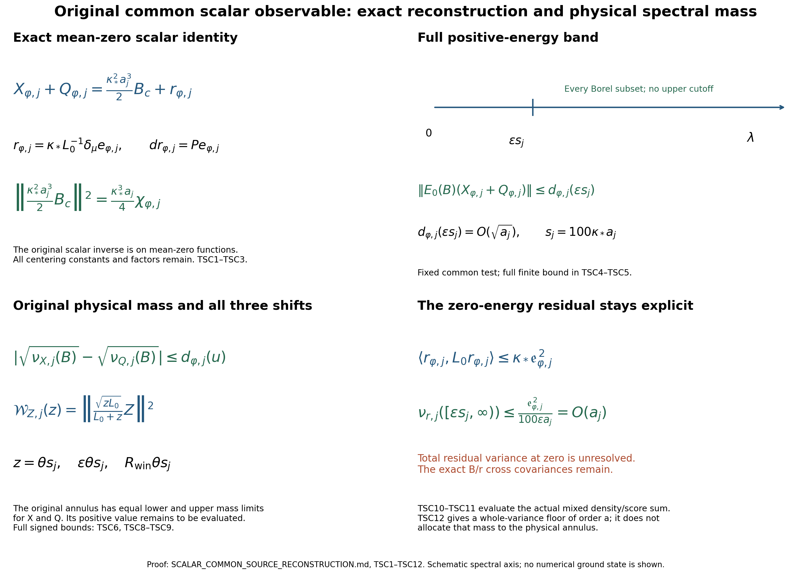

# The common scalar source, its full positive-energy band and the retained zero-energy residual

Reviewed derivation, 13 October 2026. The smooth interacting global no-gap state remains the programme goal. This note proves further identities and bounds in the actual original finite-regulator ground state. It makes no novelty claim.

The exact providers are [TFC1–TFC26](https://github.com/KokunoYumeto/yang-mills-interacting-workbench/blob/109ff0eeeb5decea9224472fb3a9f1cf0f5dcd48/yang-mills/continuations/20261011-central-signs-shrinking-window/TWO_FORM_FORCE_AND_COMMON_SPECTRUM.md), [PFR2, PFR6 and PFR17–PFR18](https://github.com/KokunoYumeto/yang-mills-interacting-workbench/blob/109ff0eeeb5decea9224472fb3a9f1cf0f5dcd48/yang-mills/continuations/20261011-central-signs-shrinking-window/PHYSICAL_SCALAR_RECEIVER_AND_CURRENT_COVARIANCE.md), and [PSC1–PSC9](https://github.com/KokunoYumeto/yang-mills-interacting-workbench/blob/109ff0eeeb5decea9224472fb3a9f1cf0f5dcd48/yang-mills/continuations/20261011-central-signs-shrinking-window/ACTUAL_PHYSICAL_SCORE_SPECTRAL_MEASURE.md). Their original-author TeX reading provenance is retained in the source-use ledger. The additional disk-index searches are routing, not new external source reading.

The inherited human comparisons are Jon Johnsen, [On the spectral properties of Witten-Laplacians, their range projections and Brascamp-Lieb's inequality](https://arxiv.org/abs/1703.10011v2), author TeX lines 934–1167 and 1439–1558, and Assane Lo, [Witten Laplacian Methods for the Decay of Correlations](https://arxiv.org/abs/math-ph/0611002v9), author TeX lines 308–446 and 2029–2083. The original compact weighted domains and exact projection receiving those methods are proved in PT/PFR; their application to the present scalar identities is written below. The source archives remain intact. No fresh reading of either entire paper is claimed.

## Original state and receiving maps

The full open lattice has vertices \(\{0,\ldots,2L_j\}^3\) and all positive coordinate edges. On \(M_j=SU(2)^{\mathcal E_j}\) retain the radius-two product metric, probability Haar measure, and orthonormal Pauli basis \(T_\alpha=-i\sigma_\alpha/2\). The unchanged objects are
\[
\begin{gathered}
L_j=j^4,\quad a_j=(100j)^{-1},\quad
g_j^2=\kappa_*a_j/2,\quad b_j=(\kappa_*a_j^2)^{-1},\quad
s_j=100\kappa_*a_j,\\
U_p=U_d(z)U_k(z+e_d)U_d(z+e_k)^{-1}U_k(z)^{-1}\quad(d<k),\\
D_p=2-\operatorname{Tr}U_p,\quad
V_j=b_j\sum_pD_p=2b_j|\mathcal P_j|-b_j\sum_p\operatorname{Tr}U_p,\\
H_j=-\kappa_*\Delta+V_j,\quad H_j\psi_j=E_{0,j}\psi_j,\quad
\psi_j>0,\quad \|\psi_j\|_{L^2(dU)}=1,\quad
d\mu_j=\psi_j^2dU,\quad w_j=\log\psi_j .
\end{gathered}
\]
The ground is smooth and invariant under \(U_e\mapsto h_{s(e)}U_eh_{t(e)}^{-1}\). With the original weighted adjoint
\[
\delta_\mu=\delta-2\iota_{dw},\qquad
L_0=\kappa_*\delta_\mu d=-\kappa_*(\Delta+2dw\cdot\nabla),\qquad
L_1=\kappa_*(d\delta_\mu+\delta_\mu d),
\]
use \(L_0\) on mean-zero invariant scalars and \(L_1\) on invariant one-forms. The compact elliptic domains and spectral resolutions \(E_0,E_1\) are those proved in PT and TFC. Every finite \(L_0^{-1}\) below is on the mean-zero space. Its norm need not be uniform in \(j\). Inner products conjugate their first argument.

For the fixed physical cube \(\mathcal Q=\prod_d[c_d,c_d+R]\), retain
\[
\begin{gathered}
q_j=\lceil R/a_j\rceil+3,\quad
(v_Q)_d=L_j+\lfloor(c_d-o_d)/a_j\rfloor-1,\quad
Q=v_Q+\{0,\ldots,q_j\}^3,\\
N_Q=3q_j(q_j+1)^2,\quad M_Q=3q_j^2(q_j+1),\quad
I_j=E_Q^\circ,\quad |I_j|=3q_j(q_j-1)^2,\\
C_Q=2q_j(q_j+1)\sum_d
[\mathbf1_{\{(v_Q)_d>0\}}+\mathbf1_{\{(v_Q)_d+q_j<2L_j\}}],\\
d_Q=\mu_j\sum_{p\text{ inside }Q}D_p,\quad
\Lambda_Q=\min(2M_Q,6g_j^2\sqrt{N_QM_Q})+2C_Q,\\
\kappa_*T_Q+b_jd_Q\le E_{0,j}-E_{\rm out}\le b_j\Lambda_Q,\qquad
\limsup_j a_j^2d_Q\le K_R,\\
\mathsf L_R=9\kappa_*R^3+24R^2,\qquad
K_R=\frac{\mathsf L_R+\sqrt{\mathsf L_R^2-81\kappa_*^2R^6/4}}2 .
\end{gathered}
\]
All exterior edges and crossing faces remain in the full operators. The centers are
\(x_e=o+a_j(z-L_j\mathbf1+e_d/2)\) and
\(x_p=o+a_j(z-L_j\mathbf1+(e_d+e_k)/2)\).
The direction-labelled cell \(K_{j,e}=x_e+[-a_j/2,a_j/2)^3\) defines
\[
(J_jc)_d|_{K_{j,e}}=c_e,\qquad
(\mathcal A_jh)_e=a_j^{-3}\int_{K_{j,e}}h_d(x)\,dx,\qquad
\mathcal A_j=a_j^{-3}J_j^*,\qquad J_j^*J_j=a_j^3I .
\]
Fix \(\varphi\in C_c^1(\mathcal Q;\mathbb C)\), extend it by zero, and put
\(h_\varphi=(\varphi,\varphi,\varphi)\), \(c_{\varphi,j}=\mathcal A_jh_\varphi\), extended by zero on every edge outside \(I_j\). All formulas involving the fitting support hold for all sufficiently large \(j\), with the threshold depending on this fixed support.

Suppress \(j\) only in finite identities. Define
\[
\begin{gathered}
G_c=\sum_ec_e|d_ew|^2,\qquad
B_c=\sum_ec_e(\Delta_ew+2|d_ew|^2),\qquad
\mathsf Cc=a^2\sum_ec_e\Pi_edw,\\
P=P_{\rm ex},\quad \alpha_\varphi=P\mathsf Cc_{\varphi,j},\quad
P^\perp=I-P,\quad
\mathsf Q_j=\mathsf C^*L_1\mathsf C,\quad
\mathcal Q_j=a_j^{-2}J_j\mathsf Q_j\mathcal A_j .
\end{gathered}
\]
Weighted integration proves \(\mu B_c=0\). PFR2 gives
\(\alpha_\varphi=-\kappa_*a_j^2dL_0^{-1}B_{c_{\varphi,j}}\).
Keep the original observables, including their actual centering constants:
\[
\begin{gathered}
X_{\varphi,j}=\frac{a_j}{2}\sum_p\varphi(x_p)D_p
-\mu_j\!\left(\frac{a_j}{2}\sum_p\varphi(x_p)D_p\right),\\
Q_{\varphi,j}=\frac{\kappa_*^2a_j^3}{2}(G_{c_{\varphi,j}}-\mu_jG_{c_{\varphi,j}}),\quad
v_\varphi=dX_{\varphi,j},\quad q_\varphi=dQ_{\varphi,j},\\
e_\varphi=\frac{a_j}{2}\sum_p\sum_{e\in\partial p}
[\varphi(x_p)-(c_{\varphi,j})_e]\Pi_edD_p .
\end{gathered}
\]
Here \(Q_{\varphi,j}\), the scalar observable, differs from the displayed current-energy operator \(\mathcal Q_j\). TFC23 proves the exact identity
\[
v_\varphi+q_\varphi=-\frac{\kappa_*a_j}{2}L_1\alpha_\varphi+Pe_\varphi .
\]
For later finite bounds write
\[
\begin{gathered}
M_\varphi=\|D\varphi\|_\infty,\quad
\delta_{\varphi,j}=\sup_x|\varphi_{a_j}(x)-\varphi(x)|,\quad
\varphi_a(x)=a^{-3}\int_{[-a/2,a/2)^3}\varphi(x+y)\,dy,\\
\delta_{\varphi,j}\le\frac{\sqrt3a_j}{2}
\omega_{D\varphi}(\sqrt3a_j/2)=o(a_j),\\
\mathfrak e_{\varphi,j}
=a_j^2\left(M_\varphi+\frac{2\delta_{\varphi,j}}{a_j}\right)\sqrt{d_Q},\quad
\|e_\varphi\|\le\mathfrak e_{\varphi,j}=O(a_j),\\
\|v_\varphi\|\le2a_j\|\varphi\|_\infty\sqrt{d_Q},\qquad
\|\mathsf Cc_{\varphi,j}\|\le\sqrt{\Theta_G(a_j)}\|h_\varphi\|,\\
\Theta_G(a)=
\frac{-3a/2+\sqrt{9a^2/4+144/(\kappa_*^2(7/5))}}8,\qquad
\Theta_0=\frac3{2\kappa_*}\sqrt{\frac57}.
\end{gathered}
\]
These retain TFC23's full face-pair covariance and cell-average error. They do not replace \(e_\varphi\) by its bound.

## The exact mean-zero scalar reconstruction

Put
\[
t_j=\frac{\kappa_*^2a_j^3}{2},\qquad
r_{\varphi,j}=\kappa_*L_0^{-1}\delta_\mu e_\varphi .
\]
The source \(\delta_\mu e_\varphi\) is smooth, invariant and mean zero: its pairing with the constant function is \(\langle d1,e_\varphi\rangle=0\), and every map commutes with the original gauge action. Elliptic regularity on the finite compact manifold gives a smooth mean-zero \(r_{\varphi,j}\). Its gradient equals the exact projection because
\(d\kappa_*L_0^{-1}\delta_\mu=P\) on smooth invariant forms. This equality also follows directly: its difference from \(e_\varphi\) pairs to zero with every exact form by integration by parts, and its value is exact.

Substituting PFR2 and \(L_1d=dL_0\) in TFC23 gives
\[
\begin{gathered}
dr_{\varphi,j}=Pe_\varphi,\qquad
X_{\varphi,j}+Q_{\varphi,j}=t_jB_{c_{\varphi,j}}+r_{\varphi,j},\\
\langle r_{\varphi,j},L_0r_{\varphi,j}\rangle
=\kappa_*\|Pe_\varphi\|^2
\le\kappa_*\mathfrak e_{\varphi,j}^2 .
\end{gathered}\tag{TSC1}
\]
Indeed the two sides of the scalar equality have identical gradients. A smooth function of zero gradient on the connected product \(SU(2)^{\mathcal E_j}\) is constant, as its derivative along every smooth path is zero. Both sides have mean zero, so that constant is zero. This proves the scalar equality without discarding an additive constant or assuming a uniform Poincaré inequality.

## The scalar score term has an exact vanishing norm

Let
\[
k_{\varphi,j}=\langle P^\perp\mathsf Cc_{\varphi,j},
L_1P^\perp\mathsf Cc_{\varphi,j}\rangle,\qquad
\chi_{\varphi,j}=\langle h_\varphi,\mathcal Q_jh_\varphi\rangle-a_jk_{\varphi,j}.
\]
Because \(P\) reduces \(L_1\), the two energy terms add exactly. The cell adjoint gives
\(\langle h_\varphi,\mathcal Q_jh_\varphi\rangle
=a_j\langle\mathsf Cc_{\varphi,j},L_1\mathsf Cc_{\varphi,j}\rangle\).
Integration by parts in the formula for \(\alpha_\varphi\) gives
\(\langle\alpha_\varphi,L_1\alpha_\varphi\rangle
=\kappa_*a_j^4\|B_{c_{\varphi,j}}\|^2\).
Consequently
\[
\begin{gathered}
\chi_{\varphi,j}=a_j\langle\alpha_\varphi,L_1\alpha_\varphi\rangle
=\kappa_*a_j^5\|B_{c_{\varphi,j}}\|^2\ge0,\\
\|t_jB_{c_{\varphi,j}}\|^2
=\frac{\kappa_*^3a_j}{4}\chi_{\varphi,j},\\
0\le\chi_{\varphi,j}\le
\left(\frac3{\kappa_*}+4\Theta_G(a_j)\right)\|h_\varphi\|^2 .
\end{gathered}\tag{TSC2}
\]
The last inequality is GWH12's unchanged full current-energy bound and the cell adjoint; it does not assign a pointwise multiplier to \(\mathcal Q_j\). Thus the scalar score term has norm \(O(\sqrt{a_j})\) on the entire spectrum.

TFC22 proves \(k_{\varphi,j}=O(1)\). On each already constructed actual weak-operator subsequence \(\mathcal Q_j\rightharpoonup\mathcal Q\), TSC2 therefore gives the exact limit
\[
\frac{\|X_{\varphi,j}+Q_{\varphi,j}-r_{\varphi,j}\|^2}{a_j}
\longrightarrow\frac{\kappa_*^3}{4}
\langle h_\varphi,\mathcal Qh_\varphi\rangle .
\tag{TSC3}
\]
The original observables remain on the left with their amplitudes. No conclusion about the norm of \(r_{\varphi,j}\) at zero energy is inserted.

## The entire positive-energy band, with no upper cutoff

For every Borel \(B\subset[u,\infty)\), \(u>0\), TSC1 and the scalar spectral theorem prove
\[
\begin{gathered}
\|E_0(B)r_{\varphi,j}\|^2
\le\frac{\kappa_*}{u}\mathfrak e_{\varphi,j}^2,\\
\|E_0(B)(X_{\varphi,j}+Q_{\varphi,j})\|
\le d_{\varphi,j}(u),\\
d_{\varphi,j}(u)=
\frac{\kappa_*^{3/2}}2\sqrt{a_j\chi_{\varphi,j}}
+\sqrt{\frac{\kappa_*}{u}}\,\mathfrak e_{\varphi,j}.
\end{gathered}\tag{TSC4}
\]
The first inequality integrates \(1\le\lambda/u\) against the actual spectral measure of \(r_{\varphi,j}\); the second applies TSC2 to the first summand in TSC1. No upper endpoint has entered this argument.

For a finite upper endpoint \(B\subset[u,\Lambda]\), one may retain the stronger first term
\[
\|E_0(B)t_jB_{c_{\varphi,j}}\|
\le\frac{\kappa_*^{3/2}a_j\sqrt{\Lambda}}2\|\alpha_\varphi\|
\le\frac{\kappa_*^{3/2}a_j\sqrt{\Lambda\Theta_G(a_j)}}2\|h_\varphi\|.
\]
To prove it, use the exact identity
\(\|\alpha_\varphi\|^2
=\kappa_*a_j^4\langle B_c,L_0^{-1}B_c\rangle\), then
\(\|E_0([0,\Lambda])B_c\|^2
\le\Lambda\langle B_c,L_0^{-1}B_c\rangle\).
Multiplication by \(t_j^2\) gives precisely the displayed factors.

In particular, for each fixed \(\epsilon>0\),
\[
d_{\varphi,j}(\epsilon s_j)=
\frac{\kappa_*^{3/2}}2\sqrt{a_j\chi_{\varphi,j}}
+\frac{\mathfrak e_{\varphi,j}}{10\sqrt{\epsilon a_j}}
=O(\sqrt{a_j}).
\tag{TSC5}
\]
This holds uniformly over all Borel subsets of \([\epsilon s_j,\infty)\), including sets depending on \(j\). For any bounded spectral multiplier \(m_j\) supported there, the same proof gives the bound
\(\|m_j(L_0)(X_{\varphi,j}+Q_{\varphi,j})\|
\le\|m_j\|_\infty d_{\varphi,j}(\epsilon s_j)\).
For a fixed finite family \(\varphi_\ell\) and arbitrary raw complex coefficients \(\gamma_\ell\), the error bound is
\(\|\gamma\|_{\ell^2}(\sum_\ell d_{\varphi_\ell,j}(\epsilon s_j)^2)^{1/2}\).
This follows from the triangle inequality and finite Cauchy–Schwarz; the coefficient norm remains explicit and may vary with \(j\).

## Original physical mass and the exact remaining zero-energy term

For each centered scalar \(Z\), let
\(\nu_{Z,j}(B)=\|E_0(B)Z\|_{\mu_j}^2\).
Multiplication by \(\psi_j\) is the original unitary into the physical Haar space and sends \(L_0\) to \(H_j-E_{0,j}I\). Hence this is exactly the physical excitation measure of \(Z\psi_j\).
The reverse triangle inequality in TSC4 gives
\[
\left|\sqrt{\nu_{X_{\varphi,j},j}(B)}
-\sqrt{\nu_{Q_{\varphi,j},j}(B)}\right|
\le d_{\varphi,j}(u)\qquad(B\subset[u,\infty)).
\tag{TSC6}
\]
For every sequence \(B_j\subset[\epsilon s_j,\infty)\), their mass liminfs agree in \([0,\infty]\), and their mass limsups agree in \([0,\infty]\). To prove this without a boundedness assumption, first apply TSC5–TSC6 to the square roots. For every \(\eta>0\) their difference is at most \(\eta\) eventually, so their extended liminfs and limsups agree. Squaring is continuous and increasing on the extended nonnegative line and therefore gives the same assertions for the masses. This statement does not assert that the mass differences themselves tend to zero.

For the original annulus \(B_j=[\varepsilon\theta s_j,R_{\rm win}\theta s_j]\), the two original observables thus have exactly the same limiting lower and upper mass values. Whether those values are positive is still an actual-state calculation.

The residual cannot be discarded at zero:
\[
\nu_{r_{\varphi,j},j}([\epsilon s_j,\infty))
\le\frac{\mathfrak e_{\varphi,j}^2}{100\epsilon a_j}=O(a_j),\qquad
\nu_{X_{\varphi,j}+Q_{\varphi,j},j}([\epsilon s_j,\infty))
\le d_{\varphi,j}(\epsilon s_j)^2=O(a_j).
\tag{TSC7}
\]
This proves convergence to zero on every relative-energy region bounded away from zero, including its high-energy tail. For each continuous test supported in \([\epsilon,\infty]\), the absolute integral is bounded by its supremum norm times the corresponding right side of TSC7 and therefore tends to zero. Total residual variance is not assumed bounded, so no full limiting measure at zero is introduced here.

For every Borel \(B\), including bands adjacent to zero, the exact covariance remains
\[
\begin{aligned}
\nu_{X+Q,j}(B)={}&t_j^2\langle B_c,E_0(B)B_c\rangle
+t_j\langle B_c,E_0(B)r_\varphi\rangle\\
&+t_j\langle r_\varphi,E_0(B)B_c\rangle
+\langle r_\varphi,E_0(B)r_\varphi\rangle .
\end{aligned}
\]
Both mixed terms are retained. The finite scalar inverse defining \(r_\varphi\) remains the exact object receiving the unresolved zero-energy part.

## All original squared-resolvent responses

For \(z>0\), set
\[
K_z(\lambda)=\frac{\sqrt{z\lambda}}{\lambda+z},\qquad
\mathcal W_{Z,j}(z)=\|K_z(L_0)Z\|^2
=\kappa_*z\|(L_1+z)^{-1}dZ\|^2 .
\]
The equality is the exact scalar-gradient intertwining and one integration by parts. From TFC23,
\[
\begin{gathered}
\|K_z(L_0)(X_{\varphi,j}+Q_{\varphi,j})\|
\le \rho_{\varphi,j}(z),\\
\rho_{\varphi,j}(z)=
\frac{\kappa_*^{3/2}a_j\sqrt z}{2}
\sqrt{\Theta_G(a_j)}\|h_\varphi\|
+\sqrt{\frac{\kappa_*}{z}}\,\mathfrak e_{\varphi,j},\\
\left|\sqrt{\mathcal W_{X,j}(z)}
-\sqrt{\mathcal W_{Q,j}(z)}\right|
\le\rho_{\varphi,j}(z),\qquad
\rho_{\varphi,j}(\beta s_j)=O(\sqrt{a_j})\quad(\beta>0).
\end{gathered}\tag{TSC8}
\]
Indeed apply \(\sqrt{\kappa_*z}(L_1+z)^{-1}\) to \(v+q\), use
\(\|L_1(L_1+z)^{-1}\|\le1\) and \(\|(L_1+z)^{-1}\|\le z^{-1}\), then the stated norm bound on \(\alpha_\varphi\). The scalar polar isometry identifies the resulting norm with the first line. No high-energy truncation is used.

Retain all original signs and shifts:
\[
\begin{gathered}
\mathcal C_{Z,j}(\theta s_j)=
\mathcal W_{Z,j}(\theta s_j)
-A_\varepsilon\mathcal W_{Z,j}(\varepsilon\theta s_j)
-A_R\mathcal W_{Z,j}(R_{\rm win}\theta s_j),\\
A_\varepsilon=\frac{4\varepsilon}{(1+\varepsilon)^2},\qquad
A_R=\frac{4R_{\rm win}}{(1+R_{\rm win})^2},\qquad
0<\varepsilon<1<R_{\rm win}.
\end{gathered}
\]
Writing \(w_\beta=\sqrt{\mathcal W_{Q,j}(\beta s_j)}\) and
\(\rho_\beta=\rho_{\varphi,j}(\beta s_j)\), TSC8 gives the finite two-sided bound
\[
\begin{aligned}
\mathcal C_{X,j}(\theta s_j)\ge{}&
(w_\theta-\rho_\theta)_+^2
-A_\varepsilon(w_{\varepsilon\theta}+\rho_{\varepsilon\theta})^2
-A_R(w_{R_{\rm win}\theta}+\rho_{R_{\rm win}\theta})^2,\\
\mathcal C_{X,j}(\theta s_j)\le{}&
(w_\theta+\rho_\theta)^2
-A_\varepsilon(w_{\varepsilon\theta}-\rho_{\varepsilon\theta})_+^2
-A_R(w_{R_{\rm win}\theta}-\rho_{R_{\rm win}\theta})_+^2 .
\end{aligned}\tag{TSC9}
\]
Each inequality uses the central term's sign and both negative signs separately. It does not infer a vanishing difference of the two signed responses from their root comparisons. The original certificate
\(\nu_{X,j}([\varepsilon\theta s_j,R_{\rm win}\theta s_j])
\ge4[\mathcal C_{X,j}(\theta s_j)]_+\)
keeps its original physical amplitude; neither side has been assigned an unproved positive limit.

## An actual mixed covariance and a variance floor

For a second fixed common test \(\psi\), use its own \(c_\psi,e_\psi,G_{c_\psi}\). Pair TFC23 with \(\alpha_\varphi\). Integration by parts gives
\[
\langle\alpha_\varphi,q_\psi\rangle
=-\frac{\kappa_*^2a_j^5}{2}
\langle B_{c_\varphi},G_{c_\psi}-\mu_jG_{c_\psi}\rangle .
\]
All factors follow from
\(-\kappa_*a_j^2\cdot\kappa_*^2a_j^3/2\)
and the integration-by-parts factor \(\kappa_*^{-1}\). Therefore
\[
\begin{aligned}
\frac{\kappa_*^2a_j^5}{2}
\langle B_{c_\varphi},G_{c_\psi}-\mu_jG_{c_\psi}\rangle
={}&\langle\alpha_\varphi,v_\psi\rangle
+\frac{\kappa_*a_j}{2}\langle\alpha_\varphi,L_1\alpha_\psi\rangle
-\langle\alpha_\varphi,e_\psi\rangle\\
\longrightarrow{}&
-\frac32\langle h_\varphi,h_\psi\rangle
+\frac{\kappa_*}{2}\langle h_\varphi,\mathcal Qh_\psi\rangle .
\end{aligned}\tag{TSC10}
\]
Here PSC6 proves the first limit. The last term is \(O(a_j)\). The middle energy equals
\(\frac{\kappa_*}{2}\langle h_\varphi,\mathcal Q_jh_\psi\rangle
-\frac{\kappa_*a_j}{2}\langle P^\perp\mathsf Cc_\varphi,L_1P^\perp\mathsf Cc_\psi\rangle\).
TFC22 and Cauchy–Schwarz for the nonnegative energy form bound the removed cross term by \(O(a_j)\). This proves the complete mixed limit on the same actual subsequence, including complex tests.

With PFR6's original centered density potential
\[
Y_c=\sum_ec_e\frac{\Delta_ew+2T_e}{6b_j},\qquad
G_{0,c}=\sum_ec_e(|d_ew|^2-T_e),\qquad
B_c=6b_jY_c+2G_{0,c},
\]
the left side of TSC10 is exactly
\[
3\kappa_*a_j^3\langle Y_{c_\varphi},G_{0,c_\psi}\rangle
+\kappa_*^2a_j^5\langle G_{0,c_\varphi},G_{0,c_\psi}\rangle .
\tag{TSC11}
\]
Thus the result evaluates this full mixed combination; it does not assign the separate variance or mixed covariance the value of their sum. For every bounded Borel function \(F\) on the finite-regulator scalar spectrum, the original score covariance has all four terms
\[
B^*F(L_0)B=
36b_j^2Y^*F(L_0)Y+12b_jY^*F(L_0)G_0
+12b_jG_0^*F(L_0)Y+4G_0^*F(L_0)G_0 .
\]
This includes every spectral projection and every original positive-shift inverse kernel, including the factors \(L_0^{-1}\): the mean-zero finite-regulator spectrum has a positive lower endpoint. The equality follows by substituting \(B=6b_jY+2G_0\) on both sides of the bounded operator and using the conjugate-linear first argument. For a real nonnegative \(F\), its positive square root proves the full matrix is a Gram matrix. Inserting \(Q=-X+t_jB+r\) into any such spectral covariance retains its nine products, or equivalently the complete three-by-three matrix for \((X,B,r)\), positive when \(F\ge0\). Neither identity identifies its diagonal entries.

Finally integration by parts also gives
\(\langle B_{c_\varphi},X_{\varphi,j}\rangle
=-a_j^{-2}\langle\alpha_\varphi,v_\varphi\rangle\).
For nonzero \(\varphi\), PSC6 makes this nonzero eventually, so \(\chi_{\varphi,j}>0\) then. Cauchy–Schwarz and TSC2 prove
\[
\begin{gathered}
\nu_{X,j}((0,\infty))=\|X_{\varphi,j}\|^2
\ge\frac{\kappa_*a_j|\langle\alpha_\varphi,v_\varphi\rangle|^2}
{\chi_{\varphi,j}},\\
\liminf_j\frac{\nu_{X,j}((0,\infty))}{a_j}
\ge
\frac{9\kappa_*}{4(3/\kappa_*+4\Theta_0)}\,\|h_\varphi\|^2 .
\end{gathered}\tag{TSC12}
\]
This is a lower bound on the whole original variance at its displayed order \(a_j\). It places no mass in a specified shrinking annulus and does not supply the no-gap conclusion. TSC6 locates the exact common observable to evaluate next, while TSC10–TSC11 constrain its actual mixed covariance without deleting the remaining terms.

## Next calculation

The next calculation is the actual \(G_0\)-spectral covariance, with the full \(Y/G_0\) cross terms and the weighted Poisson residual at zero. TSC10 supplies a calculated mixed combination; obtaining a positive original annulus still requires evaluating its allocation in energy. The original full complementary inverse, five second-energy Green moments and J5 comparison remain. The continuum state, reconstruction, intended-theory identification and smooth global no-gap endpoint remain active.

## Reproducible checks and illustration

The source check_scalar_common.py verifies 456 identities and inequalities on specified complex spectral arrays. It retains the original \(a_j,s_j,\kappa_*\) factors, low and high energies, full mixed products and all three signed response terms. The density/score products are evaluated at 80-digit precision because their separate terms can nearly cancel. These arrays diagnose the universal algebra and are not samples from the actual interacting ground state. The mathematical claims are established by the complete arguments above.

## Scalar residual and original local-energy moments

[SLE1–SLE24](https://github.com/KokunoYumeto/yang-mills-interacting-workbench/blob/main/yang-mills/continuations/20261011-central-signs-shrinking-window/SCALAR_RESIDUAL_AND_LOCAL_ENERGY.md) identify the full scalar residual with the original centered weighted energy:
\[
r_{\varphi,j}=D_{\varphi,j}
-\frac{\kappa_*^2a_j^3}{2}\upsilon_{c_{\varphi,j}},
\qquad \|D_{\varphi,j}\|=o(1)\quad(\varphi\in C_c^1).
\]
The original interpolation covariance gives the sharper \(O(a_j)\) error for \(C_c^2\), with both cell and face terms retained. SLE8 compares the full spectral roots on every Borel set, including energy approaching zero. For \(v_e=(A_e-m_e)\psi\), the first energy matrix satisfies
\[
\mathsf E_{ef}=\tfrac12\langle\psi,[A_e,[H,A_f]]\psi\rangle,
\qquad \operatorname{dist}_{\rm coface}(e,f)>2\Longrightarrow\mathsf E_{ef}=0.
\]
SLE17 retains the exact six/eight-edge Wilson difference at distance two; the ordinary and second-energy covariance matrices retain every spatial pair. SLE19–SLE22 derive all three original inverse moments from the same actual score-contracted source measure. SLE23–SLE24 prove that the geometric field kernel consists exactly of constants and characterize the remaining energy-vector kernel by ground-density-preserving flows. These complete finite-regulator results strengthen the original receiver without assigning a positive shrinking-annulus mass. The interacting smooth global no-gap construction remains the goal.

## Actual density characters and central-reversal spectral weight

[DCH1–DCH22](https://github.com/KokunoYumeto/yang-mills-interacting-workbench/blob/main/yang-mills/continuations/20261011-central-signs-shrinking-window/ACTUAL_DENSITY_CHARACTERS.md) derive the complete original density-character equations, including the kinetic-density and weighted local-energy sources. For every original face collection \(A\), the exact map satisfies
\[
\begin{gathered}
\|\rho_{S_A}-\sigma_A\rho_\varnothing\|_1
=2\mu(\mathcal T_A<0)\le\sum_{p\in A}\mu D_p,\\
[1-\tfrac12\sum_{p\in A}\mu D_p]_+
\le\|\rho_{S_A}\|_1\le1 .
\end{gathered}
\]
All physical face cross terms retain their actual central density and a proved mixed-deficit error. For the original common smooth coefficients, DCH15 bounds the actual face-action form uniformly, while DCH16 gives its full Haar comparison \(9(16a_j)^{-1}\int|\nabla\varphi|^2+o(a_j^{-1})\). DCH17–DCH22 calculate the original central-reversed ground's spectral weight: it concentrates near the full energy \(4b_jM_j\), and its mass in each fixed multiple of the original shrinking window is \(O(a_j^2)\). The original scalar observable and squared-score source retain their own unresolved signed response. The even-density Gram and complete kinetic-density sources are the next receiving calculation toward the smooth interacting global no-gap goal.

## Central kinetic source and complete physical resolvent

[CK1–CK24](https://github.com/KokunoYumeto/yang-mills-interacting-workbench/blob/main/yang-mills/continuations/20261011-central-signs-shrinking-window/CENTRAL_KINETIC_SOURCE.md) calculate the complete central-orbit kinetic source and its exact original-Hamiltonian representation. The actual marginal amplitude \(A=\sqrt{\rho_\varnothing}\), probabilities \(p_\tau=\rho_\tau/(2^{N_j}\rho_\varnothing)\), and \(h_\tau=\sqrt{p_\tau}\) satisfy
\[
\Pi_\varnothing|d\psi|^2=|dA|^2+A^2\sum_\tau|dh_\tau|^2 .
\]
All nonempty-character cross terms are retained. The full physical operator couples the central-average component to its fluctuation through
\[
Bf=-2\kappa_*(\langle dh_\tau,df\rangle)_\tau .
\]
CK19–CK24 prove the complete two-component resolvent on its exact form domains, retaining both source components, their cross terms, shift derivatives and the nonnegative residual gain over the central-average trial. The original squared-resolvent response is \(z\mathcal G_Z(z)-z^2\|(\mathcal M+z)^{-1}\mathbf Z\|^2\); all three original shifts and signs remain. The actual gain at one shift does not assign a positive signed three-shift limit. That joint evaluation, reconstruction and the smooth interacting global no-gap endpoint remain active.
