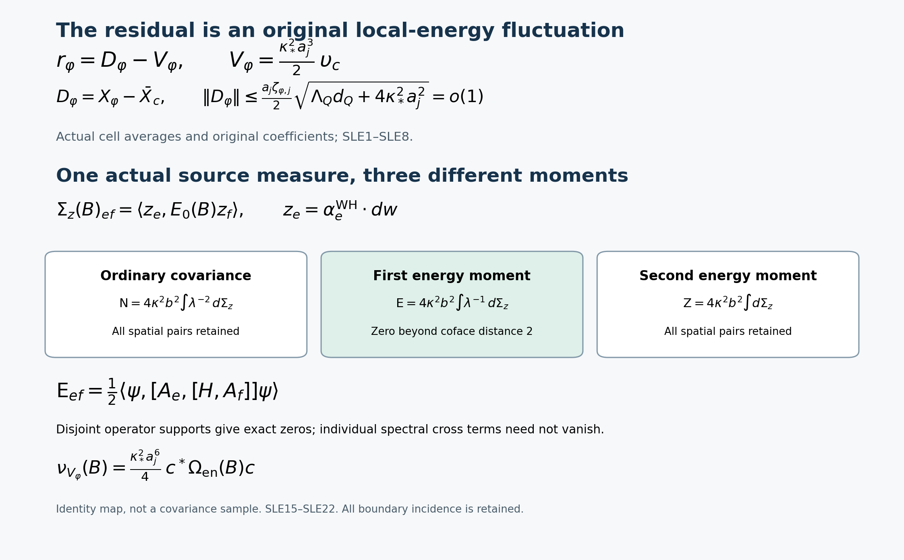

# The scalar residual, original local energy and its first spectral moment

13 October 2026. This note proves exact statements in the original interacting finite-regulator vacuum. The globally smooth interacting gapless four-dimensional state remains the research goal. No novelty claim is made.

The providers are [TSC1–TSC12](https://github.com/KokunoYumeto/yang-mills-interacting-workbench/blob/ef572d469c4359990925bd4240a9bafed8569697/yang-mills/continuations/20261011-central-signs-shrinking-window/SCALAR_COMMON_SOURCE_RECONSTRUCTION.md), [WH1–WH24](https://github.com/KokunoYumeto/yang-mills-interacting-workbench/blob/ef572d469c4359990925bd4240a9bafed8569697/yang-mills/continuations/20261011-central-signs-shrinking-window/SMOOTH_WEIGHTED_LOCAL_ENERGY.md), and the original traversal calculation [SF1–SF5](https://github.com/KokunoYumeto/yang-mills-interacting-workbench/blob/ef572d469c4359990925bd4240a9bafed8569697/yang-mills/continuations/20261011-central-signs-shrinking-window/SHARED_FACE_WORDS_AND_PHYSICAL_COUPLING.md). Their complete proofs and original-source provenance remain in the repository. Inherited human comparisons are Jon Johnsen, [arXiv:1703.10011v2](https://arxiv.org/abs/1703.10011v2), author TeX lines 934–1167 and 1439–1558, and Assane Lo, [arXiv:math-ph/0611002v9](https://arxiv.org/abs/math-ph/0611002v9), author TeX lines 308–446 and 2029–2083. No further reading of those papers is claimed here. The projection and finite weighted inverses used below are the compact realizations already proved in PT/PFR.

## 1. Original objects and the exact local-energy receiver

Retain the open cubic graph with vertices \(\{0,\ldots,2L_j\}^3\), all positive coordinate edges \(\mathcal E_j\), and all its unit faces \(\mathcal P_j\). Keep
\[
\begin{gathered}
L_j=j^4,\quad a_j=(100j)^{-1},\quad g_j^2=\kappa_*a_j/2,\quad
b_j=(\kappa_*a_j^2)^{-1},\quad s_j=100\kappa_*a_j,\\
U_p=U_d(z)U_k(z+e_d)U_d(z+e_k)^{-1}U_k(z)^{-1}\quad(d<k),\\
D_p=2-\operatorname{Tr}U_p,\quad
H=-\kappa_*\Delta+b_j\sum_pD_p,\\
b_j\sum_pD_p=2b_j|\mathcal P_j|-b_j\sum_p\operatorname{Tr}U_p,\\
H\psi=E_0\psi,\quad \psi>0,\quad \int\psi^2dU=1,\quad
w=\log\psi,\quad d\mu=\psi^2dU,\quad g_e=d_ew .
\end{gathered}
\]
The configuration space is \(SU(2)^{\mathcal E_j}\), with the radius-two product metric, probability Haar measure, and orthonormal \(T_\alpha=-i\sigma_\alpha/2\). All vacuum expectations below use this actual \(\mu\). Its positive smooth ground is gauge invariant. Write \(\kappa=\kappa_*\), \(a=a_j\), \(b=b_j\) only within a fixed-regulator identity. The full physical ground transform is
\[
L_0=\psi^{-1}(H-E_0)\psi=\kappa\delta_\mu d,\qquad
\delta_\mu=\delta-2\iota_{dw},\qquad
P=d(\delta_\mu d)^{-1}\delta_\mu .
\]
Here \(P\) is the orthogonal projection onto exact invariant one-forms. All scalar inverses act on the invariant mean-zero space. Compact ellipticity gives a positive first eigenvalue there for each fixed \(j\); no uniform lower bound is used. Inner products conjugate their first entry. All differential calculations first act on smooth functions, including \(\psi\), and all displayed vector moments are in their indicated operator domains.

For the unchanged physical cube \(\mathcal Q=\prod_d[c_d,c_d+R]\), retain the fitting cube and its entire boundary cost:
\[
\begin{gathered}
q_j=\lceil R/a_j\rceil+3,\quad
(v_Q)_d=L_j+\lfloor(c_d-o_d)/a_j\rfloor-1,\quad
Q=v_Q+\{0,\ldots,q_j\}^3,\\
N_Q=3q_j(q_j+1)^2,\quad M_Q=3q_j^2(q_j+1),\\
C_Q=2q_j(q_j+1)\sum_d
[\mathbf1_{\{(v_Q)_d>0\}}+\mathbf1_{\{(v_Q)_d+q_j<2L_j\}}],\\
W_Q=\sum_{p\text{ inside }Q}D_p,\quad d_Q=\mu W_Q,\quad
\Lambda_Q=\min(2M_Q,6g_j^2\sqrt{N_QM_Q})+2C_Q,\\
\kappa T_Q+bd_Q\le E_0-E_{\rm out}\le b\Lambda_Q,\quad
\mu W_Q^2\le\Lambda_Qd_Q+4\kappa/b,\\
\limsup_j a_j^2d_Q\le K_R,\quad
K_R=\frac{\mathsf L_R+
\sqrt{\mathsf L_R^2-81\kappa_*^2R^6/4}}2,\quad
\mathsf L_R=9\kappa_*R^3+24R^2 .
\end{gathered}
\]
The second-moment bound is WH8 with its \(\Lambda_Qd_Q\) term retained before the weaker \(\Lambda_Q^2\) estimate. The cube is strict for all sufficiently large \(j\). Exterior edges and crossing faces remain in \(H\).

Fix \(\varphi\in C_c^1(\mathcal Q;\mathbb C)\), extended by zero. The original centers, cells and coefficients are
\[
\begin{gathered}
x_e=o+a_j(z-L_j\mathbf1+e_d/2),\quad
x_p=o+a_j(z-L_j\mathbf1+(e_d+e_k)/2),\\
K_{j,e}=x_e+[-a_j/2,a_j/2)^3,\quad
c_e=a_j^{-3}\int_{K_{j,e}}\varphi(x)\,dx=\varphi_{a_j}(x_e),\\
\varphi_a(x)=a^{-3}\int_{[-a/2,a/2)^3}\varphi(x+y)\,dy .
\end{gathered}
\]
As in TSC, \(c_e=0\) on every edge outside \(E_Q^\circ\); for large \(j\) the compact support and the retained margins make these exactly the displayed cell averages on the full graph. Any face meeting a nonzero coefficient, or a nonzero \(\varphi(x_p)\), lies inside \(Q\).

For any original complex edge array \(c\), define
\[
\begin{gathered}
\bar c_p=\tfrac14\sum_{e\in\partial p}c_e,\quad
W_c=\sum_p\bar c_pD_p,\quad \Delta_c=\sum_ec_e\Delta_e,\\
H_c=-\kappa\Delta_c+bW_c,\quad
m_c=\langle\psi,H_c\psi\rangle,\\
\upsilon_c=-\kappa^{-1}(\psi^{-1}H_c\psi-m_c)
=\Delta_c\psi/\psi-(b/\kappa)W_c+m_c/\kappa,\\
G_c=\sum_ec_e|g_e|^2,\quad
B_c=\sum_ec_e(\Delta_ew+2|g_e|^2),\quad t_j=\kappa_*^2a_j^3/2,\\
X_\varphi=\tfrac a2\sum_p\varphi(x_p)D_p
-\mu\!\left(\tfrac a2\sum_p\varphi(x_p)D_p\right),\\
\bar X_c=\tfrac a2(W_c-\mu W_c),\quad
Q_\varphi=t_j(G_c-\mu G_c),\quad
D_\varphi=X_\varphi-\bar X_c,\quad V_\varphi=t_j\upsilon_c .
\end{gathered}\tag{SLE1}
\]
The full scalar in \(H_c\) is \(2b\sum_p\bar c_p\). The formula is complex linear in the actual coefficients. For nonreal \(c\), no self-adjointness of \(H_c\) is asserted: on smooth functions its adjoint is \(H_{\bar c}\). Its applications above are well defined. Gauge invariance is preserved by each edge Casimir and each original face trace.

Weighted integration by parts gives \(\mu\Delta_ew=-2\mu|g_e|^2\), so \(\mu B_c=0\). As \(\Delta_c\psi/\psi=\Delta_cw+G_c\), subtracting the full mean in (SLE1) proves
\[
\begin{gathered}
\upsilon_c=B_c-(G_c-\mu G_c)-(b/\kappa)(W_c-\mu W_c),\\
t_j\upsilon_c=t_jB_c-Q_\varphi-\bar X_c,\\
\boxed{r_\varphi=D_\varphi-V_\varphi},\qquad
\boxed{X_\varphi+Q_\varphi+V_\varphi=t_jB_c+D_\varphi}.
\end{gathered}\tag{SLE2}
\]
Here \(r_\varphi=\kappa L_0^{-1}\delta_\mu e_\varphi\) is precisely the TSC1 residual, since TSC1 proves \(X_\varphi+Q_\varphi=t_jB_c+r_\varphi\). The factor \(t_jb/\kappa=a_j/2\) uses the original coupling. These equalities keep every centering constant; no undetermined constant remains.

To retain the differential map as well, use the WH one-form, denoted \(\alpha_c^{\rm WH}\) to distinguish it from TSC's projected current:
\[
\begin{gathered}
\alpha_{c,e}^{\rm WH}=\sum_{p\ni e}(c_e-\bar c_p)d_eD_p,\qquad
\operatorname{div}\alpha_c^{\rm WH}=0,\\
d\upsilon_c=(b/\kappa)P\alpha_c^{\rm WH},\quad
L_0\upsilon_c=b\delta_\mu\alpha_c^{\rm WH},\quad
dV_\varphi=\tfrac a2P\alpha_c^{\rm WH},\\
e_\varphi=\tfrac a2\sum_{p,e\in\partial p}
[\varphi(x_p)-c_e]\Pi_edD_p
=dD_\varphi-\tfrac a2\alpha_c^{\rm WH},\\
dr_\varphi=Pe_\varphi=dD_\varphi-\tfrac a2P\alpha_c^{\rm WH}.
\end{gathered}\tag{SLE3}
\]
Indeed \(\Delta_eD_p=\tfrac34(2-D_p)\) on each of its four edges, including inverse traversals. The face contribution to the divergence is
\(\tfrac34\sum_{e\in\partial p}(c_e-\bar c_p)(2-D_p)=0\).
The first two differential identities are WH3 extended complex linearly; alternatively applying \((H-E_0)\) to \(\Delta_c\psi\), using commuting edge Casimirs, gives \(L_0(\Delta_c\psi/\psi)=\delta_\mu(D_cdV)\). Subtract the complete \(bW_c/\kappa\) and apply \(dL_0^{-1}\) to obtain (SLE3). Expanding \(dD_\varphi\) proves its last two lines directly.

## 2. The interpolation error in its original norm

Put \(M_\varphi=\|D\varphi\|_\infty\), and let \(\omega_{D\varphi}(\rho)\) be the uniform modulus of continuity of the derivative as a real-linear map to \(\mathbb C\). Write
\[
\begin{gathered}
\delta_{\varphi,j}=\sup_x|\varphi_{a_j}(x)-\varphi(x)|,\quad
\delta_{\varphi,j}\le\tfrac{\sqrt3a_j}{2}
\omega_{D\varphi}(\sqrt3a_j/2)=o(a_j),\\
\zeta_{\varphi,j}=\sup_p|\varphi(x_p)-\bar c_p|
\le\delta_{\varphi,j}+\tfrac{a_j}{2}
\omega_{D\varphi}(a_j/2)=o(a_j).
\end{gathered}\tag{SLE4}
\]
For the first line integrate
\(\varphi(x+y)-\varphi(x)-D\varphi(x)y\); the linear term has zero cell average. Its remainder is at most \(|y|\omega_{D\varphi}(|y|)\). For the second, the four edge centers are \(x_p\pm a_je_d/2,x_p\pm a_je_k/2\). Their linear terms cancel exactly. Each remainder is at most \((a_j/2)\omega_{D\varphi}(a_j/2)\); the cell-average errors contribute at most \(\delta_{\varphi,j}\).

For \(\varphi\in C_c^2\), let \(N_\varphi=\sup_x\|D^2\varphi(x)\|\) in the bilinear Euclidean operator norm, without changing \(\varphi\)'s amplitude. Taylor's integral remainder is at most \(N_\varphi|y|^2/2\). The cell mean of \(|y|^2\) is \(a_j^2/4\), and each face displacement has square \(a_j^2/4\). Therefore
\[
\delta_{\varphi,j}\le N_\varphi a_j^2/8,\qquad
\zeta_{\varphi,j}\le N_\varphi a_j^2/4 .
\tag{SLE5}
\]
Both contributions are necessary: a function equal to \(N|x|^2/2\) in the relevant cells and face neighborhood attains their local sum \(Na_j^2/4\).

Set \(d_p=\varphi(x_p)-\bar c_p\) and
\(\mathcal B_{Q,j}=(\Lambda_Qd_Q+4\kappa_*^2a_j^2)^{1/2}\).
The exact covariance and resulting bounds are
\[
\begin{gathered}
\|D_\varphi\|^2=\tfrac{a_j^2}{4}
\sum_{p,q}\overline{d_p}d_q
[\mu(D_pD_q)-(\mu D_p)(\mu D_q)],\\
\|D_\varphi\|\le\tfrac{a_j\zeta_{\varphi,j}}2\mathcal B_{Q,j},\\
\|dD_\varphi\|^2=
\tfrac{a_j^2}{4}\sum_e\sum_{p,q\ni e}
\overline{d_p}d_q\,\mu\langle d_eD_p,d_eD_q\rangle\\
\hfill{}\le4a_j^2\zeta_{\varphi,j}^2d_Q
-a_j^2\zeta_{\varphi,j}^2\sum_{p\text{ inside }Q}\mu D_p^2
\le4a_j^2\zeta_{\varphi,j}^2d_Q .
\end{gathered}\tag{SLE6}
\]
Centering is an orthogonal projection, and pointwise
\(|\sum_pd_pD_p|\le\zeta_{\varphi,j}W_Q\). This and the full WH8 budget prove the norm bound. For the gradient, use at most four incident faces at each edge and
\(|d_eD_p|^2=D_p-D_p^2/4\); summing the four edge contributions of every inside face gives exactly the displayed bound, including its negative square term. All covariances were retained before this inequality. Since \(d_Q,\Lambda_Q=O(a_j^{-2})\), (SLE4) proves \(\|D_\varphi\|=o(1)\), \(\|dD_\varphi\|=o(a_j)\); (SLE5) strengthens these to \(O(a_j)\), \(O(a_j^2)\).

## 3. Spectral consequences, including energy close to zero

Retain TSC's original current and its complete energy difference:
\[
\begin{gathered}
\mathsf Cc=a_j^2\sum_ec_e\Pi_edw,\quad
\alpha_\varphi=P\mathsf Cc,\quad h_\varphi=(\varphi,\varphi,\varphi),\\
\chi_{\varphi,j}
=\langle h_\varphi,\mathcal Q_jh_\varphi\rangle
-a_j\langle P^\perp\mathsf Cc,L_1P^\perp\mathsf Cc\rangle
=\kappa_*a_j^5\|B_c\|^2\ge0,\\
\mathcal Q_j=a_j^{-2}J_j(\mathsf C^*L_1\mathsf C)\mathcal A_j,\quad
(\mathcal A_jh)_e=a_j^{-3}\int_{K_{j,e}}h_d,\quad J_j^*J_j=a_j^3I,\\
\chi_{\varphi,j}\le(3/\kappa_*+4\Theta_{G,j})\|h_\varphi\|^2,\quad
\Theta_{G,j}=
\frac{-3a_j/2+\sqrt{9a_j^2/4+144/(\kappa_*^2(7/5))}}8 .
\end{gathered}
\]
These are TSC2 and its original cell map. In particular
\[
\begin{gathered}
\|t_jB_c\|=\tfrac{\kappa_*^{3/2}}2\sqrt{a_j\chi_{\varphi,j}},\\
\|X_\varphi+Q_\varphi+V_\varphi\|
\le\tfrac{\kappa_*^{3/2}}2\sqrt{a_j\chi_{\varphi,j}}
+\tfrac{a_j\zeta_{\varphi,j}}2\mathcal B_{Q,j}=:\eta_{\varphi,j},\\
\eta_{\varphi,j}=o(1)\quad(C_c^1),\qquad
\eta_{\varphi,j}=O(\sqrt{a_j})\quad(C_c^2).
\end{gathered}\tag{SLE7}
\]
For the actual scalar spectral projection \(E_0(B)\), define
\(\nu_Z(B)=\|E_0(B)Z\|^2\). Projection contraction and the reverse triangle inequality prove, for every Borel set \(B\subset[0,\infty)\),
\[
\begin{gathered}
|\sqrt{\nu_{r_\varphi}(B)}-\sqrt{\nu_{V_\varphi}(B)}|
\le\tfrac{a_j\zeta_{\varphi,j}}2\mathcal B_{Q,j},\\
|\sqrt{\nu_{X_\varphi+Q_\varphi}(B)}
-\sqrt{\nu_{V_\varphi}(B)}|\le\eta_{\varphi,j}.
\end{gathered}\tag{SLE8}
\]
The minus sign in \(r_\varphi=D_\varphi-V_\varphi\) does not change the projected norm. Thus for every sequence \(B_j\), including sets approaching zero, each displayed pair has equal extended mass liminf and limsup. To verify this when masses are unbounded, the corresponding nonnegative roots differ by \(o(1)\); their extended liminf and limsup agree. Squaring preserves finite limits and \(+\infty\). This does not assert that differences of unbounded masses tend to zero, nor that a limiting spectral measure has already been constructed.

The original cell average is Lipschitz with constant at most \(M_\varphi\), by integrating the derivative of the zero extension. Put \(c_\varphi=(1+\sqrt2)M_\varphi/4\). From the original four distances \(0,a_j,a_j/\sqrt2,a_j/\sqrt2\),
\[
\begin{gathered}
|c_e-\bar c_p|\le c_\varphi a_j,\qquad
\|\alpha_c^{\rm WH}\|^2\\
=\sum_e\sum_{p,q\ni e}
\overline{(c_e-\bar c_p)}(c_e-\bar c_q)
\mu\langle d_eD_p,d_eD_q\rangle
\le16c_\varphi^2a_j^2d_Q,\\
\langle V_\varphi,L_0V_\varphi\rangle
=\tfrac{\kappa_*a_j^2}{4}\|P\alpha_c^{\rm WH}\|^2
\le4\kappa_*c_\varphi^2a_j^4d_Q,\\
\nu_{V_\varphi}([\epsilon s_j,\infty))
\le\frac{c_\varphi^2a_j^3d_Q}{25\epsilon}=O(a_j)
\qquad(\epsilon>0).
\end{gathered}\tag{SLE9}
\]
The first inequality uses all four face coefficients, and the norm bound again sums the at most four incident vectors. The energy is \(\kappa\|dV_\varphi\|^2\) by (SLE3). The last line divides the first energy moment by \(\epsilon s_j=100\epsilon\kappa_*a_j\). This calculates the residual's local-energy mechanism in the original physical scale. It supplies no positive lower mass for \(X_\varphi\) or \(Q_\varphi\).

## 4. Signed coefficients without changing their size

For any finite real array \(c\), let \(m=\min_ec_e\), \(M=\max_ec_e\), \(S_r=\{e:c_e>r\}\) for \(m<r<M\). Let \(H_{S_r}\) include the kinetic terms on \(S_r\) and potentials only of faces wholly in \(S_r\), exactly as WH16. Retain its full ground energy and mean when defining
\(\upsilon_{S_r}=-\kappa^{-1}(\psi^{-1}H_{S_r}\psi-\langle\psi,H_{S_r}\psi\rangle)\).
Put
\[
\begin{gathered}
c_p^-=\min_{e\in\partial p}c_e,\quad
c_p^+=\max_{e\in\partial p}c_e,\quad
Z_c=\sum_p(\bar c_p-c_p^-)D_p,\quad
\mathcal R_c=\sum_p(c_p^+-c_p^-),\\
H_c=mH+\int_m^M H_{S_r}\,dr+bZ_c,\\
m_c=mE_0+\int_m^M\langle\psi,H_{S_r}\psi\rangle\,dr+b\mu Z_c,\\
\upsilon_c=\int_m^M\upsilon_{S_r}\,dr-(b/\kappa)(Z_c-\mu Z_c).
\end{gathered}\tag{SLE10}
\]
Indeed \(c_e=m+\int_m^M\mathbf1_{\{c_e>r\}}dr\), and
\(c_p^-=m+\int_m^M\mathbf1_{\{\partial p\subset S_r\}}dr\).
Substitution proves both operator and mean identities with their \(mH\) and \(mE_0\) terms. All integrals are finite sums over intervals between actual coefficient values. They also cover \(m=M\), giving the zero centered vector.

The complete variance, including distinct nested sectors, is
\[
\begin{split}
\|\upsilon_c\|^2={}&
\int_m^M\!\!\int_m^M
\langle\upsilon_{S_r},\upsilon_{S_s}\rangle\,dr\,ds\\
&-\frac{2b}{\kappa}\int_m^M
\langle\upsilon_{S_r},Z_c-\mu Z_c\rangle\,dr
+\frac{b^2}{\kappa^2}\operatorname{Var}_\mu Z_c .
\end{split}\tag{SLE11}
\]
WH19 proves \(\|\upsilon_S\|\le2bC_S^\times/\kappa\) for every actual subset, with its full complementary Hamiltonian and crossing-face cost. A face is mixed for exactly an interval of length \(c_p^+-c_p^-\). Consequently
\[
\begin{gathered}
\|t_j\upsilon_c\|\le\tfrac{a_j}{2}
(2\mathcal R_c+\sqrt{\operatorname{Var}_\mu Z_c}),\\
\|V_\varphi\|\le
a_j^2M_\varphi M_Q+
\tfrac{c_\varphi a_j^2}{2}\mathcal B_{Q,j}=O(a_j^{-1})
\quad(\varphi\text{ real}).
\end{gathered}\tag{SLE12}
\]
For the second line the four edge-center distances give
\(\mathcal R_c\le M_\varphi a_jM_Q\) and
\(0\le Z_c\le c_\varphi a_jW_Q\). Apply the full second-moment bound. Complex coefficients are handled by the exact linear identity
\(\upsilon_c=\upsilon_{\Re c}+i\upsilon_{\Im c}\).
Their squared norm retains both norms and
\(2\Re\langle\upsilon_{\Re c},i\upsilon_{\Im c}\rangle\); this cross term is zero because both component functions are real. Each real component has the bound (SLE12) with its own derivative constant. Thus the square root of the sum of their squared bounds bounds \(\|V_\varphi\|\). No amplitude has been replaced by a unit weight.

## 5. Three original moment matrices and an exact first-moment locality

For every edge of the entire original graph define
\[
\begin{gathered}
A_e=-\kappa\Delta_e+\tfrac b4 W_e,\quad W_e=\sum_{p\ni e}D_p,\quad
m_e=\langle\psi,A_e\psi\rangle,\quad v_e=(A_e-m_e)\psi,\\
\sum_eA_e=H,\quad \sum_ev_e=0,\quad
\mathsf N_{ef}=\langle v_e,v_f\rangle,\\
\mathsf E_{ef}=\langle v_e,(H-E_0)v_f\rangle,\quad
\mathsf Z_{ef}=\langle(H-E_0)v_e,(H-E_0)v_f\rangle .
\end{gathered}\tag{SLE13}
\]
These are real symmetric positive semidefinite matrices, with every row and column sum zero. Reality follows from real coefficients and the real ground; positivity follows from the respective norm, positive quadratic form and norm. All vectors are smooth and orthogonal to \(\psi\). The first matrix is precisely WH14's \(\mathcal C\). For arbitrary complex original arrays \(c,d\), their forms are the corresponding moments of \(\sum_ec_ev_e\), with conjugation on \(c\). For \(c=d\) every one of the three matrices \(\mathsf M\) satisfies
\[
c^*\mathsf M c=-\tfrac12\sum_{e,f}|c_e-c_f|^2\mathsf M_{ef}.
\tag{SLE14}
\]
Expand the square and use both zero sums; the cross sum is real by symmetry. This retains the actual signs of all matrix entries.

There is an exact local formula for the first moment:
\[
\boxed{\mathsf E_{ef}
=\tfrac12\langle\psi,[A_e,[H,A_f]]\psi\rangle}.
\tag{SLE15}
\]
Expand the double commutator into
\(A_eHA_f-A_eA_fH-HA_fA_e+A_fHA_e\).
Move the outer \(H\)'s onto \(\psi\); they give
\(-E_0\langle A_e\psi,A_f\psi\rangle
-E_0\langle A_f\psi,A_e\psi\rangle\).
The other two terms give the same two pairings with \(H\) inserted. Their sum is twice the real symmetric centered first-energy entry, proving (SLE15). This also proves the complex polarized formula with \(H_{\bar c}\) in the outer commutator and \(H_d\) in the inner one; no complex self-adjointness is assumed.

Define the coface graph on original edges: two distinct edges are adjacent when they lie on an original face. Let \(\mathcal N(e)\) be the union of the four-edge sets of all faces containing \(e\), together with \(e\) itself. This includes the actual boundary incidence rather than filling in absent faces. Write
\(\alpha_f=\alpha^{\rm WH}_{\mathbf1_f}\). Directly from (SLE3) or WH12,
\[
[H,A_f]=2\kappa b\,\alpha_f\cdot d,\qquad
\boxed{\operatorname{dist}_{\rm coface}(e,f)>2
\ \Longrightarrow\ \mathsf E_{ef}=0}.
\tag{SLE16}
\]
For the commutator, the scalar Casimir terms cancel facewise:
\(\Delta_f\sum_pD_p-\tfrac14\Delta W_f=0\).
The first-order terms are \(2\kappa b\sum_{p\ni f,g\in\partial p}
(\mathbf1_{\{g=f\}}-\tfrac14)d_gD_p\cdot d_g\), as displayed.
They use only the variables in \(\mathcal N(f)\).
The coefficients and differentiation of \(A_e\) use only \(\mathcal N(e)\).
If the graph distance is greater than two these sets are disjoint: a common edge would give a path of length at most two. Differential operators on these disjoint factors commute on smooth functions, proving (SLE16) before taking the ground expectation. No finite-range assertion is made for \(\mathsf N\), \(\mathsf Z\), or an individual spectral projection.

The entries at distance two can be computed with their complete original Wilson words. For distinct \(e,f\) sharing no face,
\[
\begin{gathered}
\mathsf E_{ef}
=\frac{\kappa b^2}{16}
\sum_{\substack{p\ni f,\ q\ni e\\g\in\partial p\cap\partial q}}
\mu\langle d_gD_p,d_gD_q\rangle\\
=\frac{\kappa b^2}{64}
\sum_{\substack{p\ni f,\ q\ni e\\g\in\partial p\cap\partial q}}
[\mu\operatorname{Tr}G_{pq,g}-\mu\operatorname{Tr}R_{pq,g}].
\end{gathered}\tag{SLE17}
\]
Here \(p\ne q\). To prove the coefficient, \(\Delta_e\) commutes with \(\alpha_f\cdot d\) because \(e\notin\mathcal N(f)\). For the potential multiplier,
\([W_e,\alpha_f\cdot d]=-\alpha_f\cdot dW_e\).
If \(g=f\), \(d_fW_e=0\); every surviving \(g\) therefore has coefficient \(-1/4\) in \(\alpha_f\). Substitution in
\(\mathsf E_{ef}=\kappa b\langle\psi,[A_e,\alpha_f\cdot d]\psi\rangle\)
gives \(+\kappa b^2/16\), with exactly the displayed ordered face pairs.

For clarity the words in the second line retain every traversal. At the positive tail of \(g\), write
\[
\begin{gathered}
H_{p,g}=U_gA_{p,g}\quad(\epsilon_{p,g}=+1),\qquad
H_{p,g}=A_{p,g}U_g^{-1}\quad(\epsilon_{p,g}=-1),\\
\sigma=\epsilon_{p,g}\epsilon_{q,g},\quad
G_{pq,g}=H_{p,g}H_{q,g}^{-\sigma},\quad
R_{pq,g}=H_{p,g}H_{q,g}^{\sigma},\\
\langle d_gD_p,d_gD_q\rangle
=\tfrac14(\operatorname{Tr}G_{pq,g}-\operatorname{Tr}R_{pq,g}).
\end{gathered}
\]
The three-edge paths \(A\) are the actual cyclically ordered other links. Differentiation of \(U_g^{-1}\) gives \(-U_g^{-1}T_\alpha\), and the Pauli contraction
\(\sum_\alpha\operatorname{Tr}(T_\alpha X)\operatorname{Tr}(T_\alpha Y)
=-\operatorname{Tr}(XY)/2+\operatorname{Tr}X\operatorname{Tr}Y/4\)
proves this formula using the \(SU(2)\) characteristic equation. The \(G\) trace is the six-edge loop and \(R\) keeps all eight factors, as enumerated in SF5. The complete difference also equals
\([(2-\operatorname{Tr}R)-(2-\operatorname{Tr}G)]/4\), retaining both deficit scalars. No sign or limiting expectation is assigned to that difference.

For all \(e,f\), including equal and adjacent edges, another full entry formula is
\[
\begin{gathered}
K_e=\Delta_e\psi/\psi=\Delta_ew+|g_e|^2,\quad
z_f=\alpha_f\cdot dw,\\
\mathsf E_{ef}
=-2\kappa^2b\,\mu(K_ez_f)
-\tfrac{\kappa b^2}{4}\mu(\alpha_f\cdot dW_e).
\end{gathered}\tag{SLE18}
\]
The divergence of \(\alpha_f\) is zero in Haar measure, so \(\alpha_f\cdot d\) is skew symmetric. Thus
\(\langle\psi,[\Delta_e,\alpha_f\cdot d]\psi\rangle
=2\langle\Delta_e\psi,\alpha_f\cdot d\psi\rangle\).
The multiplier commutator is the one used above. Inserting both in (SLE15) proves (SLE18), with \(K_e\) and the full actual score retained. Its symmetry follows from (SLE15) even though it is not manifest term by term.

## 6. The actual spectral source and all inverse moments

The divergence identity gives \(\delta_\mu\alpha_f=-2z_f\). Its integral is zero because it is the adjoint pairing against \(d1=0\). Consequently every \(z_f\) is mean zero and gauge invariant. The exact maps are
\[
\begin{gathered}
\upsilon_{\mathbf1_f}=-2bL_0^{-1}z_f,\qquad
v_f=-\kappa\psi\upsilon_{\mathbf1_f}
=2\kappa b\,\psi L_0^{-1}z_f,\\
(H-E_0)v_f=2\kappa b\,\psi z_f,\qquad
\mathsf Z_{ef}=4\kappa^2b^2\,\mu(z_ez_f).
\end{gathered}\tag{SLE19}
\]
The first identity follows from (SLE3) with its zero mean; the second follows from (SLE1). Equivalently the third follows directly from the commutator on \(\psi\). This proves agreement of the differential and inverse-operator maps, retaining their sign.

For Borel \(B\subset(0,\infty)\) define the actual matrix-valued measures
\[
\begin{gathered}
\Sigma_z(B)_{ef}=\langle z_e,E_0(B)z_f\rangle,\quad
\Omega_{\rm en}(B)_{ef}=\langle v_e,E_{H-E_0}(B)v_f\rangle,\\
d\Omega_{\rm en}(\lambda)=4\kappa^2b^2\lambda^{-2}\,d\Sigma_z(\lambda),\\
\mathsf N=4\kappa^2b^2\int\lambda^{-2}\,d\Sigma_z(\lambda),\quad
\mathsf E=4\kappa^2b^2\int\lambda^{-1}\,d\Sigma_z(\lambda),\\
\mathsf Z=4\kappa^2b^2\int d\Sigma_z(\lambda).
\end{gathered}\tag{SLE20}
\]
Multiplication by \(\psi\) is the unitary ground transform from \(L^2(\mu)\) to \(L^2(dU)\). It intertwines the scalar spectral resolutions. Apply it to (SLE19) and use spectral calculus to prove every entry in (SLE20), including complex polarization. At fixed \(j\), the inverse powers are bounded on the mean-zero spectrum; at high energy the smooth \(z_e\)'s give all required moments. Both measures are positive semidefinite matrix measures with zero row sums, since \(\sum_f\alpha_f=0\) and hence \(\sum_fz_f=0\). The original vacuum is excluded by exact orthogonality, not by deleting a spectral contribution.

In particular,
\[
\begin{gathered}
\ker\mathsf N=\ker\mathsf E=\ker\mathsf Z
=\{c:\sum_ec_ez_e=0\text{ in }L^2(\mu)\},\\
\operatorname{dist}_{\rm coface}(e,f)>2
\ \Longrightarrow\
\int\lambda^{-1}\,d\Sigma_z(\lambda)_{ef}=0 .
\end{gathered}\tag{SLE21}
\]
For the kernel assertion, a zero nonnegative quadratic integral in any of (SLE20) implies that the positive scalar measure of \(\sum_ec_ez_e\) vanishes, since each integrand is strictly positive on \((0,\infty)\). The converse follows from the exact map. This includes the constant edge array. It does not prove that constants exhaust the kernel. The last identity is (SLE16) through the positive factor \(4\kappa^2b^2\); it does not assert vanishing of every individual cross spectral measure.

For the original \(V_\varphi=t_j\upsilon_c\), all raw coefficients and powers remain:
\[
\begin{gathered}
\nu_{V_\varphi}(B)=\frac{\kappa_*^2a_j^6}{4}
c^*\Omega_{\rm en}(B)c,\\
\|V_\varphi\|^2=\frac{\kappa_*^2a_j^6}{4}c^*\mathsf N c,\quad
\langle V_\varphi,L_0V_\varphi\rangle
=\frac{\kappa_*^2a_j^6}{4}c^*\mathsf E c
=\frac{\kappa_*a_j^2}{4}\|P\alpha_c^{\rm WH}\|^2,\\
\|L_0V_\varphi\|^2=\frac{\kappa_*^2a_j^6}{4}c^*\mathsf Zc .
\end{gathered}\tag{SLE22}
\]
The factor is \(t_j^2/\kappa_*^2\), since
\(\psi V_\varphi=-(t_j/\kappa_*)\sum_ec_ev_e\).
This derives the exact map from the finite-range first moment back to the residual; it is not an identification of auxiliary and physical spectra without a receiving map.

The first row depicts the exact identity (SLE2) and its original-norm error (SLE6). The second row depicts the three different inverse moments of the same actual source measure (SLE20); only the middle matrix has the proved coface range two. This is a map of the proved identities, not a measured covariance plot. Reproducible source: figure_scalar_energy.py. Proof locators: SLE2, SLE6, SLE15–SLE22; human comparisons and source-reading coverage are specified at the start.

## 7. The exact defect behind a zero energy vector

The geometric map \(c\mapsto\alpha_c^{\rm WH}\), before contraction against the actual score, has an exact kernel:
\[
\alpha_c^{\rm WH}=0\text{ as a smooth one-form}
\quad\Longleftrightarrow\quad c\text{ is constant on the full edge set}.
\tag{SLE23}
\]
To prove the forward implication, fix an original face \(p\) and one edge \(g\) in it. In the \(g,T_1\) component of \(\alpha_c^{\rm WH}\), differentiate in the \(T_1\) directions of the other three original edges of \(p\), and evaluate all links at \(I\). Any different face \(q\) incident on \(g\) lacks those three edges: two distinct unit cubic faces share at most one edge, as the coordinate check in SF5 proves. Its differentiated term is therefore zero. In the surviving term, each inverse traversal supplies its actual minus sign. There are two such traversals in the original ordered face, and
\(\operatorname{Tr}(T_1^4)=1/8\).
The four-edge derivative of \(D_p=2-\operatorname{Tr}U_p\) is hence exactly \(-1/8\). The result is
\(-\tfrac18(c_g-\bar c_p)=0\), so every edge of \(p\) has coefficient \(\bar c_p\). The coface graph of the original box is connected: any face's four edges are connected; neighboring parallel faces are connected through the side faces of their intervening unit cube; the unit cubes form a connected rectangular array, and every boundary edge belongs to at least one of those cubes. Since \(2L_j\ge2\), these observations cover every original edge and propagate the coefficient to the entire graph. The reverse implication follows from every face average of a constant. The proof works complex linearly and retains both inverse signs.

The common kernel in (SLE21) can nevertheless contain only information after contraction with \(dw\); (SLE23) cannot be substituted for its evaluation. There is a precise dynamical description of that remaining defect. For a real array \(c\), let \(Y_c\) be the vector field metrically dual to \(\alpha_c^{\rm WH}\), and let \(\Phi_c^u\) be its flow. Then
\[
\begin{gathered}
c\in\ker\mathsf N
\quad\Longleftrightarrow\quad
Y_cw=0
\quad\Longleftrightarrow\quad
w\circ\Phi_c^u=w\text{ for all }u\in\mathbb R,\\
(\Phi_c^u)^*dU=dU,\qquad
c\in\ker\mathsf N\quad\Longrightarrow\quad
(\Phi_c^u)^*d\mu=d\mu .
\end{gathered}\tag{SLE24}
\]
The smooth field is complete because the finite configuration manifold is compact. Its divergence is zero by (SLE3), so the Jacobian of its flow with respect to Haar volume has derivative zero and equals one. Equation (SLE21) says \(Y_cw=\sum_ec_ez_e=0\) in \(L^2(\mu)\). Smoothness and strict positivity of \(\mu\)'s density make this a pointwise identity. Differentiating \(w(\Phi_c^u(U))\) proves constancy along every flow line; conversely differentiating the flow identity at \(u=0\) proves the kernel condition. Since \(d\mu=e^{2w}dU\), the measure assertion follows. Each field and its flow are gauge equivariant: the original metric, edge blocks, coefficients and face gradients are equivariant under the vertex gauge action. No isometry or commutation with the full Hamiltonian is claimed for this flow.

For complex \(c\), the real and imaginary parts of \(\sum_ec_ez_e\) vanish separately, because all \(z_e\) are real. Thus its defect is exactly the pair of real flows just described. If two real arrays lie in the kernel, their vector-field bracket also preserves \(w\) and Haar volume: the identities are
\([Y_c,Y_d]w=Y_c(Y_dw)-Y_d(Y_cw)=0\) and
\(\operatorname{div}[Y_c,Y_d]
=Y_c(\operatorname{div}Y_d)-Y_d(\operatorname{div}Y_c)=0\).
The bracket need not be in the original linear family \(Y_e\). This describes the actual larger field family determined by the defect without declaring new coefficient kernels.

## 8. Receiving calculation still to perform

The scalar residual has now been identified with a specific original local-energy fluctuation, up to a vanishing original-norm interpolation error. Its entire band above \(\epsilon s_j\) has the bound (SLE9), and its first energy matrix is determined by the local double commutator, including the exact six/eight-edge expression at distance two.

The next concrete receiving calculation is to evaluate the actual entries in (SLE17)–(SLE18), together with the source inverse moments in (SLE20), in the original interacting vacuum. In particular the sparse first moment and the positive diagonal variance previously proved in EV12 do not by themselves determine the mass of \(X_\varphi\) or \(Q_\varphi\) in the original shrinking annulus. Equations (SLE23)–(SLE24) identify exactly where an additional kernel can occur: a nonzero original face field preserving the actual ground density. Its geometric kernel alone consists of constants; classifying those density-preserving fields is the next kernel calculation. Equation (SLE8) retains energy approaching zero. No replacement vacuum, sign pattern for off-diagonal entries, uniform inverse bound, positive annulus mass, continuum state or theory identification has been assumed. The five original Green moments and J5 comparison remain in the programme alongside this map.
