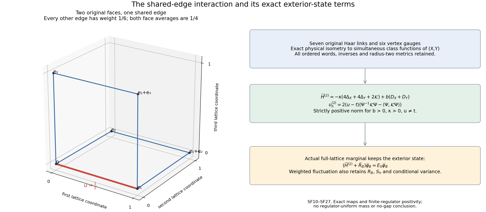

# Shared-face words, the exact two-face physical map and the exterior state

This calculation continues [WH1–WH33](https://github.com/KokunoYumeto/yang-mills-interacting-workbench/blob/59caf02049b597daceec939ef179ba60fbccbcc6/yang-mills/continuations/20261011-central-signs-shrinking-window/SMOOTH_WEIGHTED_LOCAL_ENERGY.md), with the original finite compact-sector construction and local energy budget in [LC3–LC20](https://github.com/KokunoYumeto/yang-mills-interacting-workbench/blob/59caf02049b597daceec939ef179ba60fbccbcc6/yang-mills/continuations/20261011-central-signs-shrinking-window/LOCAL_CURVATURE_BUDGET.md). It evaluates all shared-edge word maps, proves a strictly nonzero two-face physical fluctuation, and calculates its complete receiving map to the original full-lattice marginal. No continuum or no-gap conclusion is asserted.

## 1. Original words and every traversal sign

Keep the original positive cubic edge \(e:v\to w\), link \(U_e\), probability Haar measure and radius-two \(\mathrm{SU}(2)\) metric. The three orthonormal generators remain \(T_\alpha=-i\sigma_\alpha/2\), and

\[
X_{e,\alpha}f=\left.\frac{d}{dt}f(\ldots,\exp(tT_\alpha)U_e,\ldots)\right|_{t=0}
.
\]
For an original oriented plaquette \(p\) containing \(e\), cyclically base its holonomy at \(v\):
\[
H_{p,e}=
\begin{cases}
U_e A_{p,e},&\epsilon_{p,e}=+1,\\
A_{p,e}U_e^{-1},&\epsilon_{p,e}=-1.
\end{cases}
\qquad D_p=2-\operatorname{Tr}H_{p,e}.
\tag{SF1}
\]
Here \(A_{p,e}\) is the actual ordered product of the remaining three edges with their original inverse traversals. If the original word is \(L U_e R\), set \(A=RL\); if it is \(L U_e^{-1}R\), again set \(A=RL\), but retain the second ordering in (SF1). The first \(A\) is a path from \(w\) to \(v\), the second from \(v\) to \(w\). These products are functions of the original links, never independent replacement holonomies.

The derivative of the inverse edge is \(-U_e^{-1}T_\alpha\). Cyclic invariance of trace therefore gives both signs exactly:
\[
X_{e,\alpha}D_p=-\epsilon_{p,e}\operatorname{Tr}(T_\alpha H_{p,e}).
\tag{SF2}
\]
The Pauli entry identity
\(\sum_\alpha(\sigma_\alpha)_{ij}(\sigma_\alpha)_{kl}
=2\delta_{il}\delta_{jk}-\delta_{ij}\delta_{kl}\)
is verified by the three matrices
\(\left(\begin{smallmatrix}0&1\\1&0\end{smallmatrix}\right)\),
\(\left(\begin{smallmatrix}0&-i\\i&0\end{smallmatrix}\right)\),
\(\left(\begin{smallmatrix}1&0\\0&-1\end{smallmatrix}\right)\).
Contracting the entries of arbitrary two-by-two matrices \(X,Y\), retaining \((-i/2)^2=-1/4\), proves
\[
\sum_\alpha\operatorname{Tr}(T_\alpha X)\operatorname{Tr}(T_\alpha Y)
=-\frac12\operatorname{Tr}(XY)
+\frac14\operatorname{Tr}X\operatorname{Tr}Y.
\tag{SF3}
\]
For \(Y\in\mathrm{SU}(2)\), its characteristic equation is
\(Y^2-(\operatorname{Tr}Y)Y+I=0\).
Multiply by \(Y^{-1}\), then by \(X\), and take trace. Thus
\(\operatorname{Tr}X\operatorname{Tr}Y
=\operatorname{Tr}(XY)+\operatorname{Tr}(XY^{-1})\).
For distinct faces \(p,q\) sharing \(e\), write
\(\sigma=\epsilon_{p,e}\epsilon_{q,e}\). It follows that
\[
\begin{gathered}
\theta_{pq,e}:=\langle d_eD_p,d_eD_q\rangle
=\frac{\sigma}{4}
\{\operatorname{Tr}(H_{p,e}H_{q,e}^{-1})
-\operatorname{Tr}(H_{p,e}H_{q,e})\},\\
G_{pq,e}=H_{p,e}H_{q,e}^{-\sigma},\qquad
R_{pq,e}=H_{p,e}H_{q,e}^{\sigma},\\
\theta_{pq,e}=\frac14(\operatorname{Tr}G_{pq,e}-\operatorname{Tr}R_{pq,e})
=\frac14\{(2-\operatorname{Tr}R_{pq,e})-(2-\operatorname{Tr}G_{pq,e})\}.
\end{gathered}\tag{SF4}
\]
The two deficit scalars are present before subtraction.

For explicit paths, put \(U=U_e,A=A_{p,e},B=A_{q,e}\). All four cases are
\[
\begin{array}{c|c|c|c}
(\epsilon_p,\epsilon_q)&G&\operatorname{Tr}G\text{ as six edges}&R\\ \hline
(+,+)&UAB^{-1}U^{-1}&\operatorname{Tr}(AB^{-1})&UAUB\\
(+,-)&UABU^{-1}&\operatorname{Tr}(AB)&UAUB^{-1}\\
(-,+)&AB&\operatorname{Tr}(AB)&AU^{-1}B^{-1}U^{-1}\\
(-,-)&AB^{-1}&\operatorname{Tr}(AB^{-1})&AU^{-1}BU^{-1}.
\end{array}\tag{SF5}
\]
Substitution of (SF1) proves each row, including the adjacent inverse cancellation in the last two rows and the conjugation in the first two. Distinct unit faces incident on a cubic edge have only that edge and its two endpoints in common. To check this geometrically, use the coordinate along the common edge and its two transverse coordinates. Each face chooses one transverse coordinate and one of its two sides. The four choices give the four incident faces. Different choices either use opposite sides of the same coordinate or different coordinates; their other vertices and edges are distinct. The two remaining three-edge paths therefore form a genuine six-edge closed path, for both coplanar and perpendicular faces. The \(R\) words keep the common edge twice with the same traversal; they have all eight factors.

## 2. Original observable entry and its actual support

Keep the full lattice vacuum \(\psi\), \(d\mu=\psi^2dU\), and all original quantities of WH1:
\[
L_j=j^4,\quad a_j=(100j)^{-1},\quad
g_j^2=\kappa_*a_j/2,\quad b_j=(\kappa_*a_j^2)^{-1},\quad
s_j=100\kappa_*a_j.
\]
With the original \(C=a_j\sum_p f_pD_p\), \(F=C-\mu C\), edge samples \(h_e\), face averages \(t_p\) and vector \(\upsilon_h\), WH27 and (SF4) give the exact original-state entry
\[
\begin{split}
r_h={a_jb_j\over4}
\sum_e\sum_{\substack{p<q\\p,q\ni e}}
&\{f_p(h_e-t_q)+f_q(h_e-t_p)\}\\
&\cdot\{\mu\operatorname{Tr}G_{pq,e}-\mu\operatorname{Tr}R_{pq,e}\},
\qquad {a_jb_j\over4}={1\over4\kappa_*a_j}.
\end{split}\tag{SF6}
\]
This is a difference of two expectations in the same original vacuum. Positivity of an individual expectation does not evaluate that difference.

There is a needed support enlargement. Write the WH7 fitting cube as
\[
\begin{gathered}
v_{j,d}=L_j+\lfloor(c_d-o_d)/a_j\rfloor-1,\quad
q_j=\lceil R/a_j\rceil+3,\quad Q_0=v_j+\{0,\ldots,q_j\}^3,\\
Q_+=v_j-\mathbf1+\{0,\ldots,q_j+2\}^3,\\
N_+=3(q_j+2)(q_j+3)^2,\quad
M_+=3(q_j+2)^2(q_j+3),\quad
C_+=12(q_j+2)(q_j+3),\\
W_+=\sum_{p\subset Q_+}D_p,\quad
\Lambda_+=\min\{2M_+,6g_j^2\sqrt{N_+M_+}\}+2C_+ .
\end{gathered}\tag{SF7}
\]
For all sufficiently large original \(j\), this is still a strict cube in the original box. A nonzero coefficient in (SF6) implies that at least one of its two faces has a nonzero sampled edge weight. That face lies wholly in \(Q_0\) by WH7. Its common edge lies in \(Q_0\); every vertex of the other incident unit face lies at most one lattice step beyond the coordinate bounds of \(Q_0\), and hence in \(Q_+\). This argument includes the case where the other face has four zero edge weights. Thus the original LC budget gives \(\mu W_+\le\Lambda_+\) for all terms actually used.

Keep the complete gradient norms before bounding:
\[
|\theta_{pq,e}|
\le\sqrt{(D_p-D_p^2/4)(D_q-D_q^2/4)}
\le(D_p+D_q)/2 .
\tag{SF8}
\]
The first inequality is the Euclidean Cauchy inequality on the original three-dimensional edge tangent space; the exact norm follows from (SF2) or WH9. The second uses \(0\le D_p,D_q\le4\), then \(2\sqrt{D_pD_q}\le D_p+D_q\).
Set \(M_f=\max_\sigma\|f_\sigma\|_\infty\) and \(c_h=(1+\sqrt2)L_h/4\).
The coefficient of \(\theta\) is at most \(2M_fc_ha_j\) in absolute value. A face has four edges, each incident to at most three other faces. In the unordered pair sum, its deficit therefore occurs at most twelve times. Consequently
\[
|r_h|\le12b_ja_j^2M_fc_h\Lambda_+
=\frac{12M_fc_h}{\kappa_*}\Lambda_+,\qquad
\limsup_j a_j^2|r_h|
\le\frac{12M_fc_h}{\kappa_*}(9\kappa_*R^3+24R^2).
\tag{SF9}
\]
The integer formulas in (SF7), \(a_jq_j\to R\), and the original coupling give the last limit. This is an upper bound on the actual source entry, not its limiting value.

## 3. Exact physical coordinates for two incident faces

Now take the actual seven-edge, six-vertex graph consisting of these two faces alone. This finite graph is a comparison object, with every original link, metric and potential retained. Relate it to the full lattice explicitly in Section 5.
Define the two aligned, tail-based holonomies
\[
X=H_{p,e}^{\epsilon_{p,e}}=U_eA_{p,e}^{\epsilon_{p,e}},
\qquad
Y=H_{q,e}^{\epsilon_{q,e}}=U_eA_{q,e}^{\epsilon_{q,e}},
\qquad D_X=2-\operatorname{Tr}X,\quad D_Y=2-\operatorname{Tr}Y.
\tag{SF10}
\]
The trace of an \(\mathrm{SU}(2)\) matrix equals the trace of its inverse, so \(D_X=D_p,D_Y=D_q\) exactly. All original inverses remain in the map.
Let \(\mathscr H_2\) be the simultaneous-conjugation-invariant subspace of
\(L^2(\mathrm{SU}(2)^2,dX\,dY)\), and set
\[
\Phi f(\{U_\ell\}_{\ell\in p\cup q})=f(X,Y).
\tag{SF11}
\]
This is a unitary map onto the seven-edge physical subspace. Here is the measure and orbit proof. Conditional on the common link, the two other three-edge paths use disjoint link variables. Each ordered path product has probability Haar distribution: integrate any one of its links and use invariance of Haar under fixed left/right multiplication and inversion. The two path products are independent conditional on the common link. Multiplication by that common link leaves the joint probability Haar distribution \(dX\,dY\). Thus \(\Phi\) preserves the full \(L^2\) norm.

For surjectivity, choose a tree containing the common edge and two of the three edges in each other path. It has five edges and all six vertices, without a cycle. Starting from the tail vertex, use the gauge transformation at the next vertex to set each successive tree link to \(I\). The remaining two links specify exactly the two cycle holonomies \(X,Y\), with the inverses already in (SF10). The unfixed gauge transformation at the starting vertex conjugates both simultaneously. Conversely simultaneous conjugation extends to the vertex gauge action, and two link assignments with the same resulting pair are related by reversing this tree procedure. The physical measurable functions are therefore precisely the pullbacks of measurable simultaneous class functions, up to Haar-null sets. This proves the stated onto isometry without factoring a physical Hilbert space across faces.

Let \(L_\alpha^X,L_\alpha^Y\) denote the original left-multiplication derivatives on these two factors, and
\[
\mathcal K=\sum_{\alpha=1}^3L_\alpha^X L_\alpha^Y,\qquad
\Delta_X=\sum_\alpha(L_\alpha^X)^2,\quad
\Delta_Y=\sum_\alpha(L_\alpha^Y)^2.
\tag{SF12}
\]
Each of the three noncommon edges in \(p\) has
\(\Delta_\ell\Phi f=\Phi\Delta_X f\).
For fixed other links, its map to \(X\) is multiplication, possibly inversion, and multiplication again. These are isometries of the original bi-invariant metric; \(Y\) is independent of that edge. The three noncommon edges in \(q\) similarly give \(\Delta_Y\).
Under \(U_e\mapsto\exp(tT_\alpha)U_e\), both \(X,Y\) are left multiplied by the same matrix. The common-edge Casimir is consequently
\(\Delta_X+\Delta_Y+2\mathcal K\).
Thus the entire original seven-edge Hamiltonian has the physical representation
\[
\begin{gathered}
\Phi^{-1}H^{(2)}\Phi
=\widetilde H^{(2)}
=-\kappa(4\Delta_X+4\Delta_Y+2\mathcal K)+b(D_X+D_Y),\\
\widetilde H_p=-4\kappa\Delta_X+bD_X,\quad
\widetilde H_q=-4\kappa\Delta_Y+bD_Y,\quad
\mathcal J=-2\kappa\mathcal K,\qquad
\widetilde H^{(2)}=\widetilde H_p+\widetilde H_q+\mathcal J .
\end{gathered}\tag{SF13}
\]
The potential scalar is \(4b\). The kinetic coefficient matrix on the two copies of each original generator is
\(\left(\begin{smallmatrix}4&1\\1&4\end{smallmatrix}\right)\), with eigenvalues \(3,5\). It is strictly positive. In particular the reduced operator is elliptic on the connected compact product. The finite compact ground construction of LC3 applies to it. Its unique positive ground is simultaneous-conjugation invariant because the operator and positivity commute with that group action. It is therefore the image of the unique original physical ground. Denote it by \(\Psi>0\), with \(\int\Psi^2dX\,dY=1\), and its full energy by \(E_2\).
The differential identities above hold first for smooth functions. Equality of their closed energy forms and of the unitary physical spaces gives the corresponding self-adjoint operator relation.

For arbitrary retained weights on the seven edges, put
\(u=h_e\), \(t_p=\frac14\sum_{\ell\in p}h_\ell\), \(t_q=\frac14\sum_{\ell\in q}h_\ell\).
The weighted operator, with its full scalar \(2b(t_p+t_q)\), is
\[
\begin{gathered}
\Phi^{-1}H_h^{(2)}\Phi
=\widetilde H_h^{(2)}
=-\kappa(4t_p\Delta_X+4t_q\Delta_Y+2u\mathcal K)
+b(t_pD_X+t_qD_Y)\\
=t_p\widetilde H_p+t_q\widetilde H_q+u\mathcal J .
\end{gathered}\tag{SF14}
\]
The physical weighted vector therefore depends only on the three explicit edge combinations \(t_p,t_q,u\), and adding the same constant to all three adds a multiple of the whole Hamiltonian before centering.
The original pair contraction also takes the exact aligned form
\[
\theta_{pq,e}=\frac14\{\operatorname{Tr}(XY^{-1})-\operatorname{Tr}(XY)\}.
\tag{SF15}
\]
For a reversed face, \(H^{-1}=(\operatorname{Tr}H)I-H\) implies
\(\operatorname{Tr}(T_\alpha H^{-1})=-\operatorname{Tr}(T_\alpha H)\).
Apply (SF2) to (SF10) to remove the traversal sign, then (SF3), proving (SF15). This also proves its agreement with each row of (SF5).

## 4. A strictly nonzero physical fluctuation from the shared edge

Take actual weights with \(t_p=t_q=t\) and \(u\ne t\). For example, the common-edge value \(u=1/2\) and all six other values \(1/6\) give \(t=1/4\). These are admissible values of a nonnegative compactly supported smooth spatial function: choose seven disjoint smooth bumps around the seven distinct edge centers, equal to one at their respective centers and between zero and one, and multiply each by its specified value. This construction is at a fixed regulator; it does not claim regulator-uniform derivatives.
Retain the full energy in the quotient:
\[
\begin{gathered}
\widetilde H_h^{(2)}=t\widetilde H^{(2)}+(u-t)\mathcal J,\qquad
m_h^{(2)}=tE_2+(u-t)\langle\Psi,\mathcal J\Psi\rangle,\\
k=\Psi^{-1}\mathcal K\Psi,\quad
\overline k=\langle\Psi,\mathcal K\Psi\rangle,\qquad
\upsilon_h^{(2)}
=-\kappa^{-1}(\Psi^{-1}\widetilde H_h^{(2)}\Psi-m_h^{(2)})
=2(u-t)(k-\overline k),\\
\|\upsilon_h^{(2)}\|_{L^2(\Psi^2)}^2
=4(u-t)^2\{\|\mathcal K\Psi\|_{L^2(dX\,dY)}^2-\overline k^{\,2}\}>0
\quad(\kappa>0,\ b>0).
\end{gathered}\tag{SF16}
\]
Here the strict inequality is proved, not assumed. Suppose its variance were zero. Positivity of \(\Psi\) gives
\(\mathcal K\Psi=\overline k\Psi\).
The full ground equation would then give
\[
(\widetilde H_p+\widetilde H_q)\Psi=(E_2+2\kappa\overline k)\Psi.
\tag{SF17}
\]
Let \(\phi>0\) be the probability-Haar unit ground of the one-group operator
\(-4\kappa\Delta+b(2-\operatorname{Tr}U)\), with energy \(\varepsilon\). Its product \(\phi(X)\phi(Y)\) is the unique unit positive ground of the sum in (SF17), with energy \(2\varepsilon\). Indeed the sum minus \(2\varepsilon\) is the sum of two nonnegative commuting operators on distinct Haar factors; a vector in its kernel must lie in both one-dimensional ground spaces. Self-adjointness, (SF17), and the strictly positive inner product of these two positive functions force \(E_2+2\kappa\overline k=2\varepsilon\). Hence \(\Psi=\phi(X)\phi(Y)\).

Uniqueness and conjugation invariance of the one-group operator make \(\phi\) a class function. Its derivative at \(I\) is an adjoint-invariant linear functional on \(\mathfrak{su}(2)\), which is zero: conjugation by the three Pauli-axis half-turns reverses each of the other two basis directions, and invariance forces every component to vanish. Thus
\(\mathcal K(\phi\otimes\phi)(I,Y)=0\), forcing \(\overline k=0\).
But \(\phi\) is not constant for \(b>0\), since its equation for a constant would equate \(b(2-\operatorname{Tr}U)\) to one energy for all \(U\), while its values at \(I,-I\) are \(0,4b\). On a connected manifold a smooth nonconstant function has a nonzero derivative somewhere: a zero derivative everywhere would make it constant along every smooth path. Choose such a point \(X_0\). Then
\[
\mathcal K(\phi\otimes\phi)(X_0,X_0)
=\sum_{\alpha=1}^3(L_\alpha\phi(X_0))^2>0,
\tag{SF18}
\]
contradicting \(\mathcal K\Psi=0\). This proves (SF16) for every positive \(\kappa,b\), without a perturbative expansion.

The norm is strictly positive at each fixed regulator; no lower bound uniform on the original path \(b_j/\kappa_*=(\kappa_*^2a_j^2)^{-1}\to\infty\) has been proved here.
The original source on this graph remains \(C=a_j(f_pD_X+f_qD_Y)\).
Writing \(g_X=d_X\log\Psi\), \(g_Y=d_Y\log\Psi\), Haar integration by parts gives
\[
\begin{gathered}
\overline k=-\mu_2\sum_\alpha g_{X,\alpha}g_{Y,\alpha},\qquad
\operatorname{Cov}_{\mu_2}(C,k)
=\tfrac12\mu_2\mathcal KC
-\operatorname{Cov}_{\mu_2}\!\left(C,\sum_\alpha g_{X,\alpha}g_{Y,\alpha}\right),\\
\mathcal KC=0,\qquad
\langle C-\mu_2 C,\upsilon_h^{(2)}\rangle
=-2(u-t)\operatorname{Cov}_{\mu_2}\!\left(C,\sum_\alpha g_{X,\alpha}g_{Y,\alpha}\right),\\
\langle C-\mu_2C,\mathscr L_0^{(2)}\upsilon_h^{(2)}\rangle
=a_jb_j(u-t)(f_p+f_q)\,\mu_2\theta_{pq,e},
\qquad d\mu_2=\Psi^2dX\,dY .
\end{gathered}\tag{SF19}
\]
For the covariance identity, integrate \(L_\alpha^X\) in
\(\int C\Psi L_\alpha^XL_\alpha^Y\Psi\). The terms are
\(-\mu_2[(L_\alpha^XC)g_{Y,\alpha}]
-\mu_2[Cg_{X,\alpha}g_{Y,\alpha}]\).
Integration against \(\Psi^2\) shows
\(\mu_2\mathcal KC=-2\mu_2\sum_\alpha(L_\alpha^XC)g_{Y,\alpha}\).
Subtract the mean product to obtain the first line. Each term of \(C\) uses only one group variable, so \(\mathcal KC=0\). The last line is WH27 on this exact graph: only the common edge has two faces, its coefficient is \((u-t)(f_p+f_q)\), and every same-face sum cancels as before. Strictly positive vector norm alone does not evaluate these source expectations.

The strict result extends beyond equal face averages. The exchange map
\(f(X,Y)\mapsto f(Y,X)\) preserves the full operator (SF13), Haar and positivity. It fixes the unique positive ground \(\Psi\) and exchanges \(\widetilde H_p,\widetilde H_q\). In particular their ground means agree. Define the original centered vectors
\[
V_+=(\widetilde H_p+\widetilde H_q-
\langle\Psi,(\widetilde H_p+\widetilde H_q)\Psi\rangle)\Psi,\qquad
V_-=(\widetilde H_p-\widetilde H_q)\Psi .
\tag{SF20}
\]
The first is even and the second odd under the unitary exchange, so
\(\langle V_+,V_-\rangle=-\langle V_+,V_-\rangle=0\).
The full ground equation gives
\(V_+=-(\mathcal J-\langle\Psi,\mathcal J\Psi\rangle)\Psi
=2\kappa(\mathcal K-\overline k)\Psi\).
For all original seven-edge weights the exact variance is consequently
\[
\begin{split}
\|\upsilon_h^{(2)}\|^2
={}&(t_p+t_q-2u)^2
\{\|\mathcal K\Psi\|^2-\overline k^{\,2}\}\\
&+\frac{(t_p-t_q)^2}{4\kappa^2}
\|(\widetilde H_p-\widetilde H_q)\Psi\|^2 .
\end{split}\tag{SF21}
\]
To prove it, the centered weighted energy applied to \(\Psi\) is
\(\frac12(t_p+t_q-2u)V_++\frac12(t_p-t_q)V_-\).
Square using the exact orthogonality, divide by \(\kappa^2\), and use the expression for \(V_+\). The first variance is strictly positive by (SF16)–(SF18), independently of the weights. Thus every actual weight with \(t_p+t_q\ne2u\) has a strictly nonzero physical vector. The odd-sector norm is retained without a positivity assertion. The weight-to-vector map has rank at most two and its kernel contains the five-dimensional linear subspace \(t_p=t_q=u\) of the original seven-dimensional real weight space: these are two independent linear equations on the six outer weights and the shared weight. This is a proved strengthening of the symmetric-weight case, not a new assumption.

## 5. Exact receiving map to the full original lattice state

Let \(B\) be these seven edges inside the full original cubic box. Their graph has only the two contained plaquettes \(p,q\): its only simple cycles have lengths four, four and six, as seen by the three distinct paths between the common endpoints. Write \(x\) for the seven original links, \(y\) for all others, and retain the full positive original ground \(\psi(x,y)\). Define
\[
\begin{gathered}
m_B(x)=\int\psi(x,y)^2dy,\quad
\varphi_B(x)=\sqrt{m_B(x)},\quad
\chi(x,y)=\psi(x,y)/\varphi_B(x),\quad
\int\chi(x,y)^2dy=1,\\
H=H_B+H_{B^c}+bW_\times,\qquad H_B=H^{(2)},\\
R_B(x)=\kappa\int|d_B\chi|^2dy
+\langle\chi(x,\cdot),H_{B^c}\chi(x,\cdot)\rangle_y
+b\int W_\times(x,y)\chi(x,y)^2dy .
\end{gathered}\tag{SF22}
\]
The outside Hamiltonian has its original kinetic terms and all wholly outside faces; \(W_\times\) contains every remaining original plaquette deficit and its scalar \(2\). All integrals are on finite compact products with smooth positive densities.
Multiply \(H\psi=E_0\psi\) by \(\chi\) and integrate over \(y\). For each inside derivative,
\(\int\chi\,d_B\chi=0\), by differentiation of the unit-slice identity, and
\(\int\chi\Delta_B\chi=-\int|d_B\chi|^2\), by its second derivative. Hence
\[
(H_B+R_B)\varphi_B=E_0\varphi_B,\qquad
\langle\varphi_B,H_B\varphi_B\rangle+\mu_B R_B=E_0,
\qquad d\mu_B=m_Bdx .
\tag{SF23}
\]
Every vacuum energy is retained.
Gauge transformations act separately by Haar isometries on the inside and outside links. Changing variables in the outside integral proves invariance of \(m_B\) under the full restricted six-vertex action. The same change of variables in all three terms of (SF22), using the original metric, proves invariance of \(R_B\).
Thus both descend through the exact isometry (SF11):
\[
\varphi_B=\Phi\widehat\varphi_B,\qquad R_B=\Phi\widehat R_B,\qquad
(\widetilde H^{(2)}+\widehat R_B)\widehat\varphi_B=E_0\widehat\varphi_B .
\tag{SF24}
\]
This is the actual full-state receiving map. The exterior scalar \(\widehat R_B(X,Y)\) has not been set to a constant or discarded. In particular the actual marginal is not replaced by the two-face vacuum \(\Psi^2\).

There is also an exact map for the weighted fluctuation itself. Take weights supported on \(B\), with zero weights on every other original edge. The full weighted Hamiltonian of WH2 then splits as
\[
\begin{gathered}
H_h=H_h^{(2)}+b\sum_{r\text{ mixed}}t_rD_r,\qquad
t_r=\tfrac14\sum_{\ell\in r\cap B}h_\ell,\\
S_h(x)=\kappa\int\sum_{\ell\in B}h_\ell|d_\ell\chi|^2dy
+b\int\sum_{r\text{ mixed}}t_rD_r\,\chi^2dy,\\
A_h(x):=\mathbb E_y[\psi^{-1}H_h\psi]
=\varphi_B^{-1}H_h^{(2)}\varphi_B+S_h(x).
\end{gathered}\tag{SF25}
\]
Expand the weighted inside Casimir of \(\varphi_B\chi\) and use the same unit-slice derivative identities as in (SF23); this proves the last line without removing the conditional kinetic contribution. The full scalar of the mixed-face potential remains \(2b\sum_{r\text{ mixed}}t_r\).
Since \(m_h=\mu_B A_h\), orthogonal projection onto inside functions and the elementary conditional variance identity give
\[
\begin{gathered}
\mathbb E_y\upsilon_h=-\kappa^{-1}(A_h-\mu_B A_h),\\
\|\upsilon_h\|_{L^2(\mu)}^2
=\kappa^{-2}\operatorname{Var}_{\mu_B}A_h
+\kappa^{-2}\mu_B\operatorname{Var}_{\chi^2dy}(\psi^{-1}H_h\psi),\\
\langle C-\mu C,\upsilon_h\rangle
=-\kappa^{-1}\operatorname{Cov}_{\mu_B}(C,A_h)
\quad\text{for every original inside observable }C .
\end{gathered}\tag{SF26}
\]
To check the variance decomposition directly, write the centered quotient as
\((Q-\mathbb E_yQ)+(\mathbb E_yQ-\mu Q)\).
The two terms have zero inner product because the conditional mean of the first is zero. Squaring proves the second line, with both nonnegative contributions present. The final line follows by integrating an inside function first against the outside slice.

For the same \(t_p=t_q=t,u=h_e\) as in Section 4, substitute (SF14) and the full marginal equation (SF23):
\[
\mathbb E_y\upsilon_h
=\frac t\kappa(R_B-\mu_BR_B)
+2(u-t)\left(\frac{\mathcal K\widehat\varphi_B}{\widehat\varphi_B}
-\mu_B\frac{\mathcal K\widehat\varphi_B}{\widehat\varphi_B}\right)\!\circ(X,Y)
-\frac1\kappa(S_h-\mu_BS_h).
\tag{SF27}
\]
The notation in the middle term means the pullback by (SF10); its mean is in the same actual marginal. The equality follows from
\(A_h=t(E_0-R_B)-2\kappa(u-t)(\mathcal K\widehat\varphi_B/\widehat\varphi_B)\circ(X,Y)+S_h\),
then centering. Thus the precise additional terms that accompany the shared-edge fluctuation in the original state are calculated, rather than left as an unspecified difference between models.

The next original-state calculation is the covariance and spectral contribution of the complete expression (SF27), including \(R_B,S_h\) and the conditional variance in (SF26), or equivalently the actual paired word expectations (SF6). The strict two-face result (SF16) identifies a real interaction mechanism but does not remove those exterior terms, provide a regulator-uniform lower bound, or construct the limiting state. The continuum state, reconstruction, global smoothness, intended-theory identification and no-gap endpoint remain active.

Reproducible original SU(2) word and differential checks, manufactured compact-state receiving identities and figure source are in [check_shared_faces.py](check_shared_faces.py). They are diagnostics, not original Yang–Mills vacuum samples. Exact source versions and reading coverage are in [the source-use ledger](SHARED_FACE_SOURCE_USE_LEDGER.json).

## Actual-vacuum edge variance and surrounding-loop energy

[EV1–EV29](https://github.com/KokunoYumeto/yang-mills-interacting-workbench/blob/main/yang-mills/continuations/20261011-central-signs-shrinking-window/ACTUAL_EDGE_ENERGY_VARIANCE.md) prove strictly positive edge-energy variance for every edge in the original full vacuum, including boundary edges. The exact decomposition retains the raw fiber-ground overlap, its full mass, the mean square and the entire excited remainder. Original surrounding paths determine six-edge loops and an explicit conditional-energy profile with all scalar and metric factors. The local vacuum budget proves averaged alignment of those paths and shows that one extreme-configuration lower estimate decays; it does not prove decay of the actual variance. Complete original-source, cross-edge and smooth-weight maps and full physical moments remain available for the shrinking-window calculation.

## Scalar residual and original local-energy moments

[SLE1–SLE24](https://github.com/KokunoYumeto/yang-mills-interacting-workbench/blob/main/yang-mills/continuations/20261011-central-signs-shrinking-window/SCALAR_RESIDUAL_AND_LOCAL_ENERGY.md) identify the full scalar residual with the original centered weighted energy:
\[
r_{\varphi,j}=D_{\varphi,j}
-\frac{\kappa_*^2a_j^3}{2}\upsilon_{c_{\varphi,j}},
\qquad \|D_{\varphi,j}\|=o(1)\quad(\varphi\in C_c^1).
\]
The original interpolation covariance gives the sharper \(O(a_j)\) error for \(C_c^2\), with both cell and face terms retained. SLE8 compares the full spectral roots on every Borel set, including energy approaching zero. For \(v_e=(A_e-m_e)\psi\), the first energy matrix satisfies
\[
\mathsf E_{ef}=\tfrac12\langle\psi,[A_e,[H,A_f]]\psi\rangle,
\qquad \operatorname{dist}_{\rm coface}(e,f)>2\Longrightarrow\mathsf E_{ef}=0.
\]
SLE17 retains the exact six/eight-edge Wilson difference at distance two; the ordinary and second-energy covariance matrices retain every spatial pair. SLE19–SLE22 derive all three original inverse moments from the same actual score-contracted source measure. SLE23–SLE24 prove that the geometric field kernel consists exactly of constants and characterize the remaining energy-vector kernel by ground-density-preserving flows. These complete finite-regulator results strengthen the original receiver without assigning a positive shrinking-annulus mass. The interacting smooth global no-gap construction remains the goal.

## Face action and the exact ground-density receiver

[FPA1–FPA11](https://github.com/KokunoYumeto/yang-mills-interacting-workbench/blob/main/yang-mills/continuations/20261011-central-signs-shrinking-window/FACE_FIELD_PHYSICAL_ACTION.md) calculate the original field action on every elementary face:
\[
Y_cD_q=\sum_{\substack{p\ne q\\p\cap q=\{g\}}}
(c_g-\bar c_p)\theta_{pq,g}.
\]
Independent central link characters isolate every term. Their exact Haar coefficient is \(3/16\), giving
\[
\sum_q\|Y_cD_q\|_{\rm Haar}^2
=\frac3{16}\sum_p\sum_{g\in\partial p}(m_g-1)|c_g-\bar c_p|^2 .
\]
Every nonconstant original coefficient array therefore changes at least one gauge-invariant face observable. The actual interacting form retains all cross terms through the exact density component \(\Pi_{\partial p\triangle\partial r}(\psi^2)\); it has not been replaced by Haar measure. FPA9–FPA11 derive the full score-source equation and kinetic-deformation cancellation, including the original Ricci coefficient \(1/2\). A possible nonconstant energy-kernel field preserves the ground density while acting on observables. Its density contributions and physical-window inverse moments remain the next calculation toward the smooth interacting global no-gap goal.
