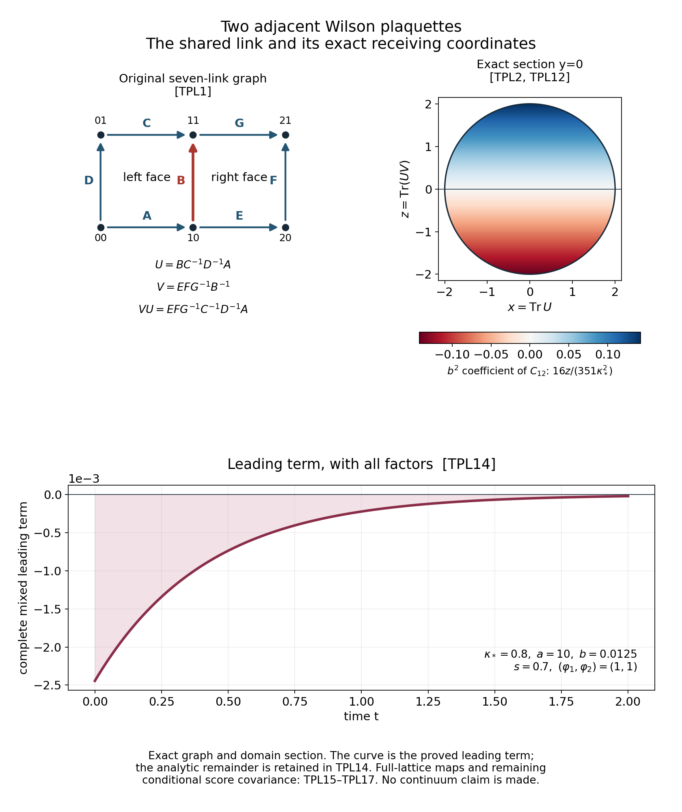

# Two adjacent Wilson plaquettes: exact trace geometry and mixed orientation

Reviewed derivation, 14 October 2026. The objects are seven original radius-two SU(2) links on two adjacent squares. All link factors, the shared edge, the two-face potential, its constant term, the ground energy and all 128 central signs are retained. This calculation extends the actual one-face mechanism in [OPC1–OPC8](https://github.com/KokunoYumeto/yang-mills-interacting-workbench/blob/bb5761720a9a27ad0c178c9743c0d1b2e7dca591/yang-mills/continuations/20261011-central-signs-shrinking-window/ACTUAL_ONE_PLAQUETTE_ORIENTATION.md). Its conditional form is the specialization of [MTO17–MTO20](https://github.com/KokunoYumeto/yang-mills-interacting-workbench/blob/bb5761720a9a27ad0c178c9743c0d1b2e7dca591/yang-mills/continuations/20261011-central-signs-shrinking-window/ACTUAL_MIXED_TIME_EVOLUTION.md). Twelve disk-index hits were routing records; none was used as a newly read external theorem. No novelty claim is made.

## 1. The seven-link object and its complete gauge map

Place vertices at (0,0),(1,0),(2,0),(0,1),(1,1),(2,1). The positively oriented link matrices, with their original endpoints, are
\[
\begin{gathered}
A:00\to10,\quad B:10\to11,\quad C:01\to11,\quad D:00\to01,\\
E:10\to20,\quad F:20\to21,\quad G:11\to21.
\end{gathered}
\]
Capital B denotes a link; the scalar coupling remains \(b=1/(\kappa_*a^2)\). The common-root holonomies at vertex 10 are
\[
U=BC^{-1}D^{-1}A,\quad V=EFG^{-1}B^{-1},\qquad
x=\operatorname{Tr}U,\quad y=\operatorname{Tr}V,\quad z=\operatorname{Tr}(UV).
\tag{TPL1}
\]
The perimeter word is \(VU=EFG^{-1}C^{-1}D^{-1}A\). The shared B and its inverse cancel in this word, without deleting their contributions to the individual holonomies.

The edges A,B,D,E,F form a spanning tree. The five nonroot vertex transformations can set these five links to the identity, successively from the root. The two remaining matrices give U and V. The root transformation conjugates them simultaneously. Conversely two configurations with simultaneously conjugate U,V are related by these tree transformations and the root transformation. This proves the complete physical orbit map. Conditional on the five tree links, the changes from C,G to U,V are inversion and fixed left/right multiplication; they preserve product probability Haar measure. Thus U and V are independent Haar variables before quotienting by simultaneous conjugation. The other five probability Haar integrals equal one.

Write \(U=u_0I-i\mathbf u\cdot\boldsymbol\sigma\), \(V=v_0I-i\mathbf v\cdot\boldsymbol\sigma\). Then
\[
x=2u_0,\quad y=2v_0,\quad z=2(u_0v_0-\mathbf u\cdot\mathbf v),
\quad |\mathbf u|^2=1-x^2/4,\quad |\mathbf v|^2=1-y^2/4.
\]
Simultaneous SU(2) conjugation is simultaneous SO(3) rotation of these two real vectors. Their lengths and dot product determine their orbit: when independent, the two ordered frames completed by their cross products give an orientation-preserving isometry; when dependent or zero, first identify their nonzero span and extend to an oriented orthonormal frame. Hence x,y,z classify every orbit, including the degenerate ones. Their exact domain is
\[
\begin{gathered}
\Omega=\{(x,y,z)\in[-2,2]^3:\mathcal D(x,y,z)\ge0\},\\
\mathcal D=4-x^2-y^2-z^2+xyz,\qquad
\left(z-\frac{xy}{2}\right)^2\le\frac{(4-x^2)(4-y^2)}4.
\end{gathered}\tag{TPL2}
\]
Indeed the Gram determinant of the two vectors is \(\mathcal D/4\). Conversely choose vectors with the displayed lengths and dot product whenever that Gram matrix is positive semidefinite; the displayed matrices then belong to SU(2). At x=2 or x=-2 the inequality forces z=xy/2, exactly as the original matrices do. The y endpoints behave identically. This proves both onto and one-to-one statements for the orbit space.

The individual trace densities are \(\sqrt{4-x^2}/(2\pi)\) and \(\sqrt{4-y^2}/(2\pi)\). Conditional on these traces, the cosine of the angle of the two directions is uniform on [-1,1]. Since
\(z=xy/2-\sqrt{(4-x^2)(4-y^2)}\cos\theta/2\),
its conditional density is \(1/\sqrt{(4-x^2)(4-y^2)}\) on its entire allowed interval. Multiplication gives
\[
d\nu_\Omega=\frac{dx\,dy\,dz}{4\pi^2}\bigg|_\Omega,\qquad
\operatorname{vol}(\Omega)=4\pi^2,\qquad
\|F\|^2=\frac1{4\pi^2}\int_\Omega|F(x,y,z)|^2dx\,dy\,dz.
\tag{TPL3}
\]
The trace endpoint sets have zero Haar measure, so this density includes the entire measure without additional singular masses. Integrating the interval length \(\sqrt{(4-x^2)(4-y^2)}\) verifies the volume and every factor in TPL3.

## 2. The original kinetic operator, including the shared edge

The orthonormal generators on each original radius-two link are \(T_\alpha=-i\sigma_\alpha/2\). At the tree representative, a left variation of the shared link gives \(U\mapsto e^{tT_\alpha}U\), \(V\mapsto V e^{-tT_\alpha}\). The three unshared edges of each face contribute its three full Casimirs. Consequently on simultaneous-conjugation invariant functions of U,V the seven-link operator is exactly
\[
\Delta_7=3\Delta_U+3\Delta_V+
\sum_{\alpha=1}^3(\mathcal L_\alpha^U-\mathcal R_\alpha^V)^2
=4\Delta_U+4\Delta_V-2\sum_\alpha\mathcal L_\alpha^U\mathcal R_\alpha^V.
\tag{TPL4}
\]
For another tree representative the generator bases are conjugated, which preserves their summed contractions. Thus this is an identity for the original gauge-invariant functions, not an altered product metric on two independent links.

The Pauli entries give
\(\sum_\alpha(T_\alpha)_{ij}(T_\alpha)_{kl}
=-\delta_{il}\delta_{jk}/2+\delta_{ij}\delta_{kl}/4\).
Contracting against arbitrary two matrices proves
\[
\sum_\alpha\operatorname{Tr}(T_\alpha M)\operatorname{Tr}(T_\alpha N)
=-\frac12\operatorname{Tr}(MN)+\frac14\operatorname{Tr}M\operatorname{Tr}N.
\]
It follows, with \(q=(x,y,z)\), that the full matrix \(\Gamma_{ij}=\langle dq_i,dq_j\rangle\) and drift are
\[
\Gamma=
\begin{pmatrix}
4-x^2&z/2-xy/4&3y/2-3xz/4\\
z/2-xy/4&4-y^2&3x/2-3yz/4\\
3y/2-3xz/4&3x/2-3yz/4&6-3z^2/2
\end{pmatrix},\qquad
d=(-3x,-3y,-9z/2),
\tag{TPL5}
\]
and
\(\Delta_7F=\sum_{i,j=1}^3\Gamma_{ij}\partial_i\partial_jF+\sum_jd_j\partial_jF\).
Both off-diagonal entries contribute to each mixed derivative.

Here are the original edge contractions establishing every entry. Each of four face edges gives \(1-x^2/4\), respectively \(1-y^2/4\). Only the shared edge contributes to \(\Gamma_{xy}\), with the opposite signs of its two variations, giving z/2-xy/4. The perimeter is independent of B, and each of its six edges gives \(1-z^2/4\). The three outer left edges contribute to \(\Gamma_{xz}\); each contraction equals y/2-xz/4. For example the displayed trace identity and \(U^2-xU+I=0\) give \(-\operatorname{Tr}(U^2V)/2+xz/4=y/2-xz/4\). The same three right-edge contractions give x/2-yz/4. Inverse orientations give the same entries because both trace derivatives acquire the same sign and conjugated generator. Finally each occurrence of a link in one of these words has Casimir -3/4; four and six occurrences give exactly d. This also verifies TPL4 directly on all trace coordinate derivatives.

The complete divergence and boundary identities, without removing the polynomial \(\mathcal D\), are
\[
\begin{gathered}
\sum_i\partial_i\Gamma_{ij}=d_j,\qquad
\Gamma\nabla\mathcal D=-\mathcal D(2x,2y,3z)^T,\\
\det\Gamma=\frac3{16}\mathcal D
(128-12x^2-12y^2-3xyz-2z^2).
\end{gathered}\tag{TPL6}
\]
These identities follow by multiplying the displayed matrix and collecting all polynomial terms. Positivity of \(\Gamma\) also follows directly from its seven-link gradient definition. It is strictly positive on \(\mathcal D>0\): the lengths and relative angle of the two noncollinear vectors are independent local coordinates there, so the trace map has rank three; the three unshared Casimirs on each factor already give a positive metric on its cotangent image. On a smooth boundary stratum the displayed normal contraction vanishes. At singular strata the integration identity is inherited from the compact link manifold; no additional boundary flux is introduced.

Specifically the physical form is the closure of the original smooth gauge-invariant form, with its exact norm TPL3 and energy
\[
\mathcal E_7(F,G)=\frac{\kappa_*}{4\pi^2}
\int_\Omega\sum_{i,j}\overline{\partial_iF}\Gamma_{ij}\partial_jG\,dx\,dy\,dz.
\]
This domain is defined by the original smooth lifts and their form completion, including the singular boundary orbits. The compact-link integration by parts proves the divergence expression and specifies its self-adjoint operator. An independently chosen Dirichlet or Neumann condition on the drawn solid would not specify this original domain.

## 3. The actual Wilson ground requires the perimeter coordinate

Keep the original operator and its unit positive physical ground:
\[
H_2=-\kappa_*\Delta_7+4b-b(x+y),\qquad
H_2\psi_b=E_2(b)\psi_b,\qquad
\int_\Omega\psi_b^2d\nu_\Omega=1.
\tag{TPL7}
\]
The compact elliptic seven-link Hamiltonian has a simple positive smooth ground. Positivity follows from its strictly positive heat kernel, and gauge invariance follows from uniqueness. Its reduced representative is smooth on the interior of TPL2.

For every b>0 this ground is not a function of x,y alone. To prove the claim, suppose it were \(F(x,y)\). The only z-dependent term in its equation is \(-\kappa_*zF_{xy}\), from the two mixed entries of TPL5. The allowed z interval has positive length for all -2<x,y<2. Thus \(F_{xy}=0\) throughout that rectangle and \(F=f(x)+g(y)\). Taking the x,y mixed derivative of its remaining equation gives
\(-b[f'(x)+g'(y)]=0\).
Hence \(f'=c\), \(g'=-c\) and \(F=c(x-y)+d\). Substitution into the complete equation gives
\[
(3\kappa_*+4b-E_2)c(x-y)+(4b-E_2)d
-bc(x^2-y^2)-bd(x+y)=0.
\]
Its quadratic coefficients force c=0, and its linear coefficients then force d=0. This contradicts its positive unit norm. This argument neither drops the original energy nor assigns it a value. It proves the specific missing coordinate and supplies its exact domain and differential operator in TPL2–TPL6.

There is also an immediate dynamical calculation. Put \(S=x+y\), \(W=4b-bS\) and \(v(t)=e^{-tH_2}1\). Retaining all terms gives
\[
\begin{gathered}
H_2^2 1=W^2-3\kappa_*bS,\\
H_2^3 1=W^3-9\kappa_*bWS-9\kappa_*^2bS
-2\kappa_*b^2(8-x^2-y^2+z-xy/2),\\
\partial_zv(t,q)=\frac{\kappa_*b^2}{3}t^3+O_K(t^4)
\quad(t\downarrow0),\qquad K\Subset\Omega^\circ.
\end{gathered}\tag{TPL8}
\]
Indeed \(\Delta_7W=3bS\) and \(\Gamma(W,W)=b^2(8-x^2-y^2+z-xy/2)\); applying \(-\kappa_*\Delta_7+W\) to the second power proves the third power. The heat Taylor expansion has alternating signs, so its third term gives the stated positive coefficient. To justify its remainder, the smooth function 1 belongs to every power domain of the compact elliptic Hamiltonian. Integrating its fourth time derivative bounds the remainder in every fixed Sobolev norm, after choosing enough powers of H. A smooth local section of the orbit map on K converts that bound to a trace-coordinate C1 bound. Thus \(\partial_zv>0\) on every such K for all sufficiently small positive t. This is a proved short-time statement, not an assertion about all times.

The exact differentiated heat equation records the next source that would have to be controlled. For \(q=\partial_zv\),
\[
\partial_tq=\kappa_*\left[
\Delta_7q-\frac32xq_x-\frac32yq_y-3zq_z-\frac92q+v_{xy}
\right]-(4b-bx-by)q.
\tag{TPL9}
\]
Differentiating the entire TPL5 gives each term: the derivative of the two xy coefficients is one, those of the xz,yz coefficients give -3x/2 and -3y/2, and the zz coefficient and z drift give -3z and -9/2. The forcing \(\kappa_*v_{xy}\) is retained. A scalar maximum principle alone does not determine its sign.

## 4. Exact first ground coefficients and the shared covariance

The following expansion is about b=0 with \(\kappa_*>0\) fixed. It is not an estimate on the original shrinking-spacing path, where b increases. The original spacing is always recovered by \(a=(\kappa_*b)^{-1/2}\) for b>0; all observable factors of a remain explicit. Small b is a small magnetic-potential coefficient; it is not the small-spacing regime of the original regulator path.

The ground 1 of \(-\kappa_*\Delta_7\) is isolated and simple on the connected compact link manifold. Multiplication by \(4-S\) is bounded. A resolvent Neumann series on a fixed circle around the ground eigenvalue gives an analytic spectral projection for small b. Applying it to 1 and choosing its positive unit norm produces an analytic real ground \(\psi_b\). Elliptic regularity applied successively to its equation upgrades the expansion to every smooth norm on the original compact manifold, hence to every trace-coordinate Ck norm on interior compact subsets. With that specified choice of ground norm,
\[
\begin{aligned}
E_2(b)&=4b-\frac{2b^2}{3\kappa_*}+O(b^4),\\
\psi_b&=1+\frac{b}{3\kappa_*}(x+y)\\
&\quad+b^2\left[
\frac{x^2+y^2-2}{24\kappa_*^2}
+\frac{4xy}{39\kappa_*^2}
+\frac{8z}{351\kappa_*^2}
-\frac1{9\kappa_*^2}\right]+O(b^3).
\end{aligned}\tag{TPL10}
\]
Here is the full coefficient calculation. Haar gives \(\langle x\rangle=\langle y\rangle=0\), \(\langle x^2\rangle=\langle y^2\rangle=1\), \(\langle xy\rangle=\langle z\rangle=0\). At order b the mean equation gives E1=4, and \(-\kappa_*\Delta_7\psi_1=S\) gives \(\psi_1=S/(3\kappa_*)\). At order b2 the mean equation gives \(E_2^{[2]}=-\langle S\psi_1\rangle=-2/(3\kappa_*)\), and the nonconstant equation is
\(-\kappa_*\Delta_7\psi_2=(x^2+y^2-2+2xy)/(3\kappa_*)\).
Directly from TPL5,
\[
\Delta_7(x^2+y^2-2)=-8(x^2+y^2-2),\quad
\Delta_7(xy)=z-13xy/2,\quad \Delta_7z=-9z/2.
\]
Solving all three coefficients gives respectively \(1/(24\kappa_*^2)\), \(4/(39\kappa_*^2)\) and \(8/(351\kappa_*^2)\). The unit norm requires \(2\langle\psi_2\rangle+\langle\psi_1^2\rangle=0\), giving the remaining constant \(-1/(9\kappa_*^2)\). Finally the central map \((x,y,z)\mapsto(-x,-y,z)\) conjugates \(H_2(b)-4b\) to \(H_2(-b)+4b\). Its simple ground energy is even, proving the O(b4) energy remainder. In particular the actual ground has \(\partial_z\psi_b=8b^2/(351\kappa_*^2)+O_K(b^3)>0\) on each fixed interior K for sufficiently small b>0.

The seven-link sign group has 128 elements. Write R1 for the four left-face edges and R2 for the four right-face edges. Their symmetric difference is the six-edge perimeter. The character map \(\tau\mapsto(\sigma_1,\sigma_2)=(\chi_{R_1}(\tau),\chi_{R_2}(\tau))\) is onto, each fiber has 32 elements, and
\((x,y,z)\mapsto(\sigma_1x,\sigma_2y,\sigma_1\sigma_2z)\).
The exact actual density, all individual probabilities and the three cycle moments are
\[
\begin{gathered}
A_b^2(q)=\frac14\sum_{\sigma_1,\sigma_2=\pm1}
\psi_b(\sigma_1x,\sigma_2y,\sigma_1\sigma_2z)^2,\\
p_\tau(q)=\frac{\psi_b(\sigma_1x,\sigma_2y,\sigma_1\sigma_2z)^2}{128A_b^2(q)},\qquad
r_i=\sum_\tau p_\tau\chi_{R_i}(\tau),\quad
r_{12}=\sum_\tau p_\tau\chi_{R_1\triangle R_2}(\tau),\\
C_{\rm cyc}=\begin{pmatrix}
1-r_1^2&r_{12}-r_1r_2&r_2-r_1r_{12}\\
r_{12}-r_1r_2&1-r_2^2&r_1-r_2r_{12}\\
r_2-r_1r_{12}&r_1-r_2r_{12}&1-r_{12}^2
\end{pmatrix}.
\end{gathered}\tag{TPL11}
\]
Uniform summation in each 32-element fiber makes all other nonempty moments zero. The vertex central-gauge condition says a physical character coefficient must have even degree at each vertex. Choosing its values on the two chords uniquely determines its values on the tree by successively removing leaves. Thus precisely the three displayed nonempty cycles survive among the full 127 coefficient indices; the other 124 physical coefficients vanish. They are not zero covariance directions: the full matrix \(C_{ST}=r_{S\triangle T}-r_Sr_T\), S,T nonempty, is positive definite. In fact its quadratic form is the variance of \(\sum_{S\ne\varnothing}c_S\chi_S\) in a probability distribution positive at every sign. A zero variance would make this character sum constant at every sign, and full finite character orthogonality then forces every cS=0. The cycle-to-noncycle entries vanish, so restriction to TPL11 is exact.

Substituting every coefficient of TPL10 into these full sums gives
\[
\begin{gathered}
A_b^2=1+\frac{7b^2}{36\kappa_*^2}(x^2+y^2-2)+O(b^4),\\
r_1=\frac{2b}{3\kappa_*}x+O(b^3),\qquad
r_2=\frac{2b}{3\kappa_*}y+O(b^3),\\
r_{12}=\frac{b^2}{351\kappa_*^2}(150xy+16z)+O(b^4),\\
(C_{\rm cyc})_{12}
=\frac{b^2}{351\kappa_*^2}(16z-6xy)+O(b^4).
\end{gathered}\tag{TPL12}
\]
Indeed the \(x^2+y^2\) coefficient in \(\psi_b^2\) is \((1/9+1/12)/\kappa_*^2=7/(36\kappa_*^2)\), its constant coefficient is \(-7/(18\kappa_*^2)\), its xy coefficient is \((2/9+8/39)/\kappa_*^2=150/(351\kappa_*^2)\), and its z coefficient is \(16/(351\kappa_*^2)\). The four-sign sums retain the indicated characters. Subtracting r1r2 contributes \(-156xy/(351\kappa_*^2)\) in the last line. The central b-reflection just proved makes A2,r12 and C12 even and r1,r2 odd, giving the stated remainder orders. In particular at x=y=0 the covariance C12 has the sign of z for small b and fixed nonzero |z|<2. A constant componentwise sign assertion for the cycle covariance would fail even in this actual state for small b.

## 5. The actual two-face mixed sign at small b

All raw samples \(\varphi_1,\varphi_2\in\mathbb C\) are retained. Use the original centered observable and conditional source
\[
\begin{gathered}
X_\varphi=\frac a2\big[\varphi_1(\mu_bx-x)+\varphi_2(\mu_by-y)\big],\\
x_\varphi=\frac a2\big[\varphi_1(\mu_bx-xr_1)+\varphi_2(\mu_by-yr_2)\big],\qquad
d^X=-\frac a2(\varphi_1x,\varphi_2y,0)^T,\\
L_{A_b}=-\kappa_*[\Delta_7+2\langle d\log A_b,d\,\cdot\,\rangle],\quad
f_{s,\varphi}=(L_{A_b}+s)^{-1}x_\varphi,\quad s>0,\\
\beta_{s,\varphi}=-\kappa_*C_{\rm cyc}^{-1}
\big(\langle dr_1,df\rangle,\langle dr_2,df\rangle,\langle dr_{12},df\rangle\big)^T.
\end{gathered}
\]
Here s is the positive resolvent shift, distinct from the perimeter coordinate z. The metric in every contraction is the full matrix TPL5. The complete restricted form and coefficient operator are
\[
\begin{gathered}
\|c\|_b^2=\int_\Omega A_b^2 c^*C_{\rm cyc}c\,d\nu_\Omega,\\
q_b(c,d)=\kappa_*\int_\Omega A_b^2\sum_{i,j}\Gamma_{ij}
\big[(\partial_ic)^*C_{\rm cyc}\partial_jd+
\overline{(\partial_ir)^Tc}(\partial_jr)^Td\big]d\nu_\Omega,\\
\mathscr D_b=-\kappa_*A_b^{-2}C_{\rm cyc}^{-1}
\sum_{i,j}\partial_i(A_b^2\Gamma_{ij}C_{\rm cyc}\partial_j)
+\kappa_*C_{\rm cyc}^{-1}\sum_{i,j}\Gamma_{ij}(\partial_ir)(\partial_jr)^T.
\end{gathered}\tag{TPL13}
\]
The domain is the original closed physical coefficient form: c1,c2,c12 transform respectively by sigma1,sigma2,sigma1sigma2 under the four center maps, and their lifts are gauge invariant. TPL13 follows from the full MTO17–MTO18 form and the proved cycle restriction; it retains both derivative terms and the entire multiplication term. No independent boundary condition or positivity cone is imposed.

For every finite T>=0 and every compact interval \(0<s_-\le s\le s_+<\infty\), the actual full mixed correlation satisfies, uniformly for 0<=t<=T,
\[
\begin{aligned}
\langle Bf_{s,\varphi},e^{-tD}y_\varphi\rangle
&=\langle\beta_{s,\varphi},e^{-t\mathscr D_b}d^X\rangle_b\\
&=-\frac{4a^2b^2e^{-3\kappa_*t}}{9\kappa_*(8\kappa_*+s)}
(|\varphi_1|^2+|\varphi_2|^2)
+a^2O_{T,s_-,s_+}(b^3)(|\varphi_1|^2+|\varphi_2|^2).
\end{aligned}\tag{TPL14}
\]
Consequently there is a positive b0, depending only on this fixed kappa,T and shift interval, for which the actual correlation is strictly negative for every 0<b<b0, every such t,s and every nonzero pair of raw samples. The error term is an actual analytic remainder proved below; it is not an assumed sign condition on an unknown state.

First \(\mu_bx=\mu_by=2b/(3\kappa_*)+O(b^3)\). TPL12 and \(\Delta_7(1-x^2)=-8(1-x^2)\), together with its y version, therefore give
\[
\begin{gathered}
f_{s,\varphi}=\frac{ab}{3\kappa_*(8\kappa_*+s)}
[\varphi_1(1-x^2)+\varphi_2(1-y^2)]+aO(b^2)|\varphi|,\\
(\beta_{s,\varphi})_1=\frac{4ab^2}{9\kappa_*(8\kappa_*+s)}
[\varphi_1x\Gamma_{xx}+\varphi_2y\Gamma_{xy}]+aO(b^3)|\varphi|,\\
(\beta_{s,\varphi})_2=\frac{4ab^2}{9\kappa_*(8\kappa_*+s)}
[\varphi_1x\Gamma_{xy}+\varphi_2y\Gamma_{yy}]+aO(b^3)|\varphi|,\qquad
(\beta_{s,\varphi})_{12}=aO(b^3)|\varphi|.
\end{gathered}
\]
At b=0, A2=1, C=I and \(\mathscr D_0=-\kappa_*\Delta_7\) componentwise. Hence \(e^{-t\mathscr D_0}d^X=e^{-3\kappa_*t}d^X\). The exact Haar contractions are
\[
\begin{gathered}
\int x^2\Gamma_{xx}d\nu_\Omega=4\langle x^2\rangle-\langle x^4\rangle=4-2=2,\qquad
\int y^2\Gamma_{yy}d\nu_\Omega=2,\\
\int xy\Gamma_{xy}d\nu_\Omega
=\frac12\langle xyz\rangle-\frac14\langle x^2y^2\rangle
=\frac14-\frac14=0.
\end{gathered}
\]
The fourth trace moment 2 follows by integrating the original semicircle density. Independence gives \(\langle x^2y^2\rangle=1\), and the exact conditional mean \(\mathbb E[z\mid x,y]=xy/2\) gives \(\langle xyz\rangle=1/2\). Thus the off-diagonal raw-sample terms cancel in this integral, while both diagonal terms give the coefficient in TPL14.

For completeness, the remainders and uniform sign use the full operators. All densities and their derivatives are analytic in b on the compact original manifold near zero, with A2 and the finite covariance uniformly positive. Multiplication by \(A_bC_{\rm cyc}^{1/2}\) identifies the coefficient spaces with a fixed Hilbert space; it respects the center transformation law, since the covariance conjugates by the same diagonal character signs. On the compact seven-link lift the transformed operators have the same elliptic principal part and differ from their b=0 value by O(b) as maps from H2 to L2. Their closed physical domains are the gauge and finite-center fixed subspaces of these Sobolev domains. The resolvent identity, the positive lower bound s_- and elliptic regularity give the stated expansion of f/a with all needed derivatives. In the semigroup expansion the exact Duhamel difference on the smooth vector dX/a is an integral of the O(b) operator difference applied to \(e^{-u\mathscr D_0}dX/a\). This vector is a fixed smooth eigenfunction times an exponential. Uniform equivalence of the Hilbert norms and bounded semigroups on 0<=t<=T bound the integral by O_T(b). The same argument applies to the identifying multiplication maps. Pairing with beta/a=O(b2), and expanding the inner-product weight, gives an O(b3) remainder uniformly on the indicated interval. The two-dimensional raw-sample space makes its quadratic bound uniform in phi. The leading negative coefficient has positive absolute minimum on that compact t,s set, so choosing b0 sufficiently small proves the asserted strict sign. This establishes a two-face interacting result in a specified coupling regime; it does not assert the result for b increasing along the original path.

## 6. Exact receiving maps into the original full lattice

Translate these two adjacent faces into any original open box containing them. Write \(\pi\) for their three traces, \(V_{\rm rest}=b\sum_{p\ne p_1,p_2}(2-T_p)\), and retain the entire original Hamiltonian and ground \(H\psi=E_0\psi\), \(\int\psi^2dU=1\). On every smooth pullback,
\[
\Delta_{\rm full}(F\circ\pi)=(\Delta_7F)\circ\pi,\qquad
H(F\circ\pi)=(H_2F)\circ\pi+V_{\rm rest}(F\circ\pi).
\tag{TPL15}
\]
Every omitted link derivative of this pullback is zero, but the displayed remaining potential is retained as multiplication. This proves the precise untransformed relation without claiming a factorization of the full ground.

Let \(\mu=\psi^2dU\) and define the actual pushforward density by
\(\pi_*\mu=\rho\,d\nu_\Omega\).
The same tree/Haar change of variables used in TPL3, with all remaining links integrated, constructs rho explicitly as the conditional Haar integral of the original \(\psi^2\). It lies between \(\min\psi^2>0\) and \(\max\psi^2\), and its lift to the two-holonomy space is smooth and simultaneously conjugation invariant. In particular rho is smooth on the interior trace coordinates. Put
\(JF=F\circ\pi\), \(\mathcal L=\psi^{-1}(H-E_0)\psi=-\kappa_*[\Delta_{\rm full}+2\langle d\log\psi,d\,\cdot\,\rangle]\).
J is an isometry from \(L^2(\rho d\nu_\Omega)\) onto the closed subspace of trace-measurable functions in L2(mu). Its adjoint is conditional expectation. The complete compressed form and operator are
\[
\begin{gathered}
\langle JF,\mathcal LJG\rangle
=\frac{\kappa_*}{4\pi^2}\int_\Omega\rho
\sum_{i,j}\overline{\partial_iF}\Gamma_{ij}\partial_jG\,dx\,dy\,dz,\\
\mathcal A_\Omega=J^*\mathcal LJ
=-\kappa_*\rho^{-1}\sum_{i,j}\partial_i(\rho\Gamma_{ij}\partial_j),
\end{gathered}\tag{TPL16}
\]
with the inherited closed form domain. The density here is that of the actual full ground, not \(\psi_b^2\) of the isolated two-face model. Compact-link integration by parts proves TPL16, including every boundary contribution through that domain.

The omitted dynamic coupling also has an exact expression. Let \(w=\log\psi\), \(h_j=\langle dw,d\pi_j\rangle\), \(\bar h_j=\mathbb E_\mu[h_j\mid\pi]\), \(P=JJ^*\). Then
\[
\bar h_j=\frac12\sum_i\Gamma_{ij}\partial_i\log\rho,\qquad
\mathcal K F:=(I-P)\mathcal LJF
=-2\kappa_*\sum_j(h_j-\bar h_j)(\partial_jF)\circ\pi.
\tag{TPL17}
\]
To prove the first identity, integrate h_j against a smooth compactly supported interior test phi(pi), write \(\psi^2dw=d(\psi^2)/2\), and integrate on the full compact link manifold. The result is
\(-\frac12\int\rho[d_j\phi+\sum_i\Gamma_{ij}\partial_i\phi]d\nu_\Omega\).
Using \(\sum_i\partial_i\Gamma_{ij}=d_j\) makes this exactly
\(\frac12\int\phi\sum_i\Gamma_{ij}\partial_i\rho\,d\nu_\Omega\).
This proves the conditional identity almost everywhere and on the interior. Subtracting the conditional expectation of the complete ground generator gives the second identity. In particular its exact nonnegative squared norm is
\[
\|\mathcal KF\|^2=4\kappa_*^2\int_\Omega\rho
\sum_{i,j}\overline{\partial_iF}\,
\mathbb E_\mu[(h_i-\bar h_i)(h_j-\bar h_j)\mid\pi]\,
\partial_jF\,d\nu_\Omega.
\]
Thus the extension to the full lattice is a definite conditional score covariance calculation, not a missing unnamed relation. TPL14 supplies the actual two-face sign at small b. TPL15–TPL17 specify exactly which remaining potential and full-state conditional scores must be evaluated to carry it into the original regulator and its signed shrinking spectral windows. No continuum state or global no-gap theorem is claimed here.

## 7. Every remaining covariance block and its full inverse

The preceding restriction retains a particularly explicit full covariance. Let \(\mathcal H=\{\varnothing,R_1,R_2,R_1\triangle R_2\}\) inside the group of all 128 edge subsets, and write \(P_\sigma=32p_\tau\) for any tau in its sigma fiber. Each P is positive and their sum is one. The 124 noncycle indices split into 31 disjoint cosets \(S\triangle\mathcal H\). The full 127-index matrix has its three-dimensional cycle block TPL11 and these 31 four-dimensional blocks; cross entries between distinct blocks are zero. On one such coset, indexed by h,k in H, the exact block and inverse are
\[
\begin{gathered}
C^{(S)}_{h,k}=r_{h\triangle k},\qquad r_\varnothing=1,\\
(C^{(S)})^{-1}_{h,k}=\frac1{16}
\sum_{\sigma_1,\sigma_2=\pm1}\frac{\chi_h(\sigma)\chi_k(\sigma)}{P_\sigma},\\
(C_{\rm cyc}^{-1})_{i,j}=\frac1{16}
\sum_{\sigma_1,\sigma_2=\pm1}\frac{\chi_i(\sigma)\chi_j(\sigma)}{P_\sigma},
\qquad i,j\in\{R_1,R_2,R_1\triangle R_2\}.
\end{gathered}\tag{TPL18}
\]
For the noncycle blocks the moment-subtraction term vanishes; a difference outside H also has zero moment. This proves every block and cross entry. The four-character matrix has entries chi_h(sigma), its product with its transpose is 4I, and it diagonalizes each displayed block with eigenvalues \(4P_\sigma\). Multiplying these matrices gives the stated inverse with its full factor 1/16. For the cycle inverse, consider the full four-by-four moment matrix in the basis consisting of the empty character followed by the three cycles. It is \(\begin{pmatrix}1&r^T\\r&M\end{pmatrix}\), and its Schur complement of the first entry is exactly \(M-rr^T=C_{\rm cyc}\). Its full inverse has lower block \(C_{\rm cyc}^{-1}\), as follows by multiplying the two elementary triangular block eliminations. The four-character diagonalization therefore gives the last formula as well. This accounts for all 3+31(4)=127 original indices and every inverse block, while the physical restriction still sets the other 124 coefficients to zero.

Upper left: all seven oriented links, both common-root holonomies and the six-edge perimeter, as defined in TPL1. Upper right: the exact y=0 section of TPL2; the color records the full \(b^2\) coefficient of the off-diagonal covariance in TPL12 at kappa=0.8, with zero at z=0. This is a section of the three-dimensional trace domain. Below: the complete leading term of TPL14 with \(\kappa_*=0.8\), \(a=10\), \(b=1/(\kappa_*a^2)=0.0125\), \(s=0.7\) and raw samples (1,1). The analytic remainder is retained in TPL14; the curve is not asserted to be the exact correlation at that finite coupling. All 128 probabilities and 127 covariance indices are accounted for in TPL11 and TPL18. Reproducible source: [figure_two_plaquette.py](figure_two_plaquette.py). The inherited center-multiplication human provenance is L. Li and Y. Meurice, [arXiv:hep-lat/0410029v2](https://arxiv.org/abs/hep-lat/0410029v2), Sections II–IV and Appendix, through the retained CS/CK author-source record; no new external reading is claimed.

The 168 diagnostic checks in [check_two_plaquette.py](check_two_plaquette.py) verify polynomial identities, derivatives on the original seven matrices, complete finite-sign algebra, all raw complex leading pairings and exact-degree Haar quadrature. A polynomial test density in those checks is expressly not an exact Wilson ground. The complete proofs, rather than those diagnostics, establish the actual ground and semigroup claims.

## Actual full-state marginal ground and nonzero trace memory

[FMP1–FMP13](https://github.com/KokunoYumeto/yang-mills-interacting-workbench/blob/main/yang-mills/continuations/20261011-central-signs-shrinking-window/FULL_STATE_MARGINAL_GROUND.md) prove the actual full-lattice marginal equation with every remaining Wilson face, the original vacuum energy and both conditional score contributions retained. A global SU(2) loop-gradient argument shows that a smooth first integral is constant, for every loop length and arbitrary positive original link weights. Applied to the original seven-link patch and an explicit crossing Wilson face, this gives
\[
\|\mathcal Kx\|^2=\|\mathcal Ky\|^2>0,\qquad
\langle\mathcal Kx,e^{-t\mathcal D}\mathcal Kx\rangle>0
\quad(t\ge0)
\]
at every original regulator, with equal diagonal memory for y and strict positive-shift resolvent memory. This is the complement of trace-measurable functions in the actual full-ground measure, whose entire receiving maps and operator domains are proved. Its nonzero coupling is established beyond the earlier two-face expansion about b=0. The original single-face observable retains its full quadratic factor \(a^2/4\). Regulator-uniform shrinking-window weight, the signed three-shift combination and the smooth global no-gap construction remain active.
