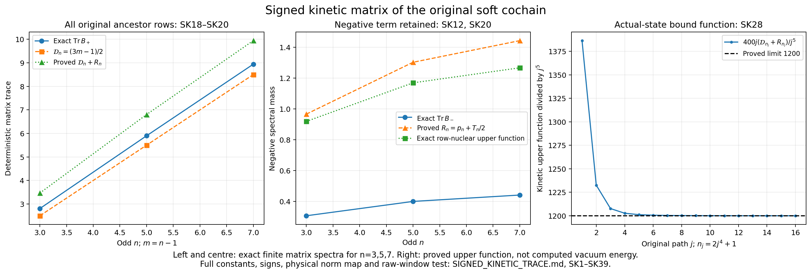

# The full root-score matrix and the original signed kinetic trace

This continuation proves a bound on the actual vacuum score covariance in
all original root-frame directions. It evaluates the signed kinetic
matrix of DP41/WC52 using every original ancestor coefficient. Its
positive trace is asymptotic to the exact ancestor mass
\((3m-1)/2\), with an explicit logarithmic remainder. The original
double-commutator kinetic upper function becomes
\(1200j^5+O(j\log j)\). This is an upper function, not an asymptotic
formula for an unknown vacuum energy. The original raw window is retained,
and its physical variable-colour covariance is calculated below.

All arguments concern the positive physical ground state of the full
finite product Hamiltonian. No product law for its links, small root
transport, rescaling of the phase, or sign of its endpoint is assumed.
The complete earlier RH, DP and WC proofs are linked below with pinned versions in the source-use ledger. Their proof locators identify the earlier inputs; every new argument appears here.

## 1. Original geometry, frame, and full covariance

Let \(L\ge1\), \(m=2L\), \(n=m+1\). The vertices are
\(o+a(i-L,k-L,l-L)\), \(0\le i,k,l\le m\), with every positive
nearest-neighbour edge and every elementary face of the open cube.
An edge is \(e=(d,i,k,l)\); its coordinate in direction \(d\)
runs through \(0,\ldots,m-1\) and the other two coordinates through
\(0,\ldots,m\). Thus \(N=3mn^2\) and \(M=3m^2n\).
Every factor has probability Haar and the radius-two metric on
\(SU(2)\). With \(T_\alpha=-i\sigma_\alpha/2\), retain
\[
 \begin{gathered}
 X_{e\alpha}f=\left.\partial_t f(\ldots,e^{tT_\alpha}U_e,\ldots)
                  \right|_{t=0},\qquad
 \Delta=\sum_{e,\alpha}X_{e\alpha}^2,\\
 U_p=U_d(x)U_r(x+e_d)U_d(x+e_r)^{-1}U_r(x)^{-1}\quad(d<r),\\
 W=\sum_p(2-\operatorname{tr}U_p),\quad
 H=-\kappa\Delta+bW,\quad
 \kappa=2g^2/a,\quad b=1/(2g^2a),\quad \xi=b/\kappa,\\
 H\psi=E_0\psi,\quad \psi>0,\quad \|\psi\|_{dU}=1,\quad
 w=\log\psi,\quad d\mu=\psi^2dU,\quad \rho=\sqrt\xi.
 \end{gathered}\tag{SK1}
\]
In particular \(2bM\) remains in the potential. The physical gauge
action is \(U_{st}\mapsto h_sU_{st}h_t^{-1}\) at every original
vertex, including boundary vertices. The positive ground state is
invariant. The ground-state form identity is
\(\langle f\psi,(H-E_0)f\psi\rangle=\kappa\mu|\nabla f|^2\);
expanding the left side and integrating the Laplacian proves it.
It also proves uniqueness of the positive unit ground state, since a
second ground vector divided by \(\psi\) has zero gradient.

The original tree and rooted words are
\[
 t_{i,k,l}=\left(\prod_{r<l}U_3(0,0,r)\right)
           \left(\prod_{s<k}U_2(0,s,l)\right)
           \left(\prod_{t<i}U_1(t,k,l)\right),\qquad
 Z_e=t_{s(e)}U_et_{t(e)}^{-1}.                         \tag{SK2}
\]
Every product is ordered increasingly. A tree edge \(f\prec e\)
means that \(f\) belongs to the root path to \(s(e)\); a chord is
never an ancestor. In particular this is a strict relation. Define
\[
 E_{e\alpha}=\operatorname{Ad}_{t_{s(e)}^{-1}}\mathbf e_\alpha\cdot X_e,
 \qquad
 \nabla_{E_{e\alpha}}E_{f\beta}
 =-\left(\mathbf1_{e\prec f}+\frac12\delta_{ef}\right)
                 E_{f,\mathbf e_\alpha\times\mathbf e_\beta}.
 \tag{SK3}
\]
Here is the complete frame verification. Its coefficient does not
depend on its own edge, so each field is Haar divergence free. Each
edge block is an orthogonal rotation and its derivatives along that
same edge vanish, giving \(\Delta=\sum E_{e\alpha}^2\).
Differentiating a root transport in an ancestor direction gives the
negative adjoint rotation in (SK3). For the same edge the
bi-invariant connection is one half of
\([X_\alpha,X_\beta]=-\epsilon_{\alpha\beta\gamma}X_\gamma\).
For different non-ancestor edges both terms are zero. These cases
prove (SK3) with every connection term and its sign.

The proved vacuum input is
\[
                         \nabla^2w\succeq-2\rho g.       \tag{SK4}
\]
For completeness, its stationary argument is retained. Differentiating
\(\Delta w+|\nabla w|^2=(bW-E_0)/\kappa\) twice on the locally
symmetric product gives, with \(h_w=\nabla^2w\),
\[
 \kappa^{-1}\nabla^2(bW)_{ij}
 = (\Delta+2\nabla w\cdot\nabla)(h_w)_{ij}+2(h_w^2)_{ij}
 +2\mathscr R_{ikjl}(h_w)_{kl}
 -\operatorname{Ric}_{ik}(h_w)_{kj}-\operatorname{Ric}_{jk}(h_w)_{ik}
 +2\mathscr R_{ikjl}w_kw_l.                            \tag{SK5}
\]
The curvature is
\(\mathscr R(v,z,v,z)=\sum_e(|v_e|^2|z_e|^2-
\langle v_e,z_e\rangle^2)/4\) and \(\operatorname{Ric}=g/2\).
The scalar derivative commutator is
\(\nabla_i(h_w)_{jk}-\nabla_k(h_w)_{ij}=\mathscr R_{ikjl}w_l\);
using it in the two differentiated terms proves (SK5).
At a negative global minimum eigenvalue \(\lambda\) of \(h_w\),
extend its unit eigenvector radially. The drift Laplacian is
nonnegative there. The curvature/Ricci combination is
\(2\operatorname{tr}[\mathscr R(v,\cdot,v,\cdot)(h_w-\lambda g)]\ge0\),
and the last term is nonnegative. Hence
\(2\lambda^2\le\kappa^{-1}\nabla^2(bW)(v,v)\).
All sixteen ordered second derivatives of each four-letter face give
\(|\nabla^2(2-\operatorname{tr}U_p)(y,y)|
 \le\frac12(\sum_{e\in\partial p}|y_e|)^2
 \le2\sum_{e\in\partial p}|y_e|^2\).
Every edge belongs to at most four faces, including boundary edges.
Thus \(\nabla^2(bW)\preceq8bg\), proving (SK4). This is the
RH18–RH20/OS/HVR argument, with its enclosed original provider proof.

Set \(g_{e\alpha}=E_{e\alpha}w\) and let the full matrix be
\(\mathsf M_{e\alpha,f\beta}=\mu(g_{e\alpha}g_{f\beta})\).
For any deterministic real array \(t=(t_{e\alpha})\), write
\(X_t=\sum t_{e\alpha}E_{e\alpha}\). Haar integration gives
\(\mu E_{e\alpha}w=\frac12\int E_{e\alpha}(\psi^2)dU=0\).
By (SK3), \(\nabla_{X_t}X_t\) is a deterministic linear
combination of root fields, even when its colours differ among edges.
Its derivative of \(w\) therefore has zero mean. Integration of
\(X_t[(X_tw)\psi^2]\) now proves
\[
 \mu(X_tw)^2=-\frac12\mu X_t^2w
            =-\frac12\mu\nabla^2w(X_t,X_t),\qquad
 \boxed{\mathsf M=-\frac12\mu[h_w(E_a,E_b)]_{a,b},
                  \quad0\preceq\mathsf M\preceq\rho I_{3N}.}
 \tag{SK6}
\]
The matrix equality follows by polarization; it does not assert that
arbitrary \(X_t\) is geodesic. The expectation of its acceleration
is the step that permits all deterministic colours at once.

Root gauge rotations rotate every root-score vector by the same
\(SO(3)\) matrix. Hence each three-by-three covariance block commutes
with every rotation. Rotations around the three coordinate axes remove
off-diagonal entries and force equal diagonal entries, so
\[
 \mathsf M_{e\alpha,f\beta}=\mathsf m_{ef}\delta_{\alpha\beta},\qquad
 \mathsf m_{ef}=\frac13\mu(g_e\cdot g_f),\qquad
                         0\preceq\mathsf m\preceq\rho I_N.
 \tag{SK7}
\]
This is an actual covariance of the coupled vacuum, not diagonal
covariance in the edge indices.

## 2. Every original ancestor coefficient and its signed cancellation

Retain, with the full indicated coordinate ranges,
\[
 \begin{gathered}
 h=\pi/(2n),\quad s=\sin h,\quad c_h=\cos h,\qquad
 v(r)=\sqrt{2/n}\cos\frac{\pi(r+1/2)}n\ (0\le r\le m),\\
 w_1(r)=-\sqrt{2/n}\sin\frac{\pi(r+1)}n\ (0\le r<m),\quad v_*=v(0),\\
 V_1=0,\qquad V_2(i,k,l)=\frac{w_1(k)v(l)}{\sqrt{2n}},\qquad
 V_3(i,k,l)=-\frac{v(k)w_1(l)}{\sqrt{2n}},\qquad
 \sum_eV_e^2=1,\\
 W_r=\sum_{t<r}w_1(t),\quad
 p_{i,k,l}=\frac{v(l)W_k-v_*W_l}{\sqrt{2n}}
          =\sum_{f\in t_{i,k,l}}V_f,\quad
 Y_z=\sum_eV_eE_{e,z}.
 \end{gathered}\tag{SK8}
\]
The finite sine/cosine sums give \(\sum v^2=\sum w_1^2=1\).
The displayed root sum is exactly the contribution of the original
direction-three trunk and direction-two branch; direction-one entries
are zero. Define the following full \(N\)-by-\(N\) matrices:
\[
 \begin{gathered}
 A_{fe}=\mathbf1_{f\prec e}V_e,\quad
 D_{ee}=V_e+p_{s(e)},\quad V^{\rm diag}_{ee}=V_e,\quad L=D+A,\\
 B=L^tL-\operatorname{sym}L^2,
 \quad \operatorname{sym}T=(T+T^t)/2 .                \end{gathered}\tag{SK9}
\]
All chord rows of \(A\) vanish. The diagonal matrix \(D\) is
retained, and can be nonzero on those rows.

For \(f\prec e\), the intermediate ancestor chain gives
\[
 (A^2)_{fe}=V_e\sum_{h:f\prec h\prec e}V_h
          =V_e(p_{s(e)}-p_{t(f)}),\qquad
 D_{ff}=p_{t(f)},\qquad
 \boxed{[D,A]=-A^2-AV^{\rm diag}.}                  \tag{SK10}
\]
If \(f\not\prec e\), both the left side and the two terms on
the right vanish. Indeed a nonzero chain through \(h\) forces
\(f\prec e\). Since \(D_{ee}=p_{s(e)}+V_e\), the diagonal
commutator in each remaining entry is exactly
\(-V_e(p_{s(e)}-p_{t(f)})-V_e^2\). This proves (SK10),
including adjacent ancestors, where the intermediate sum is empty.
Expansion of the original signed matrix therefore gives
\[
 \begin{split}
 B&=A^tA-\operatorname{sym}A^2+\tfrac12[D,A-A^t]\\
  &=A^tA-2\operatorname{sym}A^2-\operatorname{sym}(AV^{\rm diag}),\\
 \tfrac12[D,A-A^t]&=-\operatorname{sym}A^2
                         -\operatorname{sym}(AV^{\rm diag}).
 \end{split}\tag{SK11}
\]
In particular the commutator is not deleted or bounded by a maximum
diagonal entry.

Let \(P\) be the coordinate projection onto precisely the tree edges
\((2,0,k,l)\), \(0\le k<m,0\le l\le m\), and
\((3,0,0,l)\), \(0\le l<m\). The only other possible nonzero
ancestor rows are direction-one edges, whose \(V_e\) is zero.
Thus \(A^2=APA\). Completing the entire signed square in (SK11)
gives the stronger identity
\[
 \boxed{B=(A-PA^t)^t(A-PA^t)-APA^t
                       -\operatorname{sym}(AV^{\rm diag}).}
 \tag{SK12}
\]
All negative terms remain explicit. The exact traces are
\[
 \operatorname{tr}B=\|A\|_F^2=\mathcal D_n:=\frac{3m-1}{2},
 \qquad
 \|AP\|_F^2=p_n:=\frac{2m-1+v_*^2(m-1)}{4n},\qquad
 \|PA\|_F^2=m-\frac12.                             \tag{SK13}
\]
To prove them, a column \(e=(d,i,k,l)\) has exactly
\(i+k+l\) ancestors. Its direction-one ancestor mass averages
to \(m/2\), since \(V_e\) is independent of \(i\).
Reflection of \(w_1^2\) about \((m-1)/2\), and of \(v^2\)
about \(m/2\), gives direction-two and direction-three masses
\((2m-1)/4\) each. Their sum is \(\mathcal D_n\); their last
two terms alone give \(\|PA\|_F^2\).
For \(AP\), sum \((k+l)w_1(k)^2v(l)^2/(2n)\) over the
direction-two tree columns, giving \((2m-1)/(4n)\).
The direction-three tree columns give
\(v_*^2\sum_l l w_1(l)^2/(2n)=v_*^2(m-1)/(4n)\).
Finally \(A^2\) and \(AV^{\rm diag}\) have zero diagonal,
which proves the trace assertion. In particular \(p_n<1/2\)
and \(p_n\to1/2\).

## 3. Separable ancestor blocks, exact boundary ranks, and finite nuclear bounds

Write \(T=AV^{\rm diag}\), so its entries are exactly
\(T_{fe}=\mathbf1_{f\prec e}V_e^2\). Partition its nonzero rows
into the original three tree directions, denoted \(T^{(1)},T^{(2)},T^{(3)}\).
Put \(v_2(k,l)=w_1(k)v(l)/\sqrt{2n}\) when \(k<m\), and
zero when \(k=m\); put \(v_3(k,l)=-v(k)w_1(l)/\sqrt{2n}\)
when \(l<m\), and zero when \(l=m\). These zeros record
unavailable edges only. No originally present edge is removed.

For direction one, fix \((k,l)\). Its rows are
\((1,r,k,l)\), \(0\le r<m\), and its original direction-two
and direction-three columns have entries
\[
 T^{(1)}_{r;(d,i)}=\mathbf1_{r<i}v_d(k,l)^2,
 \qquad J_{r i}=\mathbf1_{r<i}\quad(0\le r<m,0\le i\le m).
 \tag{SK14}
\]
Every direction-one column is zero. Distinct transverse cells have
disjoint row and column supports, so their nuclear norms add exactly:
\[
 \|T^{(1)}\|_* =H_m S_n,\quad
 S_n=\sum_{k,l=0}^m\sqrt{v_2(k,l)^4+v_3(k,l)^4}\le\frac1n,\quad
 H_m=\sum_{r=1}^m\frac1{2\sin((2r-1)\pi/(4m+2))}.
 \tag{SK15}
\]
Indeed each block is two scalar copies of \(J\), and its Gram
matrix is \((v_2^4+v_3^4)JJ^t\). The inequality uses
\(\sqrt{x^2+y^2}\le x+y\) for the nonnegative squares and
\(\sum_{k,l}(v_2^2+v_3^2)=1/n\).

Here is a direct proof of every singular value used in (SK15).
The first column of \(J\) is zero and its other columns form a
triangular cumulative-sum matrix. Its inverse is first difference.
The corresponding inverse Gram matrix has tridiagonal diagonal
\(2,\ldots,2,1\), with adjacent entries \(-1\), up to reversal
of coordinates. A sine vector \(x_k=\sin(k\theta)\) has eigenvalue
\(2-2\cos\theta\); the first boundary is \(x_0=0\) and the last
is \(x_{m+1}=x_m\). The \(m\) resulting values are
\(\theta=(2r-1)\pi/(2m+1)\). They are distinct, so they form
the full spectrum. Taking reciprocal square roots proves (SK15).

For direction two, its rows are \((2,0,r,l)\). Different \(l\)
give disjoint blocks, with exact entries
\[
 T^{(2,l)}_{r;(d,i,k)}=\mathbf1_{r<k}v_d(k,l)^2.
 \tag{SK16}
\]
All \(n\) copies in the \(i\) coordinate are identical. Orthogonal
decomposition into their constant vector and its perpendicular
complement gives the compressed matrix
\(\sqrt n\,\mathbf1_{r<k}v_d(k,l)^2\), with the same nonzero
singular values. For direction three, the original trunk rows give
\[
 T^{(3)}_{r;(d,i,k,l)}=\mathbf1_{r<l}v_d(k,l)^2.       \tag{SK17}
\]
For each \(l\), all columns have the same cumulative vector.
Its exact compression is
\(\mathbf1_{r<l}\sqrt{n\sum_{k,d}v_d(k,l)^4}\).
Equations (SK14), (SK16), (SK17) are all ancestor blocks, with every
original column either displayed or explicitly zero.

For clarity the complete ranks, including the nodal and far boundary
losses, are
\[
 \begin{gathered}
 \operatorname{rank}T^{(1)}=m(n^2-2),\qquad
 \operatorname{rank}T^{(2,l)}=
   \begin{cases}m-1,&l=L\text{ or }l=m,\\m,&\text{otherwise},\end{cases}\\
 \operatorname{rank}T^{(2)}=mn-2,\quad
 \operatorname{rank}T^{(3)}=m,\\
 \operatorname{rank}A=\operatorname{rank}T=n^3-2n-1,\quad
 \operatorname{rank}(AP)=m^2,\quad \operatorname{rank}A^2=m^2-1.
 \end{gathered}\tag{SK18}
\]
The proof handles \(n=3\) as well as all larger odd \(n\).
The only transverse cells with both outgoing coefficients zero are
\((L,L)\), where both cosine factors vanish, and \((m,m)\),
where both outgoing edges are absent. Every other direction-one
block has rank \(m\). In (SK16), active columns with \(k=1,\ldots,m\)
are independent cumulative vectors. At \(l=L\), precisely \(k=L\)
is lost; at \(l=m\), precisely \(k=m\) is lost. These are distinct
rows because \(1\le L<m\). No loss occurs at other \(l\).
For (SK17) every \(l=1,\ldots,m\) has an active coefficient,
giving all \(m\) independent cumulative vectors.

For the full rank, root-path incidence vectors for every non-root
vertex form a basis of the tree-edge space: their differences across
a tree edge are the unit coordinate vector of that edge. A nonzero
column of \(A\) is exactly \(V_e\) times the root-path vector of
its starting vertex. There are \(n(n^2-2)\) active starting
vertices, of which the root has zero path. This proves the full
rank of \(A\) and \(T\). Among columns in \(P\), the active
non-root starting vertices number \(m^2\): direction-two tree
columns contribute \(m^2\) starting vertices including the root,
and the direction-three trunk adds the missing vertex \((0,0,L)\).
This proves the rank of \(AP\).

To verify the last rank, factor through those independent root-path
vectors. At a starting vertex \(v\), its row in the second factor
is the sum of \(V_f\) times the indicator of the descendants of
\(t(f)\), over nonzero tree edges starting at \(v\), restricted
to active starting vertices of final columns. Exactly one of the
\(m^2\) rows vanishes: \(v=(0,m-1,m)\) has only the direction-two
child \((0,m,m)\), whose entire direction-one branch is inactive.
Every other row has an active direct child with nonzero coefficient.
Choose its direction-two child where available; for \((0,0,L)\)
choose its direction-three child. These children are distinct.
Order rows and chosen children by depth. A later-depth row is zero
on each earlier chosen child; the diagonal entry is its nonzero
outgoing coefficient. This triangular minor proves rank \(m^2-1\).

The fourth-power finite trigonometric sums are
\(\sum_{r=0}^m v(r)^4=\sum_{r=0}^{m-1}w_1(r)^4=3/(2n)\).
Expand fourth powers into the constant, frequency-two and frequency-four
terms; their full finite cosine sums are respectively zero on the
half-shifted grid, and the missing sine endpoints are zero.
The formulas hold for every odd \(n\ge3\). Reflection gives their
weighted means \(m/2\) and \((m-1)/2\), respectively. Thus
\[
 \begin{gathered}
 \|T^{(2)}\|_F^2=\|T^{(3)}\|_F^2
 =f_n^2:=\frac{9(2m-1)}{32n^3},\\
 \boxed{\begin{gathered}\|AV^{\rm diag}\|_*
 \le H_m S_n+f_n(\sqrt{mn-2}+\sqrt m)
 \\
 \le T_n:=\frac{H_m}{n}+f_n(\sqrt{mn-2}+\sqrt m).\end{gathered}}
 \end{gathered}\tag{SK19}
\]
For example the direction-two squared norm is
\(n\sum_{k,l}k(v_2^4+v_3^4)
=\frac1{4n}\frac{2m-1}{2}(3/(2n))^2\), including both
boundary ranges. Direction three exchanges \(k,l\).
For a matrix of rank \(r\), Cauchy–Schwarz on its nonzero
singular values gives \(\|T\|_*\le\sqrt r\|T\|_F\).
Apply the proved ranks and then the triangle inequality after
embedding all three row blocks into the full matrix. This proves
the finite nuclear bound. The first inequality, and the exact
compressed singular sums in (SK16)–(SK17), can be retained whenever
their finite evaluation is desired.

## 4. The positive and negative spectral parts, evaluated

For a real symmetric matrix \(Z\), let \(Z_+,Z_-\succeq0\)
be its positive and negative spectral parts, so \(Z=Z_+-Z_-\).
The variational identity
\(\operatorname{tr}Z_-=max_{0\preceq Q\preceq I}-\operatorname{tr}(QZ)\)
follows by diagonalizing \(Z\); diagonal entries of \(Q\) lie
between zero and one and the maximizing spectral projection is allowed.
Apply it to (SK12). Its first term is nonnegative. The next term
has trace \(p_n\). Since \(\operatorname{tr}T=0\),
\(\operatorname{tr}(\operatorname{sym}T)_+
=\|\operatorname{sym}T\|_*/2\le\|T\|_*/2\).
Consequently
\[
 \boxed{\operatorname{tr}B_-\le R_n:=p_n+\frac12T_n,\qquad
  \mathcal D_n\le\operatorname{tr}B_+
                  \le\mathcal D_n+R_n.}                \tag{SK20}
\]
The stronger finite version replaces \(T_n\) by
\(H_mS_n+f_n(\sqrt{mn-2}+\sqrt m)\), or by the exact three
row-block nuclear sum. The original signed quadratic form is retained
in (SK11) and (SK12); (SK20) bounds its spectral parts instead of
assigning them a sign.

To evaluate the size, the difference
\(1/(2\sin x)-1/(2x)\) is bounded on \((0,\pi/2]\).
Summing this difference at \(x_r=(2r-1)\pi/(4m+2)\) gives
\(H_m=(m+1/2)\sum_{r=1}^m(r-1/2)^{-1}/\pi+O(m)\).
Integral comparison of the decreasing summand gives
\(\sum(r-1/2)^{-1}=\log m+O(1)\). Therefore
\[
 \frac{H_m}{n\log n}\longrightarrow\frac1\pi,\quad
 f_n\sqrt{mn-2}\longrightarrow\frac34,\quad
 f_n\sqrt m\longrightarrow0,\quad
 \frac{R_n}{\log n}\longrightarrow\frac1{2\pi},\quad
 \boxed{\frac{\operatorname{tr}B_+}{\mathcal D_n}\longrightarrow1.}
 \tag{SK21}
\]
The last conclusion squeezes the exact positive trace between the
two proved bounds; it is a genuine asymptotic for this deterministic
matrix. The preceding \(R_n\) asymptotic concerns its displayed
upper function. An elementary finite upper version is
\(R_n<7/8+H_m/(2n)+3/(8\sqrt n)\), using \(p_n<1/2\),
\(f_n\sqrt{mn-2}<3/4\), and \(f_n\sqrt m<3/(4\sqrt n)\).

For comparison, factoring \(A^2=APA\) also gives
\(\|A^2\|_*\le\|AP\|_F\|PA\|_F=\sqrt{p_n(m-1/2)}\).
The inequality follows by singular-vector duality and Frobenius
Cauchy–Schwarz. It gives an \(O(\sqrt n)\) remainder if used
directly in (SK11). The completed square (SK12) proves the stronger
logarithmic bound while retaining the same original matrix.

## 5. Actual kinetic contraction and the complete double commutator

Let \(Z_z\) be the matrix \(y\mapsto z\times y\), and set
\(C=L\otimes Z_z\). The connection (SK3), after subtracting
its reverse, gives the exact constant-coefficient commutator
\([Y_z,E_a]=\sum_bC_{ab}E_b\). In detail the contribution to
\([Y_z,E_{f\beta}]\) is
\(-(p_{s(f)}+V_f)E_{f,z\times\mathbf e_\beta}
 -\sum_{e:f\prec e}V_e E_{e,z\times\mathbf e_\beta}\).
Its \(\beta\) component is the displayed matrix action.
Since \(Z_z^2=zz^t-|z|^2I\), the signed kinetic matrix is
\[
 K_z=B\otimes(|z|^2I-zz^t),\qquad
 \mu\{\,|C\nabla_Ew|^2+\nabla_Ew\cdot C^2\nabla_Ew\,\}
 =\operatorname{tr}(K_z\mathsf M)
 =2|z|^2\operatorname{tr}(B\mathsf m).                \tag{SK22}
\]
The colour matrix has eigenvalues \(0,|z|^2,|z|^2\), so
\(\operatorname{tr}(K_z)_\pm=2|z|^2\operatorname{tr}B_\pm\).
By (SK6) or (SK7),
\[
 -2\rho|z|^2\operatorname{tr}B_-
 \le\operatorname{tr}(K_z\mathsf M)
 \le2\rho|z|^2\operatorname{tr}B_+,\qquad
 -2\rho|z|^2R_n\le\operatorname{tr}(K_z\mathsf M)
 \le2\rho|z|^2(\mathcal D_n+R_n).                  \tag{SK23}
\]
The exact signed value is
\(\operatorname{tr}((K_z)_+\mathsf M)-
  \operatorname{tr}((K_z)_-\mathsf M)\).
Both products are nonnegative because each is the trace of a
positive matrix after a congruence. No edge correlation has been
declared zero.

The fields \(Y_z\) preserve Haar, so \(-iY_z\) is symmetric on
smooth functions. Twice applying the commutator to
\(-\kappa\sum E_a^2\), and integrating each \(E_a\), gives
\(2\kappa\mu(|C\nabla_Ew|^2+\nabla_Ew\cdot C^2\nabla_Ew)\).
All coefficients of \(C\) are deterministic. The potential gives
\(b\mu Y_z^2W\). Expanding the ground-state double commutator
itself proves, without subtracting any constant from \(W\),
\[
 \begin{split}
 \mathscr Q_z&:=2\langle-iY_z\psi,(H-E_0)(-iY_z\psi)\rangle\\
 &=4\kappa|z|^2\operatorname{tr}(B\mathsf m)+b\mu Y_z^2W\ge0.
 \end{split}\tag{SK24}
\]
For example the abstract equality is
\(\langle\psi,[-iY_z,[H,-iY_z]]\psi\rangle
 =2\langle-iY_z\psi,(H-E_0)(-iY_z\psi)\rangle\);
its differential commutator is \([Y_z,[Y_z,H]]\), fixing its sign.

Here is the exact potential receiver from DP19 and WC50, with its
original coefficients made explicit. For a 23 face \(p=(i,k,l)\),
\(0\le i\le m,0\le k,l<m\), put
\[
 \begin{gathered}
 A_p=Z_2(i,k,l),\ B_p=Z_3(i,k+1,l),\\
 C_p=Z_2(i,k,l+1)^{-1},\ D_p^{\rm word}=Z_3(i,k,l)^{-1},\ P_p=A_pB_pC_pD_p^{\rm word},\\
 a_p=V_2(i,k,l),\ b_p=V_3(i,k+1,l),\\
 c_p^V=V_2(i,k,l+1),\ d_p=V_3(i,k,l),\\
 (t_{p1},t_{p2},t_{p3})=(b_p,-c_p^V,a_p-d_p),\\
 K_p=t_{p1}\operatorname{Ad}_{A_p}
       +t_{p2}\operatorname{Ad}_{A_pB_pC_p}
       +t_{p3}\operatorname{Ad}_{P_p},\quad
 \mathcal C_V=\frac13\mu\sum_p\operatorname{tr}K_p^tK_p,\quad
 B_n=\frac12\sum_p( |t_{p1}|+|t_{p2}|+|t_{p3}|)^2 .
 \end{gathered}\tag{SK25}
\]
The three insertions are \(J_{pr}=t_{pr}\operatorname{Ad}_{G_{pr}}z\)
with \(G_{p1}=A_p,G_{p2}=A_pB_pC_p,G_{p3}=P_p\).
The retained exact derivative is
\(Y_z^2W=\frac12\sum_p[c(P_p)|K_pz|^2+
q(P_p)\cdot\sum_{r<s}J_{pr}\times J_{ps}]\), with
\(U=c(U)I+q(U)\cdot T\). The 12 and 13 derivatives vanish
by their complete rooted word identities. Every face remains in
\(W\), including those with zero derivative. DP19 proves this
product derivative and all of its repeated-letter terms.

For a finite evaluated upper function, define
\[
 \begin{gathered}
 B_W=\min\{2M,6g^2\sqrt{NM}\},\quad
 \bar\eta=\min\{8B_n,8c_h^4B_W/(3n^3)\},\quad
 \epsilon_n=\bar\eta/4+\tfrac12\sqrt{2B_n\bar\eta},\\
 \Omega_0=-\frac{s^2v_*^2}{n}(2\cos(2h)-2v_*^2-1),\quad
 A_n^0=2(1-v_*^2)+s^2+2\Omega_0,\\
 P_+=\sum_{p,r<t}'(t_{pr}t_{pt})_+,\quad
 P_-=\sum_{p,r<t}'(-t_{pr}t_{pt})_+,\quad
 \gamma_\pm(\rho)=\frac{3\rho\pm3\sqrt{\rho(1+4\rho)}}{1+3\rho},\\
 U_n=\min\{2B_n,A_n^0+\tfrac23(\gamma_+P_+-\gamma_-P_-)\},\qquad
 \mathcal P_n=\min\{B_n,U_n/2+\epsilon_n\}.
 \end{gathered}\tag{SK26}
\]
The prime omits only the pair \((r,t)=(2,3)\) on faces \(i=k=0\),
whose relative word is exactly the identity; its contribution is
already in \(2\Omega_0\). The enclosed WC19–WC28 and WC49–WC50
prove
\(|\mu Y_z^2W-\mathcal C_V|z|^2/2|\le\epsilon_n|z|^2\)
and \(\mu Y_z^2W\le\mathcal P_n|z|^2\). These are actual-state
bounds proved from full Wilson Casimir and integration identities.
For the lower side one may retain exactly
\(\mu Y_z^2W=|z|^2\mathcal C_V/2+\varepsilon_z\),
\(|\varepsilon_z|\le\epsilon_n|z|^2\); the positive WC35 function
can also be inserted. Combining with (SK23) proves
\[
 \boxed{0\le\mathscr Q_z\le |z|^2
       [4\kappa\rho(\mathcal D_n+R_n)+b\mathcal P_n].}
 \tag{SK27}
\]
Before using the positivity of \(\mathscr Q_z\), the exact signed
lower bound is
\(|z|^2[-4\kappa\rho R_n+b\mathcal C_V/2-b\epsilon_n]\).
Thus the potential and the negative kinetic term remain coupled.

On the original path, with no change of any parameter,
\[
 \begin{gathered}
 L_j=j^4,\quad m_j=2j^4,\quad n_j=2j^4+1,\quad
 a_j=(100j)^{-1},\quad g_j^2=\kappa_*/(200j),\\
 \kappa_j=\kappa_*,\quad b_j=10000j^2/\kappa_*,\quad
 \rho_j=100j/\kappa_*,\quad s_j=\kappa_*/j,\quad
 \mathcal D_{n_j}=3j^4-\tfrac12,\\
 4\kappa_j\rho_j(\mathcal D_{n_j}+R_{n_j})
 =1200j^5+400j(R_{n_j}-\tfrac12),\quad
 \frac{R_{n_j}}{\log j}\longrightarrow\frac2\pi,\\
 \mathcal P_{n_j}\longrightarrow1+\frac{16}{3\pi^2},\qquad
 \frac{4\kappa_j\rho_j(\mathcal D_{n_j}+R_{n_j})+
                         b_j\mathcal P_{n_j}}{j^5}\longrightarrow1200.
 \end{gathered}\tag{SK28}
\]
The potential limit is the evaluated WC37/WC50 upper function; its
complete proof is enclosed. The kinetic upper function alone has
remainder asymptotic to \((800/\pi)j\log j\). Its retained negative
kinetic bound has magnitude at most \(400jR_{n_j}|z|^2\).
Thus the former DP42/WC52 \(43200j^{17}\) upper function is
strictly strengthened. This does not equate an actual expectation
with either upper function.

## 6. The next actual covariance contraction, with its complete root map

The information used in (SK23) is exactly
\(0\preceq\mathsf m\preceq\rho I\). Let
\(\mathsf R=\rho I-\mathsf m\). It is positive semidefinite,
and the unresolved signed quantity has both exact representations
\[
 \begin{split}
 \operatorname{tr}(B\mathsf m)
 &=\rho\mathcal D_n-\operatorname{tr}(B\mathsf R)\\
 &=\operatorname{tr}((A-PA^t)\mathsf m(A-PA^t)^t)
   -\operatorname{tr}(APA^t\mathsf m)
   -\sum_e V_e^2\sum_{f\prec e}\mathsf m_{ef}.
 \end{split}\tag{SK29}
\]
The first term in the second line is nonnegative. The next is
between zero and \(\rho p_n\). The last is exactly the signed
ancestor-score contraction; symmetry of \(\mathsf m\) proves
the displayed finite sum from \(\operatorname{tr}(T\mathsf m)\).
The trace constraint alone permits a matrix supported on the positive
spectral space of \(B\), attaining \(\rho\operatorname{tr}B_+\).
That matrix is not asserted to be a physical vacuum covariance.
It proves precisely that further improvement must use additional
actual-state identities, which we now calculate.

Fix the original tree variables and pass each chord to (SK2).
Successive fixed left/right multiplications preserve product Haar,
so this is an invertible change of variables with reference measure
\(dU_{\rm tree}\prod_c dZ_c\). Gauge invariance means
\(w(U)=\widetilde w((Z_c)_c)\); simultaneous root conjugation
leaves \(\widetilde w\) invariant. Put \(j_c\) for its left
score vector, defined by
\(z\cdot j_c=\partial_t\widetilde w(\ldots,e^{t z\cdot T}Z_c,\ldots)|_0\).
Let \(R_c=\operatorname{Ad}_{Z_c}\), and
\(I_f(v)=\mathbf1_{f\in t_v}\). Direct word differentiation gives
\[
 \boxed{g_c=j_c\quad(c\text{ a chord}),\qquad
  g_f=\sum_c[I_f(s(c))I-I_f(t(c))R_c^t]j_c
                               \quad(f\text{ a tree edge}).}
 \tag{SK30}
\]
Indeed variation of a tree edge in root colour \(z\) gives
\(\dot t_v=I_f(v)(z\cdot T)t_v\); thus
\(\dot Z_c=I_f(s(c))(z\cdot T)Z_c-
I_f(t(c))Z_c(z\cdot T)\). Right differentiation with coefficient
\(z\) is left differentiation with coefficient \(R_cz\),
which proves the transpose and the sign. For a chord the two root
paths are fixed. All shared-prefix terms are therefore present.

Let \(\mathcal R_{ec}(Z)\) denote these exact three-by-three
blocks, including \(\delta_{ec}I\) on chord rows. The next
contraction in (SK29) is consequently evaluated as
\[
 \begin{gathered}
 \mathsf m_{ef}=\frac13\sum_{c,d}\mu\,
            j_c^t\mathcal R_{ec}^t\mathcal R_{fd}j_d,\qquad
 \operatorname{tr}(B\mathsf m)=\frac13\sum_{c,d}\mu\,
      j_c^t\left(\sum_{e,f}B_{ef}\mathcal R_{ec}^t
                                     \mathcal R_{fd}\right)j_d,\\
 \sum_eV_e g_e=\sum_c
       [(V_c+p_{s(c)})I-p_{t(c)}R_c^t]j_c .
 \end{gathered}\tag{SK31}
\]
These are equalities on the actual state after an exact Haar map;
the matrices multiplying chord scores are configuration dependent.
In particular the map retains rotations across complete rooted
words instead of treating them as small.

There is a further exact Gauss constraint. Differentiate simultaneous
root conjugation of all chords. Its scalar derivative vanishes for
each colour, so
\[
                      \sum_c(I-R_c^t)j_c=0.          \tag{SK32}
\]
This constrains the actual matrix kernel in (SK31), but does not
erase its individual mixed terms. Equations (SK30)–(SK32) are the
next calculated contraction after the spectral trace estimate.
They describe explicitly the space of chord scores carrying the
remaining defect, with the original physical map and Gauss relation.

For a fixed nonzero colour \(z\), the exact norm and energy of
the unaltered score vector are
\[
 \|-iY_z\psi\|^2=|z|^2 V^t\mathsf m V\le\rho|z|^2,
 \qquad \langle-iY_z\psi,(H-E_0)(-iY_z\psi)\rangle
                              =\mathscr Q_z/2 .      \tag{SK33}
\]
No positive lower bound on \(V^t\mathsf mV\) is assumed. If it
vanishes the vector is zero. Otherwise its Rayleigh quotient is
exactly \(\mathscr Q_z/(2|z|^2V^t\mathsf mV)\). Moreover this
fixed-colour vector transforms in the adjoint representation under
root rotations: its root-gauge average is zero. Its projection to
physical vectors is therefore zero. It is a valid full-space
commutator probe but cannot be silently substituted for a physical
raw trial vector. The physical multiplication below performs the
required contraction with a covariant colour observable.

## 7. The physical raw phase, its variable covariance, and the original window

The original chords and every row coefficient remain
\[
 \begin{gathered}
 \mathcal C_2=\{(2,i,k,l):1\le i\le m,0\le k<m,0\le l\le m\},\\
 \mathcal C_3=\{(3,i,k,l):0\le i,k\le m,(i,k)\ne(0,0),0\le l<m\},\\
 a_{(2,i,k,l)}=-v(i)w_1(k)/\sqrt{2n},\quad a_{\mathcal C_3}=0,\quad
 b_c=V_c,\quad u_1=\sum_ca_cq(Z_c),\quad u_3=\sum_cb_cq(Z_c),\\
 S=u_1\cdot u_3,\quad
 (RU)_1(i,k,l)=U_1(m-1-i,k,l)^{-1},\quad
 (RU)_d(i,k,l)=U_d(m-i,k,l)\quad(d=2,3),\\
 S_R=S(RU),\quad F=\beta_0(S-S_R),\quad
 \beta_0=\sqrt8\sin h/(2g^2),\quad
 G_F=\mu F^2,\quad E_F=\kappa\mu|\nabla F|^2.
 \end{gathered}\tag{SK34}
\]
All reflected roots mean substitution in (SK2), including inverse
direction-one letters and all boundary words. The gauge rotations
of the two rows cancel in their dot product. Reflection fixes the
vacuum and makes \(F\) odd, so \(\mu F=0\).

For a direction-two chord put
\(r_c=2p_{t(c)}\), and define the original auxiliary row moments
\(u^{[r]}=\sum_{c\in\mathcal C_2}a_cr_c^r q(Z_c)\),
\(B_r=Y_{u^{[r]}}\). The identity
\(v(k+1)-v(k)=2\sin h\,w_1(k)\) gives
\(V_c+p_{s(c)}=p_{t(c)}\) on \(\mathcal C_2\).
Consequently the last map in (SK31), when restricted to those
chords, has coefficient \(p_{t(c)}(I-R_c^t)\), and direct
quaternion differentiation proves
\(Y_\alpha u^{[r]}=\mathbf e_\alpha\times u^{[r+1]}/2\).
It follows that \(\operatorname{div}B_r=0\) and
\(\nabla_{B_r}B_r=Y_{u^{[r]}\times u^{[r+1]}/2}\), with the
connection in (SK3) retained. Taking its divergence gives
\(\frac12(u^{[r]}\cdot u^{[r+2]}-|u^{[r+1]}|^2)\).
The calculation uses
\(\sum_\alpha\mathbf e_\alpha\cdot
[(\mathbf e_\alpha\times v)\times v]=-2|v|^2\) and
\(\sum_\alpha\mathbf e_\alpha\cdot[u\times
(\mathbf e_\alpha\times v)]=2u\cdot v\).

Put \(C_{rs}=\mu(u^{[r]}\cdot u^{[s]})\). Weighted integration
of \(B_r[(B_rw)\psi^2]\), and then polarization, gives the full
actual block, including its signed acceleration:
\[
 \begin{split}
 \mathsf V_{rs}:=\mu(B_rw)(B_sw)
 &=-\tfrac12\mu h_w(B_r,B_s)
    +\frac1{16}(C_{r,s+2}+C_{r+2,s}-2C_{r+1,s+1}),\\
 \mathsf V&\preceq \rho C+
   \left[\frac{C_{r,s+2}+C_{r+2,s}-2C_{r+1,s+1}}{16}\right]_{rs},\\
 \mathsf J_r:=\mu B_rF&=-2\mu(FB_rw),\qquad
 \begin{pmatrix}G_F&-\mathsf J^t/2\\-\mathsf J/2&\mathsf V\end{pmatrix}
                                                  \succeq0.
 \end{split}\tag{SK35}
\]
For the first equality, write \(B^2w=h_w(B,B)+(
\nabla_BB)w\) and integrate the acceleration with
\(\mu Aw=-\mu\operatorname{div}A/2\). The full score bound
(SK6) concerns deterministic coefficients; multiplying it outside
expectation by \(u^{[r]}\) would delete precisely these terms.

This also provides the explicit next contraction of (SK31) in the
physical sector. Define
\(T_c=(V_c+p_{s(c)})I-p_{t(c)}R_c^t\). Then
\[
 B_rw=\sum_c u^{[r]t}T_cj_c,\qquad
 \mathsf V_{rs}=\sum_{c,d}\mu\,
     j_c^tT_c^t u^{[r]}u^{[s]t}T_dj_d.               \tag{SK36}
\]
The complete root-colour contractions occur inside the expectation.
The tree Gauss relations (SK32), the mixed score products, and the
signed block (SK35) all remain coupled.

For the first row write \(x=C_{00}=\mu|u_1|^2\),
\(S_1=\sum_{\mathcal C_2}|a_c|\), and
\(R_k=\sum_{\mathcal C_2}|a_c|r_c^k\) for \(k=1,2\).
Let \(t_0=R_1/S_1\) and \(R_{2,c}=R_2-R_1^2/S_1\ge0\).
These are finite original coefficient sums, not rescaled rows.
The exact identity
\[
 u_1\cdot u^{[2]}-|u^{[1]}|^2
 =u_1\cdot\sum_ca_c(r_c-t_0)^2q(Z_c)
             -\left|\sum_ca_c(r_c-t_0)q(Z_c)\right|^2
 \tag{SK37}
\]
follows by expanding and cancelling its linear and quadratic powers
of \(t_0\). Since \(|q(Z_c)|\le2\), (SK35) gives
\(\mathsf V_{00}\le U_H(x):=\rho x+R_{2,c}\sqrt x/4\).
For \(n\ge3\), a nonzero original coefficient exists and variation
of its chord makes \(u_1\) nonconstant; positivity of the actual
density proves \(x>0\). The exact raw norm receiver is therefore
\[
 G_F\ge\frac{\mathsf J_0^2}{4U_H(x)},\qquad
 \mathsf J_0^2\le xE_F/\kappa,\qquad
 \boxed{\frac{\mathsf J_0^2}{4U_H(x)}-\frac{E_F}{s_j}
       \le\left(\frac{a_j}{4}-\frac1{s_j}\right)E_F.}
 \tag{SK38}
\]
The second inequality is Cauchy–Schwarz applied to
\(\mathsf J_0=\mu\langle B_0,\nabla F\rangle\), using
\(|B_0|^2=|u_1|^2\); \(\kappa\rho=1/a\) proves the last
line. Its coefficient is negative when \(400j^2>\kappa_*\).
The raw norm, energy, and endpoint are unchanged. The actual
endpoint's sign is not determined by this failure of a particular
lower certificate. The sharper kinetic trace controls the
fixed-colour commutator (SK24); the exact physical map that still
needs evaluation is (SK35)–(SK36), rather than an assumed unit vector.

There is an evaluated further signed contraction available without
discarding the physical colour dependence. Set
\(f=u^{[0]}\times u^{[1]}\). Direct divergence gives
\(\operatorname{div}Y_f=C_{02}(U)-C_{11}(U)\), where the notation
on the right denotes the unaveraged dot products. Thus
\[
 C_{02}-C_{11}=-2\mu\,f\cdot(Y_\alpha w)_\alpha
            =-2\mu\,f\cdot(Y_\alpha^{\rm rem}w)_\alpha,\qquad
 |C_{02}-C_{11}|
 \le2\sqrt{3\rho\alpha_n\,\mu|f|^2},\quad
 \alpha_n=\tfrac12+c_h^2/n^2 .                       \tag{SK39}
\]
Here \(Y^{\rm rem}\) retains every direction-two coefficient and
only direction-three tree coefficients. For each other direction-three
chord, \(f\) and its root-frame coefficient are fixed under its
one-link conditional integral; \(\int E_{e\alpha}(\psi^2)=0\)
removes that term exactly. The squared retained cochain mass is
\(1/2+v_*^2/(2n)=\alpha_n\). Applying the now proved full
covariance bound (SK6) to these deterministic fields and using
Cauchy–Schwarz proves the last inequality. This is consistent with
WC53, but does not claim that its remaining conditional products
vanish. Equations (SK31), (SK35), (SK36), and (SK39) record the
calculated signed defect that further actual-state information must
control.

## 8. Verification and scope

The bounded matrix checks enumerate every original edge, root
ancestor, diagonal coefficient, and zero for \(n=3,5,7\). They
test (SK10)–(SK13), every rank in (SK18), the fourth moments and
norms in (SK19), the full spectrum used in (SK20), and the complete
square without deleting its negative term. The smallest box includes
both exceptional transverse boundary ranks. The figure displays
these deterministic spectral quantities and explicit original-path
upper functions; it is not a vacuum simulation.

The source ledger records exact versions, reading coverage, and the
disk-literature routing query made before this derivation. No external
theorem or novelty assertion is imported. The linked complete original
sources prove the global Hessian and potential receivers. No PDF
fallback was used. This continuation establishes the finite actual-state
inequalities and exact maps above; it makes no continuum-limit or
gapless-theory assertion.

Complete earlier proof providers: [RH](https://github.com/KokunoYumeto/yang-mills-interacting-workbench/blob/d0610cf5edd84283bbdbd905e397446fe5feb60c/yang-mills/continuations/20261011-central-signs-shrinking-window/RAW_S6_HESSIAN_RECEIVING.md) [DP](https://github.com/KokunoYumeto/yang-mills-interacting-workbench/blob/d0610cf5edd84283bbdbd905e397446fe5feb60c/yang-mills/continuations/20261011-central-signs-shrinking-window/DIRECTIONAL_POTENTIAL_AND_ROOT_DEFECT.md) [WC](https://github.com/KokunoYumeto/yang-mills-interacting-workbench/blob/d0610cf5edd84283bbdbd905e397446fe5feb60c/yang-mills/continuations/20261011-central-signs-shrinking-window/ACTUAL_WILSON_COVARIANCE.md) [OS](https://github.com/KokunoYumeto/yang-mills-interacting-workbench/blob/d0610cf5edd84283bbdbd905e397446fe5feb60c/yang-mills/continuations/20261011-central-signs-shrinking-window/ORIGINAL_SOURCE_COVARIANCE.md) [HVR](https://github.com/KokunoYumeto/yang-mills-interacting-workbench/blob/d0610cf5edd84283bbdbd905e397446fe5feb60c/yang-mills/continuations/20261011-central-signs-shrinking-window/HESSIAN_RECEIVING_REVIEW.md) [LC](https://github.com/KokunoYumeto/yang-mills-interacting-workbench/blob/d0610cf5edd84283bbdbd905e397446fe5feb60c/yang-mills/continuations/20261011-central-signs-shrinking-window/LOCAL_CURVATURE_BUDGET.md) [ASL](https://github.com/KokunoYumeto/yang-mills-interacting-workbench/blob/d0610cf5edd84283bbdbd905e397446fe5feb60c/yang-mills/continuations/20261011-central-signs-shrinking-window/ACTUAL_SEMIGROUP_LIMIT.md) [LEM](https://github.com/KokunoYumeto/yang-mills-interacting-workbench/blob/d0610cf5edd84283bbdbd905e397446fe5feb60c/yang-mills/continuations/20261011-central-signs-shrinking-window/ACTUAL_LOW_ENERGY_MAPS.md) [LR](https://github.com/KokunoYumeto/yang-mills-interacting-workbench/blob/d0610cf5edd84283bbdbd905e397446fe5feb60c/yang-mills/continuations/20261011-central-signs-shrinking-window/LOWER_SIDE_RETAINED_ENERGY.md) [IM](https://github.com/KokunoYumeto/yang-mills-interacting-workbench/blob/d0610cf5edd84283bbdbd905e397446fe5feb60c/yang-mills/continuations/20261011-central-signs-shrinking-window/INSIDE_MARGINAL_ENERGY.md) [OP](https://github.com/KokunoYumeto/yang-mills-interacting-workbench/blob/d0610cf5edd84283bbdbd905e397446fe5feb60c/yang-mills/continuations/20261011-central-signs-shrinking-window/PUSHFORWARD_OPERATOR_RECEIVING.md) [OR](https://github.com/KokunoYumeto/yang-mills-interacting-workbench/blob/d0610cf5edd84283bbdbd905e397446fe5feb60c/yang-mills/continuations/20261011-central-signs-shrinking-window/INDEPENDENT_OPERATOR_REVIEW.md)

The [source-use ledger](SIGNED_MULTIPLIER_SOURCE_USE_LEDGER.json) identifies the exact reading coverage and source versions.

## Exact negative trace and retained actual covariance

[TC1–TC18](NEGATIVE_TRACE_COMPRESSION.md), with the independently evaluated [coefficient G1–G52](GAMMA_INTEGRAL.md), strengthen the earlier upper-only remainder to order log n from both sides. TC14 evaluates the actual root-cell contraction strictly negatively. All complementary and mixed covariance terms remain in the receiving identity; the deterministic trace is not substituted for the actual state.
