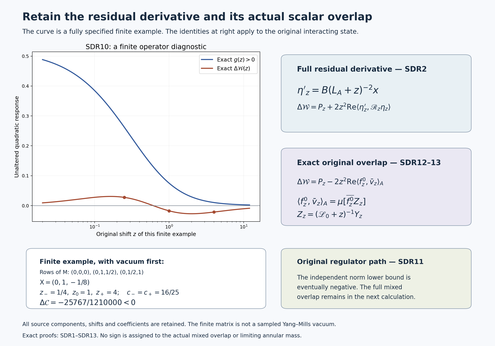

# The complete differentiated residual at the original three shifts

Reviewed derivation, 14 October 2026. This continues the original interacting-state calculation in RHB1–RHB13. The smooth globally gapless four-dimensional Yang–Mills state remains the goal. The calculation below retains every derivative of the physical residual and all three original signed coefficients.

The source edition is [4098575cb67d4e455e3b0d2bfb516b6ad3e178ce](https://github.com/KokunoYumeto/yang-mills-interacting-workbench/tree/4098575cb67d4e455e3b0d2bfb516b6ad3e178ce/yang-mills/continuations/20261011-central-signs-shrinking-window). Complete providers are [RHB1–RHB13](https://github.com/KokunoYumeto/yang-mills-interacting-workbench/blob/4098575cb67d4e455e3b0d2bfb516b6ad3e178ce/yang-mills/continuations/20261011-central-signs-shrinking-window/ACTUAL_RESOLVENT_HESSIAN.md), [CK14–CK24](https://github.com/KokunoYumeto/yang-mills-interacting-workbench/blob/4098575cb67d4e455e3b0d2bfb516b6ad3e178ce/yang-mills/continuations/20261011-central-signs-shrinking-window/CENTRAL_KINETIC_SOURCE.md), and [CFE6–CFE8](https://github.com/KokunoYumeto/yang-mills-interacting-workbench/blob/4098575cb67d4e455e3b0d2bfb516b6ad3e178ce/yang-mills/continuations/20261011-central-signs-shrinking-window/CENTRAL_FLUCTUATION_ENERGY.md). The existing physical Haar-gap argument is [UL1–UL6](https://github.com/KokunoYumeto/yang-mills-interacting-workbench/blob/4098575cb67d4e455e3b0d2bfb516b6ad3e178ce/yang-mills/continuations/20261011-central-signs-shrinking-window/union_label_global/FULL_UNION_LABEL_INVERSE.md) and [LEM48](https://github.com/KokunoYumeto/yang-mills-interacting-workbench/blob/4098575cb67d4e455e3b0d2bfb516b6ad3e178ce/yang-mills/continuations/20261011-central-signs-shrinking-window/ACTUAL_LOW_ENERGY_MAPS.md). It is applied here, not claimed new. Sixteen bounded disk-index metadata hits were not read or used as theorem inputs. Exact reading coverage and file versions are recorded in the source ledger. No novelty claim is made.

## 1. Original objects, constraints and the two Haar gaps

Retain every vertex of \(\{0,\ldots,2L_j\}^3\), every contained positive edge and every contained ordered face, including the boundary. The original objects are
\[
\begin{gathered}
L_j=j^4,\quad a_j=(100j)^{-1},\quad g_j^2=\kappa_*a_j/2,
\quad b_j=(\kappa_*a_j^2)^{-1},\quad s_j=100\kappa_*a_j,\\
N_j=3(2L_j)(2L_j+1)^2,\quad M_j=3(2L_j)^2(2L_j+1),\\
T_p=\operatorname{Tr}[U_d(v)U_k(v+e_d)U_d(v+e_k)^{-1}U_k(v)^{-1}],\quad d<k,\\
H=-\kappa_*\Delta+2b_jM_j-b_j\sum_pT_p,
\quad H\psi=E_0\psi,\quad \psi>0,\quad \int\psi^2dU=1,\\
x_p=o+a_j(v-L_j\mathbf1+(e_d+e_k)/2),\quad
X_\varphi=\frac{a_j}{2}\sum_p\varphi(x_p)(2-T_p-\mu(2-T_p)),\quad d\mu=\psi^2dU.
\end{gathered}
\]
Every link has the original radius-two \(SU(2)\) metric, with \(T_\alpha=-i\sigma_\alpha/2\) orthonormal, and probability Haar measure. All original vertex gauge transformations, including boundary vertices, act. The positive ground and its full vacuum energy are unchanged. For all \(2^{N_j}\) original signs let
\[
\begin{gathered}
A^2=2^{-N_j}\sum_\tau\psi(D_\tau U)^2,\quad
p_\tau=\frac{\psi(D_\tau U)^2}{2^{N_j}A^2},\quad h_\tau=\sqrt{p_\tau},\quad u=\log A,\\
L_A=-\kappa_*(\Delta+2du\cdot d),\quad
x=\sum_\tau p_\tau(X_\varphi\circ D_\tau),\quad
y_\tau=h_\tau[(X_\varphi\circ D_\tau)-x],\\
Jf=hf,\quad Bf=-2\kappa_*(dh_\tau\cdot df)_\tau,\quad
\mathbf X=Jx+y,\quad f_z^0=(L_A+z)^{-1}x,\quad\eta_z=y-Bf_z^0 .
\end{gathered}
\]
The full physical isometry is \((Tf)_\tau=f(D_\tau U)/(2^{N_j/2}A)\). It gives \(\mathcal M=T(H-E_0)T^{-1}\) on the physical equivariant subspace \(\mathscr R_{\rm ph}\) of \(\mathscr K=L^2(A^2dU;\mathbb C^{2^{N_j}})\), with the domains proved in CK. Its form is \(q\). In particular its unit vacuum is \(h=T\psi\). The marginal domain consists of gauge-invariant and central-invariant scalars; its unit vacuum is \(1\). The original means give \(\langle1,x\rangle_A=\mu X_\varphi=0\), and \(\eta_z\in\mathscr Q=(J\mathscr A)^\perp\), so \(\eta_z\perp h\).

Write
\[
c_j=\frac2{\kappa_*a_j},\quad G_j=4\pi^2N_jc_j^2,\quad
\Omega_j=8\pi^2c_jN_j,\qquad
\delta_j=3\kappa_*e^{-\Omega_j},\quad
\delta_j^A=8\kappa_*e^{-\Omega_j}.
\]
Then the exact finite-regulator comparisons are
\[
\mathcal M\ge\delta_j(I-|h\rangle\langle h|),\qquad
L_A\ge\delta_j^A(I-|1\rangle\langle1|).
\tag{SDR1}
\]
Here is a complete comparison argument retaining both constraints. In the original product Peter–Weyl expansion, a link spin \(j_e\in\{0,\tfrac12,1,\ldots\}\) has Casimir \(j_e(j_e+1)\). At a vertex with exactly one incident nonzero spin, the corresponding tensor product has no invariant vector. Thus every nonempty active spin support of a gauge-invariant block has no terminal vertex. A nonempty finite graph of minimum degree at least two contains a cycle: follow non-repeating successive edges until a vertex repeats. On the original cubic graph each such cycle has at least four edges. Every nonzero spin costs at least \(3/4\), proving the physical Haar gap at least \(3\). A fundamental face trace is an eigenfunction of Casimir \(4(3/4)=3\) and has Haar mean zero, so this value is attained.

If the scalar is also invariant under each independent link sign, then changing the sign of link \(e\) multiplies its spin block by \((-1)^{2j_e}\). Orthogonality of the product Fourier blocks forces every surviving \(j_e\) to be an integer. Each nonzero spin now costs at least \(2\), and the same full vertex constraint gives the Haar gap at least \(8\). The spin-one character of one face holonomy is central invariant, gauge invariant, has Haar mean zero and original Casimir \(4\cdot2=8\), so this value is attained too. Parseval's identity first proves both gradient inequalities on finite Fourier sums; closure of the original kinetic form proves them for their full \(H^1\) domains.

For a positive smooth density \(\rho\), write \(\rho_{\min},\rho_{\max}\) for its extrema. If the relevant Haar gap is \(\lambda_H\), then for every scalar in that same constraint space,
\[
\begin{aligned}
\operatorname{Var}_{\rho dU}f
&=\min_{\beta\in\mathbb C}\int\rho|f-\beta|^2dU
\le\rho_{\max}\operatorname{Var}_{dU}f\\
&\le\frac{\rho_{\max}}{\lambda_H}\int|df|^2dU
\le\frac{\rho_{\max}}{\lambda_H\rho_{\min}}
\int\rho|df|^2dU.
\end{aligned}
\]
The mean is minimized before either comparison; it is not substituted by the Haar mean. RHB10 proves \(\max\psi^2/\min\psi^2\le e^{\Omega_j}\). Since every value of \(A^2\) lies between the same two extrema, its ratio is also at most \(e^{\Omega_j}\). Apply the displayed comparison to \(\psi^2\) with \(\lambda_H=3\), and to \(A^2\) with \(\lambda_H=8\). The unchanged ground-state form and CK isometry give SDR1. LEM48 supplies an additional heat-based density comparison with its full incidence factors; SDR1 uses only the fully displayed RHB factor and does not replace that stronger existing estimate.

## 2. Differentiate the actual residual, not a fixed surrogate

To avoid collision with CK's complementary inverse \(R_z\), let
\[
\mathscr R_z=(\mathcal M+z)^{-1},\quad
g(z)=\mathcal G_{X_\varphi}(z)-\langle x,(L_A+z)^{-1}x\rangle_A
=\langle\eta_z,\mathscr R_z\eta_z\rangle.
\]
For \(z>0\), with the original \(x,y,B\) fixed, the exact differentiated expressions are
\[
\begin{gathered}
\eta_z'=B(L_A+z)^{-2}x,\\
g'(z)=2\operatorname{Re}\langle\eta_z',\mathscr R_z\eta_z\rangle
-\|\mathscr R_z\eta_z\|^2,\\
\Delta\mathcal W(z):=\mathcal W_{X_\varphi,j}(z)-\mathcal W_x^A(z)
=P_z+2z^2\operatorname{Re}\langle\eta_z',\mathscr R_z\eta_z\rangle,\\
P_z=\langle\eta_z,z\mathcal M(\mathcal M+z)^{-2}\eta_z\rangle\ge0 .
\end{gathered}\tag{SDR2}
\]
Resolvent differentiation is valid in the scalar form norm: spectral differentiation gives \(\partial_z(L_A+z)^{-1}=-(L_A+z)^{-2}\), and its derivative converges after multiplication by \(L_A^{1/2}\), uniformly on compact positive \(z\) intervals. The first-order estimate \(\|Bv\|^2\le4\kappa_*G_j\langle v,L_Av\rangle_A\), proved directly from RHB8's tensor, therefore justifies differentiating \(Bf_z^0\) in \(\mathscr K\). Differentiating the full bounded inverse gives \(\mathscr R_z'=-\mathscr R_z^2\). The product rule with Hermitian inner products proves the second line. Finally CK14 gives \(\mathcal W=z\mathcal G+z^2\mathcal G'\) for both unchanged operators. Thus \(\Delta\mathcal W=zg+z^2g'\), and the full scalar identity \(z/(\lambda+z)-z^2/(\lambda+z)^2=z\lambda/(\lambda+z)^2\) gives SDR2. The mixed term is not omitted or assigned a sign.

## 3. Actual source norms, evaluated derivatives and a joint mixed bound

Retain
\[
\Phi_1=\sum_p|\varphi(x_p)|,\quad \Phi_2=\sum_p|\varphi(x_p)|^2,
\quad Z_*=2a_j\Phi_1,\quad S_X=\mu|X_\varphi|^2
=\|x\|_A^2+\|y\|^2\le Z_*^2 .
\]
For \(z>0\), define actual spectral-floor upper functions by
\[
\begin{gathered}
\lambda_1(z)=\max\{\delta_j^A,z\},\quad
\lambda_2(z)=\max\{\delta_j^A,z/3\},\\
r_z^2=4\kappa_*G_j\frac{\lambda_1(z)}{(\lambda_1(z)+z)^2},\qquad
d_z^2=4\kappa_*G_j\frac{\lambda_2(z)}{(\lambda_2(z)+z)^4}.
\end{gathered}
\]
Then
\[
\begin{gathered}
\|Bf_z^0\|\le r_z\|x\|_A,\quad
\|\eta_z'\|\le d_z\|x\|_A,\\
m_z=\|\eta_z\|^2\le(1+r_z^2)S_X
\le U_z^m:=(1+r_z^2)Z_*^2,\\
r_z^2\le\frac{\kappa_*G_j}{z},\qquad
d_z^2\le\frac{27\kappa_*G_j}{64z^3} .
\end{gathered}\tag{SDR3}
\]
Indeed the actual \(x\) is centered, so SDR1 places its spectral measure for \(L_A\) in \([\delta_j^A,\infty)\). The full coupling estimate gives, respectively, integrands \(4\kappa_*G_j\lambda/(\lambda+z)^2\) and \(4\kappa_*G_j\lambda/(\lambda+z)^4\). Their derivatives have numerator \(z-\lambda\) and \(z-3\lambda\), respectively, with positive denominators. This gives the displayed maxima at \(\lambda_1,\lambda_2\), including the spectral-floor endpoints. The unconstrained maxima are \(1/(4z)\) and \(27/(256z^3)\), proving the last line. For the middle line apply Cauchy–Schwarz in \(\mathbb R^2\) to \(\|\eta_z\|\le\|y\|+r_z\|x\|_A\), keeping \(\|x\|_A^2+\|y\|^2=S_X\) intact. This is sharper than bounding both source components independently by \(Z_*\).

Define
\[
K_z^{\rm mix}
=\frac{z^2d_zZ_*^2}{z+\delta_j}
\left(r_z+\sqrt{1+r_z^2}\right).
\]
The complete mixed term obeys
\[
\left|2z^2\operatorname{Re}\langle\eta_z',\mathscr R_z\eta_z\rangle\right|
\le\frac{z^2d_zS_X}{z+\delta_j}
\left(r_z+\sqrt{1+r_z^2}\right)
\le K_z^{\rm mix}.
\tag{SDR4}
\]
SDR1 and \(\eta_z\perp h\) give \(\|\mathscr R_z\eta_z\|\le\|\eta_z\|/(z+\delta_j)\). Put \(a=\|x\|_A\), \(b=\|y\|\) only in this two-variable calculation. The preceding estimates bound the mixed term by \(2z^2d_z(ab+r_za^2)/(z+\delta_j)\). The real symmetric matrix of the full quadratic expression \(r_za^2+ab\) is
\[
\begin{pmatrix}r_z&1/2\\1/2&0\end{pmatrix},\qquad
\lambda_{\max}=\frac{r_z+\sqrt{1+r_z^2}}2.
\]
Its characteristic polynomial is \(\lambda^2-r_z\lambda-1/4\), proving this eigenvalue exactly. Multiplying by \(a^2+b^2=S_X\) yields SDR4. This optimization retains the original common source norm; it changes no observable or source amplitude.

## 4. The retained positive term and all three signed bounds

Let \(m^-_{j,z}>0\) and \(\mathcal E^+_{j,z}\) be the fully explicit original RHB11–RHB12 constants when \(\Phi_2>0\). Their definitions retain
\[
\begin{gathered}
m^-_{j,z}=\frac{a_j^2\Phi_2e^{-2\Omega_j}}4
\left(\frac{\rho_{j,z}-\sin\rho_{j,z}}{2\pi}\right)^{N_j},\\
\rho_{j,z}=\min\left\{1,
\frac{a_je^{-\Omega_j/2}\sqrt{\Phi_2}}
{2\sqrt{N_j}(L_j^y+2\kappa_*\widehat H_j\mathcal L_{j,z})}\right\},\\
\mathcal E^+_{j,z}=\kappa_*\left[2D_*+2Z_*\sqrt{G_j}
+Z_*(\widehat W_j+\widehat C_j)\sqrt{\kappa_*/z}
+2Z_*\sqrt{G_jM(\alpha_j^+,z)}\right]^2 .
\end{gathered}
\]
Here \(D_*=a_j\Phi_1\), \(\widehat W_j=4b_jM_j/\kappa_*+(3N_j-1)c_j\), \(\widehat C_j=\widehat W_j+G_j\), \(\widehat H_j=2\widehat W_j+5G_j\), \(L_j^y=2D_*+4Z_*\sqrt{G_j}\), \(\alpha_j^+=\kappa_*(2\widehat C_j-1/2)\). The full RHB constants are
\[
\begin{gathered}
\omega_j=2\widehat C_j+1/2,\quad q_*=\sqrt{1-e^{-1}},\quad
\mathcal L_{j,z}=Z_*\left[\frac{\sqrt{\omega_j}}{zq_*}
+\frac{2\operatorname{artanh}(q_*)}{\kappa_*\sqrt{\omega_j}}\right],\\
M(\alpha,z)=\begin{cases}1,&\alpha\le2z,\\
\alpha^2/[4z(\alpha-z)],&\alpha>2z.\end{cases}
\end{gathered}
\]
In particular no state-dependent derivative maximum is left unevaluated in these constants. Put
\[
P^-_{j,z}=\frac{z(m^-_{j,z})^2}
{\mathcal E^+_{j,z}+(2z+z^2/\delta_j)m^-_{j,z}}.
\]
The exact residual term satisfies
\[
P_z\ge\frac{zm_z^2}{e_z+2zm_z+z^2n_z}
\ge\frac{zm_z^2}{e_z+(2z+z^2/\delta_j)m_z}
\ge P^-_{j,z}>0,\qquad
P_z\le\frac{m_z}{4}\le\frac{U_z^m}{4},
\tag{SDR5}
\]
where \(e_z=q(\eta_z,\eta_z)\) is the complete original RHB12 energy and \(n_z=\langle\eta_z,\mathcal M^{-1}\eta_z\rangle\) uses the inverse on \(h^\perp\), justified by SDR1. To prove the first inequality, let \(\nu_{\eta_z}\) be its full physical spectral measure, supported in \([\delta_j,\infty)\). Cauchy–Schwarz with the reciprocal positive weights \(z\lambda/(\lambda+z)^2\) and \((\lambda+z)^2/(z\lambda)\) gives
\[
m_z^2\le P_z\left(e_z/z+2m_z+zn_z\right).
\]
All three reciprocal-weight terms have been integrated. SDR1 gives \(n_z\le m_z/\delta_j\). The function \(m\mapsto zm^2/(E+cm)\) is increasing for \(m>0\), \(E\ge0\), \(c>0\), since its derivative is \(z(2Em+cm^2)/(E+cm)^2>0\). Insert the proved bounds \(e_z\le\mathcal E^+_{j,z}\), \(m_z\ge m^-_{j,z}\). The upper bound follows from the exact scalar maximum \(z\lambda/(\lambda+z)^2\le1/4\). This proves SDR5 with the full energy retained before either estimate.

Define
\[
L_z^{\rm resp}=P^-_{j,z}-K_z^{\rm mix},\qquad
U_z^{\rm resp}=U_z^m/4+K_z^{\rm mix}.
\]
Then the actual response correction and its full signed combination obey
\[
L_z^{\rm resp}\le\Delta\mathcal W(z)\le U_z^{\rm resp}.
\tag{SDR6}
\]
For the unchanged parameters \(0<\varepsilon<1<R_{\rm win}\), \(\theta>0\), set \(z_0=\theta s_j\), \(z_-=\varepsilon\theta s_j\), \(z_+=R_{\rm win}\theta s_j\), and retain
\[
\begin{gathered}
c_-=\frac{4\varepsilon}{(1+\varepsilon)^2},\qquad
c_+=\frac{4R_{\rm win}}{(1+R_{\rm win})^2},\\
\Delta\mathcal C=\Delta\mathcal W(z_0)-c_-\Delta\mathcal W(z_-)-c_+\Delta\mathcal W(z_+).
\end{gathered}
\]
The fully evaluated two-sided statement is
\[
\begin{aligned}
L_{z_0}^{\rm resp}-c_-U_{z_-}^{\rm resp}-c_+U_{z_+}^{\rm resp}
\le{}&\Delta\mathcal C\\
\le{}&U_{z_0}^{\rm resp}-c_-L_{z_-}^{\rm resp}-c_+L_{z_+}^{\rm resp}.
\end{aligned}\tag{SDR7}
\]
SDR2, SDR4 and SDR5 give SDR6; applying the opposite endpoint at each negative coefficient gives SDR7. The exact quantity on its middle is the original full CK14 response minus that same three-shift response for \(x,L_A\). All bounds preserve the original \(s_j=100\kappa_*a_j=\kappa_*/j\). These displayed bounds are not asserted positive or uniform in \(j\). If \(\Phi_2=0\), the original observable and both responses are zero, as in RHB11; the positive residual formulas are not applied.

## 5. A full cross-shift map for the actual residuals

The three residuals also satisfy a joint constraint, stronger than treating their norms as independent input numbers. For any original positive shifts \(z,w\),
\[
\eta_w-\eta_z=(w-z)B(L_A+w)^{-1}(L_A+z)^{-1}x.
\tag{SDR8}
\]
This follows by subtracting their exact definitions and using the scalar resolvent identity; the sign of \(w-z\) is unchanged. At \(w=z\), the quotient converges in the form norm to the derivative in SDR2.

For \(z,w>0\) define
\[
\lambda_*(z,w)=\frac{\sqrt{(z+w)^2+12zw}-(z+w)}6,
\qquad \lambda_\circ(z,w)=\max\{\delta_j^A,\lambda_*(z,w)\}.
\]
The full actual norm is bounded by
\[
\|\eta_w-\eta_z\|^2
\le4\kappa_*G_j(w-z)^2\|x\|_A^2
\frac{\lambda_\circ(z,w)}
{(\lambda_\circ(z,w)+z)^2(\lambda_\circ(z,w)+w)^2}.
\tag{SDR9}
\]
Apply the same original coupling form to SDR8 and the full centered spectral measure of \(x\). The logarithmic derivative of the positive scalar multiplier \(\lambda/[(\lambda+z)^2(\lambda+w)^2]\) vanishes when
\[
(\lambda+z)(\lambda+w)-2\lambda(\lambda+w)-2\lambda(\lambda+z)
=-3\lambda^2-(z+w)\lambda+zw=0.
\]
This quadratic has exactly one positive root, the displayed \(\lambda_*\). The multiplier increases before it and decreases after it, so the constrained maximum is at \(\lambda_\circ\). This proves SDR9, including \(w=z\), when the difference is zero and its divided-difference limit recovers the second SDR3 bound. The retained cross-shift vectors in SDR8, rather than a replacement ensemble of residuals, are the input to any further joint estimate.

## 6. Exact finite example identifying the indispensable mixed term

The following original finite-matrix calculation is a diagnostic of the operator identity, not an assignment to the Yang–Mills vacuum. It shows exactly why the mixed contribution in SDR2 must be calculated. On \(\mathbb C^3\), with its indicated ordered basis, take
\[
\begin{gathered}
\mathsf M=\begin{pmatrix}0&0&0\\0&1&1/2\\0&1/2&1\end{pmatrix},\quad
\mathsf J(a,b)=(a,b,0),\quad
\mathsf A=\begin{pmatrix}0&0\\0&1\end{pmatrix},\\
\mathsf X=(0,1,-1/8),\quad x=(0,1),\quad y=(0,0,-1/8).
\end{gathered}
\]
The vacuum is the first coordinate; both source components are nonzero and vacuum orthogonal. The eigenvalues are \(0,1/2,3/2\), and the exact compressed operator is \(\mathsf J^*\mathsf M\mathsf J=\mathsf A\). Its retained off-diagonal map is \(\mathsf B(a,b)=(0,0,b/2)\). Thus for every \(z>0\),
\[
\begin{gathered}
\eta_z=(0,0,-1/8-1/[2(1+z)]),\quad
\eta_z'=(0,0,1/[2(1+z)^2]),\\
g(z)=\frac{(z+5)^2}{16(z+1)(2z+1)(2z+3)}>0,\\
\Delta\mathcal W(z)
=-\frac{z(z+5)(28z^3+38z^2-9z-15)}
{16(z+1)^2(2z+1)^2(2z+3)^2}.
\end{gathered}\tag{SDR10}
\]
To verify these formulas in full, the inverse on the last two coordinates is
\[
\frac1{(1+z)^2-1/4}
\begin{pmatrix}1+z&-1/2\\-1/2&1+z\end{pmatrix}.
\]
The residual has only the last component, so its quadratic inverse value is \((1/8+1/[2(1+z)])^2(1+z)/[(1+z)^2-1/4]\), equal to the displayed gain with every coefficient retained. Differentiating that rational function and forming \(zg+z^2g'\) gives SDR10. At \(z=1\) the complete decomposition is
\[
\begin{gathered}
m_1=9/64,\quad e_1=9/64,\quad g(1)=3/40,\quad
P_1=13/400,\\
2\operatorname{Re}\langle\eta_1',\mathscr R_1\eta_1\rangle=-1/20,
\quad\Delta\mathcal W(1)=-7/400.
\end{gathered}
\]
For completeness \(\mathscr R_1\eta_1=(0,1/20,-1/5)\); multiplication by \(\mathsf M\) gives the positive term \(13/400\), and pairing with \(\eta_1'=(0,0,1/8)\) gives the displayed mixed term. At \(z_-=1/4,z_0=1,z_+=4\), the original coefficients are \(c_-=c_+=16/25\). Direct substitution gives
\[
\Delta\mathcal W(1/4)=11/400,\quad
\Delta\mathcal W(4)=-261/12100,\quad
\Delta\mathcal C=-25767/1210000<0.
\]
Thus strict positive gain at every positive shift alone does not force positive differentiated gain or positive three-shift correction. This proves that precise implication fails, while SDR2 and SDR8 give the exact connecting derivative and cross-shift maps. No conclusion about the sign of the actual Yang–Mills response follows from this finite example. The next calculation is the joint original mixed pairing at the three shifts, using those maps and the full original conditional covariance, rather than omitting it.

## 7. Evaluate what the independent norm estimates yield on the original path

For every fixed \(\kappa_*>0\) and \(\beta>0\), set the original \(z=\beta s_j=\beta\kappa_*/j\). For nonzero original face samples, the lower function \(L_z^{\rm resp}\) from SDR6 is strictly negative for all sufficiently large \(j\). Consequently SDR7's lower function is eventually strictly negative at the original three fixed multiples \(\beta=\theta,\varepsilon\theta,R_{\rm win}\theta\). This is a statement about the evaluated estimate, not the sign of the actual response:
\[
L_z^{\rm resp}<0,\qquad
L_{z_0}^{\rm resp}-c_-U_{z_-}^{\rm resp}-c_+U_{z_+}^{\rm resp}<0
\quad\hbox{eventually}.
\tag{SDR11}
\]
To prove it with all powers visible, the original constants give
\[
\Omega_j=\frac{1600\pi^2jN_j}{\kappa_*},\qquad
\frac{\delta_j^A}{z}=\frac{8j}{\beta}e^{-1600\pi^2jN_j/\kappa_*}\longrightarrow0,
\qquad N_j=24j^{12}+24j^8+6j^4.
\]
Thus eventually \(\delta_j^A\le z/3\). Both maxima in SDR3 are then the unconstrained ones, with
\[
r_z^2=\frac{\kappa_*G_j}{z}
=\frac{160000\pi^2N_jj^3}{\beta\kappa_*^2}\longrightarrow\infty,
\qquad d_z=\frac{\sqrt{27}}{8z}r_z.
\]
Eventually \(r_z\ge1\). Also \(\delta_j=(3/8)\delta_j^A\le z/8\), so \(z/(z+\delta_j)\ge8/9\). Substitution in the unchanged mixed bound proves
\[
K_z^{\rm mix}
\ge\frac{\sqrt{27}}9Z_*^2r_z\bigl(r_z+\sqrt{1+r_z^2}\bigr)
\ge\frac{2\sqrt{27}}9Z_*^2r_z^2,
\qquad
\frac{U_z^m}{4}\le\frac12Z_*^2r_z^2 .
\]
SDR5 supplies \(P^-_{j,z}\le U_z^m/4\). Since \(2\sqrt{27}/9>1/2\),
\[
L_z^{\rm resp}\le
\left(\frac12-\frac{2\sqrt{27}}9\right)Z_*^2r_z^2<0.
\]
The source amplitude can vary with \(j\); it was retained in both terms, and nonzero samples give \(Z_*>0\). Each upper function \(U_z^{\rm resp}\) is positive, and both coefficients \(c_-,c_+\) are positive, proving the second assertion. Thus this independent norm-bound route cannot certify the desired positive limiting correction. What would sharpen it is the actual orientation in the mixed term; the next section calculates its exact original scalar receiving map.

## 8. The mixed term is an actual scalar response overlap

Put
\[
v_z=\mathscr R_z\eta_z,\qquad \bar v_z=J^*v_z.
\]
Then the exact identity is
\[
\langle\eta_z',v_z\rangle
=-\langle f_z^0,\bar v_z\rangle_A,
\qquad
\Delta\mathcal W(z)=P_z-2z^2\operatorname{Re}\langle f_z^0,\bar v_z\rangle_A.
\tag{SDR12}
\]
Every vector here is the actual vector for the original fixed source. Indeed the equation \((\mathcal M+z)v_z=\eta_z\), projected by \(J^*\), has zero right side. CK's full block equation gives
\[
(L_A+z)\bar v_z+B^*Qv_z=0.
\]
Since \(B\) takes values in \(\mathscr Q\),
\[
\begin{aligned}
\langle\eta_z',v_z\rangle
&=\langle(L_A+z)^{-2}x,B^*Qv_z\rangle_A\\
&=-\langle(L_A+z)^{-2}x,(L_A+z)\bar v_z\rangle_A
=-\langle f_z^0,\bar v_z\rangle_A .
\end{aligned}
\]
The original source is smooth, both elliptic resolvents preserve smoothness, and CK proves all domain maps; therefore these pairings and adjoints are legitimate. This proves SDR12 without assuming that the inverse preserves \(\mathscr Q\). In fact its nonzero \(J\)-component is exactly the overlap that remains.

Here is its full original scalar realization. Define the unchanged ground diffusion and the identity-sign probability by
\[
\mathscr L_0=-\kappa_*[\Delta+2d\log\psi\cdot d],\qquad
p_{\boldsymbol +}=\frac{\psi^2}{2^{N_j}A^2},\qquad
Y_z=X_\varphi-x+\kappa_*\langle d\log p_{\boldsymbol +},df_z^0\rangle,
\quad Z_z=(\mathscr L_0+z)^{-1}Y_z .
\]
The unitary original ground map is \(\mathscr U F=T(\psi F)=(h_\tau F(D_\tau U))_\tau\). Its isometry follows by the complete central change of variables, and its generator relation follows by expanding \((H-E_0)(\psi F)=\psi\mathscr L_0F\) with the original ground equation. Central invariance of \(f_z^0,x\), and \(2dh_\tau=h_\tau d\log p_\tau\), give \(\mathscr UY_z=\eta_z\). Hence
\[
\begin{gathered}
v_z=\mathscr UZ_z,\quad
\bar v_z=\sum_\tau p_\tau(Z_z\circ D_\tau),\\
\langle f_z^0,\bar v_z\rangle_A
=\mu[\overline{f_z^0}Z_z]
=\int_0^\infty e^{-zt}
\mu\!\left[\overline{f_z^0}e^{-t\mathscr L_0}Y_z\right]dt .
\end{gathered}\tag{SDR13}
\]
To prove the middle equality, expand the full conditional sum and change \(U\mapsto D_\tau U\) in each term. The source \(f_z^0\) is central invariant, the Haar measure is preserved, and the factor \(2^{-N_j}\) is summed over all \(2^{N_j}\) signs. The last equality is the positive-shift spectral integral for the original nonnegative \(\mathscr L_0\). It converges absolutely by its \(L^2(\mu)\) contraction bound and Cauchy–Schwarz, keeping \(e^{-zt}\). No equilibrium Gibbs measure or different dynamics has been inserted.

The original conditional-gradient expression for this same overlap is
\[
t_{Z_z}=\sum_\tau[(Z_z)_\tau-\bar v_z]dp_\tau,
\qquad
\langle\eta_z',v_z\rangle
=-\kappa_*\int A^2
\left\langle d\overline{(L_A+z)^{-2}x},t_{Z_z}\right\rangle dU .
\]
Indeed \(\sum_\tau h_\tau dh_\tau=0\) and \(dp_\tau=2h_\tau dh_\tau\) imply \(\sum_\tau(v_z)_\tau dh_\tau=t_{Z_z}/2\). Substitution into the unchanged \(B\) proves the identity. Thus SDR12–SDR13 give the precise map from the failed independent norm estimate to the actual original conditional covariance and positive-time scalar correlation. Their joint values at the three retained shifts are the next quantities to evaluate.

In the last displayed covector contraction the original real metric is extended complex-bilinearly, with the conjugation explicitly displayed on the first covector. The Hilbert-space pairings throughout are Hermitian, conjugate-linear in their first argument.

## 9. Reproducible figure and diagnostic scope

The left plot evaluates the exact rational functions in SDR10 without rescaling the source or spectral variable. Its three marked shifts retain the displayed signed coefficients. The right side shows the full original-state map in SDR2 and SDR12–SDR13, including the mixed term. SDR11 evaluates why the independent norm lower function becomes negative on the original regulator path; it does not determine the sign of the actual physical response. The finite matrix is explicitly specified and is not a sampled Yang–Mills vacuum. Reproducible source: `figure_signed_residual.py`.

The 612 diagnostics in `check_signed_residual.py` check exact rational example coefficients and signs; the original radius-two fundamental and adjoint Haar Casimirs; weighted original Haar comparisons; complex finite-matrix residual derivatives, all reciprocal moments, joint source bounds, cross-shift maps and scalar overlap identities; and the explicitly displayed original-path bound comparison. The continuous comparison densities are constructed examples, and the finite matrices are operator diagnostics. The proofs for the original interacting state are SDR1–SDR13 above; the checks are not replacements for those proofs.

## Actual memory and complete character-coordinate operator

[MTO1–MTO20](https://github.com/KokunoYumeto/yang-mills-interacting-workbench/blob/main/yang-mills/continuations/20261011-central-signs-shrinking-window/ACTUAL_MIXED_TIME_EVOLUTION.md) prove the actual conditional memory and its exact Laplace map to the full Schur inverse. The original character frame identifies every conditional fluctuation with the tangent space of the actual square-root probability map into the sphere. Its metric, connection, curvature, physical coefficient laws and full complementary Hamiltonian are explicit. The original ground equation evaluates the entire connection-and-potential combination and proves
\[
q(\boldsymbol\Xi c,\boldsymbol\Xi d)
=\kappa_*\int A^2\sum_i[(X_ic)^*C(X_id)
+\overline{r_i^Tc}(r_i^Td)]\,dU.
\]
MTO11 and MTO16 retain the exact comparison with all original Wilson-potential terms. MTO19 calculates the full action on the actual face source, and MTO20 retains the mixed-time remainder. The joint three-shift correlation, limiting annular mass, reconstruction and smooth global no-gap state remain active.

## Both original mixed sources and the entire inverse tail

[MSA1–MSA6](https://github.com/KokunoYumeto/yang-mills-interacting-workbench/blob/main/yang-mills/continuations/20261011-central-signs-shrinking-window/MIXED_SOURCE_OPERATOR_ACTION.md) evaluate the full complementary operator on the actual gradient and face sources. The original ground equation and actual resolvent equation give the complete commutator with all potential, Hessian and Ricci terms. Both operator norms in MTO20 now have explicit bounds from the original state estimates, retaining every lattice count, coupling and source coefficient. For \(b_z=Bf_z^0\), the full cross term is
\[
\begin{aligned}
\langle b_z,(D+\sigma)^{-1}y\rangle
={}&\frac{\langle b_z,y\rangle}{\sigma}
-\frac{\langle b_z,Dy\rangle}{\sigma^2}\\
&+\frac{\langle Db_z,(D+\sigma)^{-1}Dy\rangle}{\sigma^2}.
\end{aligned}
\]
The entire last term is bounded by the explicit \(\mathcal B_{j,z}\mathcal Y_j/[\sigma^2(\sigma+\delta_j)]\). The original time-domain remainder and source-dependent versions are also retained. The joint signed moments, full Schur solution, limiting annular mass and smooth global no-gap construction remain active.
