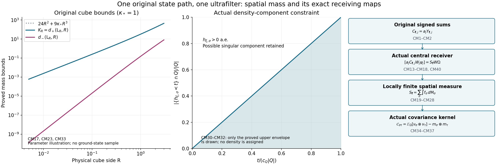
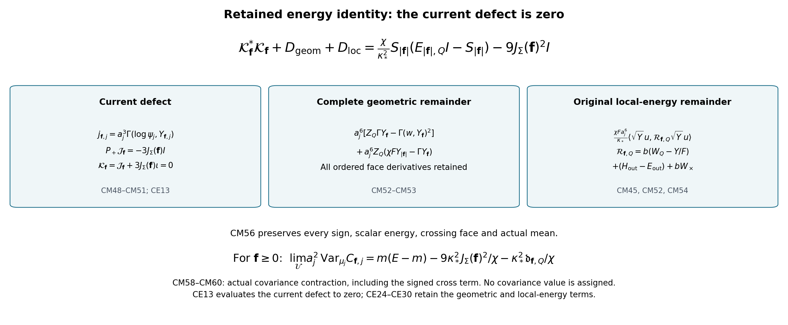

# The simultaneous original test map and its central spatial measure

All operators in this note are constructed from the same actual positive ground states, the same original path, and one fixed ultrafilter. The original signed observable is retained. A receiver for its explicitly displayed moment coefficients does not replace that observable. No density, translation invariance, covariance value or four-dimensional field identification is assumed.

The complete finite-regulator provider is [BM1–BM69](https://github.com/KokunoYumeto/yang-mills-interacting-workbench/blob/8881e58616267059c0461c8baec203e7c87d623e/yang-mills/continuations/20261011-central-signs-shrinking-window/BOUNDED_ENERGY_MULTIPLIER.md). Its original source hash and the present reading coverage are recorded in [the source-use ledger](CENTRAL_CURRENT_SOURCE_USE_LEDGER.json). The proof below supplies every simultaneous, orientation-specific and measure-theoretic extension. The companion [CE11–CE15](CURRENT_COVARIANCE_EQUALITY.md) further evaluates the current defect to zero; [CE46–CE50](CURRENT_COVARIANCE_EQUALITY.md) prove fluctuation survival for every positive heat parameter.

## 1. Original oriented sums and a full finite receiving lemma

Keep \(L_j=j^4\), \(a_j=(100j)^{-1}\), \(g_j^2=\kappa_*a_j/2\), \(\kappa_j=\kappa_*\), \(b_j=(\kappa_*a_j^2)^{-1}\), and \(\alpha_j=\kappa_*/b_j=\kappa_*^2a_j^2\). The vertices are \(z\in\{0,\ldots,2L_j\}^3\); every positive edge and all original vertex gauge constraints remain. For \(\sigma=(d,k)\), \(d<k\), retain
\[
\begin{gathered}
U_p=U_d(z)U_k(z+e_d)U_d(z+e_k)^{-1}U_k(z)^{-1},\quad
W_p=\operatorname{Tr}U_p,\quad D_p=2-W_p,\\
x_{p,j}=o+a_j(z-L_j\mathbf1+(e_d+e_k)/2),\quad
H_j=-\kappa_*\Delta+b_j\sum_pD_p,\quad
H_j\psi_j=E_{0,j}\psi_j,\quad d\mu_j=\psi_j^2dU.
\end{gathered}\tag{CM1}
\]
Haar has mass one and each \(\mathrm{SU}(2)\) has radius-two metric, with \(T_\beta=-i\sigma_\beta/2\) orthonormal and \(\Delta=\sum_{e,\beta}X_{e,\beta}^2\). The positive unit ground is unique and gauge invariant by the ground transform in BM1–BM3.

Let \(\mathcal D=C_c(\mathbb R^3;\mathbb R)^3\), indexed by the three original orientations. For \(\mathbf f=(f_{12},f_{13},f_{23})\), define the exact extension
\[
\begin{gathered}
Y_{\mathbf f,j}=\sum_\sigma\sum_{p:\operatorname{type}p=\sigma}
f_\sigma(x_{p,j})D_p,\qquad
C_{\mathbf f,j}=a_jY_{\mathbf f,j},\\
Y_{|\mathbf f|,j}=\sum_{\sigma,p:\sigma}|f_\sigma(x_{p,j})|D_p,\quad
F_\sigma=\|f_\sigma\|_\infty,\quad F=\max_\sigma F_\sigma,\\
A_{1,j}=\sum_{\sigma,p:\sigma}|f_\sigma(x_{p,j})|,\quad
A_{2,j}=\sum_{\sigma,p:\sigma}|f_\sigma(x_{p,j})|^2,\quad
J_\Sigma(\mathbf f)=\sum_\sigma\int_{\mathbb R^3} f_\sigma(x)\,d^3x .
\end{gathered}\tag{CM2}
\]
The original scalar test is exactly \(C_{f,j}=C_{(f,f,f),j}\); none of its three orientations is removed or divided by three. The three translated mesh sums give
\(a_j^3A_{1,j}\to J_\Sigma(|\mathbf f|)\) and
\(a_j^3A_{2,j}\to\sum_\sigma\int f_\sigma^2\).
For example integrate the modulus of continuity on each half-open centered mesh cube; only a fixed enlargement of the compact support contributes. This proves the limits without a differentiability assumption on the tests.

Choose an axis-parallel physical cube \(Q^{\rm phys}=\prod_d[c_d,c_d+R]\), \(R>0\), containing all three supports. Its original fitting edge patch is
\[
\begin{gathered}
v_{d,j}=L_j+\lfloor(c_d-o_d)/a_j\rfloor-1,\quad
q_j=\lceil R/a_j\rceil+3,\quad Q_j=v_j+\{0,\ldots,q_j\}^3,\\
N_Q=3q(q+1)^2,\quad M_Q=3q^2(q+1),\quad
C_Q=2q(q+1)\sum_d[
\mathbf1_{\{v_d>0\}}+\mathbf1_{\{v_d+q<2L\}}],\\
H=-\kappa\Delta_Q+bW_Q+H_{\rm out}+bW_\times,\quad
E_Q=E_0-E_{\rm out},\\
0<E_Q/b\le\Lambda_Q
=\min\{2M_Q,6g^2\sqrt{N_QM_Q}\}+2C_Q,\quad
\alpha\mu Z_Q+\mu W_Q\le E_Q/b .
\end{gathered}\tag{CM3}
\]
Here \(W_Q\) is the sum of inside deficits, \(W_\times\) the crossing deficits and \(Z_Q=|\nabla_Q\log\psi|^2\). The full scalar potentials are \(2bM_Q\), \(2b(M-M_Q-C_Q)\), \(2bC_Q\). Each crossing face has exactly one inside edge. BM5–BM6 prove these facts and the comparison using the original outside gauge invariance. They apply without change to orientation-specific tests since their support edges are still inside \(Q_j\).

For later sharp orientation constants the complete incidence estimate can be strengthened. Assume \(F>0\), and set
\[
\lambda_\sigma=8F_\sigma+4\sum_{\tau\ne\sigma}F_\tau,\qquad
\chi={\max_\sigma\lambda_\sigma\over F}
=4+{4\sum_\sigma F_\sigma\over F}\in[8,16].
\tag{CM4}
\]
On each edge at most two faces of either incident orientation occur. If \(w_p=|f_\sigma(x_p)|\) and \(v_{pe}\) is the full oriented three-component derivative of \(D_p\), then
\[
\begin{gathered}
\Gamma(Y_{\mathbf f})
=\sum_e\left|\sum_{p\ni e}f_{\operatorname{type}p}(x_p)v_{pe}\right|^2,\\
\Gamma(Y_{\mathbf f})\le
\sum_\sigma\lambda_\sigma
\sum_{p:\sigma}w_p(D_p-D_p^2/4)
\le\chi F Y_{|\mathbf f|}.
\end{gathered}\tag{CM5}
\]
Weighted Cauchy–Schwarz gives
\(|\sum f_pv_{pe}|^2\le(\sum w_p)(\sum w_p|v_{pe}|^2)\).
For an edge of direction \(d\), the first sum is at most twice the sum of the two \(F_\sigma\)'s containing \(d\). The four edges of a face of type \(\sigma\) therefore give exactly \(\lambda_\sigma\). The original one-edge identity is \(|v_{pe}|^2=D_p-D_p^2/4\), with inverse traversals and all adjoint transports retained. Thus a single orientation has \(\chi=8\), two equally weighted orientations have \(\chi=12\), and all three equally weighted orientations have \(\chi=16\). Boundary omissions only reduce the preceding exact sums.

For a nonzero nonnegative triple write \(Y=Y_{\mathbf f}\), \(A_1=\sum f_p\), \(e=FE_Q/b\). The complete inside marginal in BM40–BM42 gives smooth nonnegative \(\mathcal A\) and an exact residual:
\[
\begin{gathered}
\mathcal A=FW_Q-Y+\alpha F\overline Z+(F/b)R_Q\ge0,\quad
\mathcal M=Y+\mathcal A=e+\alpha Fs_Q,\quad \mu\mathcal A=e-\mu Y,\\
\mu[\Phi(\mathcal M-e)]={\alpha F\over2}\mu\Delta_Q\Phi,\qquad
\mathcal B:=\mu(\mathcal M-e)^2\\
\le{\alpha F^2\over2}
(6M_Q-3\mu W_Q+\tfrac32C_Q-\tfrac34\mu W_\times)
+4\alpha^{3/2}F^2\mu Z_Q=O(a^{-1}).
\end{gathered}\tag{CM6}
\]
Here \(\overline Z=\mathbb E[Z_Q\mid x]\), \(n(x)=\int\psi(x,v)^2dv\), \(s_Q=\Delta_Qn/(2n)\), and
\(R_Q=n^{-1}\int[\kappa|\nabla_{\rm out}\psi|^2+(V_{\rm out}-E_{\rm out})\psi^2+bW_\times\psi^2]dv\ge0\).
The full nonnegative difference in the bound is
\(\alpha^2F^2\{\mu\|\nabla_{\rm out}\nabla_Qw\|^2+
2\mu(\nabla_Q^2w+2\alpha^{-1/2}g_Q)(\nabla_Qw,\nabla_Qw)
+\mu\operatorname{Var}(\Delta_Qw+2Z_Q\mid x)\}\).
These formulas preserve the actual means, outside energy, conditional kinetic term and crossing contributions; their derivation in the included BM40–BM43 uses the actual ground equation and the proved \(\nabla^2w\ge-2\alpha^{-1/2}g\).

For completeness the two-root calculation with the refined \(\chi\) is as follows. Put \(\gamma=\Gamma Y\), \(J(y)=6A_1-3y\), \(M(t)=\mu e^{tY}\), and let brackets \(\langle\cdot\rangle_t\) denote division of the actual weighted expectation by \(M(t)\). Write \(d_t=\langle Y\rangle_t\), \(h_t=\langle\gamma\rangle_t>0\), \(J_t=6A_1-3d_t\), \(R_t=\langle FW_Q-Y+(F/b)R_Q\rangle_t\), and
\[
\begin{gathered}
\delta_t=\chi Fd_t-h_t\ge0,\quad
Q_t=\left\langle\left|\nabla_Qw+
(\tfrac t2+\tfrac{J_t}{2h_t})\nabla Y\right|^2\right\rangle_t\ge0,\\
c_\chi={9\alpha\over4\chi},\quad
\beta_\chi={\alpha\chi F^2\over4},\quad
B_\chi=e+4c_\chi A_1,\quad D_\chi=B_\chi^2-16(1+c_\chi)c_\chi A_1^2,\\
\boxed{\quad
(1+c_\chi-\beta_\chi t^2)d_t^2-B_\chi d_t+4c_\chi A_1^2+\mathcal D_t=0,\quad}\\
\mathcal D_t=d_tR_t+\alpha Fd_tQ_t+
{\alpha J_t^2\delta_t\over4\chi h_t}
+{\alpha Ft^2d_t\delta_t\over4}\ge0 .
\end{gathered}\tag{CM7}
\]
Indeed integration by parts gives \(2\langle\Gamma(w,Y)\rangle_t=-J_t-th_t\). Substitution in (CM6) with \(\Phi=e^{tY}\), followed by expansion of the displayed square, gives
\(e=d_t+R_t+\alpha FQ_t+\alpha FJ_t^2/(4h_t)-\alpha Ft^2h_t/4\).
Insert \(h_t=\chi Fd_t-\delta_t\), multiply by \(d_t\), and expand \(J_t^2\). This proves (CM7) without omitting a remainder.

Define \(C_\chi=4c_\chi A_1^2\) and
\[
\begin{gathered}
r_\pm={B_\chi\pm\sqrt{D_\chi}\over2(1+c_\chi)},\qquad
r_-={2C_\chi\over B_\chi+\sqrt{D_\chi}},\qquad
0<r_-\le\mu Y\le r_+\le e,\\
p_\chi={6A_1\over\chi F},\quad
T_\chi={1\over F\sqrt{\alpha\chi}},\quad
V_-={r_-^2\over2p_\chi},\quad
V_+={\sqrt{\beta_\chi C_\chi}+r_+\beta_\chi T_\chi
\over2(3/4+c_\chi)},\\
\mu(r_--Y)_+^2\le4V_-,\qquad
\mu(Y-r_+)_+^2\le4V_++2T_\chi^{-2}e^{-V_+T_\chi^2}.
\end{gathered}\tag{CM8}
\]
The discriminant is nonnegative because the polynomial in (CM7) is nonpositive at \(d_0>0\). The lower-root formula for every real \(t\) is
\(2C_\chi/[B_\chi+\sqrt{D_\chi+4\beta_\chi C_\chi t^2}]\);
it remains the unique positive root when the quadratic coefficient is nonpositive. The square-root triangle inequality bounds it below by \(r_-/(1+r_-|t|/p_\chi)\). Integrating the logarithmic derivative of \(M(-t)\) proves
\(M(-t)\le(1+r_-t/p_\chi)^{-p_\chi}\).
Chernoff then gives \(\mu(Y\le ur_-)\le e^{p_\chi(1-u+\log u)}
\le e^{-p_\chi(1-u)^2/2}\). For \(0\le t\le T_\chi\), subtracting the larger root before bounding its square-root increment gives \(d_t\le r_++2V_+t\), because \(1+c_\chi-\beta_\chi t^2\ge3/4+c_\chi\). Its integrated Chernoff bound has Gaussian part \(e^{-r^2/(4V_+)}\) until \(2V_+T_\chi\), followed by \(e^{-T_\chi r+V_+T_\chi^2}\). Integrating \(2r\) times these bounds proves (CM8). To prove \(r_+\le e\), use \(P_0(e)=c_\chi(e-2A_1)^2\ge0\). If \(\mu Y<e\), the point \(e\) lies strictly to the right of a point in the root interval, so it cannot be below the lower root. If \(\mu Y=e\), (CM6) forces \(\mu Z_Q=0\), and integration by parts gives \(6A_1-3\mu Y=0\). Hence \(e=2A_1\), \(P_0(e)=0\) and \(P_0'(e)=e>0\), again identifying the upper root. The nonconstant original commuting link path proves \(d_t,h_t>0\).

The original local comparison has the exact limits
\[
\mathsf L_R=9\kappa_*R^3+24R^2,\quad
a_j^2\Lambda_{Q_j}\to\mathsf L_R,\quad
\varepsilon_Q:=\lim_{\mathcal U}a_j^2E_{Q_j}/b_j
\in[\tfrac92\kappa_*R^3,\mathsf L_R].
\tag{CM9}
\]
The lower endpoint uses (CM7) for the full unweighted cube \(Y=W_Q\), \(F=1\), \(A_1=M_Q\), \(\chi=16\), for which \(a^3M_Q\to3R^3\). It follows by taking the discriminant limit. This array need not be a continuous test: the finite formula applies to its actual coefficients and the displayed count proves its sum limit. The upper endpoint is (CM3). The \(24R^2\) term is exactly the limiting \(2C_Q\); it has not been absorbed into a volume term.

For a fixed nonzero nonnegative \(\mathbf f\), the same calculation gives \(e_j=\Theta(a_j^{-2})\), \(r_{\pm,j}=\Theta(a_j^{-2})\), \(V_\pm=O(a_j^{-1})\), and
\[
\begin{gathered}
E_{\mathbf f,Q}=F\varepsilon_Q,\quad
\mathcal C_{\mathbf f}={9\kappa_*^2J_\Sigma(\mathbf f)^2\over\chi},\quad
\mathcal R_\pm(\mathbf f,Q)
={E_{\mathbf f,Q}\pm\sqrt{E_{\mathbf f,Q}^2-4\mathcal C_{\mathbf f}}\over2},\\
a_j^2r_{\pm,j}\longrightarrow_{\mathcal U}\mathcal R_\pm,\qquad
\mu_j\!\left[(a_j^2r_{-,j}-a_j^2Y_j)_+^2+
(a_j^2Y_j-a_j^2r_{+,j})_+^2\right]=O(a_j^3).
\end{gathered}\tag{CM10}
\]
All these are statements about the actual source-zero law.

The bounded finite function \(b_{\mathbf f,Q,j}=Y_{\mathbf f,j}/(e_j+Y_{\mathbf f,j})\) has
\(\sup\Gamma b\le27\chi F/(256e_j)=O(a_j^2)\).
The complete radius-two face Hessian bound \(\|\nabla^2Y\|^2\le21A_2\) and the log-Hessian bound are unchanged. Thus BM17 gives first energy \(O(a_j^2)\), second energy \(O(a_j)\). The exact LC32 receiving estimate is
\[
\|[M_{b_{\mathbf f,Q,j}},e^{-t(H_j-E_{0,j})}]\|
\le2\sqrt{2\kappa_*t/\exp(1)}
\sqrt{27\chi F/(256e_j)}\longrightarrow0 .
\tag{CM11}
\]
Every original bounded heat word \(W_j\psi_j=F_{W,j}\psi_j\) satisfies
\(\|F_{W,j}\|_\infty\le N_W\), the product of its multiplier norm bounds, because the positive ground-transformed semigroup preserves constants and contracts \(L^\infty\). This remains true after any finite number of the new bounded multiplier insertions.

Let \(x_j=Y_j/e_j\), \(x_j^\cap=\min\{x_j,1\}\), and \(\epsilon_j=\sqrt{\mathcal B_j}/e_j=O(a_j^{3/2})\). Equation (CM6), with \(\mathcal A\ge0\), proves
\[
\|(x_j-x_j^\cap)W_j\psi_j\|\le N_W\epsilon_j,\qquad
\|(\mathcal A_j/e_j-1+x_j^\cap)W_j\psi_j\|\le N_W\epsilon_j .
\tag{CM12}
\]
If \(x\le1\) the second scalar difference is \(x+\mathcal A/e-1\); if \(x>1\) it lies between zero and that nonnegative residual. The first difference is bounded by the same residual. Multiplying their squared bounds by \(|F_{W,j}|^2\) proves (CM12). No unbounded multiplier is commuted through a heat operator.

## 2. One simultaneous actual space and a cube-independent linear map

Fix once and for all the same nonprincipal ultrafilter \(\mathcal U\), Hilbert ultraproduct \(\mathcal H_{\mathcal U}\), vacuum \(\Omega=[\psi_j]\), and semigroup \(T(t)=[e^{-t(H_j-E_{0,j})}]\). Its continuous projection is \(P=\mathrm{s}\!-\!\lim_{t\downarrow0}T(t)\), and \(T(t)|_{P\mathcal H_{\mathcal U}}=e^{-tA}\). BM32 proves these statements from the original bounded spectral projections, including the killed escape space. The original Wilson algebra is the norm closure of fixed finite original face-word sequences and the stated fixed-length loops; it acts on \(P\mathcal H_{\mathcal U}\), preserving its original products and adjoints.

Use simultaneously every pair consisting of a nonzero nonnegative \(\mathbf f\in\mathcal D\) and a support cube, and every unweighted fitting cube array \(W_{Q_j}\). Each pair supplies the bounded operator \(B_{\mathbf f,Q}=[M_{b_{\mathbf f,Q,j}}]\). For the finite initial regulators where a fitting patch or a nonzero sample is unavailable, set this auxiliary bounded multiplier to zero; the cofinite tail determines the same ultraproduct, while all original sums remain as defined in (CM2). Any fixed finite word uses only finitely many such choices, so its estimates hold on one common cofinite tail.

Let \(\mathcal H_+\) be the closed span of all original Wilson heat words and all finite insertions of these bounded \(B\)'s, applied to \(\Omega\). Each \(B\) reduces \(P\), commutes with \(T(t)\) by (CM11), and commutes with every finite multiplication operator before taking the limit. Thus \(\mathcal H_+\) reduces all its generators, and every \(B\) is central in the represented algebra generated by them. In particular the support restriction obtained from (CM10) on \(\Omega\) holds on the entire space: a continuous cutoff outside the interval kills \(\Omega\), commutes with every generator, and hence kills the dense word span. Consequently
\[
\begin{gathered}
{\mathcal R_-\over E_{\mathbf f,Q}+\mathcal R_-}I
\le B_{\mathbf f,Q}|_{\mathcal H_+}
\le{\mathcal R_+\over E_{\mathbf f,Q}+\mathcal R_+}I<\tfrac12I,\\
X_{\mathbf f,Q}
=B_{\mathbf f,Q}(I-B_{\mathbf f,Q})^{-1}|_{\mathcal H_+},\quad
S_{\mathbf f,Q}=E_{\mathbf f,Q}X_{\mathbf f,Q},\quad
\mathcal R_-I\le S_{\mathbf f,Q}\le\mathcal R_+I,\\
\boxed{\quad
[\,a_jC_{\mathbf f,j}W_j\psi_j\,]
=[\,a_j^2Y_{\mathbf f,j}W_j\psi_j\,]
=S_{\mathbf f,Q}W\Omega .
\quad}
\end{gathered}\tag{CM13}
\]
The inverse is asserted only on the displayed space. To prove the last line, the continuous bounded function \(h(u)=\min\{u/(1-u),1\}\), extended by \(h(1)=1\), satisfies \(x_j^\cap=h(b_j)\). On \(\mathcal H_+\), its functional calculus is \(X_{\mathbf f,Q}\). Multiply (CM12) by the bounded scalar sequence \(a_j^2e_j\) and pass to the ultraproduct. This proves boundedness of the original word-vector sequence as well as the equality. It is a map from the original vector, not an assumed unbounded-operator limit.

For two support cubes \(Q,Q'\) of the same nonnegative test, the left side of (CM13) is identical at every regulator. Thus their two receiving operators agree on every word and its closure. Denote their common operator by \(S_{\mathbf f}\). Their different bounded multipliers are related exactly on \(\mathcal H_+\) by
\[
B_{\mathbf f,Q}={S_{\mathbf f}\over E_{\mathbf f,Q}I+S_{\mathbf f}},
\qquad
B_{\mathbf f,Q'}
={E_{\mathbf f,Q}B_{\mathbf f,Q}\over
E_{\mathbf f,Q'}(I-B_{\mathbf f,Q})+E_{\mathbf f,Q}B_{\mathbf f,Q}} .
\tag{CM14}
\]
The denominators are bounded below by positive scalar multiples of the identity on this space. This supplies the explicit cube-change morphism, including both actual energy coordinates.

For nonnegative \(\mathbf f,\mathbf g\) the finite sum \(Y_{\mathbf f+\mathbf g}=Y_{\mathbf f}+Y_{\mathbf g}\) and the word maps prove \(S_{\mathbf f+\mathbf g}=S_{\mathbf f}+S_{\mathbf g}\). The same proof gives \(S_{c\mathbf f}=cS_{\mathbf f}\) for \(c\ge0\). For any real triple define
\[
S_{\mathbf f}=S_{\mathbf f_+}-S_{\mathbf f_-},\qquad
S_{\mathbf f+\mathbf g}=S_{\mathbf f}+S_{\mathbf g},\quad
S_{c\mathbf f}=cS_{\mathbf f}\ (c\in\mathbb R),\quad
\mathbf f\ge0\Longrightarrow S_{\mathbf f}\ge0 .
\tag{CM15}
\]
The signed word map is again (CM13), since the original finite signed sums have the same decomposition. In particular any two positive decompositions produce the same operator: their difference annihilates every original joint word by its exact finite identity. This proves linearity on the entire test space, not only on a chosen countable family. Extend complex-linearly when using complex inner products.

The unweighted cube array has a central receiver \(T_Q\) satisfying
\[
\begin{gathered}
d_\pm(\varepsilon,R)
={\varepsilon\pm\sqrt{\varepsilon^2-81\kappa_*^2R^6/4}\over2},\\
d_-(\varepsilon_Q,R)I\le T_Q\le d_+(\varepsilon_Q,R)I,\qquad
K_R:=d_+(\mathsf L_R,R),\\
-F T_Q\le S_{\mathbf f}\le F T_Q,\qquad
\|S_{\mathbf f}\|\le F K_R
\quad\text{if all supports lie in }Q^{\rm phys}.
\end{gathered}\tag{CM16}
\]
The first line is (CM10) for \(W_Q\), including its exact count. The function \(d_+(\varepsilon,R)\) is increasing in \(\varepsilon\) on its domain; (CM9) gives the upper ceiling. For the operator inequalities, the finite nonnegative functions \(FW_{Q_j}\pm Y_{\mathbf f,j}\) have nonnegative integrals against \(|W_j\psi_j|^2\) for every joint word and every finite linear combination of words. Passing their inner products to the limit by (CM13), and then using boundedness and density, proves both inequalities. This step retains the full original joint word space; a vacuum expectation alone would not prove operator order.

The exact local ceiling and its small-cube expansion are
\[
\boxed{\begin{gathered}
K_R={9\kappa_*R^3+24R^2+
\sqrt{(9\kappa_*R^3+24R^2)^2-81\kappa_*^2R^6/4}\over2}
<9\kappa_*R^3+24R^2,\\
K_R=24R^2+9\kappa_*R^3
-{27\over128}\kappa_*^2R^4+O(R^5),\qquad R\downarrow0 .
\end{gathered}}\tag{CM17}
\]
Factor \(R^2\) in the root and Taylor-expand the positive square root at \(R=0\); its constant term is 24. Alternatively use \(d_-d_+=81\kappa_*^2R^6/16\) and \(d_-+d_+=\mathsf L_R\) to obtain the same remainder. The full finite counts (CM3), the actual \(\varepsilon_Q\) bound in (CM16), and both terms \(9\kappa_*R^3\), \(24R^2\) remain before this expansion.

For every finite collection of tests and words, all actual mixed second moments are received:
\[
\begin{gathered}
\lim_{\mathcal U}
\langle a_jC_{\mathbf f,j}W_{r,j}\psi_j,
a_jC_{\mathbf g,j}W_{s,j}\psi_j\rangle
=\langle S_{\mathbf f}W_r\Omega,S_{\mathbf g}W_s\Omega\rangle,\\
\lim_{\mathcal U}a_j\mu_jC_{\mathbf f,j}
=\langle\Omega,S_{\mathbf f}\Omega\rangle,\qquad
\lim_{\mathcal U}a_j^2\operatorname{Cov}_{\mu_j}
(C_{\mathbf f,j},C_{\mathbf g,j})
=\operatorname{Cov}_\Omega(S_{\mathbf f},S_{\mathbf g}) .
\end{gathered}\tag{CM18}
\]
The first is preservation of inner products in the actual Hilbert ultraproduct after (CM13). Taking the vacuum word and centering gives the second line. Every original factor of \(a_j\) is displayed. The receiver is central, so it commutes with every original heat time on this space and all its vacuum polynomial vectors have energy zero. The earlier first-energy estimate also places their centered bounded approximants in the original shrinking projection \([\mathbf1_{(0,\kappa_*/j]}(H_j-E_{0,j})]\), as in BM28–BM34.

## 3. The actual central Radon measure

Identify triples of tests with functions on the disjoint union
\(\mathsf X=\mathbb R^3\times\{12,13,23\}\).
Equation (CM16) makes \(\mathbf f\mapsto S_{\mathbf f}\) bounded in supremum norm on each fixed compact support; (CM15) makes it a positive linear map. Let \(\mathfrak Z=C^*(I,S_{\mathbf f}:\mathbf f\in\mathcal D)\) in \(\mathcal B(\mathcal H_+)\). It is a commutative unital central \(C^*\)-algebra. It is separable: continuous tests in an exhaustion by compact cubes have countable supremum-dense families, and (CM16) transfers those approximations to operator norm. Let \(\mathsf K\) be its compact metrizable character space. Its Gelfand representation identifies \(S_{\mathbf f}\) with the continuous real function \(s_{\mathbf f}(\xi)=\xi(S_{\mathbf f})\).

For each \(\xi\in\mathsf K\), positivity and the same local bound make \(s_\cdot(\xi)\) a positive locally bounded functional on \(C_c(\mathsf X)\). Hence it has a unique positive Radon measure \(\nu_\xi\) with
\[
s_{\mathbf f}(\xi)=\int_{\mathsf X}\mathbf f\,d\nu_\xi
=\sum_\sigma\int_{\mathbb R^3}f_\sigma\,d\nu_{\xi,\sigma}.
\tag{CM19}
\]
The underlying positive-functional representation can be constructed as follows. For an open set \(U\), define its mass as the supremum of the functional on \(0\le h\le1\), \(h\in C_c(U)\). Compact exhaustion gives local finiteness. A finite continuous partition of unity on a compact support proves subadditivity under open covers; for disjoint open sets, sums of compactly supported tests prove the reverse additivity. Taking the infimum over open supersets yields an outer measure whose separated sets add, hence every Borel set is measurable. Compact cutoff functions prove inner regularity on open sets and outer regularity on compact sets, and exhaustion gives Radon regularity. Step bounds between lower and upper level sets of a nonnegative continuous compactly supported \(h\), followed by mesh tending to zero, recover its functional as the integral. Linear decomposition proves the full representation, and open-set suprema prove uniqueness. This construction keeps the given functional at every step.

The original vacuum defines the probability measure \(\mathbb P_\Omega\) on \(\mathsf K\) by its positive state on \(\mathfrak Z\). Thus the measures in (CM19) have the exact original receiving law
\[
\int_{\mathsf K}\prod_{r=1}^n\nu_\xi(\mathbf f_r)\,d\mathbb P_\Omega(\xi)
=\langle\Omega,\prod_{r=1}^nS_{\mathbf f_r}\Omega\rangle .
\tag{CM20}
\]
This is the joint spectral law of actual operators and actual vacuum; it is not an auxiliary finite-regulator law. The map \(\xi\mapsto\nu_\xi\) is continuous for the topology tested by \(C_c(\mathsf X)\), since each such integral is the continuous Gelfand function in (CM19). A countable dense test core determines all these measures, so their Borel dependence and simultaneous interpretation require no choice of different exceptional sets for different tests.

There is a concrete operator-valued measure with these same moments. For \(u\in\mathcal H_+\), the positive functional
\(\mathbf f\mapsto\langle u,S_{\mathbf f}u\rangle\)
has its Radon measure \(\mu_u\) by the preceding construction. Polarization gives complex measures \(\mu_{u,v}\). For a relatively compact Borel \(E\subset\mathsf X\), positivity of the matrix of forms obtained from \(\mu_{\sum c_ru_r}\) proves
\[
|\mu_{u,v}(E)|^2\le\mu_u(E)\mu_v(E),\qquad
\mu_u(E)\le C_E\|u\|^2,\qquad
\langle u,\mathsf M(E)v\rangle=\mu_{u,v}(E).
\tag{CM21}
\]
A compactly supported cutoff equal to one on \(E\), and (CM16), give the finite \(C_E\). The bounded sesquilinear form therefore defines a unique positive operator \(\mathsf M(E)\). For disjoint \(E_n\) contained in a common compact set, scalar countable additivity gives a positive decreasing tail \(D_N=\mathsf M(\bigcup E_n)-\sum_{n\le N}\mathsf M(E_n)\) with \(\langle u,D_Nu\rangle\to0\). Since \(0\le D_N\le C I\),
\(\|D_Nu\|^2\le C\langle u,D_Nu\rangle\to0\).
Thus the operator measure is strongly, and hence weakly, countably additive locally. No global finite total mass is asserted.

It has the exact test map
\[
S_{\mathbf f}=\int_{\mathsf X}\mathbf f\,d\mathsf M,\qquad
\mathsf M(E)\in\mathfrak Z'',\qquad
\mathsf M_\sigma(B)=\mathsf M(B\times\{\sigma\}),\quad
\mathsf M_{\rm tot}(B)=\sum_\sigma\mathsf M_\sigma(B).
\tag{CM22}
\]
To see membership in the central von Neumann algebra, approximate open-set indicators from below by a countable increasing sequence of compactly supported continuous functions within a fixed bounded region. Their operator integrals converge strongly by the preceding tail estimate. A monotone-class argument gives every bounded Borel set. These limits belong to \(\mathfrak Z''\), and commute with every original or augmented word generator. The integral equality follows from all matrix coefficients and their defining Radon measures. The construction is unique because its integrals against every compact continuous test fix every scalar Radon measure. On unbounded Borel sets the compatible increasing local limits can instead be interpreted as extended positive forms; bounded operators are claimed only locally.

## 4. Cube boundaries, growth and absence of atoms

For a closed axis-parallel cube of side \(R\), the complete local bound is
\[
0\le\mathsf M_{\rm tot}(Q)\le K_R I,\qquad
0\le\nu_{\xi,{\rm tot}}(Q)\le K_R\quad(\xi\in\mathsf K).
\tag{CM23}
\]
Here \(\nu_{\xi,{\rm tot}}=\sum_\sigma\nu_{\xi,\sigma}\).
Choose a continuous cutoff equal to one on \(Q\), between zero and one, and supported in a concentric cube of side \(R+2\delta\). Give all three orientations that same cutoff. Equation (CM16) bounds its operator by \(K_{R+2\delta}I\), and every vector measure dominates the mass on \(Q\). Let \(\delta\downarrow0\), using the explicit continuity of \(K_R\). The same cutoff argument at each character proves the scalar statement without evaluating a character at a merely strong operator limit.

The original fitting cube array has the exact sandwich
\[
\mathsf M_{\rm tot}(\operatorname{int}Q)\le T_Q\le\mathsf M_{\rm tot}(Q),
\qquad
0\le\mathsf M_{\rm tot}(Q)-T_Q\le\mathsf M_{\rm tot}(\partial Q).
\tag{CM24}
\]
A cutoff supported a positive distance inside \(Q\) has its face coefficients at most those of \(W_{Q_j}\) for large \(j\). Conversely every inside face center of \(Q_j\) lies in a fixed \(\delta\)-enlargement for large \(j\), so a cutoff equal to one there dominates its coefficients. Pass these finite positive inequalities to the word-space operators as in (CM16), then use inner and outer regularity. This proves the sandwich and its retained boundary difference. The actual root \(d_+(\varepsilon_Q,R)\) controls the open-cube mass through this map; no boundary convention is imposed on \(T_Q\).

Let \(m_{\rm tot}(E)=\langle\Omega,\mathsf M_{\rm tot}(E)\Omega\rangle\). For relatively compact Borel sets,
\[
m_{\rm tot}(E)=0\quad\Longleftrightarrow\quad\mathsf M_{\rm tot}(E)=0.
\tag{CM25}
\]
Indeed the forward direction gives \(\mathsf M_{\rm tot}(E)^{1/2}\Omega=0\). Its central positive square root kills every augmented word applied to the vacuum, hence the entire dense span. For each coordinate direction there are only countably many exceptional coordinate planes with nonzero local operator mass: inside a fixed compact cube these disjoint planes have positive scalar masses summing to a finite number; then take a countable exhaustion. A cube whose six boundary coordinates avoid these countable sets therefore satisfies
\[
T_Q=\mathsf M_{\rm tot}(\operatorname{int}Q)=\mathsf M_{\rm tot}(Q).
\tag{CM26}
\]
Such cubes can be chosen arbitrarily close to any prescribed cube. The exceptional boundary mass remains in (CM24).

Shrinking cubes around a point and using (CM17), (CM23) prove
\[
\mathsf M_\sigma(\{x\})=0,\quad \nu_{\xi,\sigma}(\{x\})=0,\qquad
\mathsf M_{\rm tot}(\overline B(x,r))
\le K_{2r}I\le(96r^2+72\kappa_*r^3)I .
\tag{CM27}
\]
No character measure or operator measure has atoms. This does not force its coordinate-plane mass to vanish.

For precision define
\(\mathcal H^2_{\rm diam}(E)=\lim_{\delta\downarrow0}\inf\{\sum_i(\operatorname{diam}E_i)^2:
E\subset\bigcup_iE_i,\operatorname{diam}E_i\le\delta\}\).
The diameter-squared convention has no suppressed dimensional multiplier. A set of diameter \(d\) fits in an axis-parallel closed cube of side \(d\); hence, for relatively compact Borel \(E\),
\[
\boxed{\quad
\mathsf M_{\rm tot}(E)\le24\mathcal H^2_{\rm diam}(E)I,\qquad
\nu_{\xi,{\rm tot}}(E)\le24\mathcal H^2_{\rm diam}(E).
\quad}\tag{CM28}
\]
For a \(\delta\)-cover use positive countable subadditivity and
\(K_{d_i}\le24d_i^2+9\kappa_*d_i^3
\le(24+9\kappa_*\delta)d_i^2\), then take the infimum and \(\delta\downarrow0\). Replacing covering sets by their containing closed cubes makes them measurable and changes no diameter parameter in this estimate. A fixed compact enlargement suffices. Infinite right sides are allowed. In particular sets of zero \(\mathcal H^2_{\rm diam}\) mass are null.

## 5. A lower regularity statement proved from the retained roots

Fix an open cube \(Q\) of side \(R\) and its actual \(\varepsilon_Q\). For one nonnegative orientation test \(f\in C_c(Q)\), \(F=\|f\|_\infty>0\), the refined \(\chi=8\) and smaller-root identity \(r_-=C/r_+\ge C/E\) prove
\[
S_{f\mathbf e_\sigma}
\ge {9\kappa_*^2\over8\varepsilon_Q}
 {(\int_Q f)^2\over\|f\|_\infty}I
\ge {9\kappa_*^2\over8\mathsf L_R}
 {(\int_Q f)^2\over\|f\|_\infty}I .
\tag{CM29}
\]
Here \(\mathbf e_\sigma\) inserts the test in that original orientation. The other orientations remain in the Hamiltonian. The sharper complete interval remains in (CM13).

Set \(c_Q=9\kappa_*^2/(8\varepsilon_Q)>0\). For compact \(K\subset Q\), take cutoffs \(0\le f_n\le1\), \(f_n=1\) on \(K\), with supports shrinking to \(K\). Their Lebesgue integrals tend to \(|K|\), and their integrals against each Radon measure tend to its value on \(K\). Apply (CM29), then approximate any Borel \(E\subset Q\) from below by compact sets in Lebesgue measure. Monotonicity gives
\[
\boxed{\quad
\mathsf M_\sigma(E)\ge c_Q|E|^2I,\qquad
\nu_{\xi,\sigma}(E)\ge c_Q|E|^2,\qquad
c_Q\ge{9\kappa_*^2\over8(9\kappa_*R^3+24R^2)} .
\quad}\tag{CM30}
\]
For the operator assertion apply the same argument to every vector measure. No indicator was approximated in supremum norm.

Apply the Lebesgue decomposition to the already constructed measure:
\(\nu_{\xi,\sigma}|_Q=h_{\xi,\sigma}d^3x+\nu_{\xi,\sigma}^{\rm s}|_Q\).
A Lebesgue-null set carries its singular part. Outside that set, a positive-volume set where \(h_{\xi,\sigma}=0\) would contradict (CM30). On the set \(0<h_{\xi,\sigma}<t\), after removing that singular support, one has
\(c_Q|E|^2\le\nu_{\xi,\sigma}(E)=\int_Eh_{\xi,\sigma}\le t|E|\).
Thus
\[
h_{\xi,\sigma}>0\quad\text{Lebesgue-a.e.},\qquad
|\{x\in Q:h_{\xi,\sigma}(x)<t\}|
\le\min\{|Q|,t/c_Q\}\quad(t>0).
\tag{CM31}
\]
This proves a positive absolutely continuous component, while retaining a possible singular component. It does not assert that the entire measure has a density.

For \(0<p<1\) and Lebesgue-measurable \(K\subset Q\), layer cake now gives
\[
\boxed{\quad
\int_Kh_{\xi,\sigma}^{-p}\,d^3x
\le {c_Q^{-p}|K|^{1-p}\over1-p}.
\quad}\tag{CM32}
\]
Indeed bound the distribution of \(h^{-p}\) by
\(\min\{|K|,s^{-1/p}/c_Q\}\) and split its integral at
\(s=(c_Q|K|)^{-p}\). The two terms are
\(c_Q^{-p}|K|^{1-p}\) and \(p c_Q^{-p}|K|^{1-p}/(1-p)\).
A zero-volume set has zero integral. These are actual measure consequences, without a smoothness assumption.

Finally approximate one on the open cube from below by the same cutoff in all three orientations. Then \(J_\Sigma\to3R^3\), \(F=1\), \(\chi=16\), so (CM13) gives
\[
d_-(\varepsilon_Q,R)I
\le\mathsf M_{\rm tot}(\operatorname{int}Q)\le T_Q
\le d_+(\varepsilon_Q,R)I,\qquad
d_-(\mathsf L_R,R)
={27\over128}\kappa_*^2R^4+O(R^5).
\tag{CM33}
\]
The explicit lower ceiling uses that \(d_-\) decreases in its first coordinate. This proves full support and retains the original small-cube lower contribution, without choosing the actual energy coordinate or equating the two roots.

## 6. Actual covariance measures and complete heat-word maps

Write \(\mathbb P_\Omega\) for the actual vacuum probability on the character space in (CM20). For orientation indices \(\sigma,\tau\), define locally finite measures on the original spatial sets by
\[
\begin{gathered}
m_\sigma(E)=\int_{\mathsf K}\nu_{\xi,\sigma}(E)\,d\mathbb P_\Omega(\xi)
=\langle\Omega,\mathsf M_\sigma(E)\Omega\rangle,\\
\mathcal K_{\sigma\tau}(E\times F)
=\int_{\mathsf K}\nu_{\xi,\sigma}(E)\nu_{\xi,\tau}(F)\,d\mathbb P_\Omega(\xi)
=\langle\Omega,\mathsf M_\sigma(E)\mathsf M_\tau(F)\Omega\rangle,\\
\mathcal C_{\sigma\tau}=\mathcal K_{\sigma\tau}-m_\sigma\otimes m_\tau .
\end{gathered}\tag{CM34}
\]
These formulas define positive Radon \(\mathcal K\) and signed Radon \(\mathcal C\). To justify them without a chosen comparison law, evaluation of an open-set mass is the increasing limit of continuous compact-test evaluations on the metrizable character space; a monotone-class argument gives Borel evaluations. On a compact spatial rectangle the integrand measures have uniformly bounded total mass by (CM23). Integrating their products therefore gives a countably additive finite measure there, by monotone convergence. Compatible restrictions define the locally finite measure; every locally finite Borel measure on the Euclidean product is Radon, as follows by compact exhaustion and approximation of open sets by finite unions of closed rational boxes contained inside them. The operator equality first holds for products of continuous tests by (CM20), then for bounded Borel tests by strong monotone approximation. No character of a strong limit is used.

For arbitrary signed original triples, all cross terms remain:
\[
\begin{gathered}
\lim_{\mathcal U}a_j^2\operatorname{Cov}_{\mu_j}
(C_{\mathbf f,j},C_{\mathbf g,j})
=\langle\Omega,S_{\mathbf f}S_{\mathbf g}\Omega\rangle
-\langle\Omega,S_{\mathbf f}\Omega\rangle
 \langle\Omega,S_{\mathbf g}\Omega\rangle\\
=\sum_{\sigma,\tau}\int f_\sigma(x)g_\tau(y)\,
d\mathcal C_{\sigma\tau}(x,y),\\
\sum_{\sigma,\tau}\int f_\sigma(x)f_\tau(y)\,
d\mathcal C_{\sigma\tau}(x,y)\ge0 .
\end{gathered}\tag{CM35}
\]
The finite equality follows from (CM18) for both raw vectors, and their means from (CM14). Positivity here is positivity of the quadratic kernel, not a sign for its values on disjoint spatial sets.

For cubes \(Q,T\) of sides \(R,S\), let \(m=m_{\rm tot}\), \(\mathcal K_{\rm tot}=\sum_{\sigma,\tau}\mathcal K_{\sigma\tau}\). The retained local bounds include
\[
\begin{gathered}
\mathcal K_{\rm tot}(Q\times T)
\le\min\{K_Rm(T),K_Sm(Q),K_RK_S\},\\
\sum_{\sigma,\tau}|\mathcal C_{\sigma\tau}|(Q\times T)
\le \mathcal K_{\rm tot}(Q\times T)+m(Q)m(T)
\le2K_RK_S .
\end{gathered}\tag{CM36}
\]
The first inequality holds before averaging, since each character mass is at most its deterministic cube bound; the second is the variation inequality for a difference of positive measures. Every product \(\nu_{\xi,\sigma}\otimes\nu_{\xi,\tau}\) gives zero mass to the spatial diagonal \(\{(x,x):x\in\mathbb R^3\}\): its sections are singletons and (CM27) applies. Tonelli, then the same argument for \(m_\sigma\otimes m_\tau\), proves
\[
\mathcal K_{\sigma\tau}(\operatorname{diag})=0,\qquad
|\mathcal C_{\sigma\tau}|(\operatorname{diag})=0 .
\tag{CM37}
\]
Thus the actual leading covariance coefficient has no diagonal atom or diagonal measure component. Its off-diagonal values and its total variance remain those of the actual state.

For a positive triple supported in \(Q\), the actual root interval gives the sharpened bounded-variable estimate
\[
\operatorname{Var}_\Omega S_{\mathbf f}
\le(\langle S_{\mathbf f}\rangle-\mathcal R_-)
(\mathcal R_+-\langle S_{\mathbf f}\rangle)
\le {E_{\mathbf f,Q}^2-4\mathcal C_{\mathbf f}\over4}.
\tag{CM38}
\]
This follows by taking the expectation of
\((S-\mathcal R_-)(\mathcal R_+-S)\ge0\) and expanding the mean. Independently, \(0\le S_{\mathbf f}\le F K_RI\) gives \(F^2K_R^2/4\). For a signed triple the interval \([-FK_R,FK_R]\) gives \(F^2K_R^2\). Keep the minimum when both estimates apply.

The raw heat-word map can be extended to every finite number of raw insertions, with their original scaling explicit. First (CM8) implies, for every finite \(p\ge1\),
\[
\sup_j\|a_j^2Y_{\mathbf f,j}\|_{L^p(\mu_j)}<\infty,\qquad
\|a_j^2(Y_{\mathbf f,j}-\min\{Y_{\mathbf f,j},e_j\})\|_{L^p(\mu_j)}
\longrightarrow0
\tag{CM39}
\]
for nonnegative triples. Indeed integrate \(p r^{p-1}\) against the upper-tail bound from the proof of (CM8). After multiplication by \(a^{2p}\), the Gaussian part is \(O(a^{3p/2})\); the exponential tail is bounded by a polynomial in \(a^{-1}\) times \(e^{-c/a}\), since \(V_+T_\chi^2=\Theta(a^{-1})\). The bounded part is at most \(a^2e=O(1)\). A finite initial set of regulators can be discarded in an ultralimit. Sign parts give the signed assertion.

Let a finite word contain fixed original Wilson multipliers, bounded new multipliers, ground-transformed heat operators, and any finite number of multiplication operators \(a_jC_{\mathbf f,j}=a_j^2Y_{\mathbf f,j}\). Its action on \(1\) has a uniform \(L^p(\mu_j)\) bound for every finite \(p\). Prove this inductively: heat is an \(L^p\) contraction, bounded multipliers use their supremum norms, and each raw multiplier uses Hölder with exponent \(2p\). Replace raw multipliers one at a time by their bounded caps from (CM39). Hölder, using sufficiently large but finite exponents at each of the remaining finitely many steps, makes the difference tend to zero in \(L^2\). The cap sequences receive \(S_{\mathbf f}\) by (CM12)–(CM14). Consequently
\[
\left[
W_j(a_jC_{\mathbf f_1,j},\ldots,a_jC_{\mathbf f_n,j})\psi_j
\right]
=W(S_{\mathbf f_1},\ldots,S_{\mathbf f_n})\Omega .
\tag{CM40}
\]
All heat times are the original fixed physical times. Inner products of any two such words give all their mixed moments and heat correlations. This proves the map for full finite words, not only vacuum moments; it supplies no inverse scaling that would replace the original \(C_{\mathbf f,j}\).

## 7. Compression to the original cyclic representation

Let \(\mathcal H_{\rm rec}\subset\mathcal H_+\) be the closed original Wilson–heat cyclic space, and \(R\) its orthogonal projection. It reduces the original self-adjoint generators, their adjoints and heat operators. Set
\[
S_{\mathbf f}^{\rm vis}=RS_{\mathbf f}R|_{\mathcal H_{\rm rec}},\qquad
K_{\mathbf f}^{\rm vis}=(I-R)S_{\mathbf f}R,\qquad
\mathsf M^{\rm vis}(E)=R\mathsf M(E)R|_{\mathcal H_{\rm rec}} .
\tag{CM41}
\]
The last expression is a positive locally strongly countably additive operator measure, with the same local upper bounds and scalar lower bounds. It commutes with the compressed original generators because \(S_{\mathbf f}\), \(\mathsf M(E)\) commute with them and \(R\) reduces them. It need not commute with all its own values. The exact retained product and commutator defects are
\[
\begin{gathered}
R S_{\mathbf f}S_{\mathbf g}R
-S_{\mathbf f}^{\rm vis}S_{\mathbf g}^{\rm vis}
=(K_{\mathbf f}^{\rm vis})^*K_{\mathbf g}^{\rm vis},\\
[S_{\mathbf f}^{\rm vis},S_{\mathbf g}^{\rm vis}]
=(K_{\mathbf g}^{\rm vis})^*K_{\mathbf f}^{\rm vis}
 -(K_{\mathbf f}^{\rm vis})^*K_{\mathbf g}^{\rm vis}.
\end{gathered}\tag{CM42}
\]
Insert \(I=R+(I-R)\) between the two commuting self-adjoint operators. For any finite family the matrix of right sides in the first line is positive, since its quadratic form is
\(\|\sum_iK_{\mathbf f_i}^{\rm vis}u_i\|^2\). Thus every mixed missing term is preserved.

With \(s_{\mathbf f}=\langle\Omega,S_{\mathbf f}\Omega\rangle\), define
\(v_{\mathbf f}=(S_{\mathbf f}-s_{\mathbf f})\Omega\). Since \(R\Omega=\Omega\),
\[
\langle v_{\mathbf f},v_{\mathbf g}\rangle
=\langle Rv_{\mathbf f},Rv_{\mathbf g}\rangle
+\langle K_{\mathbf f}^{\rm vis}\Omega,K_{\mathbf g}^{\rm vis}\Omega\rangle .
\tag{CM43}
\]
The visible diagonal is calculated from original centered word vectors \(w_i\) by
\[
\|Rv_{\mathbf f}\|^2
=\sup_{\text{finite word lists}}
c_{\mathbf f}^*G^\dagger c_{\mathbf f},\quad
G_{ik}=\langle w_i,w_k\rangle,\quad
(c_{\mathbf f})_i=\langle w_i,v_{\mathbf f}\rangle .
\tag{CM44}
\]
Each null relation among the \(w_i\)'s annihilates \(c_{\mathbf f}\), so the Moore–Penrose inverse gives the squared projection onto their span. Increasing finite spans proves the formula; complex polarization gives its mixed entries. These actual word and mean coefficients are fixed by (CM18), (CM40); no favorable Gram rank is assumed. The hidden space vanishes for all \(\mathbf f\) exactly when \(\mathcal H_{\rm rec}\) reduces every \(S_{\mathbf f}\). In one direction this is the definition of \(K^{\rm vis}=0\) and self-adjointness. In the other direction zero hidden vacuum vectors propagate to every original word by centrality and then by density. This constructs the complete map even when the original cyclic space fails to contain a central observable.

## 8. The actual current and its full retained-energy receiver

We now calculate a further actual quantity, keeping the original ground and potential. Fix a signed nonzero triple, its support cube, \(Y=Y_{|\mathbf f|}\), \(F>0\), the constant \(\chi\) from (CM4), \(e=FE_Q/b\), and \(\ell=4A_1\). Retain
\[
\begin{gathered}
w=\log\psi,\quad
s_{\mathbf f}=\Gamma(w,Y_{\mathbf f}),\quad
j_{\mathbf f}=a^3s_{\mathbf f},\quad Z=|\nabla_Qw|^2,\\
q(u)=\langle u,(H-E_0)u\rangle
=\kappa\mu|\nabla G|^2\quad(u=G\psi),\\
\mathcal R_{\mathbf f,Q}
=b(W_Q-Y/F)+(H_{\rm out}-E_{\rm out})+bW_\times\ge0,\\
H-E_{\rm out}=\kappa K_Q+(b/F)Y+\mathcal R_{\mathbf f,Q}.
\end{gathered}\tag{CM45}
\]
The scalar \(s_{\mathbf f}\) in this section is the finite current contraction, not the mean used in (CM43). The notation \(j_{\mathbf f}\) always retains the displayed \(a^3\). The outside spectral term acts as a quadratic form on the whole tensor product, and is nonnegative by definition of \(E_{\rm out}\). Gauge invariance and every crossing potential remain.

For a smooth bounded \(G\), put \(u=G\psi\) and \(v=\sqrt Y\,u\). The local form comparison and full product rule give
\[
\begin{gathered}
\mu(Y|G|^2)\le e\|u\|^2+{F\over b}q(u),\qquad
\Gamma\sqrt Y={\Gamma Y\over4Y}\le{\chi F\over4},\\
q(v)\le2\ell q(u)+{\kappa\chi F\over2}\|u\|^2,\\
B_u:=\mu\Gamma_Q(\sqrt Y\,G)\le q(v)/\kappa,\qquad
A_u:=\mu(Y|G|^2Z),\\
A_u\le {3E_Q\over\kappa}
\left(e\|u\|^2+{F\over b}q(u)\right)
+{9\ell\over\kappa}q(u)+{9\chi F\over4}\|u\|^2 .
\end{gathered}\tag{CM46}
\]
The first line applies (CM45) to \(u\). For the last line write
\(\sqrt Y\,G\nabla_Qw=\psi^{-1}\nabla_Qv-\sqrt Y\nabla_QG-G\nabla_Q\sqrt Y\),
use the sum-of-three-squares bound, and bound
\(\kappa\|\nabla_Qv\|^2\le E_Q\|v\|^2+q(v)\).
The middle product bound supplies the coefficients \(9\). At zeros of \(Y\), use \(\sqrt{Y+\delta}\), whose gradient bound is the same, and let \(\delta\downarrow0\) in the form norm. Thus \(\sqrt Y\) is in the required form domain and the identities with it use its weak gradient; no critical set is deleted.

Every fixed augmented bounded word has \(\|G_j\|_\infty\le N\) and \(\sup_jq(G_j\psi_j)<\infty\). The initial vacuum has form energy zero. Multiplication by an original fixed Wilson word has a fixed supremum norm and a regulator-independent gradient bound (its finite face/edge factors have the radius-two one-edge derivatives). Multiplication by a new bounded multiplier has \(\sup\Gamma b=O(a^2)\). For either type,
\[
q(M_hu)\le2\|h\|_\infty^2q(u)+2\kappa\|\Gamma h\|_\infty\|u\|^2,
\qquad q(e^{-t(H-E_0)}u)\le q(u).
\tag{CM47}
\]
Finite induction proves the assertion, also for finite linear combinations of words. If an original receiving multiplier is specified as a norm limit of such fixed cylinder words, first use its cylinder approximants in the dense word core; the resulting bounded maps extend by continuity. No uniform derivative is asserted for an arbitrary norm limit.

The exact integration-by-parts formula against such a word is
\[
2\mu(\overline G\,j_{\mathbf f})
=-a^3\mu\!\left[
\overline G\left(6\sum_p f_p-3Y_{\mathbf f}\right)
+\Gamma(\overline G,Y_{\mathbf f})\right].
\tag{CM48}
\]
The second mean term is bounded by \(3a^3N\mu Y=O(a)\). The derivative term is bounded by
\(a^3(q(u)/\kappa)^{1/2}(\mu\Gamma Y_{\mathbf f})^{1/2}=O(a^2)\),
since \(\mu\Gamma Y_{\mathbf f}\le\chi F\mu Y=O(a^{-2})\).
The first term tends to
\(-6J_\Sigma(\mathbf f)\langle u,\Omega\rangle\).
Apply the same calculation to \(\overline G_VG_W\), whose supremum and form bounds follow from the product rule. This proves every mixed word coefficient, not merely the vacuum mean.

To define an operator from these coefficients, we must also prove that null word relations descend. By (CM5), (CM46),
\[
\|j_{\mathbf f}u\|^2
\le\chi F a^6 A_u
\le L_j\|u\|^2+\eta_jq(u),
\quad
\begin{cases}
L_j=\chi F a^6(3E_Qe/\kappa+9\chi F/4)=O(1),\\
\eta_j=\chi F a^6(3E_QF/(\kappa b)+9\ell/\kappa)=O(a^3).
\end{cases}
\tag{CM49}
\]
Consequently a finite word combination of ultraproduct norm zero has current image of norm zero. The actual map
\[
\mathcal J_{\mathbf f}:\mathcal H_+\longrightarrow\mathcal H_{\mathcal U},
\qquad
\mathcal J_{\mathbf f}[W_j\psi_j]=[j_{\mathbf f,j}W_j\psi_j]
\tag{CM50}
\]
is well defined on the dense word core and extends boundedly. Formula (CM48) gives, with \(P_+\) the projection onto \(\mathcal H_+\) and \(\iota\) its inclusion in the full ultraproduct,
\[
P_+\mathcal J_{\mathbf f}=-3J_\Sigma(\mathbf f)I,\qquad
\mathcal K_{\mathbf f}:=\mathcal J_{\mathbf f}+3J_\Sigma(\mathbf f)\iota,
\quad \operatorname{ran}\mathcal K_{\mathbf f}\perp\mathcal H_+.
\tag{CM51}
\]
The maps are additive and real-linear in the entire original test space: their finite current sums are exactly linear, and equality on the common word core extends boundedly. Different support cubes yield the same map because \(s_{\mathbf f}\) has no derivative outside the actual support edges. This is an actual current defect space, with its connecting map constructed, regardless of whether its Gram is zero.

Here is the sharper exact energy identity. Define nonnegative quadratic forms on the finite word core by
\[
\begin{split}
D_{{\rm geom},j}(u)&=
a^6\mu\!\left[|G|^2\{\chi F ZY-s_{\mathbf f}^2\}\right],\\
D_{{\rm loc},j}(u)&=
{\chi F a^6\over\kappa}
\langle\sqrt Y\,u,\mathcal R_{\mathbf f,Q}\sqrt Y\,u\rangle .
\end{split}\tag{CM52}
\]
In the first line the full nonnegative pointwise remainder is
\[
\chi F ZY-s_{\mathbf f}^2
=\underbrace{Z\Gamma Y_{\mathbf f}-\Gamma(w,Y_{\mathbf f})^2}_{\text{Cauchy--Schwarz remainder}}
+\underbrace{Z(\chi F Y-\Gamma Y_{\mathbf f})}_{\text{complete incidence remainder}} .
\tag{CM53}
\]
All ordered face cross terms in \(\Gamma Y_{\mathbf f}\) remain in the second bracket through (CM5). In the second line of (CM52) the three original terms of \(\mathcal R_{\mathbf f,Q}\) are all present, including \(bW_\times\).

Expansion of \(\nabla_Q(\sqrt Y\,G\psi)\), followed by (CM45), gives the exact finite identity
\[
\begin{split}
\|j_{\mathbf f}u\|^2+D_{{\rm geom},j}(u)+D_{{\rm loc},j}(u)
={\chi F a^6\over\kappa}\left[
E_Q\mu(Y|G|^2)-{b\over F}\mu(Y^2|G|^2)\right]
+\mathcal E_j(u),\\
\mathcal E_j(u)=\chi F a^6\left[
q(\sqrt Y\,u)/\kappa-B_u
-2\operatorname{Re}\mu\{\sqrt Y\,\overline G
\Gamma_Q(w,\sqrt Y\,G)\}\right],\\
|\mathcal E_j(u)|\le\chi F a^6
\{q(\sqrt Y\,u)/\kappa+B_u+2\sqrt{A_uB_u}\}.
\end{split}\tag{CM54}
\]
These are identities for the original quadratic forms, including the scalar ground energies. No subtraction with an unproved sign has been made. By (CM46), on a fixed bounded word combination \(A_u=O(a^{-6})\), \(B_u=O(a^{-3})\), \(q(\sqrt Y\,u)=O(a^{-3})\); hence \(\mathcal E_j(u)=O(a^{3/2})\to0\). Polarization gives the vanishing of every mixed error.

Equations (CM49), (CM54), the local comparison and Cauchy–Schwarz show that the two nonnegative forms (CM52) have bounded ultralimits on \(\mathcal H_+\). More explicitly the geometric form is at most \(\chi Fa^6A_u\), bounded by (CM49). The local form is at most
\(\chi Fa^6[E_Q\mu(Y|G|^2)+q(\sqrt Y\,u)]/\kappa\),
which by (CM46) is \(O(1)\|u\|^2+o(1)q(u)\). Thus both vanish on null word relations; their positive mixed forms are bounded by their diagonal geometric means. They define positive bounded operators \(D_{\rm geom},D_{\rm loc}\).
Using \(b=1/(\kappa_*a^2)\), \(E_{\mathbf f,Q}=F\varepsilon_Q\), and the complete second-word receiver (CM18), (CM40), (CM54) becomes
\[
\mathcal J_{\mathbf f}^*\mathcal J_{\mathbf f}
+D_{\rm geom}+D_{\rm loc}
={\chi\over\kappa_*^2}
S_{|\mathbf f|}(E_{|\mathbf f|,Q}I-S_{|\mathbf f|}).
\tag{CM55}
\]
Each factor in this formula comes from the original physical path. Combining (CM51) gives the full retained positive decomposition
\[
\boxed{\quad
\mathcal K_{\mathbf f}^*\mathcal K_{\mathbf f}
+D_{\rm geom}+D_{\rm loc}
={\chi\over\kappa_*^2}
S_{|\mathbf f|}(E_{|\mathbf f|,Q}I-S_{|\mathbf f|})
-9J_\Sigma(\mathbf f)^2I .
\quad}\tag{CM56}
\]
This is stronger than discarding the current or replacing its law. It evaluates the remainder as three actual nonnegative operator terms. In particular for a nonnegative triple it recovers the two-root constraint and identifies every term left by it.

All mixed current second moments likewise have the exact receiver
\[
\langle u,\mathcal J_{\mathbf f}^*\mathcal J_{\mathbf g}v\rangle
=\lim_{\mathcal U}a_j^6
\mu_j(\overline G_uG_v\,s_{\mathbf f,j}s_{\mathbf g,j}),\qquad
\mathcal J_{\mathbf f}^*\mathcal J_{\mathbf g}
=9J_\Sigma(\mathbf f)J_\Sigma(\mathbf g)I
+\mathcal K_{\mathbf f}^*\mathcal K_{\mathbf g}.
\tag{CM57}
\]
The matrices \((\mathcal K_{\mathbf f_i}^*\mathcal K_{\mathbf f_k})\) are positive for every finite test family. Since the finite currents commute with every finite multiplication operator, \(\mathcal J_{\mathbf f}\) intertwines each of the bounded central-multiplier sequences defining \(\mathcal H_+\), and the original fixed Wilson multipliers, with their full-ultraproduct multiplication operators. This follows first on the word core by pointwise commutation and (CM50), then by bounded extension. The same holds for \(\mathcal K_{\mathbf f}\), because \(\mathcal H_+\) reduces these bounded multipliers. The precise resulting central measure module is proved below. No heat commutator bound for \(j_{\mathbf f,j}\), and no assertion that this defect lies in the continuous-time ultraproduct space, is inferred.

For a nonnegative triple set \(m=\langle S_{\mathbf f}\rangle\), \(E=E_{\mathbf f,Q}\), and
\[
\mathfrak d_{\mathbf f,Q}
=\|\mathcal K_{\mathbf f}\Omega\|^2
+\langle\Omega,D_{\rm geom}\Omega\rangle
+\langle\Omega,D_{\rm loc}\Omega\rangle\ge0 .
\]
Taking the vacuum expectation of (CM56) calculates the exact next covariance contraction:
\[
\boxed{\quad
\lim_{\mathcal U}a_j^2\operatorname{Var}_{\mu_j}C_{\mathbf f,j}
=m(E-m)-{9\kappa_*^2J_\Sigma(\mathbf f)^2\over\chi}
-{\kappa_*^2\over\chi}\mathfrak d_{\mathbf f,Q}.
\quad}\tag{CM58}
\]
The mean \(m\), outside comparison coordinate \(E\), and all three nonnegative retained terms are actual quantities. In particular
\(0\le\mathfrak d_{\mathbf f,Q}\le\chi m(E-m)/\kappa_*^2-9J_\Sigma(\mathbf f)^2\).
For signed triples (CM56) concerns \(S_{|\mathbf f|}\) and the signed current, while the signed covariance itself is the full matrix in (CM35), (CM43); the sign correlations are not replaced by those of \(|\mathbf f|\).

Changing the support cube changes \(E\), \(D_{\rm geom}\) through \(Z_Q\), and \(D_{\rm loc}\), while \(\mathcal J,\mathcal K,S\) stay fixed. Subtracting their full identities proves the exact compatibility law
\[
D_{\rm geom}^{Q}+D_{\rm loc}^{Q}
-D_{\rm geom}^{T}-D_{\rm loc}^{T}
={\chi F\over\kappa_*^2}(\varepsilon_Q-\varepsilon_T)S_{|\mathbf f|}.
\tag{CM59}
\]
Its right side has the sign of the actual difference of the two outside-energy coordinates; no monotonicity of incomparable cubes is assumed.

The calculation (CM58) improves the bound whenever its actual remainder is evaluated; it does not fix that remainder or the mean. The companion CE13 evaluates the current-defect Gram to zero. The two remaining geometric and original outside-energy forms in (CM52), including their mixed versions, remain to be evaluated; CE24–CE30 give their exact covariance and equality conditions. The construction proves local spatial mass control, a positive absolutely continuous component, absence of atoms, and the full actual covariance and current maps. It proves neither zero nor positive surviving covariance, no continuous density, and no complete smooth interacting four-dimensional field theory.

For clarity the signed next contraction can also be fully evaluated as an identity. For a nonnegative nonzero triple \(\mathbf h\) put
\[
\Phi_Q(\mathbf h)=m_{\mathbf h}(F_{\mathbf h}\varepsilon_Q-m_{\mathbf h})
-{9\kappa_*^2J_\Sigma(\mathbf h)^2\over\chi_{\mathbf h}}
-{\kappa_*^2\over\chi_{\mathbf h}}\mathfrak d_{\mathbf h,Q},
\qquad \Phi_Q(0)=0 .
\]
Then the unchanged signed test has the complete formula
\[
\begin{gathered}
\lim_{\mathcal U}a_j^2\operatorname{Var}_{\mu_j}C_{\mathbf f,j}
=2\Phi_Q(\mathbf f_+)+2\Phi_Q(\mathbf f_-)-\Phi_Q(|\mathbf f|),\\
\operatorname{Cov}_\Omega(S_{\mathbf f_+},S_{\mathbf f_-})
={\Phi_Q(|\mathbf f|)-\Phi_Q(\mathbf f_+)-\Phi_Q(\mathbf f_-)\over2}.
\end{gathered}\tag{CM60}
\]
Expand the variance of \(S_++S_-\) and of \(S_+-S_-\) and use (CM58) on each of the three actual nonnegative tests. The coefficient \(\chi\), supremum \(F\), mean and retained term are taken separately for each displayed test. In particular the minus sign before the absolute-test remainder cannot be assigned a favorable value. This is the next exact signed equation, with no change of law.

Finally define the actual closed current space
\[
\mathcal H_{\rm cur}=\overline{\mathcal H_+
+\operatorname{span}\{\mathcal K_{\mathbf f}u:
\mathbf f\in\mathcal D,\ u\in\mathcal H_+\}}
\subset\mathcal H_{\mathcal U}.
\tag{CM61}
\]
It reduces every bounded finite-multiplier ultraproduct used above, by the intertwining just proved and self-adjointness (split complex multipliers into their real and imaginary parts). On it the bounded cap sequences defining \(S_{\mathbf h}\) for positive tests give a representation of precisely the same central algebra \(\mathfrak Z\), independent of their cap presentation. Here is the norm and relation check. For any self-adjoint polynomial \(A\) in finitely many such full-ultraproduct caps, let \(A_+\) be its restriction to \(\mathcal H_+\). If \(\|A_+\|\le c\), a continuous function supported outside \([-c,c]\) annihilates \(A_+\). Intertwining makes the same function of \(A\) annihilate every \(\mathcal K_{\mathbf f}u\) and \(\mathcal H_+\). Therefore the spectrum of \(A|_{\mathcal H_{\rm cur}}\) is contained in \([-c,c]\). Apply this to \(A^*A\) for a general polynomial. Norms and null relations consequently descend to the \(C^*\)-closure, proving the representation and cube-presentation independence on \(\mathcal H_{\rm cur}\).

This representation extends normally to the represented \(\mathfrak Z''\). Indeed a uniformly bounded net from \(\mathfrak Z\) converging strongly to zero on \(\mathcal H_+\) converges to zero on every \(\mathcal K_{\mathbf f}u\), by intertwining and boundedness of \(\mathcal K_{\mathbf f}\), hence strongly on the dense span in (CM61) and its closure. Bounded strong approximation, applied also to adjoints, supplies a unique extension. Thus the already constructed locally finite operator measure has an actual receiving action on the current space and
\[
\mathsf M^{\rm cur}(E)\mathcal K_{\mathbf f}
=\mathcal K_{\mathbf f}\mathsf M(E),\qquad
\mathsf M^{\rm cur}(E)\iota=\iota\mathsf M(E).
\tag{CM62}
\]
For a bounded Borel set these are identities of bounded operators; unbounded sets retain the local extended-form interpretation. The construction uses no assertion that \(\mathcal H_{\rm cur}\) is heat invariant. The companion CE13 proves that its additional components and their actual Gram vanish: the resulting current space equals the original augmented space. Formulas (CM51), (CM56), (CM57) retain the complete earlier identities, and CE24 evaluates their current term. The measure/current map is therefore proved even where an identification with the original cyclic representation fails.

The full root, rather than its first lower estimate, gives a further concrete density constraint. Put \(A_0=9\kappa_*^2/8\). Compact cutoff approximation in (CM13), followed by inner Lebesgue regularity as in (CM30), yields for Borel \(E\subset Q\)
\[
\begin{gathered}
\mathsf M_\sigma(E)\ge
{\varepsilon_Q-\sqrt{\varepsilon_Q^2-4A_0|E|^2}\over2}I,\qquad
\nu_{\xi,\sigma}(E)\ge
{\varepsilon_Q-\sqrt{\varepsilon_Q^2-4A_0|E|^2}\over2},\\
|\{x\in Q:h_{\xi,\sigma}(x)<t\}|
\le\min\!\left\{|Q|,{\varepsilon_Qt\over A_0+t^2}\right\}
\quad\left(0<t<\sqrt{A_0}={3\kappa_*\over\sqrt8}\right).
\end{gathered}\tag{CM63}
\]
The discriminant is nonnegative for \(|E|\le R^3\) by (CM9). For the second line remove the null support of the singular component and write \(v=|E|\). If \(v>0\), the ratio \(u=r_-(\varepsilon_Q,A_0v^2)/v\) satisfies
\(0<u\le\sqrt{A_0}\) and \(v=\varepsilon_Qu/(A_0+u^2)\). The density upper bound on \(E\) implies \(u\le t\). The last rational function is increasing for \(u\le\sqrt{A_0}\), proving (CM63). If \(v=0\) the result is immediate. Its denominator retains the next term lost by \(r_-\ge A_0v^2/\varepsilon_Q\). This strengthens the actual low-density estimate without removing the allowed singular measure.

## Reproducible figures and human-source scope

The reproducible check script regenerates both figures. The spatial-measure figure shows the exact \(K_R\), lower cube root and unabsorbed volume/crossing ceiling at the explicitly illustrative parameter \(\kappa_*=1\); it also displays the proved density-component envelope (CM31), strengthened by (CM63), and the exact original-sum/word/Radon/covariance maps. The retained-current figure displays all three nonnegative terms of (CM56) and the physical factors in (CM58). These are theorem-bound plots and map diagrams, not numerical samples of \(\mu_j\). Both rendered outputs were visually inspected; labels, constants, signs and proof locators were checked.

The representation-theoretic human source is Marcel de Jeu and Xingni Jiang, *Riesz representation theorems for positive linear operators*, [arXiv:2104.12153v1](https://arxiv.org/abs/2104.12153v1), with the intact [original author source archive](https://arxiv.org/src/2104.12153v1) preserved in the source-reading records. The \(C_c\) normal ordered-space theorem, its local patching proof and its strong-operator specialization support the local construction in CM19–CM22. The global finite \(C_0\) hypothesis is not imposed on our locally finite measure. CENTRAL_CURRENT_SOURCE_USE_LEDGER.json records the exact author TeX lines actually read and the receiving application; no PDF was read. The Yang–Mills model, full factors, local growth, actual covariance and current calculations are proved here and in the included complete finite basis. No novelty claim is made.

## Global source-free evolution of the measure-realizing data

[GM1–GM28](GLOBAL_MEASURE_EVOLUTION.md) apply Sung-Jin Oh's global Cauchy theorem to the exact smooth compact data, construct continuous solution laws from the actual central spatial measure, and prove their zero-time Wilson and energy receiving maps. The complete time expansion, a strict electric-field stationarity defect, and time averages with an explicit invariance error are calculated. The exact virial proves that any stationary probability on conserved finite-total-energy smooth trajectories is supported on flat fields, without an energy-moment assumption. Its receiving space must therefore be enlarged to allow infinite total energy for a nonflat stationary classical law. Quantum reconstruction and the actual low-window coefficients remain to be established.

## Stationary phase laws and exact quantum receiving tests

[HP1–HP40](STATIONARY_PHASE_RECEIVING.md) construct stationary global smooth homogeneous Yang–Mills laws and calculate their complete phase, spatial and time correlations. The actual CM lower bounds exclude this isotropic phase family, with an explicit continuous witness and a uniform interval-defect probability. The original finite Wilson observations retain a fully calculated shrinking-window weight under the specified auxiliary positive generator: the coefficient decays as j^(-63/4) for aC and j^(-55/4) for raw C, with a relative norm error of order j^(-4). Complete energy matrices and HP37 contrast this auxiliary spectrum with the actual quantum leading receiver, whose original first energy tends to zero. HP38–HP40 prove the exact composition-generator restriction and reflection-form comparisons, keeping the direct Euclidean interpretation distinct from analytic continuation. These comparisons do not assign the actual quantum window weight or establish the interacting no-gap endpoint.

## Actual energy vectors and bounded phase history maps

[EF1–EF27](ENERGY_ROOT_AND_ANCHORED_HISTORIES.md) prove that all actual CE heat-increment vectors have one continuous-time receiver, with their complete escaped Gram retained. A bounded sine-cylinder approximation receives every positive-energy component of the actual energy-root vector in an explicitly enlarged curvature-phase cyclic space. The proof preserves the smaller CM space and every zero-energy, original-window and cyclic-compression defect. Exact anchored variance and reflection formulas retain both spectral endpoints; a quantitative original-energy window bound uses the actual variance and the full fourth-moment remainder. EF25–EF27 additionally prove that the actual small-phase energy measures receive the complete finite-energy spectral measure, including its zero endpoint, and give a quantitative bound for positive windows. No actual coefficient is assigned a positive value merely from whole-vector survival.
