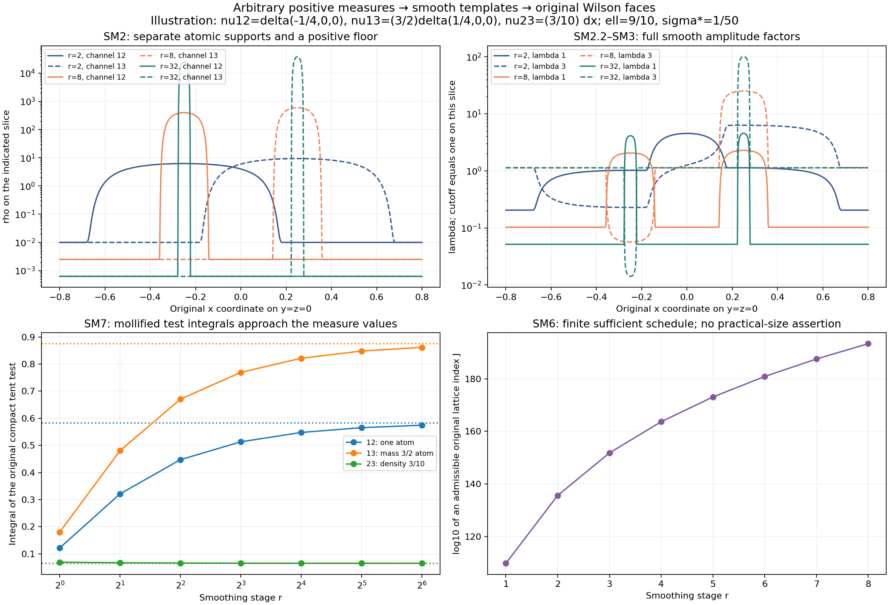

# Smooth connections receiving arbitrary positive spatial measures

This construction receives any triple of locally finite positive Radon
measures on the original physical ℝ³ by smooth compactly supported
connections on the unchanged regulator lattice. Every original finite
Wilson face, density factor, cutoff term and error is retained. The
construction is Borel, and its local mass bound gives joint moment
convergence whenever the original measure law has the corresponding
local moments. It does not identify the constructed finite link law
with the vacuum. The exact static source and a globally smooth
quadratic-time continuation with its complete remaining source are
calculated below; source-free evolution is constructed in the companion GM1–GM28 proof, using these exact initial data.

The finite holonomy estimates are [HC3–HC16](HOLONOMY_CURVATURE_RECEIVING.md), independently checked in
[HCR1–HCR2](HOLONOMY_CURVATURE_REVIEW.md). Their full finite bound is reproduced here. No external
theorem about the Yang–Mills vacuum or novelty claim is used.

## SM1. Original lattice and receiving measures

Retain the original physical center o, spacing a_j=(100j)⁻¹,
L_j=j⁴, vertices o+a_j(z−L_j1), positive edges, and three ordered face
orientations d<k. Retain T_i=−iσ_i/2 and
−2Tr(T_iT_k)=δik. For a smooth connection B, its edge transport is
U′=UB_d along the original positive edge, and its ordered face is

\[
 U_p=U_d(x)U_k(x+a_je_d)U_d(x+a_je_k)^{-1}U_k(x)^{-1},
 \qquad D_p=2-\operatorname{Tr}U_p.
\tag{SM1.1}
\]

The edge parameter is original physical length: more explicitly,
U′(s)=U(s)B_d(x+se_d), U(0)=I, 0≤s≤a_j. The iterated integral
series is bounded by the exponential of the integral of ||B_d||op,
and therefore gives its unique solution on the entire finite edge.
Differentiating UU* and det U gives U∈SU(2). Thus Tr U is real and
Dp=(1/2)||I−Up||F²≥0, with no exponential-curvature replacement.
The original couplings and Hamiltonian remain

\[
 g_j^2=\kappa_*a_j/2,\qquad \kappa_j=\kappa_*,\qquad
 b_j=(\kappa_*a_j^2)^{-1},\qquad
 \mathcal H_j=-\kappa_*\Delta+b_j\sum_p(2-\operatorname{Tr}U_p).
\tag{SM1.3}
\]

The connections below are inputs to its original link observables;
no assertion about the distribution of those inputs under its ground
state is built into this formula.

The scalar 2 remains in each Dp. Define the positive finite measures

\[
 \mathcal W_j^{dk}(B)=a_j^2\sum_{p:\,d_p=d,\,k_p=k}D_p(B)\delta_{x_{p,j}}.
\tag{SM1.2}
\]

For the original signed compact test \(f\), the exact sum over the three
orientations and the original unmultiplied observable are
\[
\begin{gathered}
\sum_{d<k}\mathcal W_j^{dk}(B)(f)=a_jC_{f,j}(\operatorname{Hol}_jB),\\
C_{f,j}=a_j\sum_p f(x_{p,j})D_p,\qquad
C_{f,j}=a_j^{-1}\sum_{d<k}\mathcal W_j^{dk}(f).
\end{gathered}
\]
Every original factor remains explicit.

Fix positive reference length ell and positive reference density σ*.
They are parameters of the connection construction and do not change
the lattice, Hamiltonian, coupling or test functions. Set
K_s=o+[−s ell,s ell]³ for s>0. Let
ν=(ν12,ν13,ν23) be any triple of positive Radon measures with finite
mass on every compact subset of the original ℝ³. Zero components and
singular components are allowed.

In the physical length convention, Dp and tj are dimensionless,
Wj and ν have mass dimension length², their densities ρ and σ* have
dimension length⁻¹, λ and A have dimension length⁻¹, and κ* has
dimension length⁻¹. In particular (SM2.2) and (SM4.1) retain the
length ell needed for that dictionary. These dimension assignments
do not restrict the mathematical choice of Radon measures.

## SM2. Smooth positive densities and all three channel factors

Choose a fixed nonnegative η∈C_c^∞(ℝ³), supported in [−1,1]³, with
∫η=1. Such a function is obtained by multiplying three copies of
exp(−1/(1−u²))1_{|u|<1} and dividing by its positive finite integral.
All derivatives extend by zero at the endpoints: each derivative is
the same exponential times a rational function of 1−u², whose limit
is zero because exponential decay dominates every power. This proves
the asserted smoothness and support.

At stage r∈{1,2,…}, put h_r=ell/r, ε_r=σ*/r and

\[
 \rho_{dk,r}(x)=\int h_r^{-3}\eta((x-y)/h_r)\,d\nu_{dk}(y)+\varepsilon_r.
\tag{SM2.1}
\]

Each integral is over a compact neighborhood of x, hence finite;
differentiation under that locally finite integral gives smoothness
of every order and the exact derivative formula
\[
\partial^\alpha\rho_{dk,r}(x)
=\int h_r^{-3-|\alpha|}(\partial^\alpha\eta)((x-y)/h_r)\,d\nu_{dk}(y),
\qquad |\alpha|\ge1.
\]
Every ρ is at least ε_r>0. Define the three positive smooth functions

\[
 \lambda_{1,r}=\sqrt2\,\ell^{-3/4}
       (\rho_{12,r}\rho_{13,r}/\rho_{23,r})^{1/4},
\quad
 \lambda_{2,r}=\sqrt2\,\ell^{-3/4}
       (\rho_{12,r}\rho_{23,r}/\rho_{13,r})^{1/4},
\]
\[
 \lambda_{3,r}=\sqrt2\,\ell^{-3/4}
       (\rho_{13,r}\rho_{23,r}/\rho_{12,r})^{1/4}.
\tag{SM2.2}
\]

These are the positive fourth roots on the entire positive octant;
no zero density is divided by, even when a target measure is zero.
Direct multiplication proves the three exact identities

\[
 \frac{\ell^3}{4}\lambda_{1,r}^2\lambda_{2,r}^2=\rho_{12,r},\quad
 \frac{\ell^3}{4}\lambda_{1,r}^2\lambda_{3,r}^2=\rho_{13,r},\quad
 \frac{\ell^3}{4}\lambda_{2,r}^2\lambda_{3,r}^2=\rho_{23,r}.
\tag{SM2.3}
\]

For example, the product of the first two squared functions is
\[
(4/\ell^3)\sqrt{(\rho_{12}\rho_{13}/\rho_{23})
(\rho_{12}\rho_{23}/\rho_{13})}=(4/\ell^3)\rho_{12},
\]
because ρ12>0. The other two computations retain the same factor.
Conversely the positive solution of these three product equations is
exactly (SM2.2), by dividing the first two equations by the third.
Thus this is a proved smooth bijection between the two positive
octants, with its full inverse density map (SM2.3).

The exact boundary image also explains why the positive floor and
stage-dependent bounds must remain. For finite nonnegative λi,
the density map (SM2.3) has image the positive octant, the three
nonnegative coordinate rays and their common origin. If all three
λi are positive, all three products are positive; if exactly two
λi are positive, exactly their pair product is positive; if at most
one is positive, all products vanish. Conversely a prescribed
positive 12 density v is realized by
λ1=λ2=(4v/ell³)¹/⁴ and λ3=0, and the other two rays follow by
permuting the same formulas; the origin is realized by λ=0.
Thus exactly two positive densities and a zero third cannot occur
with finite diagonal amplitudes. For the positive path
(ρ12,ρ13,ρ23)=(u,v,ε), u,v>0, formula (SM2.2) gives
λ1=√2ell⁻³/⁴(uv/ε)¹/⁴→∞ and the other two displayed amplitudes
decay as ε¹/⁴. The construction retains this precise possible
growth rather than assuming a uniform amplitude bound.

## SM3. Compact cutoff, exact density and derivative bounds

Choose a fixed χ∈C_c^∞(ℝ³) with 0≤χ≤1, χ=1 on [−1,1]³ and
support in [−2,2]³. Define

\[
 \chi_r(x)=\chi((x-o)/(r\ell)),\quad
 b_{i,r}(x)=\chi_r(x)\lambda_{i,r}(x),\quad
 A_{i,r}(x)=b_{i,r}(x)T_i,\quad
 H_{dk,r}(x)=\chi_r(x)^4\rho_{dk,r}(x).
\tag{SM3.1}
\]

The connection Ar is smooth and supported in K_2r; χr is one on K_r.
All three original colour channels remain. Their exact commutator
density is

\[
 \frac{\ell^3}{4}|[A_{d,r},A_{k,r}]|^2
 =\frac{\ell^3}{4}\chi_r^4\lambda_{d,r}^2\lambda_{k,r}^2
 =H_{dk,r}.
\tag{SM3.2}
\]

The fourth power of the cutoff is essential and is retained. No cutoff
is placed inside a denominator. The spatial divergence is explicitly
∑i∂iAi,r=∑i∂i(χrλi,r)Ti; it is generally nonzero. This construction
lands in the full smooth-connection domain of HC3, and is not asserted
to land in its divergence-free profile subspace.

This limitation has an exact form. If a compactly supported diagonal
connection A_i=b_iT_i obeys ∑i∂iA_i=0, independence of T1,T2,T3
implies ∂ibi=0 for each i. For fixed other coordinates, bi is then
constant on the entire i-coordinate line and is zero outside a
compact interval, hence is zero everywhere. Thus the intersection
of this compact diagonal domain with that divergence-free subspace
is exactly {0}. This does not constrain general divergence-free
connections, which can have additional spatial components in each
colour. The exact forward holonomy map used here has the full
smooth-connection domain; the Gauss equation with zero initial
electric field still holds for every output, as proved in SM10.

Here are finite bounds usable for a completely specified schedule.
Let C₀≥sup|η|, C₁≥sup|∇η|, Cχ≥sup|∇χ| be finite constants and

\[
\begin{gathered}
S_r=\sum_{d<k}\nu_{dk}(K_{2r+2}),\quad
 R_{0,r}=\varepsilon_r+C_0h_r^{-3}S_r,\quad
\\
 R_{1,r}=C_1h_r^{-4}S_r,\quad\\
 L_{\lambda,r}=\sqrt2\,\ell^{-3/4}(R_{0,r}^2/\varepsilon_r)^{1/4},
 \quad c_r^\chi=C_\chi/(r\ell).
\end{gathered}\tag{SM3.3}
\]

On K_2r and the support of χr, each density is between εr and R0,r,
and each density gradient has norm at most R1,r. The kernel's support
is contained in K_(2r+1), a subset of the retained K_(2r+2), proving
these bounds from (SM2.1). Taking a logarithmic derivative of (SM2.2)
gives, with the indicated two plus signs and one minus sign,

\[
 \partial_s\lambda_{i,r}
 =\frac{\lambda_{i,r}}4
 \left(\frac{\partial_s\rho_{a,r}}{\rho_{a,r}}
      +\frac{\partial_s\rho_{b,r}}{\rho_{b,r}}
      -\frac{\partial_s\rho_{c,r}}{\rho_{c,r}}\right).
\tag{SM3.4}
\]

Here (a,b,c) is (12,13,23), (12,23,13) or (13,23,12), according to i.

Thus |λi,r|≤Lλ,r and |∇λi,r|≤3Lλ,rR1,r/(4εr). By differentiating
χrλi,r and χr⁴ρdk,r, all cutoff contributions give the bounds

\[
 M_r:=\tfrac12L_{\lambda,r}\ge\max_i\sup\|A_{i,r}\|_{\rm op},\qquad
 L_r:=\tfrac12L_{\lambda,r}
       (c_r^\chi+3R_{1,r}/(4\varepsilon_r))
       \ge\max_{i,s}\sup\|\partial_sA_{i,r}\|_{\rm op},
\]
\[
 H_r:=R_{0,r}\ge\max_{d<k}\sup H_{dk,r},\qquad
 G_r:=4c_r^\chi R_{0,r}+R_{1,r}
       \ge\max_{d<k}\sup|\nabla H_{dk,r}|.
\tag{SM3.5}
\]

Outside the support the fields and their derivatives vanish. The
factor 1/2 in M and L is ||Ti||op=1/2. All these bounds are finite for
every locally finite input triple, including arbitrarily singular
ones. No rate of mass growth at infinity is assumed.

For the second derivatives needed by the exact source, let
C₂=max_{s,v}sup|∂s∂vη|,

Cχ,₂=max_{s,v}sup|∂s∂vχ|,
R₂,r=C₂h_r⁻⁵S_r and cχ,₂,r=Cχ,₂/(r ell)². The full logarithmic
second derivative in SM9 gives

\[
 |\partial_s\partial_v\lambda_{i,r}|
 \le L_{\lambda,r}\left(\frac{3R_{2,r}}{4\varepsilon_r}
                  +\frac{21R_{1,r}^2}{16\varepsilon_r^2}\right),
\]
\[
 |\partial_s\partial_v b_{i,r}|\le B_{2,r}:=
 L_{\lambda,r}\left[c^\chi_{2,r}
 +\frac{3c_r^\chi R_{1,r}}{2\varepsilon_r}
 +\frac{3R_{2,r}}{4\varepsilon_r}
 +\frac{21R_{1,r}^2}{16\varepsilon_r^2}\right].
\tag{SM3.6}
\]

Indeed the product of the two logarithmic first derivatives contributes
9R₁²/(16ε²); the logarithmic second derivative contributes at most
3R₂/(4ε)+3R₁²/(4ε²), giving 21/16. The two distinct mixed cutoff
terms each contribute 3cχR₁/(4ε). Smoothness gives finite constants
at every order; these second-order constants explicitly bound the
source, without asking the diagonal schedule to control that source.

## SM4. The full finite original face error

For any fixed stage r and any original j, put t_j=(ell/a_j)^(3/4),
δ_j=a_jt_j and B_j,r=t_jAr. The exact curvature is
t_j(∂dAk,r−∂kAd,r)+t_j²[Ad,r,Ak,r], with both parts retained.
HC14–HC15, or their following direct argument, give

\[
 \left|D_p(B_{j,r})-\frac{\ell^3a_j}{4}
                      |[A_{d,r}(x_p),A_{k,r}(x_p)]|^2\right|
 \le E_r(a_j),
\]
\[
 E_r(a)=4M_r^2\delta^2R_r(a)+R_r(a)^2,\qquad
 R_r(a)=\frac{32}{3}M_r^3\delta^3+4ta^2L_r,\quad
 t=(\ell/a)^{3/4},\quad\delta=at.
\tag{SM4.1}
\]

Each point on a face edge has coordinate-distance sum at most a from
the center. Unitary variation of each edge transport therefore gives
ta²Lr, and four-factor telescoping gives 4ta²Lr. The constant ordered
commutator has second derivative 2[Ad,Ak] at zero and third derivative
norm at most (2||Ad||+2||Ak||)³≤64Mr³. Its integral Taylor remainder
is at most 32Mr³δ³/3. This proves Up=I+δ²[Ad,Ak]+Rp with ||Rp||op≤Rr.
Using exactly Dp=(1/2)||I−Up||F² gives its leading term plus
δ²ReTr([Ad,Ak]*Rp)+(1/2)||Rp||F². The bounds
||[Ad,Ak]||op≤2Mr² and ||Rp||F≤√2Rr give (SM4.1). Thus the original
Dp has not been replaced by an exponential of curvature.

For use below, the complete positive error polynomial is

\[
 E_r(a)/a=
 \frac{128}{3}M_r^5\ell^{15/4}a^{1/4}
 +16M_r^2L_r\ell^{9/4}a^{3/4}
 +\frac{1024}{9}M_r^6\ell^{9/2}a^{1/2}
 +\frac{256}{3}M_r^3L_r\ell^3a
 +16L_r^2\ell^{3/2}a^{3/2}.
\tag{SM4.2}
\]

All powers and mixed terms come from the full square in (SM4.1).

## SM5. Global bounded-Lipschitz bound, with the original face centers

Suppose a_j≤ell and a_jL_j≥(2r+3)ell. Every face on which Dp(Bj,r)
can be nonzero has center in K_(2r+1): otherwise all four edges are
outside the support K_2r of Ar, so each transport is I. All such faces
belong to the original open box by the displayed geometric margin.
The density Hdk,r is supported in K_2r. Set

\[
 V_r=[2(2r+2)\ell]^3.
\tag{SM5.1}
\]

For each orientation, the number of relevant face centers is at most
Vr/a_j³. Indeed a translated one-dimensional grid has at most
2(2r+1)ell/a+2 points in that interval; cubing and using a≤ell gives
this bound. The original orientation centers can be completed to a
translated cubic mesh solely for estimating its Riemann sum; all
added nonzero candidates lie inside the original box by the margin,
and every other added term is zero.

For any real bounded Lipschitz function f with ||f||∞≤1 and
Lip(f)≤1/ell, the function fHdk,r is supported in K_2r and has Lipschitz
constant at most Hr/ell+Gr. Centered mesh cubes have maximal distance
√3a/2 from their centers, and their union where this function or its
sample is nonzero lies in K_(2r+1), of volume at most Vr. Integrating
the pointwise Lipschitz difference over those cubes proves

\[
 \left|a_j^3\sum_{p:\,dk}f(x_p)H_{dk,r}(x_p)
                     -\int fH_{dk,r}\right|
 \le\frac{\sqrt3}{2}a_jV_r(H_r/\ell+G_r).
\tag{SM5.2}
\]

Combining this with the full finite Wilson error gives

\[
 \boxed{\left|\mathcal W_j^{dk}(B_{j,r})(f)-\int fH_{dk,r}\right|
 \le V_r\left[E_r(a_j)/a_j+
        \frac{\sqrt3}{2}a_j(H_r/\ell+G_r)\right].}
\tag{SM5.3}
\]

For arbitrary bounded Lipschitz f the same right side is multiplied by
max(||f||∞,ell Lip(f)). This inequality retains the original f and
every orientation; it is a norm estimate, not a change in the
definition of an observable.

## SM6. An explicit measurable diagonal schedule

Let β_(r,1),…,β_(r,5) be the five coefficients of the powers of a in
(SM4.2), in that displayed order, and let
β_(r,6)=(√3/2)(Hr/ell+Gr). Their corresponding exponents are

\[
 (\alpha_1,\ldots,\alpha_6)=(1/4,3/4,1/2,1,3/2,1),\qquad
 \tau_r=\sigma_*\ell^3/r.
\tag{SM6.1}
\]

Starting at J₀=0, choose the following exact integer, without an
unstated rate assumption:

\[
 J_r=\max\left\{J_{r-1}+1,\ r,
 \left\lceil\frac1{100\ell}\right\rceil,
 \left\lceil[100(2r+3)\ell]^{1/3}\right\rceil,
 \max_{1\le v\le6}
 \left\lceil\frac1{100}
      \left(\frac{6V_r\beta_{r,v}}{\tau_r}\right)^{1/\alpha_v}
 \right\rceil\right\}.
\tag{SM6.2}
\]

A zero coefficient contributes zero. Every entry is finite by SM3;
Jr strictly increases and Jr≥r. If j≥Jr then each of the six terms
Vrβ_(r,v)a_j^αv is at most τr/6, and the original geometric margins
in SM5 hold because a_jL_j=j³/100. Hence (SM5.3) is at most τr.

Define r(j)=max{r:Jr≤j} when this set is nonempty, and put

\[
 \mathcal A_j[\nu]=t_jA_{r(j)}\quad(j\ge J_1),\qquad
 \mathcal A_j[\nu]=0\quad(j<J_1).
\tag{SM6.3}
\]

The maximum is finite since r≤Jr≤j, and r(j)→∞ since each fixed Jr
is finite. Every output is a smooth compactly supported connection.
The original amplitude tj=(ell/a_j)^(3/4) is unchanged; only its
explicitly chosen smooth template advances along the specified
diagonal. The zero early outputs are fully specified.

## SM7. Vague convergence for every original compact test

For f∈C_c(ℝ³), choose s with support in K_s. For all sufficiently
large r, χr=1 on this support. Formula (SM2.1) and interchange of a
finite positive measure integral (or its positive and negative test
parts) give

\[
 \int fH_{dk,r}=\int\!\int f(y+h_ru)\eta(u)\,du\,d\nu_{dk}(y)
                         +\varepsilon_r\int f.
\tag{SM7.1}
\]

Its difference from νdk(f) is at most
ω_f(√3h_r)νdk(K_(s+1))+εr∫|f| for r large enough, where ωf is the
global modulus of continuity of the compactly supported continuous
function f. Indeed the kernel moves a point by at most √3h_r and
only points in K_(s+1) contribute. This bound tends to zero.

For bounded Lipschitz compact f, SM5–SM6 already give
Wj^dk(Aj[ν])(f)−∫fHdk,r(j)→0. To pass to every continuous compact
test without a countable-test gap, we also prove a uniform local mass
bound. For s≥1 define the Lipschitz function
ψs(x)=max(0,1−dist∞(x,K_s)/ell). It is one on K_s, supported in
K_(s+1), and has Euclidean Lipschitz constant at most 1/ell. Since
0≤χr≤1 and h_r≤ell,

\[
 \int\psi_sH_{dk,r}
 \le\nu_{dk}(K_{s+2})+\sigma_*\operatorname{Vol}(K_{s+1}).
\]

Here integrating the nonnegative convolution first in x gives at most
one for each y∈K_(s+2), and zero outside; the floor contributes at
most (σ*/r)Vol K_(s+1), bounded as displayed. SM5–SM6 give, for every
j including its zero early output,

\[
 \boxed{\mathcal W_j^{dk}(\mathcal A_j[\nu])(K_s)
 \le\nu_{dk}(K_{s+2})+
       \sigma_*\operatorname{Vol}(K_{s+1})+\sigma_*\ell^3.}
\tag{SM7.2}
\]

Approximate the original f uniformly by compactly supported Lipschitz
functions supported in a fixed slightly larger cube. One explicit
approximation is multilinear interpolation on finer cubical meshes
of a compactly supported uniformly continuous f, with zero exterior
values; its error is bounded by ωf of the mesh diameter and its
support stays in that larger cube. Bound both measure-evaluation
errors by the uniform error times (SM7.2) or νdk of that cube. First
take j→∞ for the fixed approximant and then let its error tend to
zero. This proves simultaneously, for this same deterministic
connection sequence and all original compact continuous tests,

\[
 \boxed{\mathcal W_j^{dk}(\mathcal A_j[\nu])\longrightarrow\nu_{dk}
 \text{ vaguely for all }d<k.}
\tag{SM7.3}
\]

In particular a_jC_f,j→∑d<kνdk(f) for every original signed f. No
absolute continuity of ν or lower density of a target component is
required. The floor vanishes locally in the limit and the complete
cutoff contribution lies outside each fixed test support eventually.

## SM8. Borel construction and joint laws and moments

Give positive Radon measures their vague Borel structure, and smooth
connections the C^∞ local topology. For fixed r, ν→ρdk,r is continuous
in C^∞ on every compact set. To prove this, each derivative evaluated
at a fixed x is a vague integral of a compactly supported smooth test.
For x in a fixed compact set, all such kernels have a common compact
support. Vaguely convergent positive measures have uniformly bounded
mass there: choose a continuous compact test at least one on that
set and use convergence of its integrals. One more derivative of η
then gives a uniform modulus of continuity of the derivative kernels
in x. A finite covering transfers pointwise convergence to uniform
convergence. This argument applies to every derivative order.

The strictly positive floor allows the smooth functions in (SM2.2)
to be differentiated and composed continuously on each compact set;
there is a fixed lower denominator εr. Multiplication by χr gives a
continuous map to the fixed compactly supported template Ar.
Each mass νdk(K_(2r+2)) is Borel: continuous compact functions
decreasing to the indicator of that compact cube give it as the
decreasing limit of their integrals. Thus Sr and all bounds and
ceilings in (SM6.2) are Borel. Recursion gives Borel Jr, and the
finite event {r(j)=r} is {Jr≤j<Jr+1}. On each such event Aj is the
corresponding fixed-stage Borel map, multiplied by the deterministic
tj. Hence ν→Aj[ν] is Borel for every j. The exact edge holonomy is
continuous on a fixed finite edge union by the unitary integral
bound; therefore ν→HoljAj[ν] and ν→Wj(Aj[ν]) are Borel as well.

Let P be any probability law of a triple of locally finite positive
Radon measures. Applying these Borel maps defines genuine finite
connection and link laws. SM7.3 holds for every input, so for every
finite list of original compact tests and orientations their complete
joint observation vector converges almost surely. Consequently every
bounded continuous function of that vector has convergent expectation,
by its pointwise convergence and boundedness. This transfers the full
finite-dimensional limiting law without a local moment assumption.

For joint moments of total degree q, it is enough that for every
required compact cube

\[
 \mathbb E_P\left(1+\sum_{d<k}\nu_{dk}(K_{s+2})\right)^q<\infty.
\tag{SM8.1}
\]

Indeed (SM7.2) bounds each compact test evaluation by its original
supremum norm times the displayed local mass plus a fixed constant.
The absolute product of q such evaluations is bounded by a constant
times the integrable quantity in (SM8.1). Dominated convergence yields

\[
 \boxed{\lim_j\mathbb E_P\prod_{v=1}^q
  \mathcal W_j^{d_vk_v}(\mathcal A_j[\nu])(f_v)
 =\mathbb E_P\prod_{v=1}^q\nu_{d_vk_v}(f_v).}
\tag{SM8.2}
\]

All cross-orientation correlations and signed tests remain inside the
same product; independent sampling of components is not imposed.
Laws with deterministically bounded mass on each compact cube satisfy
every such finite moment assumption. They also permit a common
nonrandom schedule, obtained in SM3–SM6 by replacing Sr with its
deterministic bound. The Borel schedule above already proves the
stronger local-moment result. These limiting-observation laws are
not asserted to equal the original finite quantum vacuum laws.

## SM9. Complete static curvature and source

Fix one output j and its stage r, write b_i=χrλi,r and t=tj only in
this section, and retain the full connection B_i=t b_iTi. For k≠i,

\[
 F_{ki}^B=t[(\partial_kb_i)T_i-(\partial_ib_k)T_k]
                       +t^2b_kb_i[T_k,T_i].
\tag{SM9.1}
\]

Its three colour terms are mutually orthogonal. Thus the full
magnetic norm, including all cutoff derivatives, is

\[
 |F_{ki}^B|^2=t^2[(\partial_kb_i)^2+(\partial_ib_k)^2]+t^4b_k^2b_i^2.
\tag{SM9.2}
\]

The cross term of order t³ is exactly zero because the commutator
colour is orthogonal to Ti and Tk, not because a derivative term was
discarded. For Minkowski metric (−,+,+,+), temporal gauge B₀=0 and
static B, the time source is zero and the complete spatial source is

\[
 J_i:=\sum_kD_k^BF_{ki}^B
 =t\sum_{k\ne i}[(\partial_k^2b_i)T_i-(\partial_k\partial_ib_k)T_k]
\]
\[
 \hspace{8mm}+t^2\sum_{k\ne i}
   [b_i\partial_kb_k+2b_k\partial_kb_i][T_k,T_i]
       -t^3b_i\sum_{k\ne i}b_k^2T_i.
\tag{SM9.3}
\]

Differentiate (SM9.1), then add [t bkTk,Fki]. Its derivative-bracket
contribution is t²bk∂kbi[Tk,Ti], and its twice-bracket contribution is
−t³bk²biTi because [Tk,[Tk,Ti]]=−Ti. Combining these with the
derivative of the commutator proves every coefficient in (SM9.3).
Every derivative of b retains

\[
 \partial_sb_i=(\partial_s\chi_r)\lambda_i+\chi_r\partial_s\lambda_i,
\]
\[
 \partial_s\partial_vb_i=(\partial_s\partial_v\chi_r)\lambda_i
 +(\partial_s\chi_r)\partial_v\lambda_i
 +(\partial_v\chi_r)\partial_s\lambda_i
 +\chi_r\partial_s\partial_v\lambda_i.
\tag{SM9.4}
\]

The exact second lambda derivative is obtained by writing the
logarithmic sum Li=logρa+logρb−logρc from SM3.4:
∂s∂vλi=λi[(∂sLi)(∂vLi)/16+∂s∂vLi/4], where
∂s∂vlogρ=(∂s∂vρ)/ρ−(∂sρ)(∂vρ)/ρ². This preserves each minus
sign and denominator and completes the source in the original
measure data and fixed smoothing/cutoff functions.

In particular the full quadratic coefficient is

\[
 b_i\partial_kb_k+2b_k\partial_kb_i
 =3\chi_r(\partial_k\chi_r)\lambda_i\lambda_k
 +\chi_r^2(\lambda_i\partial_k\lambda_k
                         +2\lambda_k\partial_k\lambda_i),
\tag{SM9.5}
\]

and the cubic coefficient is χr³λi∑k≠iλk². These retain all mixed
cutoff factors. With B₀,r=Lλ,r and
B₁,r=Lλ,r(cχr+3R₁,r/(4εr)), the orthogonality of the colour
components in each degree and the triangle inequality give

\[
 |J_i|\le\sqrt6\,tB_{2,r}
             +3\sqrt2\,t^2B_{0,r}B_{1,r}
             +2t^3B_{0,r}^3.
\tag{SM9.6}
\]

For the first degree, the Ti coefficient is a sum of two second
derivatives and the other two coefficients are single second
derivatives, so its square is bounded by (4+1+1)B₂². The second
degree has two orthogonal commutator colours, each bounded by
3B₀B₁. The third degree is the sum of two coefficients B₀³ in
the Ti direction. This proves (SM9.6) including its constants.

Each B and J is smooth and compactly supported. The geometric
magnetic energy (1/2)∫∑i<k|Fik|² is finite at each j by (SM9.2).
No bound uniform in j follows from this statement. Zero initial
electric field satisfies Gauss exactly; the source-free equation
would require initial acceleration ∂₀²Ai=Ji. The static connection
is not made source free by its observable realization.

If a current is defined using the convention D^μFμi=g_j²j_i,
the exact static current is j_i=2J_i/(κ*a_j), with j₀=0.
This defines that classical current from the calculated source and
the original coupling; it does not assert a quantum current law.

## SM10. An explicit next dynamical map with exact Gauss constraint

The receiving source defines a concrete next smooth connection.
Keep physical x⁰=c tphysical, put s=x⁰, and set

\[
 C_i=J_i/2,\qquad
 \widehat A_0=0,\quad \widehat A_i(s,x)=B_i(x)+s^2C_i(x).
\tag{SM10.1}
\]

This polynomial-time connection is globally smooth and compactly
supported in space at each time. It preserves the original zero-time
holonomy and every receiving measure already proved. Its electric
field is F̂0i=2sCi=sJi.

For any smooth B, its source obeys the exact covariant identity

\[
 \sum_iD_i^BJ_i=\sum_{i,k}D_i^BD_k^BF_{ki}^B
 =\frac12\sum_{i,k}[D_i^B,D_k^B]F_{ki}^B
 =\frac12\sum_{i,k}[F_{ik}^B,F_{ki}^B]=0.
\tag{SM10.2}
\]

The middle identity follows by interchanging i,k and using
Fik=−Fki. The derivative commutator is [Di,Dk]X=[Fik,X], obtained
by expanding both derivatives and using the Jacobi identity for
matrix commutators. Each final bracket is zero since its two inputs
are negatives. Therefore, at every real s,

\[
 \sum_iD_i^{\widehat A}\widehat F_{0i}
 =s\sum_iD_i^BJ_i+\frac{s^3}{2}\sum_i[J_i,J_i]=0.
\tag{SM10.3}
\]

This proves the complete Gauss equation for the explicit extension,
not only at its initial time. It does not imply the spatial equations.
To calculate those, define without deleting any coefficient

\[
 G_{ki}=D_k^BC_i-D_i^BC_k,\qquad H_{ki}=[C_k,C_i],\qquad
 \widehat F_{ki}=F_{ki}^B+s^2G_{ki}+s^4H_{ki}.
\]
\[
 R_{2,i}=\sum_k(D_k^BG_{ki}+[C_k,F_{ki}^B]),\quad
 R_{4,i}=\sum_k(D_k^BH_{ki}+[C_k,G_{ki}]),\quad
 R_{6,i}=\sum_k[C_k,H_{ki}].
\tag{SM10.4}
\]

Since Dk^Â=Dk^B+s²[Ck,·] and −∂₀²Âi=−2Ci=−Ji, direct
multiplication gives the full residual

\[
 \boxed{D^\mu\widehat F_{\mu i}
                  =s^2R_{2,i}+s^4R_{4,i}+s^6R_{6,i},\qquad
 D^\mu\widehat F_{\mu0}=0.}
\tag{SM10.5}
\]

Thus the original spatial equation holds exactly at s=0 with its
required acceleration; the displayed higher source remains for later
times. There is no assumed PDE solution or assumed long-time limit.
All times here are the original x⁰=c tphysical, with no hidden
regulator-dependent time change.

In physical time, ∂²A_i/∂tphysical² at zero is c²J_i. The current
in the preceding coupling convention is exactly
2(s²R₂,i+s⁴R₄,i+s⁶R₆,i)/(κ*a_j), with zero time component.
Thus the time, length and coupling factors remain explicit in the
continuation as well as in its initial source.

There is also a checked energy consequence at the initial time. Let

Egeom(s)=(1/2)∫∑i|F̂0i|²+(1/2)∫∑i<k|F̂ik|².

Compact spatial
support permits integration by parts. The magnetic first variation
in a direction V is
∑i<k∫<Fik,DiVk−DkVi>=−∑i∫<Ji,Vi>, because the invariant inner
product makes ad(Bi) skew adjoint. At s=0, Â′=0 and Â″=J, so

\[
\begin{gathered}
E_{\rm electric}'(0)=E_{\rm magnetic}'(0)=0,\qquad
\\
 E_{\rm electric}''(0)=\sum_i\int|J_i|^2,
\\
 \quad E_{\rm magnetic}''(0)=-\sum_i\int|J_i|^2,
 \quad E_{\rm geom}''(0)=0.
\end{gathered}\tag{SM10.6}
\]

This is the exact next kinetic/magnetic balance for the constructed
connection. Its remaining dynamical source is still (SM10.5).

The same calculation gives the entire energy polynomial, a further
quantity determined by that source. Put
\(\langle X,Y\rangle_{\Sigma}=\sum_{i<k}\int\langle X_{ik},Y_{ik}\rangle\)
and \(\|X\|_\Sigma^2=\langle X,X\rangle_\Sigma\). Expansion of the
complete curvature square in (SM10.4), followed by
⟨FB,G⟩Σ=−∑i∫⟨Ji,Ci⟩=−(1/2)∑i∫|Ji|², proves

\[
 E_{\rm geom}(s)=E_{\rm geom}(0)
 +\frac{s^4}{2}\big(\|G\|_\Sigma^2+2\langle F^B,H\rangle_\Sigma\big)
 +s^6\langle G,H\rangle_\Sigma+\frac{s^8}{2}\|H\|_\Sigma^2.
\tag{SM10.7}
\]

Every integral is finite because the coefficients are compactly
supported. Equivalently, differentiation and integration by parts
give E′geom=∑i∫⟨Â′i,Â″i−∑kDkFki⟩. Using (SM10.5) and Â′=sJ
therefore yields the exact source-work identity

\[
 E_{\rm geom}(s)-E_{\rm geom}(0)
 =-\frac{s^4}{4}\sum_i\int\langle J_i,R_{2,i}\rangle
  -\frac{s^6}{6}\sum_i\int\langle J_i,R_{4,i}\rangle
  -\frac{s^8}{8}\sum_i\int\langle J_i,R_{6,i}\rangle.
\tag{SM10.8}
\]

This comparison proves, in particular,
∑i∫⟨Ji,R6,i⟩=−4||H||Σ²≤0 and identifies every other coefficient
by equating the displayed powers. No conservation at later times
is inferred from the exact cancellation at the initial time.

This extension is itself an exact measurable receiving map in
space-time. For any smooth spatial B define I(B) by (SM10.1), using
its full source J(B). Spatial derivatives and matrix products make
B↦J(B) continuous in the C∞ local topology. Multiplication by s²
therefore makes I continuous into the C∞ local topology on original
ℝ×ℝ³. Evaluation at s=0 obeys ev₀∘I=id, so I is an injective
section of that evaluation on its image. Composing it with the
Borel map ν↦Aj[ν] from SM8 gives Borel laws of globally smooth
space-time connections satisfying the exact Gauss identity at every
time and the spatial equation at zero, with (SM10.5) as their full
later source. No choice of a PDE solution enters this map.

For a time-independent smooth gauge h, this section also obeys
I(B^h)=I(B)^h. Indeed expanding the derivative gives
Dk^{B^h}(hXh⁻¹)=h(Dk^BX)h⁻¹, and HC5 gives F^{B^h}=hFBh⁻¹.
Thus J(B^h)=hJ(B)h⁻¹; substituting in B^h+s²J(B^h)/2 proves
the stated identity, including the original term −(dh)h⁻¹ in
B^h. The section is defined on all smooth spatial B for this
identity; compact support is used only for the finite energy claims.

## SM11. Receiving scope and subsequent calculation

SM1–SM8 prove the full deterministic and measurable receiving map,
including arbitrary singular input measures and exact joint-moment
transfer under local moment bounds. They match the limiting spatial
measure observables; no finite-regulator vacuum density has been
replaced. SM9–SM10 identify the source and construct an explicit
globally smooth continuation that satisfies Gauss for every time and
the spatial equation at its initial time, with its full subsequent
source polynomial visible. The companion [GM1–GM28](GLOBAL_MEASURE_EVOLUTION.md) now constructs source-free global evolution from these data, with exact energy, time and probability maps. Quantum reconstruction remains to be established.

The next dynamical object is now the concrete triple R2,R4,R6 and its
dependence on the original measure smoothing and diagonal schedule.
Those terms, together with the actual law being received, determine
what must be calculated next. Their presence does not invalidate or
alter the already proved spatial receiving map.

## SM12. Exact illustration, reproducible checks and source locators

The [measure figure](SMOOTH_MEASURE_RECEIVER.png) and its vector counterpart
are generated by the [reproducible script](check_smooth_measure.py). They use original physical
coordinates o=0, ell=9/10, σ*=1/50 and the exact input triple

\[
 \nu_{12}=\delta_{(-1/4,0,0)},\qquad
 \nu_{13}=\frac32\delta_{(1/4,0,0)},\qquad
 \nu_{23}=\frac3{10}\,dx,
 \qquad f(x)=\prod_{i=1}^3(1-|x_i|/(3/5))_+.
\tag{SM12.1}
\]

Its target observations are 7/12, 7/8 and 81/1250 respectively:
evaluation at either atom gives 1−(1/4)/(3/5)=7/12, the second
measure multiplies this by 3/2, and the integral of each one-dimensional
tent is 3/5, so (3/10)∫f=(3/10)(3/5)³=81/1250.

For full reproducibility set
β(u)=Z⁻¹exp(−1/(1−u²))1{|u|<1}, with its actual integral

Z=∫₋₁¹exp(−1/(1−u²))du retained, and η(u)=∏iβ(ui).
For this figure choose χ(x)=∏iθ(xi), where θ(v)=1 for |v|≤1,
θ(v)=0 for |v|≥2, and
θ(v)=∫_{2|v|−3}¹β(u)du for 1<|v|<2. Endpoint flatness of β
proves that θ is smooth and that this χ has exactly the support and
unit region in SM3. Since the test support lies in K₁, χr=1 on
that support at every illustrated stage.

The density slice in the upper left of the figure is exactly
h⁻³β((x+1/4)/h)β(0)²+ε for orientation 12 and
(3/2)h⁻³β((x−1/4)/h)β(0)²+ε for orientation 13; orientation 23
has the constant density 3/10+ε. Here h=ell/r and ε=σ*/r.
The upper right shows λ1 and λ3 obtained by substituting these
three densities into the original formula (SM2.2); λ2 is determined
by that same displayed formula. Those are slices of smooth
three-dimensional fields, not one-dimensional replacement measures.

For an atom at (v,0,0), the exact integral in the lower left is

\[
 \left[\int_{-1}^{1}\beta(u)(1-|v+h_ru|/(3/5))_+\,du\right]
 \left[\int_{-1}^{1}\beta(u)(1-|h_ru|/(3/5))_+\,du\right]^2
 +\varepsilon_r(3/5)^3.
\tag{SM12.2}
\]

For orientation 13 the atomic product is multiplied by 3/2 and the
floor remains as displayed. For orientation 23 the answer is
(3/10+εr)(3/5)³. Fubini and the product kernel prove these formulas.
The script evaluates these one-dimensional integrals by bounded
quadrature; the dotted lines show the exact limits from (SM12.1).
These are stage-density integrals. Their transfer to the original
Wilson faces is proved by the finite bound SM5.3 and schedule SM6,
not inferred from the numerical plot.

The lower-right schedule uses rigorous conservative constants
C₀=512, C₁=8192, Cχ=32. To prove them, the interval [−1/2,1/2]
gives Z≥exp(−4/3)>exp(−2)>1/8. The last inequality follows from
e²<8: the exponential series through degree four sums to 7 and
its remaining terms sum to at most (2⁵/5!)/(1−1/3)=2/5.
Thus 0≤β≤8. For t=1/(1−u²), the derivative of the unscaled bump
has magnitude at most 2t²e⁻ᵗ≤8, so |β′|≤64. The product formula
gives η≤8³=512 and |∇η|≤4096√3<8192. Finally |θ′|≤16, hence
The gradient satisfies \(|\nabla\chi|\le16\sqrt3<32\). All constants used in this schedule are therefore
proved upper bounds for the actual smooth functions.

The figure deliberately uses a larger sufficient integer schedule
to allow exact rational checks. With ell=9/10, replace Lλ by
(5/3) times the least integer N with N⁴≥R₀²/ε; this is an upper
bound because √2 ell⁻³/⁴≤(3/2)(10/9)=5/3. Use that bound in M,L;
replace positive fractional powers of ell in each β by 1, and
replace √3/2 by 1. Call the resulting rational upper coefficients
β̄v. Set Tv=max(1,ceil(6Vrβ̄v/τr)). Choosing j at least every Tv⁴
gives j^αv≥j¹/⁴≥Tv for all αv≥1/4, so every error term is at
most τr/6 even before the retained factor 100 in a_j=(100j)⁻¹.
Take also the increasing-index and geometric maxima from SM6,
with ceil(100(2r+3)ell) as a larger geometric choice. The script
checks each term exactly by the equivalent rational inequality
(6Vrβ̄v/τr)^q a_j^p≤1 for αv=p/q. The plotted logarithms are
numerical displays of these certified integers; practical lattice
sizes are not asserted.

The bounded checks comprise 23 exact symbolic identities for the
full error polynomial and quadratic-time curvature/Gauss/source,
48 exact rational schedule inequalities for r=1,…,8, and 64
positive-octant factorization samples. The independent AA1–AA20
contribution provides 89 further exact symbolic identities for all
amplitude derivatives, cutoff terms, static source and curvature
squares. These checks supplement the full proofs above. The
symbolic time test uses three explicitly recorded affine amplitudes
only to test the local algebra; compact support and energy identities
are established by SM3 and SM9–SM10, not by that probe.

The complete source map is recorded in `SMOOTH_GLOBAL_SOURCE_USE_LEDGER.json`.
HC1–HC4 fix the original metric, lattice and holonomy; HC14–HC16
provide the finite estimate rederived in SM4; HCR1 proves the gauge
notation dictionary and HCR2 its compact-local estimate domain;
AA1–AA20 independently derive the factorization, source and diagonal
domain obstruction. Their retained full source files accompany this
derivation. Existing corpus routing was inspected before this
derivation; no unread external theorem or novelty assertion is used.

## Global source-free evolution of the measure-realizing data

[GM1–GM28](GLOBAL_MEASURE_EVOLUTION.md) apply Sung-Jin Oh's global Cauchy theorem to the exact smooth compact data, construct continuous solution laws from the actual central spatial measure, and prove their zero-time Wilson and energy receiving maps. The complete time expansion, a strict electric-field stationarity defect, and time averages with an explicit invariance error are calculated. The exact virial proves that any stationary probability on conserved finite-total-energy smooth trajectories is supported on flat fields, without an energy-moment assumption. Its receiving space must therefore be enlarged to allow infinite total energy for a nonflat stationary classical law. Quantum reconstruction and the actual low-window coefficients remain to be established.
