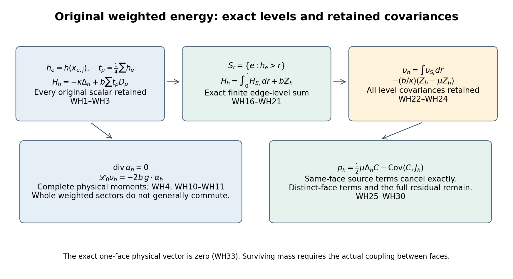
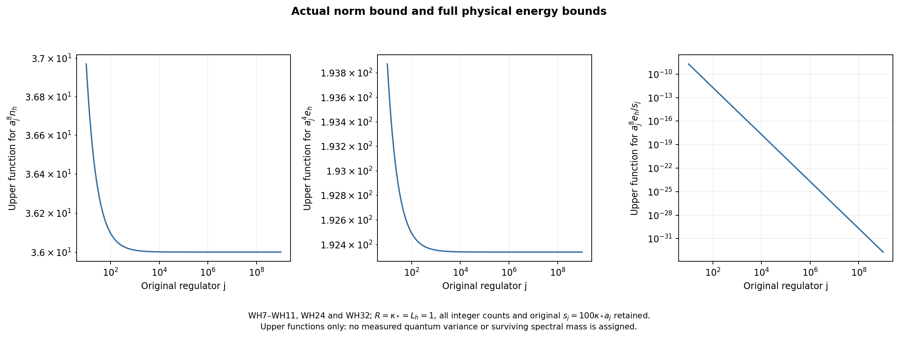

# Smooth spatial energy weights, exact sector covariances and physical windows

This calculation extends the full physical local-energy vector of [LE1–LE23](https://github.com/KokunoYumeto/yang-mills-interacting-workbench/blob/85b7dee88956ecafb4303f9794d3bee7ba0b1738/yang-mills/continuations/20261011-central-signs-shrinking-window/LOCAL_ENERGY_PHYSICAL_WINDOWS.md). Its exact inputs are [BQ2–BQ4](https://github.com/KokunoYumeto/yang-mills-interacting-workbench/blob/85b7dee88956ecafb4303f9794d3bee7ba0b1738/yang-mills/continuations/20261011-central-signs-shrinking-window/BOUNDARY_FORCE_PROJECTION.md), the original local energy and second-moment budgets [LC4–LC20](https://github.com/KokunoYumeto/yang-mills-interacting-workbench/blob/85b7dee88956ecafb4303f9794d3bee7ba0b1738/yang-mills/continuations/20261011-central-signs-shrinking-window/LOCAL_CURVATURE_BUDGET.md), the commuting-sector variance calculation [KC7–KC11](https://github.com/KokunoYumeto/yang-mills-interacting-workbench/blob/85b7dee88956ecafb4303f9794d3bee7ba0b1738/yang-mills/continuations/20261011-central-signs-shrinking-window/KINETIC_CURRENT_AND_PHYSICAL_ENERGY.md), and the original score bound [SR65](https://github.com/KokunoYumeto/yang-mills-interacting-workbench/blob/85b7dee88956ecafb4303f9794d3bee7ba0b1738/yang-mills/continuations/20261011-central-signs-shrinking-window/SQUARE_ROOT_SCORE_RECEIVING_MAPS.md). It proves physical moment bounds for smooth spatial weights, an actual variance bound by finite edge-level decomposition, the exact noncommuting-sector defect, and the complete original-observable coupling. None of the covariance terms is replaced by an assumed limiting value.

## 1. Original weighted Hamiltonian and full physical map

Keep every original positively oriented edge, vertex gauge action, Haar probability and radius-two \(\mathrm{SU}(2)\) factor, with \(T_\alpha=-i\sigma_\alpha/2\) orthonormal. Retain
\[
\begin{gathered}
L_j=j^4,\quad a_j=(100j)^{-1},\quad g_j^2=\kappa_*a_j/2,\quad
b_j=(\kappa_*a_j^2)^{-1},\quad s_j=100\kappa_*a_j,\\
U_p=U_d(z)U_e(z+e_d)U_d(z+e_e)^{-1}U_e(z)^{-1},\quad d<e,\\
D_p=2-\operatorname{Tr}U_p,\quad
H=-\kappa\Delta+b\sum_pD_p,\quad H\psi=E_0\psi,\\
\psi>0,\quad\int\psi^2dU=1,\quad w=\log\psi,\quad d\mu=\psi^2dU,\\
x_{e,j}=o+a_j\{z-L_j\mathbf1+e_d/2\},\quad
x_{p,j}=o+a_j\{z-L_j\mathbf1+(e_d+e_e)/2\},\\
C=C_{\mathbf f,j}=a_j\sum_{\sigma,p}f_\sigma(x_{p,j})D_p,\qquad F=C-\mu C .
\end{gathered}\tag{WH1}
\]
The tests \(f_\sigma\) are the original real continuous compactly supported functions. Fix an additional real \(h\in C_c^\infty(\mathbb R^3)\), \(0\le h\le1\), supported in \([c,c+R]^3\), \(R>0\). Let \(L_h\) be its Euclidean Lipschitz constant. This is a deterministic spatial weight in the original Hamiltonian, not a replacement vacuum.

Write
\[
\begin{gathered}
h_e=h(x_{e,j}),\quad t_p=\tfrac14\sum_{e\in\partial p}h_e,\quad
\Delta_h=\sum_eh_e\Delta_e,\quad W_t=\sum_pt_pD_p,\\
H_h=-\kappa\Delta_h+bW_t,\quad
K_h=\Delta_h\psi/\psi,\quad m_h=\langle\psi,H_h\psi\rangle,\\
\upsilon_h=-\kappa^{-1}(\psi^{-1}H_h\psi-m_h)
=K_h-(b/\kappa)W_t+m_h/\kappa,\\
\mu\upsilon_h=0,\quad
n_h=\|\upsilon_h\|^2
=\{\|H_h\psi\|^2-m_h^2\}/\kappa^2 .
\end{gathered}\tag{WH2}
\]
The full potential scalar is \(2b\sum_pt_p\). Nonnegative weighted Casimir forms and a bounded real potential define \(H_h\); every smooth function used here lies in the domains of all displayed differential products. The scalar and physical vector \(\psi\upsilon_h\) are smooth and gauge invariant. No strict positivity of \(n_h\) for an arbitrary weight is assumed.

Let \(D_h\) multiply the one-form block on edge \(e\) by \(h_e\), and let \(P\) be the full \(L^2(\mu)\) exact-gradient projection of BQ2. Retain
\(\delta_\mu=-\operatorname{div}-2dw\mathbin{\lrcorner}\) and
\(\mathscr L_0=\psi^{-1}(H-E_0)\psi=\kappa\delta_\mu d\).
The original weighted ground equation gives
\[
\begin{gathered}
\mathscr L_0K_h=\delta_\mu(D_h\,dV),\quad
\kappa\,dK_h=P(D_h\,dV),\quad
\mu K_h=-\mu\sum_eh_e|g_e|^2,\quad g_e=d_ew,\\
\alpha_{h,e}=\sum_{p\ni e}(h_e-t_p)d_eD_p,\quad
d\upsilon_h=(b/\kappa)P\alpha_h,\quad
\mathscr L_0\upsilon_h=b\,\delta_\mu\alpha_h .
\end{gathered}\tag{WH3}
\]
For completeness, product Casimirs commute with \(\Delta_h\). Thus
\[
(H-E_0)\Delta_h\psi
=-(\Delta_hV)\psi-2\sum_eh_e\,d_eV\cdot d_e\psi .
\]
Division by \(\psi\) proves the first identity. Its difference from
\(\kappa\delta_\mu dK_h\) has zero weighted divergence, giving the exact projection. Haar integration by parts proves the retained mean. Subtract the entire \(bW_t\) in (WH2) to obtain the final line; its scalar was present before differentiation.

Each original face has the identical one-edge Casimir
\(\Delta_eD_p=\tfrac34(2-D_p)\), including inverse traversals. Consequently
\[
\begin{gathered}
\operatorname{div}\alpha_h
=\frac34\sum_p\left(\sum_{e\in\partial p}(h_e-t_p)\right)(2-D_p)=0,\\
\delta_\mu\alpha_h=-2\sum_eg_e\cdot\alpha_{h,e},\\
e_h:=\langle\upsilon_h,\mathscr L_0\upsilon_h\rangle
=\frac{b^2}{\kappa}\|P\alpha_h\|^2
=\frac{b^2}{\kappa}\{\|\alpha_h\|^2-\|(I-P)\alpha_h\|^2\},\\
q_h:=\|\mathscr L_0\upsilon_h\|^2
=4b^2\mu\left(\sum_eg_e\cdot\alpha_{h,e}\right)^2 .
\end{gathered}\tag{WH4}
\]
The full trace is calculated before its facewise cancellation. The last square retains all different-edge and different-face cross terms.

The map from weights to centered vectors is linear. For constant \(h_e=u\), \(t_p=u\), \(H_h=uH\), and \(\upsilon_h=0\) exactly, retaining \(uE_0\) before centering. Adding a constant to any weight gives the same vector. For the sharp edge weight \(1_Q\), the face-average allocation differs from LE's inside-face allocation by one quarter of the crossing potential:
\[
\upsilon_{1_Q}^{\,\mathrm{average}}
=\upsilon_Q^{\,\mathrm{LE}}
-\frac b{4\kappa}(\mathcal W_\times-\mu\mathcal W_\times).
\tag{WH5}
\]
Every crossing face of a strict cube has one inside edge; inside and outside faces have four and zero. This proves the exact map, without identifying the two allocations.

## 2. Smooth spatial differences and complete physical moment bounds

Relative to one edge center in a plaquette, the four distances are
\(0,a_j,a_j/\sqrt2,a_j/\sqrt2\). Hence, with
\(c_h=(1+\sqrt2)L_h/4\),
\[
|h_e-t_p|\le c_ha_j,\qquad
\max_{e\in\partial p}h_e-\min_{e\in\partial p}h_e\le L_ha_j .
\tag{WH6}
\]
Keep the original fitting cube
\[
\begin{gathered}
v_{j,d}=L_j+\lfloor(c_d-o_d)/a_j\rfloor-1,\quad
q_j=\lceil R/a_j\rceil+3,\quad Q_0=v_j+\{0,\ldots,q_j\}^3,\\
N_0=3q_j(q_j+1)^2,\quad M_0=3q_j^2(q_j+1),\quad C_0=12q_j(q_j+1),\\
\Lambda_0=\min\{2M_0,6g_j^2\sqrt{N_0M_0}\}+2C_0,\quad
W_0=\sum_{p\subset Q_0}D_p,\\
G(a)=\min\{8/(\kappa_*^2a^2),C_{\rm heat}/(\kappa_*a)\},\quad
C_{\rm heat}=2+2\sqrt{4+2\pi},\quad \mathcal A_0=N_0G(a_j)^2 .
\end{gathered}\tag{WH7}
\]
For sufficiently large \(j\), the cube is strict in the original box. If a face has any nonzero \(h_e\), one edge center lies in the support cube; each of its face vertices differs in each coordinate by at most \(a_j\). The lower and upper fitting margins are at least \(a_j\), by the retained floor and ceiling. That entire face therefore belongs to \(Q_0\). Every component of \(\alpha_h\) lies on its edge set, including the possibly zero-weight edges of these faces.

The original local bounds, with all energies and crossing costs supplied in LC14–LC20, are
\[
\mu W_0\le\Lambda_0,\quad
\mu W_0^2\le\Lambda_0^2+4\kappa/b,\quad
0\le m_h\le\langle\psi,H_{\rm in}(Q_0)\psi\rangle\le b\Lambda_0 .
\tag{WH8}
\]
The second inequality follows directly from the LC form inequality with
\(f=(W_0+\epsilon)^{1/2}\), then \(\epsilon\downarrow0\):
\(\Gamma(W_0)\le16W_0\) gives
\(\mu W_0^2\le\Lambda_0\mu W_0+4\kappa/b\).
For the last bound, every coefficient \(h_e,t_p\) is between zero and one and every nonzero term is inside \(Q_0\), so the difference of the two forms is nonnegative. This preserves the inside kinetic contribution.

For each edge, the exact face-gradient square is
\(|d_eD_p|^2=D_p-D_p^2/4\).
There are at most four incident faces. Before bounding, retain
\[
\begin{split}
|\alpha_{h,e}|^2={}&
\sum_{p\ni e}(h_e-t_p)^2(D_p-D_p^2/4)\\
&+2\sum_{\substack{p<q\\p,q\ni e}}
(h_e-t_p)(h_e-t_q)\langle d_eD_p,d_eD_q\rangle .
\end{split}\tag{WH9}
\]
Applying the inequality for a sum of at most four vectors and then summing the four edge contributions of each face gives
\[
\begin{gathered}
\|\alpha_h\|^2\le16c_h^2a_j^2\Lambda_0,\\
e_h\le\frac{16c_h^2\Lambda_0}{\kappa_*^3a_j^2},\qquad
q_h\le\frac{64c_h^2\mathcal A_0\Lambda_0}{\kappa_*^2a_j^2}.
\end{gathered}\tag{WH10}
\]
The second-moment estimate uses only the actual support:
\(|\sum_eg_e\cdot\alpha_{h,e}|^2\le\mathcal A_0|\alpha_h|^2\).
It does not remove any cross term from (WH4) or (WH9).

Since \(a_jq_j\to R\),
\(a_j^2\Lambda_0\to\mathsf L_R=9\kappa_*R^3+24R^2\), and
\(a_j^5\mathcal A_0\to3C_{\rm heat}^2R^3/\kappa_*^2\), these are the exact upper-scale limits:
\[
\limsup a_j^4e_h\le16c_h^2\mathsf L_R/\kappa_*^3,\qquad
\limsup a_j^9q_h\le192c_h^2C_{\rm heat}^2R^3\mathsf L_R/\kappa_*^4 .
\tag{WH11}
\]

## 3. The exact noncommuting-sector defect

All following commutators are first calculated on smooth functions, including the smooth original vacuum. The pointwise Haar divergence cancellation in (WH4) gives
\[
[H,H_h]=2\kappa b\,\alpha_h\cdot d,\qquad
[H_h,H_{1-h}]=-2\kappa b\,\alpha_h\cdot d,\qquad H_h+H_{1-h}=H .
\tag{WH12}
\]
Indeed \([-\kappa\Delta,bW_t]=-\kappa b(\Delta W_t+2dW_t\cdot d)\) and
\([bW,-\kappa\Delta_h]=\kappa b(\Delta_hW+2D_hdW\cdot d)\).
Their scalar difference is \(\kappa b\,\operatorname{div}\alpha_h=0\), leaving (WH12). Haar integration confirms that \(\alpha_h\cdot d\) is skew symmetric on smooth functions. No commutation of the two positive sectors has been asserted.

Their centered vectors and signed covariance satisfy the entire identities
\[
\begin{gathered}
(H_{1-h}-(E_0-m_h))\psi=-(H_h-m_h)\psi,\\
\langle(H_h-m_h)\psi,(H_{1-h}-(E_0-m_h))\psi\rangle=-\kappa^2n_h,\\
\langle H_h\psi,H_{1-h}\psi\rangle
=m_h(E_0-m_h)-\kappa^2n_h .
\end{gathered}\tag{WH13}
\]
They follow by applying the full sum to \(\psi\). In particular nonnegative forms do not give a nonnegative product expectation here; (WH12) is the exact obstruction to transferring KC10's commuting-sector argument.

There is also an exact finite covariance representation. Define
\[
\begin{gathered}
A_e=-\kappa\Delta_e+\frac b4\sum_{p\ni e}D_p,\quad
\sum_eA_e=H,\quad H_h=\sum_eh_eA_e,\\
\mathcal C_{ef}
=\langle(A_e-\mu A_e)\psi,(A_f-\mu A_f)\psi\rangle,\qquad
\mu A_e:=\langle\psi,A_e\psi\rangle,\\
\mathcal C=\mathcal C^T\ge0,\quad \sum_f\mathcal C_{ef}=0,\\
n_h=\kappa^{-2}\sum_{e,f}h_eh_f\mathcal C_{ef}
=-\frac1{2\kappa^2}\sum_{e,f}(h_e-h_f)^2\mathcal C_{ef}.
\end{gathered}\tag{WH14}
\]
All differential expressions and the vacuum are real, so the Gram matrix is real symmetric; its positive semidefiniteness is a squared-norm identity. Its row sums follow from \((H-E_0)\psi=0\). Expanding the last square and using both row and column sums proves the final formula. The off-diagonal entries are retained with their actual signs. No finite-range or sign condition is imposed on this covariance matrix.

For distinct original edges,
\[
[A_e,A_f]=\frac{\kappa b}{2}
\sum_{p:\,e,f\in\partial p}
(d_fD_p\cdot d_f-d_eD_p\cdot d_e).
\tag{WH15}
\]
Only the kinetic action of one edge on the other's incident-face potential contributes. Their scalar terms cancel because \(\Delta_eD_p=\Delta_fD_p\); the two first-order terms have the displayed traversal-independent Casimir coefficients. This computes the original local operator relation behind (WH12).

## 4. An actual variance bound through finite edge levels

The commuting-sector estimate does extend to every actual edge subset, without requiring a cube. Let \(S\) be any subset of the original finite edge set. Partition the original faces into wholly in \(S\), wholly in \(S^c\), and mixed faces. Write
\[
\begin{gathered}
H_S=-\kappa\sum_{e\in S}\Delta_e+b\sum_{\partial p\subset S}D_p,\quad
H_{S^c}=-\kappa\sum_{e\notin S}\Delta_e+b\sum_{\partial p\subset S^c}D_p,\\
A_S=H_S-e_S,\quad B_S=H_{S^c}-e_{S^c},\quad
V_S^\times=b\sum_{p\text{ mixed}}D_p,\quad
\epsilon_S=E_0-e_S-e_{S^c},\\
C_S^\times=|\{p\text{ mixed}\}|,\quad M_S=2bC_S^\times,\qquad
\upsilon_S=-\kappa^{-1}(\psi^{-1}H_S\psi-\langle\psi,H_S\psi\rangle).
\end{gathered}\tag{WH16}
\]
Empty edge products are the one-dimensional scalar space. Otherwise the sector kinetic energy is elliptic on its full compact configuration product. Its positive unique ground vector exists by the ground-transform and maximum-principle argument in LC3, even if the selected spatial graph is disconnected. Closed sector faces preserve every restricted vertex gauge action, so the positive sector ground vector is invariant under those actions.

Every proper nonempty subset of the four edges of a plaquette cycle has a vertex of odd degree in that subset. To prove this, a nonempty subgraph with even degree at every vertex of the four-cycle would have degree two at any occupied vertex; propagation around the cycle then forces all four edges. Therefore, for any mixed face, apply the restricted central gauge transformation \(-I\) in the \(S\) sector at an odd-degree vertex. It preserves that sector ground measure and multiplies the ordered crossing trace by \(-1\), with all inverse traversals retained. The trace expectation in the product of the two sector grounds is exactly zero. The mixed-face expectation is thus exactly \(2C_S^\times\).

The unrestricted product ground is a legitimate Rayleigh comparison because the full and physical ground energies coincide, as in LC3. Positivity and this exact cost give
\[
0\le\mu V_S^\times\le\epsilon_S\le M_S,\quad
0\le V_S^\times\le2M_S,\quad
(A_S+B_S)\psi=(\epsilon_S-V_S^\times)\psi .
\tag{WH17}
\]
Here \(A_S,B_S\) strongly commute on different full-Haar factors. The complete variance identity is
\[
\begin{split}
\kappa^2\|\upsilon_S\|^2={}&M_S^2
-(M_S-\epsilon_S)(M_S+\epsilon_S-2\mu V_S^\times)\\
&-\mu[V_S^\times(2M_S-V_S^\times)]
-\|B_S\psi\|^2-2\langle A_S\psi,B_S\psi\rangle
-\langle\psi,A_S\psi\rangle^2 ,
\end{split}\tag{WH18}
\]
and consequently
\[
\|\upsilon_S\|\le 2bC_S^\times/\kappa .
\tag{WH19}
\]
To prove (WH18), square (WH17), subtract \(\|B_S\psi\|^2+2\langle A_S\psi,B_S\psi\rangle\), and subtract the exact mean square of \(A_S\). Factoring \(M_S^2-\| (A_S+B_S)\psi\|^2\) gives the first two remainders. Each is nonnegative by (WH17); the mixed product is nonnegative by the joint positive spectral resolution. This proof also covers \(S=\varnothing\) and \(S=E\), where \(C_S^\times=0\) and the centered vector vanishes. Every sector energy, scalar and mixed-face term remains explicit.

For the original weights in \([0,1]\), define their exact finite levels
\[
\begin{gathered}
S_r=\{e:h_e>r\},\quad 0<r<1,\quad
h_p^-=\min_{e\in\partial p}h_e,\quad h_p^+=\max_{e\in\partial p}h_e,\\
\beta_p=t_p-h_p^-,\quad Z_h=\sum_p\beta_pD_p,\quad
\mathcal R_h=\sum_p(h_p^+-h_p^-).
\end{gathered}\tag{WH20}
\]
There are finitely many distinct edge values, so all integrals in \(r\) below are finite sums over the intervening intervals. Direct integration of edge and face indicators proves the operator and scalar identities
\[
\begin{gathered}
H_h=\int_0^1H_{S_r}\,dr+bZ_h,\qquad
\int_0^1 C_{S_r}^\times\,dr=\mathcal R_h,\\
\upsilon_h=\int_0^1\upsilon_{S_r}\,dr
-\frac b\kappa(Z_h-\mu Z_h).
\end{gathered}\tag{WH21}
\]
For a face, all four edges belong to \(S_r\) precisely for \(r<h_p^-\), while the face is mixed precisely for \(h_p^-\le r<h_p^+\), except endpoints of measure zero. These facts prove both integrals. The full mean and scalar \(2b\sum_pt_p\) agree on both sides before centering.

The original variance is therefore exactly
\[
\begin{split}
n_h={}&\int_0^1\!\!\int_0^1
\langle\upsilon_{S_r},\upsilon_{S_s}\rangle\,dr\,ds\\
&-\frac{2b}{\kappa}\int_0^1
\langle\upsilon_{S_r},Z_h-\mu Z_h\rangle\,dr
+\frac{b^2}{\kappa^2}\operatorname{Var}_\mu Z_h .
\end{split}\tag{WH22}
\]
This retains the full covariance between distinct nested sectors; they have not been asserted to commute with one another. The triangle inequality for the finite Hilbert-space sum and (WH19) prove
\[
\sqrt{n_h}\le\frac b\kappa
\{2\mathcal R_h+\sqrt{\operatorname{Var}_\mu Z_h}\}.
\tag{WH23}
\]
Moreover \(0\le\beta_p\le c_ha_j\) by the same edge-center distances as (WH6), and nonzero \(\beta_p\) implies a face in \(Q_0\). Thus \(0\le Z_h\le c_ha_jW_0\) pointwise. Keep the exact variance \(\mu Z_h^2-(\mu Z_h)^2\) in (WH22); the actual upper bounds are
\[
\begin{gathered}
\mathcal R_h\le L_ha_jM_0,\quad
\operatorname{Var}_\mu Z_h
\le c_h^2a_j^2(\Lambda_0^2+4\kappa_*^2a_j^2),\\
\sqrt{n_h}\le
\frac1{\kappa_*^2a_j}
\{2L_hM_0+c_h\sqrt{\Lambda_0^2+4\kappa_*^2a_j^2}\},\\
\limsup a_j^8n_h\le36L_h^2R^6/\kappa_*^4 .
\end{gathered}\tag{WH24}
\]
Use (WH8), \(b/\kappa=(\kappa_*^2a_j^2)^{-1}\), and
\(a_j^3M_0\to3R^3\). After multiplication of the middle line by \(a_j^4\), its second term tends to zero and its first tends to \(6L_hR^3/\kappa_*^2\). Squaring proves the last line. This bound is proved in the original vacuum; it neither imposes a sign on (WH22)'s cross terms nor supplies a positive lower limit.

## 5. Original observable covariance and all moment entries

Put \(G_h=\sum_eh_e|g_e|^2\) and retain the full positive scalar
\(J_h=G_h+(b/\kappa)W_t\).
The exact original source overlap is
\[
\begin{gathered}
p_h:=\langle F,\upsilon_h\rangle
=\tfrac12\mu\Delta_hC-\operatorname{Cov}_\mu(C,J_h),\\
\tfrac12\mu\Delta_hC
=\frac{3a_j}{2}\sum_{\sigma,p}
f_\sigma(x_{p,j})t_p(2-\mu D_p).
\end{gathered}\tag{WH25}
\]
Indeed integration by parts gives
\(\mu(CK_h)=-\mu(CG_h)-\mu\langle D_hg,dC\rangle\), and
\(\mu K_h=-\mu G_h\).
Also \(\mu\Delta_hC=-2\mu\langle D_hg,dC\rangle\).
Insert both identities into (WH2), retaining the full covariance and the scalar in \(J_h\). Summing the four equal one-edge Casimirs proves the last line.

The trace part has an evaluated original-scale limit:
\[
a_j^2\left(\tfrac12\mu\Delta_hC\right)
\longrightarrow
3\sum_\sigma\int_{\mathbb R^3}f_\sigma(x)h(x)\,dx .
\tag{WH26}
\]
The distance of every edge center from its face center is \(a_j/2\), so
\(|t_p-h(x_{p,j})|\le L_ha_j/2\).
The shifted Riemann sums of the original compact tests converge. The absolute deficit remainder after multiplication by \(a_j^2\) is at most
\((3/2)a_j^3\max_\sigma\|f_\sigma\|_\infty\mu W_0\), because every nonzero \(t_p\) face belongs to \(Q_0\). This tends to zero by (WH8). No limit for the subtracted covariance in (WH25) is inferred.

The source first-energy entry retains a specific cross-face structure. If \(f_p\) denotes the actual test value belonging to face \(p\), then
\[
\begin{gathered}
r_h:=\langle F,\mathscr L_0\upsilon_h\rangle
=b\mu\langle dC,\alpha_h\rangle\\
=a_jb\,\mu\sum_e\sum_{\substack{p<q\\p,q\ni e}}
\{f_p(h_e-t_q)+f_q(h_e-t_p)\}
\langle d_eD_p,d_eD_q\rangle .
\end{gathered}\tag{WH27}
\]
Expand the complete ordered double face sum. Its same-face part is
\(\sum_p f_p(D_p-D_p^2/4)\sum_{e\in\partial p}(h_e-t_p)=0\).
Pair the two remaining ordered terms to obtain (WH27). All distinct-face transports and signs remain in the gradient contraction. In particular LE15's disjoint-support zero does not apply here.

Write
\[
\begin{gathered}
m_F=\mu F^2,\quad d_F=\kappa\mu|dC|^2,\quad
q_F=\kappa^2\mu(\Delta C+2dw\cdot dC)^2,\\
\eta_h=\langle\mathscr L_0F,\mathscr L_0\upsilon_h\rangle
=-\kappa b\,\mu\left\langle
d(\Delta C+2dw\cdot dC),\alpha_h\right\rangle,\\
\mathsf G_h=\begin{pmatrix}m_F&p_h\\p_h&n_h\end{pmatrix},\quad
\mathsf E_h=\begin{pmatrix}d_F&r_h\\r_h&e_h\end{pmatrix},\quad
\mathsf Q_h=\begin{pmatrix}q_F&\eta_h\\\eta_h&q_h\end{pmatrix}.
\end{gathered}\tag{WH28}
\]
The source second moment follows by one full weighted integration by parts. Its derivative includes the mixed Hessian of \(w\), Hessian of \(C\), and derivative of \(\Delta C\), all retained in the displayed expression. These are the complete original physical norm, energy and second-moment matrices.

For \(F\ne0,z>0\), set
\[
\begin{gathered}
A_z=d_F+zm_F,\quad B_z=r_h+zp_h,\quad
T_z=e_h+zn_h-B_z^2/A_z,\quad
N_z=p_hd_F-m_Fr_h .
\end{gathered}
\]
If \(T_z>0\), define
\(\beta_z=N_z/(A_zT_z)\),
\(\gamma_z=(m_F-B_z\beta_z)/A_z\), and
\(X_z=\gamma_zF+\beta_z\upsilon_h\). Then
\[
\langle F,(\mathscr L_0+z)^{-1}F\rangle
=\frac{m_F^2}{A_z}+\frac{N_z^2}{A_z^2T_z}
+\|(\mathscr L_0+z)^{1/2}
((\mathscr L_0+z)^{-1}F-X_z)\|^2 .
\tag{WH29}
\]
Here \(A_z>0,T_z\ge0\) because the shifted form is positive on the actual span. Completion of its first coordinate square leaves source remainder
\(p_h-B_zm_F/A_z=N_z/A_z\); completing the second square proves (WH29). If \(T_z=0\), strict positivity of the full shifted form implies
\(\upsilon_h=(B_z/A_z)F\); hence \(N_z=0\), and (WH29) holds with the gain defined as zero and \(X_z=(m_F/A_z)F\). For \(F=0\) the Green function and source entries are zero. These cases are part of the actual finite-dimensional optimization, not additional research assumptions.

The full equation residual, for coefficient vector
\(\boldsymbol c_z=(\gamma_z,\beta_z)^T\), is
\[
\begin{gathered}
\|F-(\mathscr L_0+z)X_z\|^2
=m_F-2\boldsymbol c_z^T\binom{d_F+zm_F}{r_h+zp_h}\\
\hspace{6mm}
+\boldsymbol c_z^T(\mathsf Q_h+2z\mathsf E_h+z^2\mathsf G_h)\boldsymbol c_z .
\end{gathered}\tag{WH30}
\]
Expand the square in the original physical inner product. The residual term in (WH29) is at most \(z^{-1}\) times (WH30), by the full shifted inverse. All complementary physical states are retained.

## 6. Original shrinking energy and the remaining actual mass

Let \(\Pi_s=\mathbf1_{(0,s]}(\mathscr L_0)\). Both centered vectors have no finite vacuum component. The spectral theorem gives
\[
\begin{gathered}
\|\mathbf1_{(s,\infty)}(\mathscr L_0)\upsilon_h\|^2\le e_h/s,\\
0\le n_h-\langle\upsilon_h,s(\mathscr L_0+s)^{-1}\upsilon_h\rangle\le e_h/s,\\
|p_h-\langle\Pi_sF,\Pi_s\upsilon_h\rangle|
\le\sqrt{m_Fe_h/s}.
\end{gathered}\tag{WH31}
\]
At the original \(s_j=100\kappa_*a_j\), the evaluated estimates are
\[
\begin{gathered}
e_h/s_j\le\frac{4c_h^2\Lambda_0}{25\kappa_*^4a_j^3},\qquad
\limsup a_j^5e_h/s_j\le4c_h^2\mathsf L_R/(25\kappa_*^4),\\
a_j^8\|\mathbf1_{(s_j,\infty)}(\mathscr L_0)\upsilon_h\|^2=O(a_j^3),\\
a_j^8\left(n_h-\langle\upsilon_h,s_j(\mathscr L_0+s_j)^{-1}\upsilon_h\rangle\right)=O(a_j^3),\\
a_j^6|p_h-\langle\Pi_{s_j}F,\Pi_{s_j}\upsilon_h\rangle|=O(a_j^{3/2}) .
\end{gathered}\tag{WH32}
\]
For the last line use the original \(m_F\le16a_j^2(\sum_{\sigma,p}|f_\sigma(x_{p,j})|)^2=O(a_j^{-4})\) from LE23. The other lines use (WH10) and the complete original energy.

## 7. An exact one-face comparison and its weight kernel

The single original four-edge plaquette provides an exact comparison for the variance question. Its physical functions are class functions of the full ordered holonomy: restricted vertex gauge transformations can set three tree edges to the identity, and the residual vertex action conjugates the fourth holonomy. Define
\(\Phi f(U_1,U_2,U_3,U_4)=f(U_1U_2U_3^{-1}U_4^{-1})\)
for a class function \(f\). Integration of probability Haar first in one edge proves that \(\Phi\) is an isometry onto the physical subspace. For each edge, multiplication by the fixed other links and inversion preserve the original bi-invariant radius-two metric. Therefore
\[
\begin{gathered}
\Delta_e\Phi f=\Phi\Delta_{\mathrm{SU}(2)}f\quad(e=1,2,3,4),\\
H\Phi f=\Phi\{-4\kappa\Delta_{\mathrm{SU}(2)}+b(2-\operatorname{Tr}U)\}f,\\
H_h\Phi f=t_pH\Phi f,\quad
t_p=(h_1+h_2+h_3+h_4)/4,\qquad \upsilon_h=0
\quad\hbox{in the one-face physical vacuum}.
\end{gathered}\tag{WH33}
\]
Smooth class functions suffice for the differential identities; the isometry and closed forms extend the operator relation to its full physical domain. Thus every weight has a zero centered vector in this one-face comparison, even though a raw sector variance in (WH18) may be nonzero. The terms in (WH22) then cancel exactly. This is not a conclusion about the many-face lattice: (WH27) explicitly retains its shared-edge contractions between distinct faces, and (WH14) retains its entire covariance matrix. It proves that surviving mass must be established using those actual couplings.

The exact variance is (WH14) or (WH22), and its source overlap is (WH25). The leading trace in (WH26) is evaluated, while its subtracting covariance remains. The noncommuting-sector product is computed in (WH12)–(WH13), not replaced by a positivity assertion. The one-face comparison identifies why uncoupled face information cannot supply the missing norm. The next actual calculation is the retained nested-sector covariance or the equivalent energy-density covariance matrix, together with the distinct-face source contractions and full physical residual. The bounds above do not give a positive limiting low-energy mass. Reconstruction, the interacting continuum state, its required global smoothness, intended-theory identification and the no-gap result remain the programme goal.

Reproducible diagnostics and figure sources are in [check_smooth_energy.py](check_smooth_energy.py). Original SU(2) face algebra, manufactured curved states, finite central-spin comparison sectors and diagnostic positive operators do not constitute original Yang–Mills vacuum samples. Exact provider versions and bounded reading coverage are in [the source-use ledger](SMOOTH_ENERGY_SOURCE_USE_LEDGER.json).
