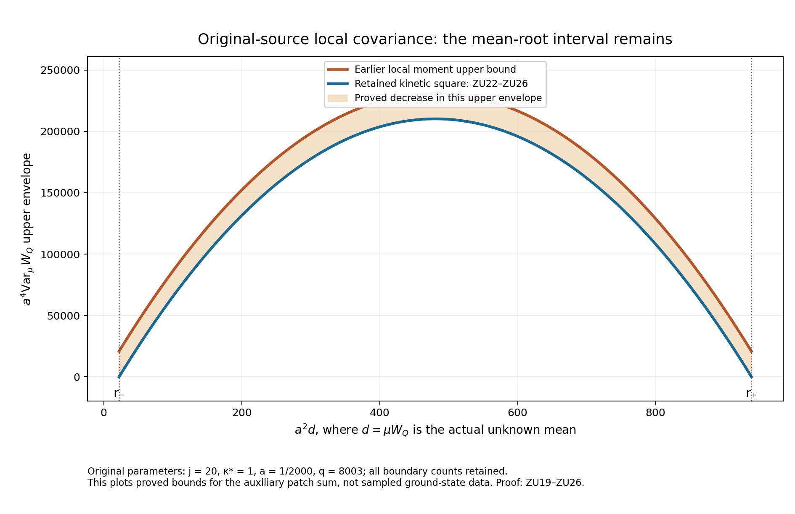

# A retained kinetic square gives a stronger upper covariance bound at the original source

Every expectation in this note is in the actual original positive ground state. The new bound improves the leading coefficient of an actual source-zero second-moment upper bound. Its remainder has order \(a\) after insertion into the curvature variance. The remaining mean-root term can still have order \(a^{-2}\); an upper bound of order \(a\) for the full original covariance is not proved here.

## 1. Original configuration and exact ground transform

Let \(m=2L\), let the vertices be \(z\in\{0,\ldots,m\}^3\), and retain every positive edge \(e=(z,d)\) with both endpoints in this set. The geometric faces are \(p=(z;d,e)\), \(d<e\), with all four vertices present. Their original ordered words and scalars are
\[
\begin{gathered}
 U_p=U_d(z)U_e(z+e_d)U_d(z+e_e)^{-1}U_e(z)^{-1},\\
 W_p=\operatorname{Tr}U_p,\quad D_p=2-W_p,\quad 0\le D_p\le4,\\
 N=3m(m+1)^2,\quad M=3m^2(m+1),\quad
 T_\alpha=-i\sigma_\alpha/2,\\
 \Delta=\sum_{e,\alpha}X_{e,\alpha}^2,\quad K=-\Delta,\quad
 \Gamma(F,G)=\sum_{e,\alpha}(X_{e,\alpha}F)(X_{e,\alpha}G),\\
 H=\kappa K+b\sum_pD_p
   =\kappa K+2bM-b\sum_pW_p,\qquad
 \kappa=2g^2/a,\quad b=1/(2g^2a),\quad\kappa b=a^{-2}.
\end{gathered}\tag{ZU1}
\]
The metric is the radius-two metric on every \(\mathrm{SU}(2)\) factor. Each Haar measure has total mass one. The physical subspace imposes every original vertex gauge action, including boundary vertices. The full compact elliptic operator has a smooth positive unit lowest eigenfunction \(\psi\). Taking the absolute value of a minimizing vector does not increase its first Sobolev quadratic form; elliptic regularity and the strong maximum principle give strict positivity. Put
\[
 H\psi=E_0\psi,\quad d\mu=\psi^2dU,\quad w=\log\psi,
 \qquad \mathscr L=\Delta+2\nabla w\cdot\nabla.
\tag{ZU2}
\]
Product expansion and Haar integration by parts give
\[
 \langle F\psi,(H-E_0)F\psi\rangle=\kappa\mu\Gamma(F,\overline F),
 \qquad \mu\Gamma(w,F)=-\tfrac12\mu\Delta F.          \tag{ZU3}
\]
The first identity proves uniqueness: the quotient of another ground vector by \(\psi\) has zero gradient and is constant on the connected product. Gauge transformations preserve Haar, the metric and every closed face trace, so they fix the positive unit ground vector. Thus the full and physical ground energies coincide. All calculations initially use smooth functions; the bounded first-Sobolev limits below extend (ZU3) by closure.

Fix real \(f\in C_c(\mathbb R^3)\), with the original centers
\[
 x_p=o+a\bigl(z-L\mathbf1+(e_d+e_e)/2\bigr),\quad f_p=f(x_p),
 \quad C_f=a\sum_p f_pD_p=2a\sum_pf_p-a\sum_pf_pW_p.
\tag{ZU4}
\]
All three orientations occur. Retain the actual mean and covariance
\[
 m_f=\mu C_f=2a\sum_pf_p-a\sum_pf_p\mu W_p,
 \qquad G_f=\mu C_f^2-m_f^2.                          \tag{ZU5}
\]
The sampled coefficients are constants on configuration space, so \(C_f\) is smooth even for continuous \(f\).

## 2. Full local budget and its positive remainder

Choose a vertex cube \(Q=v+\{0,\ldots,q\}^3\) containing every edge of every face with \(f_p\ne0\). Inside edges have both endpoints in \(Q\); inside faces use four inside edges. Define
\[
\begin{gathered}
 N_Q=3q(q+1)^2,\quad M_Q=3q^2(q+1),\\
 \eta_Q=\sum_{d=1}^3
 [\mathbf1_{\{v_d>0\}}+\mathbf1_{\{v_d+q<m\}}],
 \quad C_Q=2q(q+1)\eta_Q,\\
 W_Q=\sum_{p\ \mathrm{inside}}D_p,\quad
 K_Q=-\sum_{e\ \mathrm{inside},\alpha}X_{e,\alpha}^2,
 \quad Z_Q=|\nabla_Qw|^2,\\
 H=\kappa K_Q+bW_Q+H_{\rm out}+bW_\times,
 \quad H_{\rm out}\ge E_{\rm out}I.
\end{gathered}\tag{ZU6}
\]
A mixed face has exactly one inside edge. Indeed two adjacent inside edges put three face vertices in the interval product \(Q\), which puts the fourth in \(Q\); two opposite inside edges already include all vertices. Each available outward side has \(2q(q+1)\) tangent edges, giving the stated \(C_Q\). The scalar parts are \(2bM_Q\), \(2b(M-M_Q-C_Q)\), and \(2bC_Q\), whose sum is the full \(2bM\).

Here is the local comparison used in LC14–LC15a and OS5–OS7, recalled with its proof. The positive outside ground is invariant under all original vertex actions restricted to outside edges. Start a crossing trace at its unique inside traversal. The remaining actual three-edge ordered outside path has distinct endpoints. The central gauge element \(-I\) at one endpoint negates that matrix path and preserves the outside ground density. Its matrix expectation is therefore zero. Any tensor of a unit inside vector with the outside ground has crossing energy exactly \(2bC_Q\).

For an inside edge put \(x=\operatorname{Tr}U/2\),
\[
 Z_t=\int e^{2tx}dU,\quad h_t=Z_t^{-1/2}e^{tx},\quad
 q_t=Z_t^{-1}\int xe^{2tx}dU.
\]
The marginal Haar measure is \((2/\pi)\sqrt{1-x^2}\,dx\). After \(z=1-x\), the squared comparison density is proportional to \(e^{-2tz}z^{1/2}\sqrt{2-z}\mathbf1_{[0,2]}\). The extra factor relative to \(e^{-2tz}z^{1/2}\) is decreasing; applying

\(2\operatorname{Cov}(z,r(z))=\mathbb E[(z-z')(r(z)-r(z'))]\le0\)

and integrating that gamma density gives \(1-q_t\le3/(4t)\). Symmetry gives \(0<q_t<1\). The radius-two identities \(\Gamma(x)=(1-x^2)/4\), \(\Delta x=-3x/4\), integrated against \(e^{2tx}\), give kinetic energy \(3\kappa tq_t/8\) per edge. Centrality gives both matrix means \(\mathbb E_tU=\mathbb E_tU^{-1}=q_tI\). Thus the product inside comparison has energy
\[
 \frac{3\kappa N_Qtq_t}{8}+2bM_Q(1-q_t^4)
 \le \frac{3\kappa N_Qt}{8}+\frac{6bM_Q}{t}.
\]
Taking \(t=4\sqrt{bM_Q/(\kappa N_Q)}\), or taking the constant inside vector, proves
\[
\begin{gathered}
 0\le E_0-E_{\rm out}\le b\Lambda_Q,\qquad
 \Lambda_Q=\min\{2M_Q,6g^2\sqrt{N_QM_Q}\}+2C_Q,\\
 \kappa\mu Z_Q+b\mu W_Q\le E_0-E_{\rm out},\qquad
 \delta_Q=b\Lambda_Q-(E_0-E_{\rm out})\ge0.
\end{gathered}\tag{ZU7}
\]
The full/physical ground equality makes the tensor comparison legitimate without assuming a tensor decomposition of the physical Hilbert space. The actual measure remains \(\mu\).

For a nonnegative inside multiplier \(Y\) used below, define the retained outside remainder
\[
 \mathcal O_Q(Y)=
 \langle\sqrt Y\psi,(H_{\rm out}-E_{\rm out})\sqrt Y\psi\rangle
       +b\mu(YW_\times)\ge0.                         \tag{ZU8}
\]
The first term is the outside quadratic form and includes its whole kinetic and scalar potential contributions. The square-root regularization below proves its domain assertion.

## 3. Absolute weights and exact one-face derivatives

Let \(F=\|f\|_\infty>0\), \(A_1=\sum_p|f_p|\), and put
\[
\begin{gathered}
 Y=\sum_p|f_p|D_p,\quad d=\mu Y,\quad
 Y_+=\sum_{f_p>0}f_pD_p,\quad
 Y_-=\sum_{f_p<0}(-f_p)D_p,\\
 Y=Y_++Y_-,\quad C_f=a(Y_+-Y_-),\quad 0\le Y\le FW_Q,\\
 J(Y)=6A_1-3Y,\quad\Delta Y=J(Y),\quad
 \gamma=\Gamma(Y)\le16FY.
\end{gathered}\tag{ZU9}
\]
For the Laplacian, on each of the four incident edges \(\sum_\alpha T_\alpha^2=-3I/4\), giving \(\Delta D_p=6-3D_p\) with the scalar (6) retained. A quaternion representation of the full ordered face word gives, for each incident edge,
\[
 \sum_\alpha(X_{e,\alpha}D_p)^2=1-W_p^2/4=D_p-D_p^2/4.
\tag{ZU10}
\]
The surrounding links and inverse orientations act by signs and orthogonal adjoint transports on this derivative vector. Cauchy–Schwarz at each edge, with at most four incident faces, gives
\[
 \gamma\le\sum_e r_e^f\sum_{p\ni e}|f_p|^2(D_p-D_p^2/4)
 \le16\sum_p|f_p|^2D_p\le16FY.
\tag{ZU11}
\]
Every boundary incidence remains in the first expression. There is no claimed independence between its derivative summands.

If \(A_1=0\), \(C_f=Y=0\) and the target variance is zero. Suppose henceforth \(A_1>0\). Strict positivity of \(\psi\) gives \(d>0\), because a face with a positive coefficient can have nonidentity holonomy on an open configuration set.

Apply (ZU3) to \(\sqrt{Y+\epsilon}\), \(\epsilon>0\), and use the decomposition (ZU6). Inside derivative expansion cancels the identical \(\kappa\mu\gamma/[4(Y+\epsilon)]\) terms on both sides. Its cross term is
\[
 \mu\Gamma(w,Y)=-\tfrac12\mu J(Y)=-3A_1+\tfrac32d.
\]
Letting \(\epsilon\downarrow0\) yields the exact identity
\[
 b\Lambda_Qd
 =b\mu(W_QY)+\kappa\mu(YZ_Q)
       -\kappa(3A_1-3d/2)+\mathcal O_Q(Y)+\delta_Qd.
\tag{ZU12}
\]
All limits are finite: \(Y,w\) and their derivatives are bounded at fixed regulator, and \(\gamma/(Y+\epsilon)\le16F\). Outside derivatives act only on \(\psi\), so the outside quadratic forms converge directly. No crossing energy was dropped in (ZU12).

## 4. The evaluated weighted square

Define \(B(Y)=J(Y)/(32F)\). Complete the following actual score square:
\[
 \mathcal Q_\epsilon=
 \mu\left[(Y+\epsilon)
  \left|\nabla_Qw+\frac{B(Y)}{Y+\epsilon}\nabla Y\right|^2\right]\ge0.
\tag{ZU13}
\]
Weighted Haar integration by parts gives exactly
\[
 2\mu[B(Y)\Gamma(w,Y)]
   =-\mu[B'(Y)\gamma+B(Y)\Delta Y],\qquad B'=-3/(32F).
\tag{ZU14}
\]
Consequently
\[
 \mu[(Y+\epsilon)Z_Q]
 =\mathcal Q_\epsilon+
   \mu\left[\frac{J(Y)^2}{32F}-\frac{3\gamma}{32F}
       -\frac{J(Y)^2\gamma}{1024F^2(Y+\epsilon)}\right].
\tag{ZU15}
\]
The last ratio is bounded by \(16F\max J^2\) before its displayed coefficient. All other terms are integrable and fixed. Thus \(\mathcal Q=\lim_{\epsilon\downarrow0}\mathcal Q_\epsilon\) exists, is finite and nonnegative. Set \(\gamma/Y=0\) when \(Y=0\), which is precisely the regularized ratio's pointwise limit. Put
\[
 \mathcal R=
 \mu\left[\frac{3}{32F}(16FY-\gamma)
       +\frac{J(Y)^2}{1024F^2}
                       \left(16F-\frac\gamma Y\right)\right]\ge0.
\tag{ZU16}
\]
Each summand is nonnegative by (ZU11), including the stipulated zero set. Rearranging (ZU15) and taking the limit proves the evaluated source-zero square identity
\[
 \boxed{\quad
 \mu(YZ_Q)=\mathcal Q+\mathcal R
                  +\frac{\mu J(Y)^2}{64F}-\frac32d.
 \quad}                                               \tag{ZU17}
\]
This is stronger than retaining only \(\mu(YZ_Q)\ge0\). In particular it retains the square of the original full scalar \(6A_1\).

Define the original coupling ratio and polynomial
\[
\begin{gathered}
 \alpha=\kappa/b=4(g^2)^2=\kappa^2a^2,\quad c=9\alpha/64,
 \quad \Lambda_f=F\Lambda_Q,\\
 P_f(s)=(1+c)s^2-(\Lambda_f+4cA_1)s+4cA_1^2,\\
 \mathcal D_f=
 \alpha F(\mathcal Q+\mathcal R)
 +\mu[Y(FW_Q-Y)]
 +\frac F b[\mathcal O_Q(Y)+\delta_Qd]\ge0.
\end{gathered}\tag{ZU18}
\]
Multiply (ZU12) by \(F/b\), insert (ZU17), and use

\(F W_QY=Y^2+Y(FW_Q-Y)\).

Every term is now evaluated, and the exact result is
\[
 \boxed{\quad \mu P_f(Y)+\mathcal D_f=3\alpha F A_1.\quad}
\tag{ZU19}
\]
This is an identity for the original actual source, with its complete nonnegative remainder. It contains no source derivative, covariance-sign assumption, Gaussian comparison measure or spatial symmetry assumption.

## 5. The two mean roots and stronger upper bounds

For clarity the root interval follows directly from the same actual state. By (ZU7), \(d\le F\mu W_Q\le\Lambda_f\), and
\[
 \mu Z_Q\le\alpha^{-1}(\Lambda_Q-\mu W_Q)
              \le(\alpha F)^{-1}(\Lambda_f-d).
\]
The full scalar identity \(\mu J(Y)=-2\mu\Gamma(w,Y)\), Cauchy–Schwarz and (ZU11) give
\[
 (6A_1-3d)^2\le4\mu Z_Q\,\mu\gamma
                 \le\frac{64}{\alpha}d(\Lambda_f-d).
\tag{ZU20}
\]
Equivalently \(P_f(d)\le0\). Therefore its discriminant is nonnegative and its roots are
\[
\begin{gathered}
 \mathfrak D_f=(\Lambda_f+4cA_1)^2-16c(1+c)A_1^2,\\
 r_\pm=\frac{\Lambda_f+4cA_1\pm\sqrt{\mathfrak D_f}}{2(1+c)},
 \qquad 0<r_-\le d\le r_+\le\Lambda_f.
\end{gathered}\tag{ZU21}
\]
The root product and sum are positive. To verify the last bound without an unstated branch choice, observe \(P_f(\Lambda_f)=c(\Lambda_f-2A_1)^2\ge0\) and \(d\le\Lambda_f\). The alternative \(\Lambda_f\le r_-\) forces \(d=\Lambda_f=r_-\), \(\Lambda_f=2A_1\). In that case the other root is \(2cA_1/(1+c)<2A_1\), so \(\Lambda_f\) is the upper root. This proves the claim in every case, including a repeated root.

Let \(\varepsilon_f=3\alpha F A_1/(1+c)\). Since

\(\mu P_f(Y)=(1+c)\operatorname{Var}_\mu Y+P_f(d)\),

the exact covariance remainder form of (ZU19) is
\[
 \boxed{\quad
 \operatorname{Var}_\mu Y
 =(d-r_-)(r_+-d)+\varepsilon_f-\frac{\mathcal D_f}{1+c}.
 \quad}                                                \tag{ZU22}
\]
In particular, with the full actual \(d\) first retained,
\[
\begin{split}
 \operatorname{Var}_\mu Y
 &\le(d-r_-)(r_+-d)+\varepsilon_f
 \le\frac{(r_+-r_-)^2}{4}+\varepsilon_f,\\
 \mu Y^2
 &\le(r_-+r_+)d-r_-r_++\varepsilon_f
 \le r_+^2+\varepsilon_f.
\end{split}\tag{ZU23}
\]
No observed mean was set equal to either root.

For the unchanged signed observable, the following scalar and sign contributions are exact:
\[
 C_f^2=a^2Y^2-4a^2Y_+Y_-,\qquad
 G_f=a^2\mu Y^2-m_f^2-4a^2\mu(Y_+Y_-).              \tag{ZU24}
\]
Combining with (ZU19) proves the complete source-zero upper identity
\[
\boxed{\begin{aligned}
 G_f={}&a^2[(r_-+r_+)d-r_-r_++\varepsilon_f]
      -m_f^2-4a^2\mu(Y_+Y_-)
      -\frac{a^2\mathcal D_f}{1+c}\\
 \le{}&a^2[(r_-+r_+)d-r_-r_++\varepsilon_f]
      -m_f^2-4a^2\mu(Y_+Y_-)\\
 \le{}&a^2[r_+^2+\varepsilon_f]-m_f^2.
\end{aligned}}\tag{ZU25}
\]
The product \(Y_+Y_-\) is nonnegative pointwise; no assertion about the sign of its connected covariance has been made. When \(f\ge0\), \(Y_-=0\) and \(m_f=ad\), so the sharper upper bound is
\[
 G_f\le a^2[(d-r_-)(r_+-d)+\varepsilon_f]
       \le a^2\left[\frac{(r_+-r_-)^2}{4}+\varepsilon_f\right].
\tag{ZU26}
\]
The same statement applies to \(f\le0\) after retaining \(m_f=-ad\).

## 6. Exact strength and limit on the original path

Retain
\[
 L_j=j^4,\quad a_j=(100j)^{-1},\quad
 g_j^2=\kappa_*/(200j),\quad\kappa_j=\kappa_*,\quad
 b_j=1/(\kappa_*a_j^2),\quad\alpha_j=\kappa_*^2a_j^2.
\tag{ZU27}
\]
Choose a physical support cube \(\prod_d[c_d,c_d+R]\) and exactly
\[
 v_{d,j}=L_j+\lfloor(c_d-o_d)/a_j\rfloor-1,\quad
 q_j=\lceil R/a_j\rceil+3.
\tag{ZU28}
\]
This includes the original four edges of every supported face. Because \(a_jL_j=j^3/100\to\infty\), it is strictly inside the original box for all sufficiently large \(j\); the finite boundary indicators remain in (ZU6). The local counts and original comparison give
\[
 a_j^2\Lambda_{Q_j}\longrightarrow
 \mathsf L_R=9\kappa_*R^3+24R^2.                     \tag{ZU29}
\]
For each of the three face orientations the mesh is a translate of \(a_j\mathbb Z^3\). Partition a fixed support enlargement into its mesh cubes. The quadrature error for \(|f|\) is at most its volume times the modulus of continuity of \(|f|\) at \(\sqrt3a_j/2\), per orientation. Thus, with \(J_1=\int|f(x)|\,d^3x>0\),
\[
 a_j^3A_{1,j}\to3J_1,\qquad d_j\le F\Lambda_{Q_j}=O(a_j^{-2}).
\tag{ZU30}
\]
The full finite roots in (ZU21), with every coefficient retained, consequently satisfy
\[
\begin{gathered}
 a_j^2r_{\pm,j}\to
 \mathsf r_\pm=
 \frac{F\mathsf L_R\pm
 \sqrt{F^2\mathsf L_R^2-81\kappa_*^2J_1^2/4}}2,\\
 \frac{a_j^2\varepsilon_{f,j}}{a_j}
       \longrightarrow9\kappa_*^2FJ_1.
\end{gathered}\tag{ZU31}
\]
The discriminant is strictly positive: \(J_1\le FR^3\), while \(\mathsf L_R\ge9\kappa_*R^3\), so its subtracted term is at most one quarter of the square of the cubic part. Both limiting roots are positive. Thus (ZU25)–(ZU26) give
\[
\begin{split}
 \limsup_j a_j^2G_{f,j}&\le\mathsf r_+^2
                  &&(f\ \mathrm{real}),\\
 \limsup_j a_j^2G_{f,j}&\le
          \frac{F^2\mathsf L_R^2-81\kappa_*^2J_1^2/4}{4}
                  &&(f\ge0\ \mathrm{or}\ f\le0).
\end{split}\tag{ZU32}
\]
These inequalities do not discard the finite \(m_f^2\) or sign term: the stronger equations retaining them are (ZU25). The final asymptotic displays give an explicit bound when those actual expectations are not evaluated.

The comparison to the previous upper estimate can also be proved exactly. Dropping the local kinetic form before testing with \(\sqrt{Y+\epsilon}\) gives
\[
 \mu Y^2\le\Lambda_f d+4\alpha F^2=:B_{\rm old}.
\tag{ZU33}
\]
Indeed \(bW_Q\le H-E_{\rm out}\) as forms, \(Y\le FW_Q\), and \(\Gamma(Y)/(4Y)\le4F\). The new mean-retaining bound is
\[
 B_{\rm new}=
 \frac{(\Lambda_f+4cA_1)d-4cA_1^2+3\alpha F A_1}{1+c}.
\tag{ZU34}
\]
Their difference is exactly
\[
 B_{\rm old}-B_{\rm new}
 =\frac{c\Lambda_fd-4cA_1d+4cA_1^2
             +4\alpha F^2(1+c)-3\alpha F A_1}{1+c},
\quad
 a_j^4(B_{\rm old}-B_{\rm new})
       \longrightarrow\frac{81\kappa_*^2J_1^2}{16}>0.
\tag{ZU35}
\]
All other terms vanish after multiplication by \(a_j^4\), using (ZU27)–(ZU30). Thus the new bound is strictly stronger at every sufficiently fine original regulator for each fixed nonzero test. In the covariance, the upper envelope decreases by \(81\kappa_*^2J_1^2/(16a_j^2)+o(a_j^{-2})\), before the additional retained sign and mean subtractions. At a coarse regulator one can take the minimum of (ZU33), (ZU34), and the already proved finite bounds; no assertion of strict improvement at every coarse regulator is needed.

The exponent is unchanged. Formula (ZU22) gives an exact reason: the remaining term \((d-r_-)(r_+-d)\) is nonnegative and can have order \(a^{-4}\) under the proved root interval. It is not zero by the mean uncertainty inequality. For a nonnegative test, (ZU22) and (ZU26) identify precisely how this term and the nonnegative evaluated remainder enter the actual covariance. No value or sign beyond what is proved is assigned to their difference. The source-zero calculation has advanced the upper bound; it has not established a smooth interacting continuum theory or its spectral endpoint.

## 7. The next actual calculation: optimizing the score square

The remaining term in (ZU22) calls for an evaluated subtraction, not a choice of mean within its allowed interval. The same calculation can be continued by optimizing the square rather than fixing its coefficient. All quantities here are again at source zero. Put
\[
 U=\mu J(Y)^2,\quad S=\mu\gamma,\quad
 T=\mu\left[\frac{J(Y)^2\gamma}{Y}\right]\le16FU.
\tag{ZU36}
\]
The ratio uses the convention and dominated limit of (ZU16). Both \(U,T\) are positive. To see this, \(Y\) is a nonconstant real analytic function: it is zero at the identity configuration and positive on an open set. Its gradient is nonzero on some open set; \(J(Y)\) cannot vanish throughout that open set, since then \(Y\) would be constant there. Strict positivity of the density proves \(T>0\) and \(U>0\).

For every real \(t\), replace \(B(Y)\) in (ZU13) by \(tJ(Y)\). The full limiting square is
\[
 0\le\mu(YZ_Q)-t(U-3S)+t^2T.
\]
Minimizing this scalar quadratic at \(t=(U-3S)/(2T)\) proves
\[
 \mu(YZ_Q)\ge\frac{(U-3S)^2}{4T}
              \ge\frac{(U-3S)^2}{64FU}.
\tag{ZU37}
\]
The first expression retains the exact original derivative ratio. There is no need to assume a sign for \(U-3S\), since the square is valid for every real \(t\). Combining the last bound with (ZU12), and retaining the nonnegative spatial and outside terms
\[
 \mathcal B_f=\mu[Y(FW_Q-Y)]
                  +\frac F b[\mathcal O_Q(Y)+\delta_Qd],
\]
gives the further proved upper estimate
\[
 \boxed{\quad
 \mu P_f(Y)\le3\alpha FA_1
 -\frac{3\alpha}{32}(16Fd-S)
 -\frac{9\alpha S^2}{64U}-\mathcal B_f.
 \quad}                                                \tag{ZU38}
\]
Every displayed subtraction is nonnegative. This follows by expanding \((U-3S)^2/U=U-6S+9S^2/U\) and the original \(J(Y)^2\); no omitted covariance sign is involved. It can be used together with (ZU19), taking the smaller of the two evaluated upper bounds.

There is also a coefficient-sensitive incidence improvement. If \(n_f\) is the number of nonzero sampled face coefficients, the same first inequality as (ZU11), before its last simplification, gives
\[
\begin{split}
 16FY-\gamma
 &\ge16\sum_p |f_p|(F-|f_p|)D_p
                       +4\sum_pf_p^2D_p^2\\
 &\ge4Y^2/n_f.
\end{split}\tag{ZU39}
\]
Here scalar Cauchy–Schwarz is applied to the \(n_f\) numbers \(|f_p|D_p\). Thus (ZU16) implies
\[
 \alpha F\mathcal R\ge
 \frac{3\alpha}{8n_f}\mu Y^2
       +\frac{\alpha}{256Fn_f}\mu[J(Y)^2Y].
\tag{ZU40}
\]
These terms strengthen (ZU25) after division by \(1+c\). The exact first line of (ZU39) retains more information than its universal second line. Neither (ZU38) nor (ZU40), with the estimates proved here, closes the order-\(a^{-2}\) mean-root contribution. They are completed source-zero receiving calculations of the next remainders, not assumptions that these remainders cancel it.

For comparison, directly multiplying the original ground equation by a smooth real \(F_0\) and integrating twice gives
\[
 \operatorname{Cov}_\mu(F_0,V)
  +\kappa\operatorname{Cov}_\mu(F_0,|\nabla w|^2)
  =\frac\kappa2\mu\Delta F_0,
 \quad V=b\sum_pD_p.                                  \tag{ZU41}
\]
Indeed \(V-E_0=\kappa(\Delta w+|\nabla w|^2)\), while

\(\mu(F_0\Delta w)=-\mu\Gamma(F_0,w)-2\mu(F_0|\nabla w|^2)\)

and \(\mu\Gamma(w,F_0)=-\mu\Delta F_0/2\). Taking \(F_0=1\) first and subtracting its product with \(\mu F_0\) proves (ZU41). At \(F_0=V\), the variance equals \(\kappa\mu\Delta V/2\) minus the potential-score covariance. That covariance cannot be deleted by the stationary identity. The independent PVI proof contains explicit positive-ground-state counterexamples to a universal sign, including one on the compact gauge-invariant configuration space with an explicitly different potential. It does not assert that the original plaquette potential has that counterexample's sign. The actual original-potential progress in this note uses the nonnegative forms (ZU12)–(ZU19) instead.

The independent weighted derivation further retains every term in the optimized square. Define
\[
 Q_*=\mu(YZ_Q)-\frac{(U-3S)^2}{4T}\ge0.
\]
Inserting this equality in (ZU12), and using
\[
 \frac{\alpha F(U-3S)^2}{4T}
 =\frac{\alpha(U-3S)^2}{64U}
  +\frac{\alpha(U-3S)^2(16FU-T)}{64UT},
\]
proves the stronger exact decomposition
\[
\boxed{\begin{aligned}
 \mu P_f(Y)+\mathcal B_f+\alpha FQ_*
 &+\frac{3\alpha}{32}(16Fd-S)
    +\frac{9\alpha S^2}{64U}\\
 &+\frac{\alpha(U-3S)^2(16FU-T)}{64UT}
     =3\alpha FA_1.
\end{aligned}}\tag{ZU42}
\]
All retained defects are nonnegative by (ZU11), (ZU36) and (ZU37). Formula (ZU39), divided by \(Y\) on its positive set, multiplied by \(J(Y)^2\) and integrated, also gives
\[
 16FU-T\ge\frac4{n_f}\mu[J(Y)^2Y].                 \tag{ZU43}
\]
At the zero set its left integrand is nonnegative and the right integrand is zero, so the same inequality holds with the earlier ratio convention.

The mean-root calculation itself can retain the incidence correction. Replace \(S\le16Fd\) in (ZU20) by \(S\le16Fd-4\mu Y^2/n_f\). Since \(\Lambda_f-d\ge0\), no sign reverses. Multiplication by \(\alpha/64\) gives the complete strengthening
\[
 \boxed{\quad P_f(d)+
       \frac{\Lambda_f-d}{4Fn_f}\,\mu Y^2\le0.\quad}  \tag{ZU44}
\]
No division by \(\Lambda_f-d\) has occurred, so this includes its zero endpoint. An independent weighted verification established these last three formulas. The complete arguments above check them by substitution into the full original local identity. They further evaluate the same remaining upper-variance terms without changing the established power of \(a\).

## 8. Sources and scope of the calculation

The original spatial programme source, Section 12, equations (93)–(100), was read in its retained TeX; the [pinned public source begins at line 1742](https://github.com/KokunoYumeto/yang-mills-interacting-workbench/blob/485b61423c1f4e1805deb453c1b6b342b27842b6/yang-mills/continuations/20260930-s6-ns-moment-map-bridge/sources/spatial/spatial_continuum.tex#L1742). It supplies the original metric and variational comparison, not a theorem about the new covariance bound. The complete needed local comparison was proved again in (ZU6)–(ZU7), following LC14–LC15a. The retained weighted kinetic identity (OS34) is generalized with all positive remainders in (ZU12). The mean uncertainty roots already present in PVC28–PVC29 are extended to the absolute weighted observable in (ZU20)–(ZU21). The new step is the evaluated square (ZU13)–(ZU19), followed by the actual covariance and limiting comparisons (ZU22)–(ZU35).

No external correlation-sign theorem was imported. The canonical disk index queries and their routing records are retained in LITERATURE_ROUTES.json; the search results were not treated as reading evidence. No PDF was read. RAW_UPPER_SOURCE_USE_LEDGER.json records exact reading coverage and hashes. SOURCE_ZERO_UPPER_CHECKS.json and check_source_zero_upper.py verify the scalar identities and bounded original-incidence calculations; they do not replace the analytic proof. The reproducible inspected figure shows the actual algebraic upper envelope and its positive root interval, with its residual term visibly retained.

The figure uses the original finite patch constants specified on the plot. It shows upper bounds and their exact decrease, not sampled vacuum values. ZU19–ZU26 retain the mean-root term and all nonnegative remainders. The reproducible source is check_source_zero_upper.py.

Complete programme sources: [original covariance and Hessian proof](https://github.com/KokunoYumeto/yang-mills-interacting-workbench/blob/791f11fb3fcad8b36bbabd19018a792bf469c262/yang-mills/continuations/20261011-central-signs-shrinking-window/ORIGINAL_SOURCE_COVARIANCE.md), [HVR1–HVR34](https://github.com/KokunoYumeto/yang-mills-interacting-workbench/blob/791f11fb3fcad8b36bbabd19018a792bf469c262/yang-mills/continuations/20261011-central-signs-shrinking-window/HESSIAN_RECEIVING_REVIEW.md), [LC1–LC42](https://github.com/KokunoYumeto/yang-mills-interacting-workbench/blob/791f11fb3fcad8b36bbabd19018a792bf469c262/yang-mills/continuations/20261011-central-signs-shrinking-window/LOCAL_CURVATURE_BUDGET.md), and [PVC1–PVC50](https://github.com/KokunoYumeto/yang-mills-interacting-workbench/blob/791f11fb3fcad8b36bbabd19018a792bf469c262/yang-mills/continuations/20261011-central-signs-shrinking-window/PHYSICAL_LOCAL_COVARIANCE.md). Actual source reading and comparison scope are recorded in [the source-use ledger](https://github.com/KokunoYumeto/yang-mills-interacting-workbench/blob/main/yang-mills/continuations/20261011-central-signs-shrinking-window/RAW_UPPER_SOURCE_USE_LEDGER.json).

The full independent stationary identities and explicitly different-potential counterexamples are [PVI1–PVI24](https://github.com/KokunoYumeto/yang-mills-interacting-workbench/blob/main/yang-mills/continuations/20261011-central-signs-shrinking-window/POTENTIAL_VARIANCE_IDENTITIES.md). They do not assert a covariance sign for the original plaquette potential.

## Actual potential law, central covariance, and complete scalar spectral map

[FO1–FO56](ACTUAL_PUSHFORWARD_OPTIMIZATION.md) and the independent [PF1–PF53](ACTUAL_PUSHFORWARD.md) construct the actual weighted-potential density directly from the original interacting ground state. They prove both continuous zero-flux currents across critical values, the optimum over all score functions, the full conditional ground equation, and the original upper-tail bound. The scaled upper excess is O(a); the upper endpoint contributes less than every fixed power of a. The remaining centered variance is an explicit integral over the central range, with its actual mean and all outside terms retained.

[OP1–OP19](PUSHFORWARD_OPERATOR_RECEIVING.md) prove closability and the full scalar ground-form domain, its isometry into the physical Hilbert space, and the complete second-energy matrix including the orthogonal residual and its two-variable covariance. OP18–OP19 retain the physical kappa, radius-two Haar-volume factor and source noise coefficient in the comparison with Legoll and Lelièvre. The original shrinking-window spectral mass, smooth continuum state and reconstruction remain the active calculations.

## Both potential tails and the complete retained-energy covariance

[LR1–LR58](LOWER_SIDE_RETAINED_ENERGY.md) prove both tails around the original local energy roots, exact negative-moment bounds, and inverse-weighted ground and Bochner identities. The full inside energy, including the actual conditional kinetic and outside terms, has variance O(a^-1), with an explicit constant and a complete nonnegative remainder. For the signed original curvature, LR58 proves the exact compensated map and all of its mean and covariance terms.

[IM1–IM42](INSIDE_MARGINAL_ENERGY.md) independently derive the inside marginal, its conditional-vector equation and full operator residual. They evaluate every mixed-Hessian, shifted-Hessian and conditional-score-variance contribution, including inverse weights. The unchanged potential variance retains its signed covariance with the nonnegative energy remainder. The proved small variance of their sum does not assign a sign to that covariance.
