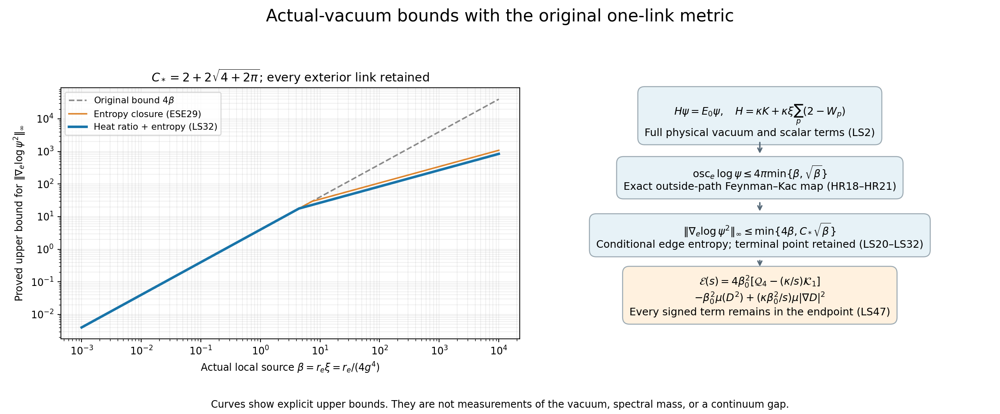

# A square-root local score for the original vacuum

The complete original finite-box vacuum satisfies the volume-independent
bound
\[
 \boxed{\|\nabla_e\log\psi^2\|_\infty
 \le \min\{4r_e\xi,\ C_*\sqrt{r_e\xi}\},\qquad
 C_*=2+2\sqrt{4+2\pi}.}
 \tag{LS1}
\]
Here the metric is the original radius-two \(SU(2)\) metric,
\(\xi=1/(4g^4)\), and \(r_e\) is the actual number of incident
faces of the physical link \(e\). Every original potential term and
all outside-link dynamics remain in the proof. The argument first
proves the proposed Feynman–Kac comparison, then bounds a one-link
logarithmic oscillation, and finally differentiates an exact
terminal-point-preserving path transformation. That last step
retains the edge displacement in the potential term.

The accepted
[PS1–PS76 proof](https://github.com/KokunoYumeto/yang-mills-interacting-workbench/blob/442786391ab942ad0c829c0ebf32e952585915e0/yang-mills/continuations/20261011-central-signs-shrinking-window/POLYNOMIAL_SCORE_AND_ORIGINAL_ENDPOINT.md)
is unchanged. Section 7 below applies (LS1) to its complete
fourteen-dimensional polynomial bound and to the exact original
boundary derivative, with all affine terms and physical factors.
The all-row positive endpoint correction on the prescribed path
then has a proved lower-bound function of order \(j^{-27}\).

## 1. Original operator, local splitting and the first score bound

Let the original open box have \(L\ge2\),
\(N=3(2L)(2L+1)^2\) physical links and
\(M=12L^2(2L+1)\) elementary faces. Retain
\[
 \begin{split}
 H&=\kappa H_0+V,\qquad
 H_0=-\sum_{f,\alpha}X_{f,\alpha}^2,\qquad
 V=b_{\rm mag}\sum_p(2-\operatorname{tr}U_p),\\
 \kappa&={2g^2\over a},\qquad
 b_{\rm mag}={1\over2g^2a},\qquad
 \xi={b_{\rm mag}\over\kappa}={1\over4g^4},\qquad a,g>0,\\
 H\psi&=E_0\psi,\qquad \psi>0,\qquad \|\psi\|_{L^2(dU)}=1,
 \qquad \rho_{\rm full}=\psi^2.
 \end{split}
 \tag{LS2}
\]
The original fields are generated by
\(T_\alpha=-i\sigma_\alpha/2\), orthonormal in the physical link
metric. If \(U=cI+\sum_\alpha q_\alpha T_\alpha\), then
\((c,q/2)\in S^3\); physical distance is twice its unit-sphere
angular distance, and the diameter is \(2\pi\).

Fix a physical link \(e\), let \(\mathcal P_e\) be its complete
set of incident faces, and write \(r=r_e=|\mathcal P_e|\).
With \(x=U_e\) and \(z=(U_f)_{f\ne e}\), define the exact split
\[
 V_e(x,z)=b_{\rm mag}\sum_{p\in\mathcal P_e}
                         (2-\operatorname{tr}U_p),\qquad
 V_{\bar e}(z)=b_{\rm mag}\sum_{p\notin\mathcal P_e}
                         (2-\operatorname{tr}U_p).
 \tag{LS3}
\]
Thus \(V=V_e+V_{\bar e}\), with no scalar removed. In particular
the constants in these two sums add to \(2b_{\rm mag}M\).
Each \(SU(2)\) face trace lies in \([-2,2]\), so
\[
 0\le V_e\le4b_{\rm mag}r,\qquad
 \|\nabla_eV_e\|_\infty\le b_{\rm mag}r.
 \tag{LS4}
\]
For the derivative constant, cyclicity of trace, bi-invariance
and inversion reduce a face containing \(e\) to a translate of
\(\operatorname{tr}U=2c(U)\). Its gradient has squared norm
\(|q|^2/4=1-c^2\le1\). Summing the \(r\) incident gradients
proves (LS4), retaining every incident face.

Set \(\beta=r\xi\). The original first score proof gives
\(\|\nabla_e\log\psi\|_\infty\le2\beta\). Its full identity is
recalled here, because it supplies a small-\(\beta\) branch below.
For \(u=\log\psi\), \(\Delta=\sum_f\Delta_f=-H_0\), and
\(w_e=|\nabla_eu|^2\),
\[
 \Delta u+|\nabla u|^2=(V-E_0)/\kappa,\qquad
 (\Delta+2\nabla u\cdot\nabla)w_e
 =2\sum_f|\nabla_f\nabla_eu|^2+w_e
       +{2\over\kappa}\langle\nabla_eu,\nabla_eV\rangle.
 \tag{LS5}
\]
The radius-two Ricci tensor is one half the metric, so its
Bochner contribution is \(w_e\). The terms with \(f\ne e\)
are precisely the retained mixed Hessians on the product.
At a maximum of \(w_e\), the left side is nonpositive. By (LS4),
\(0\ge w_e-2\beta\sqrt{w_e}\); hence
\[
 \|\nabla_eu\|_\infty\le2\beta,\qquad
 \sup_z\operatorname{osc}_{x}u(x,z)\le4\pi\beta.
 \tag{LS6}
\]
This is the original
[partial Bochner proof, equations (77)–(79)](https://github.com/KokunoYumeto/yang-mills-interacting-workbench/blob/485b61423c1f4e1805deb453c1b6b342b27842b6/yang-mills/continuations/20260930-s6-ns-moment-map-bridge/sources/spatial/spatial_continuum.tex#L1415),
with every mixed derivative and the full potential retained.

## 2. Exact Feynman–Kac comparison with the outside motion retained

Let \(X_s\) be the Brownian motion on the full physical link
product with generator \(\kappa\Delta\). Its link motions are
independent before the potential weight is inserted. Itô's
formula and the full equation in (LS2) show that
\[
 e^{E_0s-\int_0^s V(X_v)\,dv}\psi(X_s)
 \]
is a martingale. Indeed its drift is
\(e^{E_0s-\int_0^sV}[(E_0-V)\psi+\kappa\Delta\psi]=0\).
Compactness, smoothness and bounded coefficients make it a true
martingale on each finite time interval. Thus, for every \(t>0\),
\[
 \psi(x,z)=e^{E_0t}\,
 \mathbb E_{x,z}\!\left[e^{-\int_0^tV(X_s)\,ds}\psi(X_t)\right].
 \tag{LS7}
\]
This derivation keeps the full scalar in \(V\) and the full
ground energy \(E_0\).

Condition only on the outside Brownian path
\(\zeta=(Z_s)_{0\le s\le t}\), with \(Z_0=z\).
Write
\[
 W_{\bar e}(\zeta)=\exp\!\left[-\int_0^tV_{\bar e}(Z_s)\,ds\right],
 \quad f_\zeta(w)=\psi(w,Z_t),\quad
 F_\zeta(x)=\mathbb E_x\!\left[
  e^{-\int_0^tV_e(X_s,Z_s)\,ds}f_\zeta(X_t)\right].
 \tag{LS8}
\]
No outside link is frozen as a physical approximation: its complete
path is subsequently integrated in (LS7). With \(P_\tau\) the
original one-link heat semigroup generated by \(\Delta_e\),
(LS4) gives the pointwise sandwich
\[
 e^{-4b_{\rm mag}rt}P_{\kappa t}f_\zeta(x)
       \le F_\zeta(x)\le P_{\kappa t}f_\zeta(x).
 \tag{LS9}
\]
All \(f_\zeta\) and \(W_{\bar e}\) are strictly positive.
Define the common positive function
\[
 G_{t,z}(w)=\mathbb E_z^{\bar e}
                    [W_{\bar e}(\zeta)\psi(w,Z_t)].
 \]
Tonelli's theorem and the product Brownian motion give
\[
 e^{E_0t-4b_{\rm mag}rt}P_{\kappa t}G_{t,z}(x)
    \le\psi(x,z)\le e^{E_0t}P_{\kappa t}G_{t,z}(x).
 \tag{LS10}
\]
Both bounds use the same \(G_{t,z}\). If \(p_\tau\) is the
strictly positive heat kernel with respect to probability Haar
measure, then division yields precisely
\[
 \boxed{{\psi(x,z)\over\psi(y,z)}
 \le e^{4\kappa\xi rt}
      \sup_w{p_{\kappa t}(x,w)\over p_{\kappa t}(y,w)}.}
 \tag{LS11}
\]
Indeed the ratio of the two positive integrals of
\(p_{\kappa t}(\cdot,w)G_{t,z}(w)\) is at most the supremum
of their pointwise kernel ratio. The factor \(e^{E_0t}\) cancels
only in this exact comparison. Equation (LS11) is valid at every
outside configuration and every finite volume.

## 3. Original radius-two heat kernel and its global ratio

Put \(\theta=d(x,w)/2\in[0,\pi]\), and write \(p_\tau(\theta)\)
for the radial kernel. Its exact character series is
\[
 p_\tau(\theta)=\sum_{\ell=0}^{\infty}
   (\ell+1)e^{-\tau\ell(\ell+2)/4}
                      {\sin((\ell+1)\theta)\over\sin\theta}.
 \tag{LS12}
\]
The quotient has its continuous endpoint values. To derive the
factors, the radial Laplacian is
\(\tfrac14(\partial_\theta^2+2\cot\theta\,\partial_\theta)\).
The functions
\(\sin((\ell+1)\theta)/\sin\theta\) are its eigenfunctions with
eigenvalue \(-\ell(\ell+2)/4\), are orthonormal for radial Haar
measure \((2/\pi)\sin^2\theta\,d\theta\), and have value
\(\ell+1\) at zero. Their completeness is the completeness of
the sine series after multiplication by \(\sin\theta\).
Consequently (LS12) solves the heat equation with the initial
point mass at the identity. Rotational invariance gives the full
kernel from this radial equation. The series and every fixed
number of derivatives converge uniformly for \(\tau\) bounded
away from zero.

Periodize a Gaussian. Computing its Fourier coefficients by the
Gaussian Fourier integral gives
\[
 \sum_{n\in\mathbb Z}e^{-\tau n^2/4}e^{in\theta}
 ={2\sqrt\pi\over\sqrt\tau}
            \sum_{k\in\mathbb Z}e^{-(\theta+2\pi k)^2/\tau}.
 \]
Differentiating this absolutely convergent equality and using
\(\ell+1=n\) in (LS12) gives
\[
 \boxed{p_\tau(\theta)=
 A_\tau\,{\displaystyle\sum_{k\in\mathbb Z}
       (\theta+2\pi k)e^{-(\theta+2\pi k)^2/\tau}
                    \over\sin\theta},\qquad
 A_\tau={2\sqrt\pi\,e^{\tau/4}\over\tau^{3/2}}.}
 \tag{LS13}
\]
This is the original metric comparison with the Riemannian
kernel \(q_t\) in Fabrice Baudoin and Michel Bonnefont,
[*The subelliptic heat kernel on SU(2): Representations,
Asymptotics and Gradient bounds*, original TeX,
Section 3, formula labelled spectralQ and first Gaussian image
formula](https://arxiv.org/src/0802.3320v1).
Their complete Riemannian generator is \(4\Delta_e\), so
\(p_\tau(\theta)=q_{\tau/4}(\cos\theta)\).
More explicitly, their displayed Pauli basis is
\(X=-2T_2,\ Y=-2T_1,\ Z=-2T_3\); summing its three squares
gives exactly \(4\sum_\alpha T_\alpha^2\) at the level of
the corresponding invariant differential operators.
Only their complete Riemannian kernel is used; their two-field
subelliptic operator is not substituted for the original electric
operator. Equations (LS12)–(LS13) also supply a direct derivation
with the full multiplier \(A_\tau\) retained.

The radial kernel is nonincreasing in \(\theta\). Here is a
maximum-principle proof including the endpoints. Start with the
smooth radial probability density proportional to
\(\exp(\cos\theta/\epsilon)\). It is nonincreasing and tends
weakly to the point mass at zero as \(\epsilon\downarrow0\).
If \(u_\epsilon=P_\tau f_\epsilon\) and
\(v_\epsilon=\partial_\theta u_\epsilon\), then
\[
 \partial_\tau v_\epsilon={1\over4}
 [\partial_\theta^2v_\epsilon
      +2\cot\theta\,\partial_\theta v_\epsilon
      -2\csc^2\theta\,v_\epsilon].
 \tag{LS14}
\]
Smooth radial functions have \(v_\epsilon=0\) at \(0,\pi\).
At any positive interior spatial maximum, the zeroth-order term
is strictly negative. The parabolic maximum principle therefore
preserves \(v_\epsilon\le0\). One may apply the usual first-positive-
maximum argument on \([0,\pi]\): a positive maximum cannot be at
the zero boundary values, so the singular endpoint coefficients
never enter the interior contradiction. The kernel and its
derivatives are smooth for positive time; hence convolution with
the weakly convergent \(f_\epsilon\) converges to the kernel and
its first derivative, uniformly on each positive-time compact
interval. Letting \(\epsilon\downarrow0\) proves the assertion.
Thus the largest and smallest heat-kernel values are respectively
\(p_\tau(0)\) and \(p_\tau(\pi)\).

Taking the two endpoint limits in the complete image formula gives
\[
 \begin{split}
 {p_\tau(0)\over A_\tau}
 &=1+2\sum_{k=1}^{\infty}
       (1-8\pi^2k^2/\tau)e^{-4\pi^2k^2/\tau},\\
 {p_\tau(\pi)\over A_\tau}
 &=2\sum_{k=0}^{\infty}
       [\,2(2k+1)^2\pi^2/\tau-1\,]
                             e^{-(2k+1)^2\pi^2/\tau}.
 \end{split}
 \tag{LS15}
\]
For \(0<\tau\le\pi^2\), every correction in the first line is
nonpositive and every term in the second line is nonnegative.
Retaining its first term proves
\[
 \boxed{\sup_{x,y,w}{p_\tau(x,w)\over p_\tau(y,w)}
 ={p_\tau(0)\over p_\tau(\pi)}
 \le {e^{\pi^2/\tau}\over2(2\pi^2/\tau-1)}
 \le e^{\pi^2/\tau}.}
 \tag{LS16}
\]
The equality follows by choosing \(x=w\) and \(y=-w\);
strict positivity follows from the heat kernel. No image term
was incorrectly replaced by a positive contribution: its sign
is accounted for separately in (LS15).

## 4. A volume-independent one-link logarithmic oscillation

Use \(\tau=\kappa t\) in (LS11). Equations (LS6) and (LS16)
give the explicit bound
\[
 \begin{split}
 \sup_z\operatorname{osc}_{x}\log\psi(x,z)
 \le B(\beta):=\min\Big\{4\pi\beta,\
 \inf_{0<\tau\le\pi^2}
  [4\beta\tau+\pi^2/\tau-\log(2(2\pi^2/\tau-1))]\Big\}.
 \end{split}
 \tag{LS17}
\]
This is an evaluated one-variable upper bound: every quantity
inside its infimum is explicit and positive. A particularly useful
closed consequence is
\[
 \boxed{\sup_z\operatorname{osc}_{x}\log\psi(x,z)
                                  \le4\pi\sqrt\beta.}
 \tag{LS18}
\]
For \(0<\beta\le1\), use \(4\pi\beta\le4\pi\sqrt\beta\)
in (LS6). For \(\beta\ge1\), choose
\(\tau=\pi/(2\sqrt\beta)\le\pi/2<\pi^2\) and omit only the
nonnegative improvement \(\log(2(2\pi^2/\tau-1))\) in
(LS17). The two remaining terms are each \(2\pi\sqrt\beta\).
This proves (LS18) at all positive \(g,a\), with no volume
factor. In physical time this second choice is
\[
 t={\pi\over2\kappa\sqrt{r\xi}}={\pi a\over2\sqrt r}.
 \tag{LS19}
\]
The equality retains the actual \(g,a\) relations in (LS2).

The global oscillation (LS18) by itself would yield an exponential
density penalty. The next step derives a score and therefore a
finite-radius comparison; it is essential for improving the
polynomial cap estimates.

## 5. Exact terminal-point-preserving derivative formula

Fix an outside path \(\zeta\) in (LS8) and a physical time \(t>0\).
On the selected link, use the Stratonovich equation
\[
 dX_s=\sqrt{2\kappa}\sum_{\alpha=1}^3T_\alpha X_s\circ dB_s^\alpha,
 \qquad X_0=x,
 \tag{LS20}
\]
where \(B\) is standard three-dimensional Brownian motion.
Its generator is exactly \(\kappa\Delta_e\).
For a Lie-algebra vector \(v=\sum_\alpha v^\alpha T_\alpha\),
put \(|v|^2=\sum_\alpha(v^\alpha)^2\) and
\[
 h_s=1-s/t,\quad
 g_s^\epsilon=\exp(\epsilon h_s v),\quad
 Y_s^\epsilon=g_s^\epsilon X_s,\quad
 R_s^\epsilon=\operatorname{Ad}_{g_s^\epsilon}\in SO(3).
 \tag{LS21}
\]
Then \(Y_0^\epsilon=\exp(\epsilon v)x\) and
\(Y_t^\epsilon=X_t\) exactly. The Stratonovich product rule gives
\[
 dY_s^\epsilon=
 \sqrt{2\kappa}\sum_\alpha T_\alpha Y_s^\epsilon
                                 \circ d\widetilde B_s^{\epsilon,\alpha}
                  -{\epsilon\over t}vY_s^\epsilon\,ds,
 \quad
 \widetilde B_s^\epsilon=\int_0^sR_u^\epsilon\,dB_u.
 \tag{LS22}
\]
The rotation is deterministic and orthogonal, so
\(\widetilde B^\epsilon\) is Brownian motion under the original
measure. It fixes \(v\), whence
\(\langle v,d\widetilde B_s^\epsilon\rangle
=\langle v,dB_s\rangle\).

Define the Gaussian change-of-measure density
\[
 Z_\epsilon=\exp\!\left[
 {\epsilon\langle v,B_t\rangle\over\sqrt{2\kappa}\,t}
                  -{\epsilon^2|v|^2\over4\kappa t}\right].
 \tag{LS23}
\]
It has expectation one. Under the probability measure with
density \(Z_\epsilon\),
\[
 \widehat B_s^\epsilon
    =\widetilde B_s^\epsilon-
                     {\epsilon s\over\sqrt{2\kappa}\,t}v
 \]
is standard Brownian motion. This follows directly from the
finite-dimensional Gaussian increment densities: multiplication
by \(\exp(\langle a,B_t\rangle-|a|^2t/2)\) changes each independent
increment of duration \(\delta\) from mean zero to mean \(a\delta\),
without changing its covariance. Here
\(a=\epsilon v/(\sqrt{2\kappa}t)\); the deterministic rotation
fixes that mean direction and preserves all covariances. The
finite-dimensional distributions and continuity give the stated
Brownian law on path space.
Substitution in (LS22) cancels the displayed drift exactly.
Thus \(Y^\epsilon\) under this new measure has the original
Brownian law starting at \(\exp(\epsilon v)x\).

Let
\[
 W=\exp\!\left[-\int_0^tV_e(X_s,Z_s)\,ds\right]f_\zeta(X_t),
 \qquad F_\zeta(x)=\mathbb EW .
 \]
The preceding exact path-law identity gives
\[
 F_\zeta(\exp(\epsilon v)x)
 =\mathbb E\!\left[
 Z_\epsilon\exp\!\left(-\int_0^tV_e(Y_s^\epsilon,Z_s)\,ds\right)
                         f_\zeta(X_t)\right].
 \tag{LS24}
\]
In particular the derivative of the terminal function is not
omitted; its argument is exactly fixed by \(Y_t^\epsilon=X_t\).
Differentiating (LS24) at zero yields
\[
 \boxed{X_vF_\zeta(x)=
 \mathbb E\!\left[W\left\{
 {\langle v,B_t\rangle\over\sqrt{2\kappa}\,t}
       -\int_0^t(1-s/t)(X_vV_e)(X_s,Z_s)\,ds
                         \right\}\right].}
 \tag{LS25}
\]
All derivatives of the incident potential remain in the second
term. Differentiation under expectation is justified by (LS4),
the compact positive terminal function, and Gaussian integrability
of \(\exp(c|B_t|)\) on every bounded \(\epsilon\)-interval.
The outside path need only be continuous in time; the original
face potential is smooth in the link variable with the uniform
derivative bound (LS4). Thus conditioning has introduced no
time-differentiability assumption on Brownian paths.

For comparison, James Thompson's
[*Functional inequalities for Feynman-Kac semigroups*, original
TeX, equation labelled eq:bismut](https://arxiv.org/src/1811.03471v1)
retains the same potential-gradient contribution in the general
Riemannian derivative formula. His
[*Derivatives of Feynman-Kac Semigroups*, original TeX,
first-derivative local martingale proof and non-local
formula](https://arxiv.org/src/1611.04373v1)
was also read. The source generator \(\tfrac12\Delta\) has
time \(T=2\kappa t\) and potential \(V_e/(2\kappa)\) for the
2018 killing convention. The 2016 source writes a plus sign
for its potential, so its corresponding potential is
\(-V_e/(2\kappa)\). Formula (LS25) is proved above directly for
the actual conditional time-dependent incident potential and the
original left-multiplication fields; no outside derivatives or
unspecified Riemannian constants are imported.

## 6. Entropy estimate and the square-root score

Define a probability measure on the selected Brownian path by
\(d\mathbb Q=(W/F_\zeta(x))d\mathbb P\).
Its relative entropy is
\(\mathcal H=\mathbb E_{\mathbb Q}\log(W/F_\zeta(x))\).
If \(\mathfrak b\) bounds \(\operatorname{osc}\log f_\zeta\), then (LS4)
gives
\[
 e^{-4b_{\rm mag}rt}\min f_\zeta\le W\le\max f_\zeta,
 \qquad 0\le\mathcal H\le \mathfrak b+4b_{\rm mag}rt.
 \tag{LS26}
\]
For the upper bound, \(F_\zeta(x)\) lies between the same two
endpoints, and hence
\(\log(W/F_\zeta(x))\le\mathfrak b+4b_{\rm mag}rt\) pointwise.
Nonnegativity is Jensen's inequality for \(s\log s\).
By (LS18), the terminal function
\(f_\zeta(w)=\psi(w,Z_t)\) satisfies
\(\mathfrak b=4\pi\sqrt\beta\),
uniformly in the entire outside path and its endpoint.

Here is the Gaussian entropy step with its exact constant.
If \(M=\langle v,B_t\rangle\), then
\(\log\mathbb E e^{sM}=s^2t|v|^2/2\). Jensen's inequality
under \(\mathbb Q\), applied to
\(e^{sM}/(d\mathbb Q/d\mathbb P)\), gives
\[
 s\mathbb E_{\mathbb Q}M
                  \le\mathcal H+s^2t|v|^2/2.
 \]
Optimizing over positive and negative \(s\) yields
\[
 |\mathbb E_{\mathbb Q}M|
                         \le |v|\sqrt{2t\mathcal H}.
 \tag{LS27}
\]
This is a bound for every unit direction; it introduces no factor
equal to the number of physical links or the three colour
components.

Divide (LS25) by \(F_\zeta(x)>0\). Equations (LS4), (LS26)
and (LS27), together with
\(\int_0^t(1-s/t)\,ds=t/2\), give
\[
 |X_v\log F_\zeta(x)|
 \le |v|\left[
 \sqrt{{4\pi\sqrt\beta\over\kappa t}+4\beta}
                                  +{\kappa\beta t\over2}\right].
 \tag{LS28}
\]
The bound is uniform in every outside path. In (LS7)–(LS8),
the logarithmic derivative of \(\psi\) is the positive weighted
average of the logarithmic derivatives of \(F_\zeta\):
\[
 X_v\log\psi(x,z)
 ={\mathbb E_z^{\bar e}
       [W_{\bar e}F_\zeta(x)X_v\log F_\zeta(x)]
        \over
        \mathbb E_z^{\bar e}[W_{\bar e}F_\zeta(x)]}.
 \tag{LS29}
\]
All outside Brownian motion and its full potential weight remain
in this identity. At fixed finite volume, the compact smooth
terminal function and the preceding uniform derivative bound
justify differentiation and integration. Applying (LS28) proves,
for every \(\tau=\kappa t>0\),
\[
 \|\nabla_e\log\psi\|_\infty
 \le\sqrt{{4\pi\sqrt\beta\over\tau}+4\beta}+{\beta\tau\over2}.
 \tag{LS30}
\]
Choose \(\tau=2/\sqrt\beta\). Then
\[
 \boxed{\|\nabla_e\log\psi\|_\infty
       \le(1+\sqrt{4+2\pi})\sqrt\beta.}
 \tag{LS31}
\]
Combining this with (LS6), and doubling because
\(\log\rho_{\rm full}=2\log\psi\), proves (LS1).
The physical time used in this derivative estimate is
\[
 t={2\over\kappa\sqrt{r\xi}}={2a\over\sqrt r}.
 \]
In the original variables the complete score bound is
\[
 \boxed{\|\nabla_e\log\rho_{\rm full}\|_\infty
 \le\Lambda_r(\xi):=\min\{4r\xi,C_*\sqrt{r\xi}\}
 =\min\left\{{r\over g^4},
                  {(1+\sqrt{4+2\pi})\sqrt r\over g^2}\right\}.}
 \tag{LS32}
\]
There is no change to \(a,g\), the vacuum, or the physical
metric in this equality. A still stronger explicit one-variable
bound follows by using \(B(\beta)\) from (LS17) instead of
\(4\pi\sqrt\beta\) in (LS26)–(LS30), then minimizing over
\(\tau>0\). The closed constant in (LS32) is sufficient for all
applications below.

For any fixed exterior configuration and any two selected-link
values \(x,y\), integrating the actual score along a shortest
geodesic yields the finite-radius comparison
\[
 |\log\rho_{\rm full}(x,z)-\log\rho_{\rm full}(y,z)|
                              \le\Lambda_r(\xi)d(x,y).
 \tag{LS33}
\]
The actual conditional density has the identical logarithmic
derivative, because its denominator is independent of that link.
For an actual marginal, differentiation of the compact positive
integral gives the conditional average of
\(\nabla_e\log\rho_{\rm full}\), so its norm obeys the same
bound. These statements also hold in the exact tree-gauge chord
coordinates: changing a chord at tree identity is precisely its
physical left variation, and the Haar/gauge change preserves the
original measure. The complete coordinate map and conditional
formula are proved in PS34–PS35.

Thus (LS32) supplies an actual score to the polynomial cap
theorems, and (LS33) supplies their needed displacement-sensitive
comparison. The square-root estimate is a proved conclusion of
the original vacuum equation, not a new hypothesis.

## 7. Stronger actual conditional factors for the complete cap estimates

For \(r\in\{2,3,4\}\), keep the actual value of \(r\) and define
\[
 \Lambda_r=\min\{4r\xi,C_*\sqrt{r\xi}\},\qquad
 \Omega_r=8\pi\min\{r\xi,\sqrt{r\xi}\}.
 \tag{LS34}
\]
The second number is a proved logarithmic oscillation bound for
the actual conditional density: square the ratios in (LS6) and
(LS18). It is also valid for its actual marginal, because the
pointwise ratio can be integrated over the remaining variables.
A positive probability density with oscillation at most
\(\Omega_r\) is everywhere at least \(e^{-\Omega_r}\):
its maximum is at most \(e^{\Omega_r}\) times its minimum,
and its integral is one.

Retain the constants and exact cap optimization from PS12,
PS17 and PS25:
\[
 C_2={24398405\over306317856079872},\qquad
 C_1={705\over4096},\qquad
 C_6={2595575\over14797504512},\qquad
 R_k(\lambda)=
 \begin{cases}1,&0\le\lambda\le k,\\ k/\lambda,&\lambda>k.\end{cases}
 \tag{LS35}
\]
The following factors retain both the new finite-radius comparison
and the stronger actual density floor:
\[
 \begin{split}
 \widehat\Theta_{2,r}(\xi)
 &=\max\{e^{-\Omega_r},
             C_2e^{-\Lambda_rR_8(\Lambda_r)}R_8(\Lambda_r)^8\},\\
 \widehat\Theta_{1,r}(\xi)
 &=\max\{e^{-\Omega_r},
             C_1e^{-\Lambda_rR_2(\Lambda_r)}R_2(\Lambda_r)^2\},\\
 \widehat\Theta_{6,r}(\xi)
 &=\max\{e^{-\Omega_r},
             C_6e^{-\Lambda_rR_6(\Lambda_r)}R_6(\Lambda_r)^6\}.
 \end{split}
 \tag{LS36}
\]
Each lies in \((0,1]\). The complete proofs of the cap constants
are PS3–PS12, PS17–PS18 and PS19–PS26; their only density input
is the finite-radius ratio. To see directly that the receiving
operation is valid, if
\(\operatorname{Av}_{B(z,R)}Q\ge cR^k\) for a nonnegative
function \(Q\), then
\[
 \int Q\rho\,dH
 ={1\over v_R}\int_z\int_{B(z,R)}Q(y)\rho(y)\,dH(y)dH(z)
 \ge cR^ke^{-\Lambda_rR}\int\rho(z)dH(z)
 =cR^ke^{-\Lambda_rR}.
 \]
The exact volume \(v_R=(R-\sin R)/(2\pi)\) cancels. This
calculation uses (LS33), including its actual displacement \(R\).
The density floor supplies the other term in each maximum.
It follows, respectively, that
\[
 \begin{split}
 \int|P|^2\rho\,dH
   &\ge\widehat\Theta_{2,r}(\xi)\int|P|^2dH,
                     &&P\in\mathcal P_{\le2},\\
 \int|\ell|^2\rho\,dH
   &\ge\widehat\Theta_{1,r}(\xi)\int|\ell|^2dH,
                     &&\ell\text{ a pure linear harmonic},\\
 \int\sum_{\alpha=1}^3|a\,cq_\alpha+R_\alpha|^2\rho\,dH
   &\ge{|a|^2\over2}\widehat\Theta_{6,r}(\xi),
                     &&R_\alpha\text{ arbitrary affine functions}.
 \end{split}
 \tag{LS37}
\]
All lower degrees remain in the first and third inequalities.
The stronger closed forms include
\(\widehat\Theta_{2,r}\ge C_2(1+\Lambda_r)^{-8}\) and
\(\widehat\Theta_{6,r}\ge C_6(1+\Lambda_r)^{-6}\), by the
optimization already proved in PS16 and PS26.

These new factors dominate their former counterparts at every
positive coupling, not only asymptotically. In fact
\(\Lambda_r\le4r\xi\), the optimized cap factor is nonincreasing
in its argument, and
\(\Omega_r\le8\pi r\xi\). These compare the two terms in each
maximum separately with the original factors in PS15,
PS18 and PS26.

## 8. Original boundary rows, masses, gradients and full endpoint

All receiving states and row coefficients remain those of
PS36–PS60. For completeness, their exact data are recorded here.
Write \(m=2L,\ n=m+1,\ h=\pi/(2n)\). The physical vertex with
indices \((i,y,l)\) is still \(o+a(i-L,y-L,l-L)\).
The original tree has every direction-one edge, direction-two
edges at \(i=0\), and direction-three edges at \(i=y=0\).
The original coefficient rows are
\[
 \begin{gathered}
 v_0(l)=n^{-1/2},\quad
 v_1(l)=\sqrt{2/n}\cos[(2l+1)h],\quad
 w_1(y)=-\sqrt{2/n}\sin[\pi(y+1)/n],\\
 a_{(i,y,l;2)}=-v_1(i)w_1(y)v_0(l)/\sqrt2,\quad
 a_{(i,y,l;3)}=0,\\
 b_{(i,y,l;2)}=v_0(i)w_1(y)v_1(l)/\sqrt2,\quad
 b_{(i,y,l;3)}=-v_0(i)v_1(y)w_1(l)/\sqrt2.
 \end{gathered}
 \tag{LS38}
\]
Direction-two chord indices are
\(1\le i\le m,\ 0\le y<m,\ 0\le l\le m\).
Direction-three indices are
\(0\le i,y\le m,\ (i,y)\ne(0,0),\ 0\le l<m\).
Retain the entire original sums
\[
 u_1=\sum_ca_cq(Z_c),\quad u_3=\sum_cb_cq(Z_c),\quad
 \mathcal S=u_1\cdot u_3,\quad
 D=\mathcal S+\mathcal S_{\mathcal R},\quad
 F=\beta_0(\mathcal S-\mathcal S_{\mathcal R}),\qquad
 \beta_0={\sqrt8\sin h\over2g^2}.
 \tag{LS39}
\]
Here \(\mathcal S_{\mathcal R}\) uses the complete direction-one
reflection of every rooted word, with the same coefficient rows.

For \(0\le y<m,\ 0\le l\le m\), select the distinct physical
links \(k_{y,l}=(1,y,l;2)\), \(b_{y,l}=(m,y,l;2)\).
Keep the ordered products
\[
 B_l=\prod_{q=0}^{l-1}U_3(m,0,q),\qquad
 A_{y,l}=B_l\prod_{q=0}^{y-1}U_2(m,q,l).
 \]
The selected reflected target word is exactly
\(A_{y,l}kH_b^{-1}A_{y,l}^{-1}\), where
\(k=Z_{k_{y,l}}\), \(H_b=Z_{b_{y,l}}\).
The scalar coefficients, distinct from this matrix \(A_{y,l}\),
are
\[
 \begin{split}
 A^{\rm row}_{y,l}
   &={\sqrt2\cos3h\sin[\pi(y+1)/n]\over n^{3/2}},\\
 d^0_{y,l}
   &=-{\sqrt2\cos[(2l+1)h]\sin[\pi(y+1)/n]\over n^{3/2}},\\
 d_{y,l}=-4A^{\rm row}_{y,l}d^0_{y,l}
   &={8\cos3h\cos[(2l+1)h]\sin^2[\pi(y+1)/n]\over n^3}.
 \end{split}
 \tag{LS40}
\]
All signs and the central-height zero remain.
The exact derivatives proved by the full word calculation
PS42–PS46 are
\[
 \begin{split}
 X_{b_{y,l},\alpha}D
  &=2A^{\rm row}_{y,l}d^0_{y,l}
       c(kH_b^{-1})q_\alpha(kH_b^{-1})+R_\alpha^D(k),\\
 X_{b_{y,l},\alpha}F
  &=-2\beta_0A^{\rm row}_{y,l}d^0_{y,l}
       c(kH_b^{-1})q_\alpha(kH_b^{-1})+R_\alpha^F(k).
 \end{split}
 \tag{LS41}
\]
The remainders are the full affine functions of all four
coordinates of \(k\); their coefficients retain every other
original chord and every differentiated endpoint transport.
The physical face counts are
\[
 (r_{k_{y,l}},r_{b_{y,l}})
 =\begin{cases}(3,2),&l=0,m,\\(4,3),&1\le l\le m-1.\end{cases}
 \tag{LS42}
\]

Apply (LS37) to (LS41), and use the exact two-link quadratic Gram
and \(k\)-derivative identities PS49–PS54. Every occurrence of
a density factor then has its actual \(r_k\) or \(r_b\):
\[
 \begin{split}
 \mu\sum_\alpha|X_{b_{y,l},\alpha}D|^2
   &\ge{d_{y,l}^2\over8}\widehat\Theta_{6,r_k},\\
 \mu\sum_\alpha|X_{b_{y,l},\alpha}F|^2
   &\ge{\beta_0^2d_{y,l}^2\over8}\widehat\Theta_{6,r_k},\\
 \mu\sum_\alpha|X_{k_{y,l},\alpha}D|^2
   &\ge{d_{y,l}^2\over4}
                    \widehat\Theta_{2,r_k}\widehat\Theta_{1,r_b},\\
 \mu\sum_\alpha|X_{k_{y,l},\alpha}F|^2
   &\ge{\beta_0^2d_{y,l}^2\over6}\widehat\Theta_{2,r_k}
                                     [1+\tfrac12\widehat\Theta_{1,r_b}].
 \end{split}
 \tag{LS43}
\]
All factors here have argument \(\xi\). The coordinate map to
the original physical gradient is the one in PS34: at tree
identity, a chord variation is the variation of that actual
physical link, and full gradient norms are gauge invariant.
The sets of \(k\)-links and \(b\)-links are individually distinct
and mutually disjoint. Therefore the inequalities in (LS43)
can be added without a conditional-independence assumption.

The finite sums
\(\sum_{y=0}^{m-1}\sin^4[\pi(y+1)/n]=3n/8\) and
\(\sum_{l=0}^{m}\cos^2[(2l+1)h]=n/2\), proved in PS57 by
finite geometric series, give
\[
 \begin{split}
 \widehat B_6={3\cos^2(3h)\over n^5}
 \Big\{&2\cos^2h\,\widehat\Theta_{6,3}
       +({n\over2}-2\cos^2h)\widehat\Theta_{6,4}\Big\},\\
 \widehat B_2^-={6\cos^2(3h)\over n^5}
 \Big\{&2\cos^2h\,\widehat\Theta_{2,3}\widehat\Theta_{1,2}
       +({n\over2}-2\cos^2h)
                         \widehat\Theta_{2,4}\widehat\Theta_{1,3}\Big\},\\
 \widehat B_2^+={4\cos^2(3h)\over n^5}
 \Big\{&2\cos^2h\,\widehat\Theta_{2,3}
                                   [1+\tfrac12\widehat\Theta_{1,2}]\\
       &+({n\over2}-2\cos^2h)\widehat\Theta_{2,4}
                                   [1+\tfrac12\widehat\Theta_{1,3}]\Big\}.
 \end{split}
 \tag{LS44}
\]
They include both physical boundary heights, all interior heights
and the retained central zero. The exact resulting physical
gradient and energy bounds are
\[
 \boxed{\mu(|\nabla D|^2)\ge\widehat B_6+\widehat B_2^-,
 \qquad C_F:=\kappa\mu(|\nabla F|^2)
             \ge\kappa\beta_0^2(\widehat B_6+\widehat B_2^+).}
 \tag{LS45}
\]

The original coefficient at \(y=L-1,l=0\) is
\(d^\circ=8\cos^3h\cos3h/n^3>0\). The same complete raw mass
calculation PS50–PS53 gives
\[
 \boxed{\begin{split}
 G:=\mu(F^2)&\ge{\beta_0^2(d^\circ)^2\over12}
                    \widehat\Theta_{2,3}
                                  [1+\tfrac12\widehat\Theta_{1,2}],\\
 \mu(D^2)&\ge{(d^\circ)^2\over8}
                           \widehat\Theta_{2,3}\widehat\Theta_{1,2}.
 \end{split}}
 \tag{LS46}
\]
The actual mass Gram matrix of
\((\mathcal S,\mathcal S_{\mathcal R})\) is at least
\((d^\circ)^2\widehat\Theta_{2,3}\widehat\Theta_{1,2}I_2/16\).
The raw mass inequalities are not summed over rows.
Their full Haar quadratic components are
\[
 \|P_2F\|_H^2={\beta_0^2(d^\circ)^2\over12}
                        [1+2c(H_b)^2],\qquad
 \|P_2D\|_H^2={(d^\circ)^2\over24}|q(H_b)|^2.
 \]
The remaining affine terms are retained before applying the
full-space weighted estimate. The pure-linear estimate is then
applied only to \(c(H_b)\) and the three \(q_\alpha(H_b)\);
this proves the two marginal factors in (LS46).

Retain the complete expectations
\(\mathcal Q_4=\mu(\mathcal S^2)\),
\(\mathcal Q_{4,\mathcal R}=\mu(\mathcal S\mathcal S_{\mathcal R})\),
\(\mathcal K_1=\mu(|\nabla\mathcal S|^2)\), and
\(\mathcal K_{\mathcal R}
=\mu(\nabla\mathcal S\cdot\nabla\mathcal S_{\mathcal R})\).
The full ground-state identity
\(\langle f\psi,(H-E_0)f\psi\rangle
=\kappa\mu(|\nabla f|^2)\) is proved in PS61 by subtracting
the complete vacuum equation, including its scalar.
Reflection invariance then gives the exact original endpoint
\[
 \begin{split}
 \mathscr E(s)&=G-C_F/s\\
 &=2\beta_0^2(\mathcal Q_4-\mathcal Q_{4,\mathcal R})
       -{2\kappa\beta_0^2\over s}
                            (\mathcal K_1-\mathcal K_{\mathcal R})\\
 &=4\beta_0^2[\mathcal Q_4-(\kappa/s)\mathcal K_1]
       -\beta_0^2\mu(D^2)
       +(\kappa\beta_0^2/s)\mu(|\nabla D|^2).
 \end{split}
 \tag{LS47}
\]
Consequently the new bound is
\[
 \boxed{\mathscr E(s)\ge
 4\beta_0^2[\mathcal Q_4-(\kappa/s)\mathcal K_1]
       -\beta_0^2\mu(D^2)
       +{\kappa\beta_0^2\over s}
                             (\widehat B_6+\widehat B_2^-).}
 \tag{LS48}
\]
The negative even mass and both original cross expectations remain.
The score improvement does not change this exact connecting map
or infer the sign of the complete endpoint from its positive term.

## 9. Evaluation on the unchanged simultaneous path

Keep exactly
\[
 L_j=j^4,\quad a_j={1\over100j},\quad
 g_j^2={\kappa_*\over200j},\quad s_j={\kappa_*\over j},\quad
 \kappa_j=\kappa_*>0,\quad j\ge2.
 \]
Thus
\[
 n_j=2j^4+1,\quad h_j={\pi\over2n_j},\quad
 \xi_j={10000j^2\over\kappa_*^2},\quad
 \beta_{0,j}={100j\sqrt8\sin h_j\over\kappa_*},\quad
 j^3\beta_{0,j}\to{50\sqrt2\pi\over\kappa_*},\quad
 j^{12}d_j^\circ\to1.
 \tag{LS49}
\]
For each \(r=2,3,4\), the square-root branch of (LS32)
eventually gives the exact value
\[
 \Lambda_r(\xi_j)={100C_*\sqrt r\over\kappa_*}j.
 \tag{LS50}
\]
Indeed it is smaller than \(4r\xi_j\) once
\(j\ge C_*\kappa_*/(400\sqrt r)\).
The global density floor in (LS36) is eventually
\(\exp[-800\pi\sqrt r\,j/\kappa_*]\).
This is eventually smaller than the corresponding positive
polynomial cap term. Define
\[
 \begin{split}
 U_{2,r}&=C_2\left({2\kappa_*\over25C_*e\sqrt r}\right)^8,\\
 U_{1,r}&=C_1\left({\kappa_*\over50C_*e\sqrt r}\right)^2,\\
 U_{6,r}&=C_6\left({3\kappa_*\over50C_*e\sqrt r}\right)^6.
 \end{split}
 \tag{LS51}
\]
By the exact optimization radii in (LS35), for each fixed
\(\kappa_*>0\) and sufficiently large \(j\),
\[
 \widehat\Theta_{2,r}(\xi_j)=U_{2,r}j^{-8},\qquad
 \widehat\Theta_{1,r}(\xi_j)=U_{1,r}j^{-2},\qquad
 \widehat\Theta_{6,r}(\xi_j)=U_{6,r}j^{-6}.
 \tag{LS52}
\]
The assertion about the exponential term follows from
\(-cj+k\log j\to-\infty\), for \(c>0\) and fixed \(k\);
each argument in (LS50) also eventually exceeds the relevant
optimization breakpoint.

The explicit lower-bound function for the raw odd mass in (LS46)
has order \(j^{-38}\), with limit after multiplication by
\(j^{38}\) equal to
\[
 {1250\pi^2\over3\kappa_*^2}\,U_{2,3}>0.
 \tag{LS53}
\]
The even mass lower-bound function has order \(j^{-34}\), with
corresponding positive constant \(U_{2,3}U_{1,2}/8\).
The full mass Gram lower-bound function has that same power and
scalar constant \(U_{2,3}U_{1,2}/16\).
These follow from the exact factors
\(\beta_{0,j}^2\sim(5000\pi^2/\kappa_*^2)j^{-6}\) and
\((d_j^\circ)^2\sim j^{-24}\) in (LS49).

The all-row sums in (LS44) have the exact leading constants
\[
 j^{22}\widehat B_{6,j}\to {3\over32}U_{6,4},\qquad
 j^{26}\widehat B_{2,j}^-\to {3\over16}U_{2,4}U_{1,3},\qquad
 j^{24}\widehat B_{2,j}^+\to {1\over8}U_{2,4}.
 \tag{LS54}
\]
For example, the leading interior-height coefficient of
\(\widehat B_6\) is \(3/(2n_j^4)\);
\(j^{16}/n_j^4\to1/16\), and its new score factor has power
\(j^{-6}\). The two other sums have leading geometric
coefficients \(3/n_j^4\) and \(2/n_j^4\) and score powers
\(j^{-10}\) and \(j^{-8}\), respectively. The boundary-height
terms remain in (LS44) and are smaller by one power of \(n_j\).

Thus the lower-bound functions for the original odd energy
\(C_{F,j}\) and the original even-correction energy
\(\kappa_*\beta_{0,j}^2\mu_j(|\nabla D_j|^2)\) both have
order \(j^{-28}\), with leading constant
\[
 {1875\pi^2\over4\kappa_*}\,U_{6,4}>0.
 \tag{LS55}
\]
The full positive term now retained in the endpoint bound is
\(j\beta_{0,j}^2(\widehat B_{6,j}+\widehat B_{2,j}^-)\).
Its exact limit is
\[
 \boxed{\lim_{j\to\infty}
 j^{27}\,j\beta_{0,j}^2
                  (\widehat B_{6,j}+\widehat B_{2,j}^-)
 = {1875\pi^2\over4\kappa_*^2}\,
        C_6\left({3\kappa_*\over100C_*e}\right)^6>0.}
 \tag{LS56}
\]
For every original \(j\ge2\), before taking any limit, (LS48)
retains the exact inequality
\[
 \mathscr E_j(s_j)\ge
 4\beta_{0,j}^2[\mathcal Q_{4,j}-j\mathcal K_{1,j}]
 -\beta_{0,j}^2\mu_j(D_j^2)
 +j\beta_{0,j}^2(\widehat B_{6,j}+\widehat B_{2,j}^-).
 \tag{LS57}
\]
All asymptotic assertions in this section evaluate the explicit
lower-bound functions. They do not identify the unknown actual
mass, energy or endpoint with those functions. The spectral
relation from PS65 remains
\(\langle F_j\psi_j,\mathbf1_{(0,s_j]}(H_j-E_{0,j})
F_j\psi_j\rangle\ge\max\{0,\mathscr E_j(s_j)\}\).
The actual endpoint sign is still governed by all terms in
(LS47), not by any one positive lower bound.

The [complete bulk receiving calculation, SR1 onward](https://github.com/KokunoYumeto/yang-mills-interacting-workbench/blob/main/yang-mills/continuations/20261011-central-signs-shrinking-window/SQUARE_ROOT_SCORE_RECEIVING_MAPS.md) retains every additional bulk derivative and strengthens the boundary-only positive correction in LS56 to order \(j^{-25}\). The full signed endpoint remains LS47. The [independent all-time heat proof, HR1–HR25](https://github.com/KokunoYumeto/yang-mills-interacting-workbench/blob/main/yang-mills/continuations/20261011-central-signs-shrinking-window/HEAT_RATIO_PROOF.md) and [independent stochastic proof, ID1–ID57](https://github.com/KokunoYumeto/yang-mills-interacting-workbench/blob/main/yang-mills/continuations/20261011-central-signs-shrinking-window/INDEPENDENT_EDGE_ENTROPY_PROOF.md) supply separate complete derivations; ID53–ID57 additionally prove a sharper finite-range entropy inequality.

