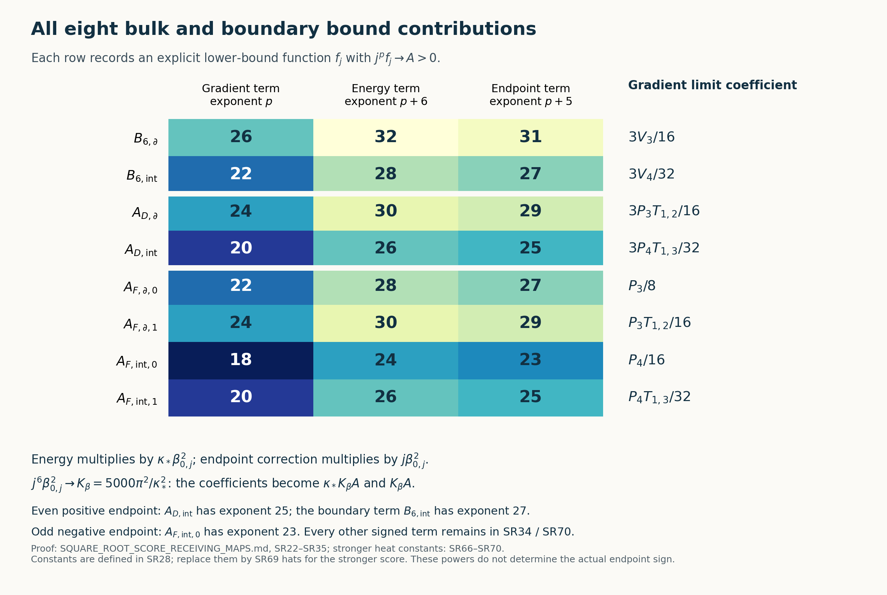

# The square-root vacuum score in every original receiving map

11 October 2026. This note evaluates proved bounds for the actual finite-box vacuum on the prescribed path. In particular, the even bulk derivative bound has order \(j^{-20}\), its positive endpoint contribution has order \(j^{-25}\), and the odd energy bound has order \(j^{-24}\). The finite face-response inverse has an explicit \(O(j^{32})\) bound. None of these assertions assigns a sign to the original shrinking-window endpoint.

The inputs have been read in their entirety and their exact file hashes recorded in `SOURCE_READING_USE_LEDGER.json`: [ESE1–ESE38](https://github.com/KokunoYumeto/yang-mills-interacting-workbench/blob/main/yang-mills/continuations/20261011-central-signs-shrinking-window/CONDITIONAL_EDGE_ENTROPY_AND_SCORE.md), [PS1–PS76](https://github.com/KokunoYumeto/yang-mills-interacting-workbench/blob/442786391ab942ad0c829c0ebf32e952585915e0/yang-mills/continuations/20261011-central-signs-shrinking-window/POLYNOMIAL_SCORE_AND_ORIGINAL_ENDPOINT.md), [PG1–PG70](https://github.com/KokunoYumeto/yang-mills-interacting-workbench/blob/442786391ab942ad0c829c0ebf32e952585915e0/yang-mills/continuations/20261011-central-signs-shrinking-window/POLYNOMIAL_GRADIENT_BOUNDS.md), [GPR1–GPR55](https://github.com/KokunoYumeto/yang-mills-interacting-workbench/blob/442786391ab942ad0c829c0ebf32e952585915e0/yang-mills/continuations/20261011-central-signs-shrinking-window/GLOBAL_PHYSICAL_RESPONSE.md), [UL1–UL47](https://github.com/KokunoYumeto/yang-mills-interacting-workbench/blob/442786391ab942ad0c829c0ebf32e952585915e0/yang-mills/continuations/20261011-central-signs-shrinking-window/union_label_global/FULL_UNION_LABEL_INVERSE.md), and [UF1–UF17](https://github.com/KokunoYumeto/yang-mills-interacting-workbench/blob/442786391ab942ad0c829c0ebf32e952585915e0/yang-mills/continuations/20261011-central-signs-shrinking-window/SUPPORT_AND_SCALAR_FACTORIZATION.md). These are programme derivations. The original source definitions and human-source comparison remain those identified in PS and GPR; no external novelty claim is made here. Each new receiving calculation and each asymptotic constant is proved below. The cap inequalities used here are the fully proved PS and PG inequalities, with their constants repeated explicitly; Sections 1–11 use the actual-vacuum ESE proof and are independent of a heat-kernel ratio bound. Section 12 uses the subsequently completed LS and independent HR heat-kernel proofs, retaining the stronger score and its separate oscillation floor.

## 1. Original objects and the actual score

Keep \(L\ge2\), \(m=2L\), \(n=m+1\), \(h=\pi/(2n)\). Vertices \((i,k,l)\), \(0\le i,k,l\le m\), denote the original physical points \(o+a(i-L,k-L,l-L)\). There are \(N=3m(m+1)^2\) original positive coordinate edges and \(M=3m^2(m+1)\) elementary faces. The product \(Q_L=SU(2)^{E_L}\) carries Haar probability. Every vertex, including boundary vertices, acts by \(U_{(s,t)}\mapsto q_sU_{(s,t)}q_t^{-1}\). Retain
\[
\begin{gathered}
T_\alpha=-i\sigma_\alpha/2,\quad
U=c(U)I+\sum_{\alpha=1}^3q_\alpha(U)T_\alpha,
\quad c^2+|q|^2/4=1,\\
X_{e,\alpha}f=\left.\frac d{dt}f(\ldots,e^{tT_\alpha}U_e,\ldots)\right|_{0},
\quad K=-\sum_{e,\alpha}X_{e,\alpha}^2,
\quad\Gamma(f,g)=\sum_{e,\alpha}(X_{e,\alpha}f)(X_{e,\alpha}g),\\
W_{(z;i,k)}=\operatorname{tr}[U_i(z)U_k(z+e_i)U_i(z+e_k)^{-1}U_k(z)^{-1}],\\
H(x)=\kappa K+\kappa\sum_p x_p(2-W_p),\qquad x\in\mathbb R^M,\quad\kappa>0,\\
H(x)\psi_x=E(x)\psi_x,\quad \psi_x>0,\quad\int\psi_x^2dU=1,
\quad\rho_x=\psi_x^2,\quad d\mu_x=\rho_xdU.
\end{gathered}\tag{SR1}
\]
The fields have the radius-two metric, diameter \(2\pi\), Ricci tensor \(\tfrac12 g\). For the original homogeneous source, \(x_p=\xi=1/(4g^4)\), \(\kappa=2g^2/a\), and the magnetic coefficient is \(b_{\rm mag}=1/(2g^2a)=\kappa\xi\). Every scalar \(2\kappa x_p\), the actual energy \(E(x)\), and the unit vacuum factor are retained in (SR1).

Put
\[
\beta_e(x)=\sum_{p:e\in\partial p}|x_p|,\quad
c_*={\sqrt{9\pi^2+32\pi}-3\pi\over8},\quad
\Phi(c)={2\pi/c+4\over(1-c/2)^2},\quad
C_\rho=2\sqrt{\Phi(c_*)},\quad
B_e(x)=\min\{4\beta_e(x),C_\rho\sqrt{\beta_e(x)}\}.
\tag{SR2}
\]
The actual full vacuum satisfies \(|\nabla_e\log\rho_x|\le B_e(x)\). Here is the precise ESE closure needed for its use. Write \(u=\log\psi_x\), \(M_e=\max|\nabla_eu|\), and let \(\omega_e\) be the maximum oscillation of \(u\) on one edge slice. The incident potential has gradient norm at most \(\kappa\beta_e\) and range length at most \(4\kappa\beta_e\), including signed sources. For Brownian generator \(\kappa\Delta\), the full vacuum martingale is
\[
Z_t={e^{E(x)t-\int_0^tV_x(X_s)ds}\psi_x(X_t)\over\psi_x(X_0)}.
\tag{SR3}
\]
Changing just the selected path to \(e^{\epsilon(1-s/t)v}X_s^e\), with \(|v|=1\), preserves the terminal link. Rotating its Brownian driver by this deterministic adjoint rotation and multiplying its law by
\(\exp[\epsilon v\cdot B_t^e/(\sqrt{2\kappa}t)-\epsilon^2/(4\kappa t)]\)
adds \(+\epsilon v/t\) to its drift, cancelling the path derivative \(-\epsilon v/t\). Thus differentiation of the exact vacuum identity gives
\[
X_{e,v}u(X_0)=\mathbb E_{Z_t}\left[
{v\cdot B_t^e\over\sqrt{2\kappa}t}
-\int_0^t(1-s/t)X_{e,v}V_x(X_s)ds\right].
\tag{SR4}
\]
For each fixed outside Brownian path, the conditional density of the selected driver is proportional to
\(e^{-\int_0^t V_e(X_s)ds}\psi_x(X_t)\).
Its logarithmic oscillation and entropy are bounded by \(\omega_e+4\kappa\beta_et\). The original conditional scalar \(v\cdot B_t^e\) is Gaussian of variance \(t\); the entropy inequality follows by applying Jensen to \(\log(e^{\lambda Z}/q)\), and yields \(|\mathbb E_q Z|\le\sqrt{2t\operatorname{Ent}(q)}\). Integrating these conditional expectations against the actual tilted outside marginal gives
\[
M_e\le\sqrt{\omega_e/\tau+4\beta_e}+\tau\beta_e/2
\quad(\tau=\kappa t>0),\qquad \omega_e\le2\pi M_e.
\tag{SR5}
\]
The outside entropy is not discarded: only the conditional entropy enters this directional expectation. The terminal vacuum remains in the conditional tilt. Compactness, positivity and smoothness dominate all differentiated integrands at a fixed finite box and time, as explicitly proved in ESE14–ESE22.

If \(M_e>0\) and \(\beta_e>0\), choose \(\tau=cM_e/\beta_e\), which is allowed because (SR5) holds at every positive time. It gives \(M_e^2\le\beta_e\Phi(c)\). The derivative is
\(\Phi'(c)=(4c^2+3\pi c-2\pi)/[c^2(1-c/2)^3]\);
the unique minimum on \((0,2)\) is \(c_*\). This proves the square-root branch in (SR2). The full product Bochner formula is
\[
(\Delta+2\nabla u\cdot\nabla)|\nabla_eu|^2
=2\sum_f|\nabla_f\nabla_eu|_{\rm HS}^2+|\nabla_eu|^2
+2\kappa^{-1}\langle\nabla_eu,\nabla_eV_x\rangle.
\tag{SR6}
\]
At its maximum this gives \(M_e\le2\beta_e\), proving the other branch after \(\log\rho_x=2u\). If \(\beta_e=0\), left translation of edge \(e\) commutes with \(H(x)\), so uniqueness of its positive unit vacuum makes \(M_e=0\). These arguments establish (SR2) in all cases without a heat-ratio assertion.

The original tree contains all direction-one edges, direction-two edges at \(i=0\), and direction-three edges at \(i=k=0\). Its root paths run in directions three, two, one. For a chord \(e=(s,t)\), let \(Z_e=t_sU_et_t^{-1}\). Successive left and right Haar invariance makes this an exact product-Haar change to tree transports and chords. Gauge invariance makes \(\rho_x\) independent of the tree transports. Varying a chord varies that physical edge through left and right translations; its three derivatives are rotated orthogonally by the adjoint action. Consequently its full, conditional and marginal scores all obey (SR2). In the marginal assertion the exact calculation is
\[
\nabla_e\log\int\rho_x(Z_e,z)dz
={\int\rho_x(Z_e,z)\nabla_e\log\rho_x(Z_e,z)dz\over
\int\rho_x(Z_e,z)dz};
\tag{SR7}
\]
the norm bound follows by the triangle inequality. The conditional denominator is constant in \(Z_e\). No independence of chords or physical links is assumed.

## 2. All cap factors, with the improved score as their argument

For \(k>0\), let \(R_k(B)=1\) when \(0\le B\le k\), and \(R_k(B)=k/B\) otherwise. Keep all original constants:
\[
\begin{gathered}
C_2={80\over225407}\left({47\over384}\right)^4,
\quad C_1={705\over4096},\quad
C_6={75\over784}\left({47\over384}\right)^3,
\quad c_6={(23/24)^{10}\over588},\\
\Theta_2(B)=\max\{e^{-2\pi B},C_2e^{-BR_8(B)}R_8(B)^8\},\\
\Theta_1(B)=\max\{e^{-2\pi B},C_1e^{-BR_2(B)}R_2(B)^2\},\\
\Theta_6(B)=\max\{e^{-2\pi B},C_6e^{-BR_6(B)}R_6(B)^6\},\\
\Psi_6(B)=\max\{2e^{-2\pi B},c_6e^{-BR_6(B)}R_6(B)^6\}.
\end{gathered}\tag{SR8}
\]
The factor two in \(\Psi_6\)'s density floor is the original degree-two Casimir. In any positive unit density of score at most \(B\), the completely proved PS and PG cap calculations give
\[
\begin{aligned}
\int|P|^2\rho\,dH&\ge\Theta_2(B)\|P\|_H^2
&& (P\in\mathcal H_0\oplus\mathcal H_1\oplus\mathcal H_2),\\
\int|\ell|^2\rho\,dH&\ge\Theta_1(B)\|\ell\|_H^2
&& (\ell\in\mathcal H_1),\\
\int\sum_\alpha|a\,cq_\alpha+R_\alpha|^2\rho\,dH
&\ge {|a|^2\over2}\Theta_6(B)
&& (R_\alpha\text{ arbitrary affine}),\\
\int|\nabla P|^2\rho\,dH&\ge\Psi_6(B)\|\Pi_2P\|_H^2.
\end{aligned}\tag{SR9}
\]
The exact cap-average constants in these four proofs are respectively \(C_2R^8\), \(C_1R^2\), \((|a|^2/2)C_6R^6\), and \(c_6R^6\|\Pi_2P\|^2\). Their centre integration is
\(v_R^{-1}\int_z\int_{B(z,R)}|P(y)|^2\rho(y)dH(y)dH(z)\),
which equals the full integral and contributes \(e^{-BR}\) after comparison to \(\rho(z)\). Thus the cap volume cancels exactly. Optimization gives (SR8); the density floor is \(e^{-2\pi B}\). The gradient Haar energy is \(\tfrac34\|\Pi_1P\|^2+2\|\Pi_2P\|^2\). These are the same complete-polynomial and special-vector inequalities, including all affine coefficients, as PS12–PS26 and PG7–PG20, PG47–PG59. We change only their proved score input.

For the homogeneous source write
\[
B_r(\xi)=\min\{4r\xi,C_\rho\sqrt{r\xi}\},\qquad r=2,3,4.
\tag{SR10}
\]
Every old \(\Theta_\nu(4r\xi)\), \(\Psi_6(4r\xi)\), \(\eta_6(4r\xi)=c_6(1+4r\xi)^{-6}\), \(\Lambda_6(4r\xi)\), and \(\eta_q(4r\xi)=\tfrac4{5e^2}(23/24)^4(1+4r\xi)^{-2}\) may therefore receive \(B_r(\xi)\). The stronger factors (SR8) dominate the retained \(\eta\) factors by the original PG proofs. This includes the actual-marginal formulas, not only their fully evaluated lower bounds.

## 3. Complete original rows, words, odd and even polynomials

The chord sets are
\(\mathcal C_2=\{(i,k,l;2):1\le i\le m,0\le k<m,0\le l\le m\}\) and
\(\mathcal C_3=\{(i,k,l;3):0\le i,k\le m,(i,k)\ne(0,0),0\le l<m\}\).
Retain
\[
\begin{gathered}
v_0(t)=n^{-1/2},\quad v_1(t)=\sqrt{2/n}\cos{\pi(t+1/2)\over n},
\quad w_1(t)=-\sqrt{2/n}\sin{\pi(t+1)\over n},\\
a_{(i,k,l;2)}=-v_1(i)w_1(k)v_0(l)/\sqrt2,\quad a_{(i,k,l;3)}=0,\\
b_{(i,k,l;2)}=v_0(i)w_1(k)v_1(l)/\sqrt2,\quad
b_{(i,k,l;3)}=-v_0(i)v_1(k)w_1(l)/\sqrt2,\\
u_1=\sum_ca_cq(Z_c),\quad u_3=\sum_cb_cq(Z_c),\quad
S=u_1\cdot u_3,\quad S_{\mathcal R}=S\circ\mathcal R,\\
\sigma_*=\sqrt8\sin h,\quad\beta_0={\sigma_*\over2g^2},\quad
F=\beta_0(S-S_{\mathcal R}),\quad D=S+S_{\mathcal R}.
\end{gathered}\tag{SR11}
\]
All sums are over these complete original chord sets, and \(\mathcal R\) is the direction-one reflection. The ordered boundary comb and complete reflected words in tree coordinates are
\[
\begin{gathered}
A_{k,l}=\left(\prod_{t=0}^{l-1}Z_{(m,0,t;3)}\right)
\left(\prod_{s=0}^{k-1}Z_{(m,s,l;2)}\right),\\
Z^{\mathcal R}_{(i,k,l;2)}=A_{k,l}U_2(m-i,k,l)A_{k+1,l}^{-1},\qquad
Z^{\mathcal R}_{(i,k,l;3)}=A_{k,l}U_3(m-i,k,l)A_{k,l+1}^{-1}.
\end{gathered}\tag{SR12}
\]
Each product is in increasing displayed order; empty products and original tree variables equal \(I\). In particular no boundary transport is removed.

For any bulk chord \(e=(i,k,l;2)\), \(1\le i\le m-1\), put \(K_e=Z_e\), \(H_\partial=Z_{(m,k,l;2)}\). Its unique reflected occurrence is
\(A_{k,l}K_eH_\partial^{-1}A_{k,l}^{-1}\).
Both comb and boundary link are independent of \(K_e\), and the comb is independent of that boundary link. Let \(Q=q(K_e)\), \(Q'=\operatorname{Ad}_{A_{k,l}}q(K_eH_\partial^{-1})\). The complete exterior sums give
\[
\begin{aligned}
S&=U_1\cdot U_3+(b_eU_1+a_eU_3)\cdot Q+a_eb_e|Q|^2,\\
S_{\mathcal R}&=V_1\cdot V_3+(b_eV_1-a_eV_3)\cdot Q'-a_eb_e|Q'|^2.
\end{aligned}\tag{SR13}
\]
Here \(U_1,U_3\) are exactly the original sums excluding \(e\), and \(V_1,V_3\) the reflected sums excluding \((m-i,k,l;2)\). Their dependence on every exterior chord is retained. The sign follows from \(a_{m-i,k,l}=-a_{i,k,l}\), \(b_{m-i,k,l}=b_{i,k,l}\). Thus adding or subtracting (SR13) supplies the entire original even or odd conditional polynomial, including its constants and affine terms.

Let \(\chi_1=4c^2-1\), whose original Haar norm is one and Casimir is two. The fourth moments on \(S^3\) are
\(\int x_ix_jx_kx_l=(\delta_{ij}\delta_{kl}+\delta_{ik}\delta_{jl}+\delta_{il}\delta_{jk})/24\).
Because \(c(K_eH_\partial^{-1})\) is the Euclidean quaternion dot product, they prove
\[
\begin{gathered}
\int\chi_1(K_e)\chi_1(K_eH_\partial^{-1})dK_e={4c(H_\partial)^2-1\over3}=:\eta_\partial,\\
\Pi_2F=-\beta_0a_eb_e[\chi_1(K_e)+\chi_1(K_eH_\partial^{-1})],\quad
\|\Pi_2F\|^2={4\beta_0^2a_e^2b_e^2\over3}[1+2c(H_\partial)^2],\\
\Pi_2D=-a_eb_e[\chi_1(K_e)-\chi_1(K_eH_\partial^{-1})],\quad
\|\Pi_2D\|^2={2a_e^2b_e^2\over3}|q(H_\partial)|^2,\\
\Gamma_2(S,S_{\mathcal R})=a_e^2b_e^2
\begin{pmatrix}1&-\eta_\partial\\-\eta_\partial&1\end{pmatrix}.
\end{gathered}\tag{SR14}
\]
These projections are used for inequalities on the full polynomials in (SR13), not as replacements for those polynomials.

The bulk edge incidence is \(r_e=3\) for \(l=0,m\), and \(r_e=4\) otherwise. Its associated boundary edge has incidence \(r_\partial=2\) for \(l=0,m\), and \(r_\partial=3\) otherwise. There are two transverse direction-one faces for the bulk edge and one for the boundary edge; the other transverse direction contributes one or two according to height. The longitudinal coordinate does not change these counts. Using (SR7) and (SR9) in the actual boundary marginal gives
\[
\mu(c(H_\partial)^2)\ge\tfrac14\Theta_1(B_{r_\partial}),
\qquad\mu(|q(H_\partial)|^2)\ge3\Theta_1(B_{r_\partial}).
\tag{SR15}
\]
The two expectations refer to the same original marginal, without a product assumption.

## 4. Raw masses, including all marginal factors

For the selected rows \(i=1\), define
\[
d_{k,l}=-4a_{(1,k,l;2)}b_{(1,k,l;2)}
={8\cos(3h)\cos((2l+1)h)\sin^2(\pi(k+1)/n)\over n^3}.
\tag{SR16}
\]
It retains both signs and the zero at \(l=L\). Conditioning on \(K_e\), applying the full-polynomial mass inequality in (SR9), then integrating (SR14) and (SR15), proves for every selected row
\[
\begin{aligned}
G:=\mu(F^2)&\ge {\beta_0^2d_{k,l}^2\over12}
\Theta_2(B_{r_e})[1+\tfrac12\Theta_1(B_{r_\partial})],\\
\mu(D^2)&\ge {d_{k,l}^2\over8}\Theta_2(B_{r_e})\Theta_1(B_{r_\partial}),\\
\operatorname{Gram}_\mu(S,S_{\mathcal R})
&\ge {d_{k,l}^2\over16}\Theta_2(B_{r_e})\Theta_1(B_{r_\partial})I_2.
\end{aligned}\tag{SR17}
\]
For the Gram assertion apply the first inequality in (SR9) to every linear combination before integrating the quadratic Gram. Its eigenvalues, after removal of the displayed coefficient, are \(1-\mu\eta_\partial=\mu|q|^2/3\) and \(1+\mu\eta_\partial=2/3+4\mu c^2/3\). Both are at least \(\Theta_1\), since \(0<\Theta_1\le1\). This proves the matrix inequality also for complex coefficient vectors. These mass lower bounds are never added over different rows.

For the unchanged original row \((k,l)=(0,0)\) and the larger existing row \((L-1,0)\), respectively,
\[
d_*={8\cos h\cos3h\sin^2(2h)\over n^3},\qquad
d^\circ={8\cos^3h\cos3h\over n^3},\quad
r_e=3,\quad r_\partial=2.
\tag{SR18}
\]
The second identity uses \(\sin(\pi L/n)=\cos h\). Selecting this coefficient in the lower bound does not alter any vector in (SR11).

## 5. Every derivative sum, with disjoint physical supports

Set \(J_n=n/2-2\cos^2h\). The exact sums are
\[
\sum_{i=1}^{m-1}\cos^2{\pi(i+1/2)\over n}=J_n,\quad
\sum_{k=0}^{m-1}\sin^4{\pi(k+1)\over n}={3n\over8},\quad
\sum_{l=0,m}\cos^2((2l+1)h)=2\cos^2h,\quad
\sum_{l=1}^{m-1}\cos^2((2l+1)h)=J_n.
\tag{SR19}
\]
Expansion into cosine frequencies two and four followed by the complete \(n\)-term geometric sum proves these equalities for every odd \(n\ge5\). Thus \(J_n\ge0\), including all middle zeros. The original coefficient is exactly
\[
a_e^2b_e^2={4\over n^6}\cos^2{\pi(i+1/2)\over n}
\cos^2{\pi(l+1/2)\over n}\sin^4{\pi(k+1)\over n}.
\tag{SR20}
\]

The complete PG receiving formulas, before replacing any actual marginal moment, now read
\[
\begin{aligned}
\mu\sum_{e\in E_{\rm bulk}}|\nabla_eD|^2
&\ge {2\over3}\sum_{e\in E_{\rm bulk}}a_e^2b_e^2\Psi_6(B_{r_e})\mu|q(H_\partial)|^2,\\
\mu\sum_{e\in E_{\rm bulk}}|\nabla_eF|^2
&\ge {4\beta_0^2\over3}\sum_{e\in E_{\rm bulk}}a_e^2b_e^2\Psi_6(B_{r_e})[1+2\mu c(H_\partial)^2],\\
\sum_{e\in E_{\rm bulk}}a_e^2b_e^2 f_{k,l}
&={4J_n\over n^6}\sum_{k=0}^{m-1}\sin^4{\pi(k+1)\over n}
\sum_{l=0}^{m}\cos^2((2l+1)h)f_{k,l}.
\end{aligned}\tag{SR21}
\]
The bulk set is exactly \(E_{\rm bulk}=\{(i,k,l;2):1\le i\le m-1,0\le k<m,0\le l\le m\}\). Inequality (SR9) is first applied to each entire conditional polynomial and its actual conditional density. The exterior is then integrated. The sums therefore add distinct physical derivative energies and require no independence. Combining (SR15), (SR19), and (SR21) gives
\[
\begin{aligned}
A_D&={3J_n\over n^5}[2\cos^2h\,\Psi_6(B_3)\Theta_1(B_2)
 +J_n\Psi_6(B_4)\Theta_1(B_3)],\\
A_F&={2J_n\over n^5}[2\cos^2h\,\Psi_6(B_3)(1+\tfrac12\Theta_1(B_2))
 +J_n\Psi_6(B_4)(1+\tfrac12\Theta_1(B_3))],\\
\mu\sum_{e\in E_{\rm bulk}}|\nabla_eD|^2&\ge A_D,\qquad
\mu\sum_{e\in E_{\rm bulk}}|\nabla_eF|^2\ge\beta_0^2A_F.
\end{aligned}\tag{SR22}
\]
Every argument in this and subsequent homogeneous formulas is \(B_r=B_r(\xi)\).

For each boundary derivative \(b=(m,k,l;2)\), condition on the selected bulk chord \(K=Z_{(1,k,l;2)}\). Its left variation gives \(KH_\partial(t)^{-1}=KH_\partial^{-1}e^{-tT_\alpha}\), so
\(\partial_t c(Ve^{-tT_\alpha})|_0=q_\alpha(V)/4\) and
\(\partial_t|q(Ve^{-tT_\alpha})|^2|_0=-2c(V)q_\alpha(V)\).
Differentiating the entire (SR13) therefore gives
\[
X_{b,\alpha}D=2a_eb_e\,c(KH_\partial^{-1})q_\alpha(KH_\partial^{-1})+R^D_\alpha(K),\quad
X_{b,\alpha}F=-2\beta_0a_eb_e\,c(KH_\partial^{-1})q_\alpha(KH_\partial^{-1})+R^F_\alpha(K).
\tag{SR23}
\]
The two remainders contain every derivative of every exterior coefficient. They are affine in all four coordinates of \(K\), since right multiplication is linear and the displayed terms are the only quadratic terms. The special-vector inequality (SR9), right-translation invariance, and the unchanged exterior integration give respectively \(d_{k,l}^2\Theta_6(B_{r_e})/8\) and \(\beta_0^2d_{k,l}^2\Theta_6(B_{r_e})/8\). Their exact sum is
\[
B_6={3\cos^2(3h)\over n^5}
[2\cos^2h\,\Theta_6(B_3)+J_n\Theta_6(B_4)].
\tag{SR24}
\]
All these derivative links have first coordinate \(m\); all the links in (SR21) have first coordinate at most \(m-1\). The two sets are disjoint. Hence
\[
\boxed{\mu(|\nabla D|^2)\ge B_6+A_D,\qquad
C_F:=\langle F\psi,(H-E_0)F\psi\rangle
=\kappa\mu(|\nabla F|^2)\ge\kappa\beta_0^2(B_6+A_F).}
\tag{SR25}
\]
The energy identity follows by expanding \(\nabla(F\psi)\) and subtracting the full equation \(H\psi=E_0\psi\) multiplied by \(F^2\psi\). It cancels exactly the derivative cross terms and the complete \((V-E_0)F^2\psi^2\) integral, including \(2\kappa\xi M\).

For completeness the selected \(i=1\) PS derivative estimates remain, with their full original factors:
\[
\begin{aligned}
B_2^-&={6\cos^2(3h)\over n^5}
[2\cos^2h\,\Theta_2(B_3)\Theta_1(B_2)+J_n\Theta_2(B_4)\Theta_1(B_3)],\\
B_2^+&={4\cos^2(3h)\over n^5}
[2\cos^2h\,\Theta_2(B_3)(1+\tfrac12\Theta_1(B_2))
 +J_n\Theta_2(B_4)(1+\tfrac12\Theta_1(B_3))],\\
\mu(|\nabla D|^2)&\ge B_6+B_2^-,\qquad C_F\ge\kappa\beta_0^2(B_6+B_2^+).
\end{aligned}\tag{SR26}
\]
Each original selected derivative is a complete degree-at-most-two polynomial; its Haar energy is at least twice its projected quadratic mass. This proves the factors six and four after (SR19). These are not additional derivative sets beyond (SR22): their bulk links already occur there. In fact \(\Psi_6(B)\ge2\Theta_2(B)\) for every \(B\ge0\). To prove it, use \(c_6>2C_2\), \(0<R\le1\), and \(R^6\ge R^8\), maximize over \(R\), and retain the common density-floor factor two. Consequently (SR22), which contains every selected bulk row and additional nonnegative rows, dominates the selected-row bounds. Adding \(B_2^\pm\) to (SR25) would count some physical derivatives twice and is not done.

## 6. Exact original path and every positive contribution

Keep precisely
\[
L_j=j^4,\quad a_j={1\over100j},\quad g_j^2={\kappa_*\over200j},\quad
s_j={\kappa_*\over j},\quad n_j=2j^4+1,\quad h_j={\pi\over2n_j},\quad
\xi_j={10000j^2\over\kappa_*^2},\quad\kappa_j=\kappa_*>0,\quad j\ge2.
\tag{SR27}
\]
Define the following exact positive constants, without absorbing original powers into a redefined state:
\[
\begin{gathered}
b_r={100C_\rho\sqrt r\over\kappa_*},\qquad
T_{2,r}=C_2\left({8\over eb_r}\right)^8,\quad
T_{1,r}=C_1\left({2\over eb_r}\right)^2,\\
V_r=C_6\left({6\over eb_r}\right)^6,\quad
P_r=c_6\left({6\over eb_r}\right)^6,\quad
K_\beta={5000\pi^2\over\kappa_*^2}.
\end{gathered}\tag{SR28}
\]
For each fixed \(\kappa_*\), eventually \(B_r(\xi_j)=b_rj\): compare the linear-in-\(j\) square-root branch to \(40000rj^2/\kappa_*^2\). Every polynomial cap branch then eventually dominates its exponential floor because \(j^k e^{-aj}\to0\) for every \(a>0\) and fixed \(k\); taking logarithms proves this since \(\log j/j\to0\). After the finite breakpoints, therefore, the equalities are exact:
\[
\Theta_2(B_r(\xi_j))=T_{2,r}j^{-8},\quad
\Theta_1(B_r(\xi_j))=T_{1,r}j^{-2},\quad
\Theta_6(B_r(\xi_j))=V_rj^{-6},\quad
\Psi_6(B_r(\xi_j))=P_rj^{-6}.
\tag{SR29}
\]
Also
\[
{n_j\over j^4}\to2,\quad {J_{n_j}\over j^4}\to1,\quad
j^6\beta_{0,j}^2\to K_\beta,\quad
j^{12}d_j^\circ\to1,\quad j^{20}d_{*,j}\to\pi^2/4.
\tag{SR30}
\]
The last three limits follow from the full original \(\beta_{0,j}=100j\sqrt8\sin h_j/\kappa_*\), (SR18), \(j^4h_j\to\pi/4\), and \(\sin t/t\to1\).

The raw-mass table lists each exact positive summand of (SR17), using \(d^\circ\). In the table \(p\) means that multiplication of that summand by \(j^p\) tends to the stated positive constant.

| Exact mass summand | \(p\) | Limit |
|---|---:|---|
| \(\beta_0^2(d^\circ)^2\Theta_2(B_3)/12\) | 38 | \(K_\beta T_{2,3}/12\) |
| \(\beta_0^2(d^\circ)^2\Theta_2(B_3)\Theta_1(B_2)/24\) | 40 | \(K_\beta T_{2,3}T_{1,2}/24\) |
| \((d^\circ)^2\Theta_2(B_3)\Theta_1(B_2)/8\) | 34 | \(T_{2,3}T_{1,2}/8\) |
| Gram scalar \((d^\circ)^2\Theta_2(B_3)\Theta_1(B_2)/16\) | 34 | \(T_{2,3}T_{1,2}/16\) |
| Even-state mass \(\beta_0^2(d^\circ)^2\Theta_2(B_3)\Theta_1(B_2)/8\) | 40 | \(K_\beta T_{2,3}T_{1,2}/8\) |

These are bound-function limits. They follow by multiplying exactly the factors in (SR29)–(SR30). Keeping the original \(d_*\) instead adds 16 to every listed exponent and multiplies every listed constant by \(\pi^4/16\), because \(j^{40}d_{*,j}^2\to\pi^4/16\), whereas \(j^{24}(d_j^\circ)^2\to1\). In particular its two odd mass terms have exponents 54 and 56, with constants \(625\pi^6T_{2,3}/(24\kappa_*^2)\) and \(625\pi^6T_{2,3}T_{1,2}/(48\kappa_*^2)\). Every finite mass formula remains (SR17).

Split \(B_6\) and \(A_D\) by the height classes \(\partial=\{0,m\}\), \({\rm int}=\{1,\ldots,m-1\}\). Split each \(A_F\) height class into its factor one (index 0) and factor \(\Theta_1/2\) (index 1). The complete energy-summand table is

| Exact positive summand of (SR22),(SR24) | \(p\) | \(\lim j^p\) times summand |
|---|---:|---|
| \(B_{6,\partial}=6\cos^2(3h)\cos^2h\,\Theta_6(B_3)/n^5\) | 26 | \(3V_3/16\) |
| \(B_{6,{\rm int}}=3\cos^2(3h)J_n\Theta_6(B_4)/n^5\) | 22 | \(3V_4/32\) |
| \(A_{D,\partial}=6J_n\cos^2h\,\Psi_6(B_3)\Theta_1(B_2)/n^5\) | 24 | \(3P_3T_{1,2}/16\) |
| \(A_{D,{\rm int}}=3J_n^2\Psi_6(B_4)\Theta_1(B_3)/n^5\) | 20 | \(3P_4T_{1,3}/32\) |
| \(A_{F,\partial,0}=4J_n\cos^2h\,\Psi_6(B_3)/n^5\) | 22 | \(P_3/8\) |
| \(A_{F,\partial,1}=2J_n\cos^2h\,\Psi_6(B_3)\Theta_1(B_2)/n^5\) | 24 | \(P_3T_{1,2}/16\) |
| \(A_{F,{\rm int},0}=2J_n^2\Psi_6(B_4)/n^5\) | 18 | \(P_4/16\) |
| \(A_{F,{\rm int},1}=J_n^2\Psi_6(B_4)\Theta_1(B_3)/n^5\) | 20 | \(P_4T_{1,3}/32\) |

This table retains both boundary strata: the derivative links in \(B_6\) themselves have first coordinate \(m\); the height label \(\partial\) or \({\rm int}\) records their distinct transverse incidence. For example, the even interior bulk row has \(3J_n^2/n^5\sim(3/32)j^{-12}\), \(\Psi_6\sim P_4j^{-6}\), and the actual marginal factor \(\Theta_1\sim T_{1,3}j^{-2}\), proving exponent 20 with its full constant. Thus the even bulk term decays more slowly than the disjoint boundary term, whose exponent is 22. The table is not a multi-term expansion of the sum: finite-size corrections of a larger term can occur before the leading contribution of a smaller term.

For the retained PS selected-bulk expression (SR26), every additional row is

| Exact positive summand | \(p\) | Limit |
|---|---:|---|
| \(B_{2,\partial}^-\) | 30 | \(3T_{2,3}T_{1,2}/8\) |
| \(B_{2,{\rm int}}^-\) | 26 | \(3T_{2,4}T_{1,3}/16\) |
| \(B_{2,\partial,0}^+\) | 28 | \(T_{2,3}/4\) |
| \(B_{2,\partial,1}^+\) | 30 | \(T_{2,3}T_{1,2}/8\) |
| \(B_{2,{\rm int},0}^+\) | 24 | \(T_{2,4}/8\) |
| \(B_{2,{\rm int},1}^+\) | 26 | \(T_{2,4}T_{1,3}/16\) |

The definitions of the subscripts are exactly the corresponding bracket terms of (SR26), with index 1 retaining its factor \(\Theta_1/2\). The same substitutions prove this table. In particular PS alone gives \(j^{22}(B_6+B_2^\pm)\to3V_4/32\). The complete PG bound instead proves
\[
\begin{aligned}
j^{20}(B_{6,j}+A_{D,j})&\to3P_4T_{1,3}/32,\\
j^{18}(B_{6,j}+A_{F,j})&\to P_4/16,\\
j^{26}\kappa_*\beta_{0,j}^2(B_{6,j}+A_{D,j})
&\to {1875\pi^2\over4\kappa_*}P_4T_{1,3},\\
j^{24}\kappa_*\beta_{0,j}^2(B_{6,j}+A_{F,j})
&\to {625\pi^2\over2\kappa_*}P_4.
\end{aligned}\tag{SR31}
\]
More completely, for every individual energy row with exponent \(p\) and constant \(A\) in either table, multiplication by the original energy factor \(\kappa_*\beta_{0,j}^2\) changes its exponent to \(p+6\) and constant to \(\kappa_*K_\beta A\). Multiplication by the original endpoint factor \(\kappa_*\beta_{0,j}^2/s_j=j\beta_{0,j}^2\) changes them to \(p+5\) and \(K_\beta A\). This statement proves all eight physical energy contributions and all eight endpoint contributions individually, rather than retaining only the leading ones.

## 7. Both endpoint signs, with all original terms

The reflection commutes with the entire Hamiltonian, preserves its positive unit vacuum and kinetic form, and interchanges \(S,S_{\mathcal R}\). Retain the actual four expectations
\[
Q_4=\mu(S^2),\quad Q_4^{\mathcal R}=\mu(SS_{\mathcal R}),\quad
K_1=\mu(|\nabla S|^2),\quad K_{\mathcal R}=\mu(\nabla S\cdot\nabla S_{\mathcal R}).
\tag{SR32}
\]
Expansion of the full original squares gives
\[
\begin{gathered}
G=2\beta_0^2(Q_4-Q_4^{\mathcal R}),\quad
C_F=2\kappa\beta_0^2(K_1-K_{\mathcal R}),\\
\mu(D^2)=2(Q_4+Q_4^{\mathcal R}),\quad
\mu(|\nabla D|^2)=2(K_1+K_{\mathcal R}),\\
\mathcal E(s):=G-C_F/s
=2\beta_0^2(Q_4-Q_4^{\mathcal R})-{2\kappa\beta_0^2\over s}(K_1-K_{\mathcal R})\\
=4\beta_0^2[Q_4-(\kappa/s)K_1]-\beta_0^2\mu(D^2)
+{\kappa\beta_0^2\over s}\mu(|\nabla D|^2).
\end{gathered}\tag{SR33}
\]
The odd energy has a negative coefficient and the even energy a positive coefficient in these respective identical expressions. Applying (SR25) therefore proves, for every path point,
\[
\boxed{\begin{aligned}
\mathcal E_j(s_j)&\le G_j-j\beta_{0,j}^2(B_{6,j}+A_{F,j}),\\
\mathcal E_j(s_j)&\ge4\beta_{0,j}^2[Q_{4,j}-jK_{1,j}]
-\beta_{0,j}^2\mu_j(D_j^2)+j\beta_{0,j}^2(B_{6,j}+A_{D,j}).
\end{aligned}}\tag{SR34}
\]
Every original signed term remains. The exact evaluated corrections are
\[
\begin{aligned}
\lim_j j^{23}\,j\beta_{0,j}^2(B_{6,j}+A_{F,j})
&={625\pi^2\over2\kappa_*^2}P_4,\\
\lim_j j^{25}\,j\beta_{0,j}^2(B_{6,j}+A_{D,j})
&={1875\pi^2\over4\kappa_*^2}P_4T_{1,3},\\
\lim_j j^{27}\,j\beta_{0,j}^2B_{6,j}
&={1875\pi^2\over4\kappa_*^2}V_4.
\end{aligned}\tag{SR35}
\]
Thus a positive-correction calculation retaining only the last line misses the larger proved bulk contribution in the second line. All the smaller contributions remain in the finite formulas and tables.

The odd vector \(F\psi\) is vacuum orthogonal. Integrating \(\mathbf1_{(0,s]}(t)\ge1-t/s\) against its positive spectral measure gives
\[
\langle F\psi,\mathbf1_{(0,s]}(H-E_0)F\psi\rangle\ge\max\{0,\mathcal E(s)\}.
\tag{SR36}
\]
A lower bound on \(\mu(D^2)\) cannot be inserted into its negative term in the lower line of (SR34). A lower bound on \(G\) cannot turn the upper line into a sign test. The asymptotics proved above concern the displayed bound functions; they are not asymptotic equalities for \(G,C_F,\mu(D^2)\), or the endpoint itself.

## 8. The complete raw quotient upper bound

ESE33–ESE38 also provide an independent direct estimate of the quotient for this same \(F\), because its restriction along each original physical edge subgroup has degree at most two, including tree links. Retain
\[
r_B={1\over2(B+2)},\qquad
b_2(B)={75\over64}(1+r_B^2)^5e^{4B\arctan r_B}{\arctan r_B\over r_B^3},\qquad
{b_2(B)\over B^2}\to{75e^2\over16}.
\tag{SR37}
\]
The proved one-dimensional full-polynomial inequality applies separately to every colour field, so the exact edge incidence counts give
\[
{C_F\over G}\le\kappa\widetilde{\mathcal B}_L(\xi),\quad
\widetilde{\mathcal B}_L=3[12m\,b_2(B_2)+12m(m-1)b_2(B_3)+3m(m-1)^2b_2(B_4)].
\tag{SR38}
\]
The three factors count every original physical edge with incidence 2, 3, or 4; the leading factor three is the colour count. Using (SR29) and (SR37), their individual orders and constants are
\[
\begin{array}{c|c|c}
\text{summand of }\widetilde{\mathcal B}_{L_j}&\text{growth power}&\text{limit after division by that power}\\\hline
36m_jb_2(B_2)&j^6&6750000e^2C_\rho^2/\kappa_*^2\\
36m_j(m_j-1)b_2(B_3)&j^{10}&20250000e^2C_\rho^2/\kappa_*^2\\
9m_j(m_j-1)^2b_2(B_4)&j^{14}&13500000e^2C_\rho^2/\kappa_*^2
\end{array}\tag{SR39}
\]
For example the last count divided by \(j^{12}\) tends to 72 and \(b_4^2=40000C_\rho^2/\kappa_*^2\), giving \(72(75e^2/16)40000\). The other counts tend to 72 and 144 at their respective powers and use \(b_2^2=20000C_\rho^2/\kappa_*^2\), \(b_3^2=30000C_\rho^2/\kappa_*^2\). Consequently
\[
\mathcal E_j(s_j)\ge[1-j\widetilde{\mathcal B}_{L_j}(\xi_j)]G_j,\qquad
{j\widetilde{\mathcal B}_{L_j}(\xi_j)\over j^{15}}
\to{13500000e^2C_\rho^2\over\kappa_*^2}.
\tag{SR40}
\]
The coefficient on the right is eventually negative. This particular estimate therefore does not establish positivity of the actual endpoint, while remaining compatible with both signed inequalities in (SR34).

## 9. Actual face covariance and response at every finite real source

For (SR1) define the actual matrices
\[
\begin{gathered}
C(x)_{pq}=\operatorname{Cov}_{\mu_x}(W_p,W_q),\quad
r_p=(W_p-\mu_xW_p)\psi_x,\quad A_x=H(x)-E(x),\\
R^{\rm phys}_{pq}(x)=\kappa\langle r_p,A_x^\dagger r_q\rangle,\quad
\partial_{x_q}\mu_xW_p=2R^{\rm phys}_{pq},\quad
\partial_{x_p}\partial_{x_q}E=-2\kappa R^{\rm phys}_{pq}.
\end{gathered}\tag{SR41}
\]
Here the dagger is the actual physical vacuum-complement inverse, extended by zero on the vacuum. The ground-state transform is \(\mathcal L_x=K-2\Gamma(\log\psi_x,\cdot)=\kappa^{-1}\psi_x^{-1}A_x\psi_x\). All equalities in (SR41) retain their GPR domains and factors. For a face coefficient vector \(a\), let \(F_a=\sum_pa_pW_p\).

Choose two distinct edges \(e,f\) of face \(p\). No other elementary face contains both. Conditional on all other links,
\(F_a=a_pW_p(U_e,U_f)+B_e(U_e)+B_f(U_f)+B_0\),
including the complete neighbouring face terms. Its two-link Haar square after subtraction of any constant is at least \(|a_p|^2\), by integrating the missing edge in every cross term. If \(T=B_e(x)+B_f(x)\), the actual conditional density has ratio at most \(e^{2\pi T}\). This proves conditional variance at least \(e^{-2\pi T}|a_p|^2\).

For the polynomial branch retain GPR's translated stereographic coordinates on each original edge:
\[
U=U^0{(1-|t|^2)I+2i\sum_\alpha t_\alpha\sigma_\alpha\over1+|t|^2},\quad
dU={4\over\pi^2}(1+|t|^2)^{-3}d^3t,\quad d(U,U^0)=4\arctan|t|.
\tag{SR42}
\]
On the two cubes \([-r,r]^3\), \(0<r\le1\), the conditional density is at least its centre value times \(e^{-4\sqrt3rT}\). Multiplying \(F_a-c\) by both denominators produces a polynomial \(P(t,t')\) of degree at most two in each coordinate. Its nine mixed degree-two coefficients are exactly \(a_p\partial_{t_\alpha}\partial_{t'_\beta}W_p(0,0)\). Because each stereographic tangent is \(-4T_\alpha\), the original orientations and fixed exterior words act by signs and orthogonal adjoint rotations; the full Frobenius sum is
\[
\sum_{\alpha,\beta}|b_{t_\alpha t'_\beta}|^2
=|a_p|^2[128+16(W_p^0)^2]\ge128|a_p|^2.
\tag{SR43}
\]
Indeed \(\operatorname{tr}(T_\alpha T_\beta G_0)=-q_0\delta_{\alpha\beta}/2+\sum_\gamma\varepsilon_{\alpha\beta\gamma}q_\gamma/2\) for \(G_0=q_0I+i\sum q_\gamma\sigma_\gamma\). Its squared sum is \((3q_0^2+2\sum q_\gamma^2)/4\), multiplied by \(16^2\); \(W_p^0=2q_0\) proves (SR43).

The one-variable Gram matrix of \(1,z,z^2\) on \([-1,1]\) is
\(\left(\begin{smallmatrix}2&0&2/3\\0&2/3&0\\2/3&0&2/5\end{smallmatrix}\right)\ge I/8\).
Subtracting \(I/8\) gives a positive middle entry and a remaining block determinant \(41/576\). Tensor six copies, rescale each variable by \(r\), and retain the mixed coefficients: \(\int|P|^2\ge128\,8^{-6}r^{10}|a_p|^2\). The two Haar densities and squared denominators contribute \((4/\pi^2)^2(1+3r^2)^{-10}\). Averaging all two-link centres divides by their exact translated cube volume squared, at most \([(4/\pi^2)8r^3]^2\). Therefore the actual conditional variance satisfies
\[
\operatorname{Var}(F_a\mid\hbox{outside})
\ge {2\over8^6}{r^4e^{-4\sqrt3rT}\over(1+3r^2)^{10}}|a_p|^2.
\tag{SR44}
\]
Every Haar factor and power is retained; the six-dimensional volume cancels only through the exact centre averaging. This is precisely the GPR proof with the new proved conditional score.

Put
\[
\begin{gathered}
C_*={1\over e2^{37}},\qquad
T_p(x)=\min_{e\ne f\in\partial p}[B_e(x)+B_f(x)],\qquad
\widetilde\eta_p(x)=\max\{e^{-2\pi T_p},C_*(1+4\sqrt3T_p)^{-4}\},\\
\widetilde\Omega(x)=2\pi\sum_eB_e(x),\qquad
\widetilde c_0(x)=\max\{e^{-\widetilde\Omega(x)},[\sum_p\widetilde\eta_p(x)^{-1}]^{-1}\}.
\end{gathered}\tag{SR45}
\]
Choose \(r=(1+4\sqrt3T_p)^{-1}\) in (SR44). Its exponential is at least \(e^{-1}\), and \((1+3r^2)^{10}\le4^{10}\), giving exactly \(C_*\). The law of total variance gives \(\operatorname{Var}_{\mu_x}F_a\ge\widetilde\eta_p|a_p|^2\) for each face. Summing the inequalities \(|a_p|^2\le\operatorname{Var}(F_a)/\widetilde\eta_p\) gives the second branch of \(\widetilde c_0\). The first follows by moving every original edge, obtaining \(\rho_x\ge e^{-\widetilde\Omega}\), and using the original Haar orthonormal face basis. Hence
\[
C(x)\ge\widetilde c_0(x)I_M.
\tag{SR46}
\]
The exact geometry constant is \(C_L^\nabla=\max_p\sum_{e\in\partial p}r_e=16\) for \(m\ge4\): the upper bound is four times four, and an entirely interior face attains it. Cauchy–Schwarz over every incident face, with \(|\nabla_eW_p|\le1\), gives \(\mu_x\Gamma(\bar F_a,F_a)\le16\|a\|_2^2\). Spectral Cauchy–Schwarz on the complement of constants in \(L^2(\mu_x)\) gives
\(\operatorname{Var}(F_a)^2\le(a^*R^{\rm phys}a)\mu_x\Gamma(\bar F_a,F_a)\).
Together with (SR46) this proves
\[
\boxed{R^{\rm phys}(x)\ge\widetilde c_0(x)^2I_M/16,\quad
\|(R^{\rm phys}(x))^{-1}\|\le16\widetilde c_0(x)^{-2},\quad
\|D(m^{-1})\|=\|(2R^{\rm phys})^{-1}\|\le8\widetilde c_0(x)^{-2}.}
\tag{SR47}
\]
The norms are the unchanged Euclidean face-coefficient norms. This does not assign the same polynomial bound to the full physical spectral inverse.

## 10. Exact face boundary classes and path constants

For the homogeneous source all \(B_e=B_{r_e}(\xi)\). An original face has third, transverse coordinate \(t\in\{0,\ldots,m\}\). Put \(d=1\) for \(t=0,m\), and \(d=2\) otherwise. Among the two lower coordinates within the face, let \(k\in\{0,1,2\}\) count those in \(\{0,m-1\}\). Exactly \(k\) of its four edges have incidence \(d+1\), and the other \(4-k\) have incidence \(d+2\). The function \(r\mapsto B_r\) is nondecreasing. Selecting the two least-score edges therefore gives the following exact face table:

| Transverse class | \(k\) | Face count, all three orientations | \(T_p\) |
|---|---:|---:|---|
| \(t=0,m\) | 0 | \(6(m-2)^2\) | \(2B_3\) |
| \(t=0,m\) | 1 | \(24(m-2)\) | \(B_2+B_3\) |
| \(t=0,m\) | 2 | \(24\) | \(2B_2\) |
| \(0<t<m\) | 0 | \(3(m-1)(m-2)^2\) | \(2B_4\) |
| \(0<t<m\) | 1 | \(12(m-1)(m-2)\) | \(B_3+B_4\) |
| \(0<t<m\) | 2 | \(12(m-1)\) | \(2B_3\) |

For fixed orientation and \(t\), the numbers of the two lower-coordinate choices are \((m-2)^2,4(m-2),4\). Multiplication by two boundary levels or \(m-1\) interior levels and three orientations proves all six counts. They sum to \(3m^2(m+1)=M\). This evaluates exactly the harmonic sum in (SR45), including every boundary face.

For a class with \(T_p\sim tj\), the explicit \(\widetilde\eta_p^{-1}\) is asymptotic to \(C_*^{-1}(4\sqrt3t)^4j^4\). The complete contribution table for \(H_j:=\sum_p\widetilde\eta_p^{-1}\) is therefore

| Class in preceding order | Growth power | Limit after division by that power |
|---|---:|---|
| 1 | \(j^{12}\) | \(24C_*^{-1}(8\sqrt3b_3)^4\) |
| 2 | \(j^8\) | \(48C_*^{-1}[4\sqrt3(b_2+b_3)]^4\) |
| 3 | \(j^4\) | \(24C_*^{-1}(8\sqrt3b_2)^4\) |
| 4 | \(j^{16}\) | \(24C_*^{-1}(8\sqrt3b_4)^4\) |
| 5 | \(j^{12}\) | \(48C_*^{-1}[4\sqrt3(b_3+b_4)]^4\) |
| 6 | \(j^8\) | \(24C_*^{-1}(8\sqrt3b_3)^4\) |

These follow directly from \(m_j=2j^4\) and the six finite counts. Set
\[
\mathfrak a={1600\sqrt3C_\rho\over\kappa_*}=8\sqrt3b_4.
\tag{SR48}
\]
Then \(H_j/j^{16}\to24C_*^{-1}\mathfrak a^4\). The global exponential floor in (SR45) is eventually smaller than \(H_j^{-1}\), as the explicit oscillation growth proved in the next section shows. Consequently
\[
j^{16}\widetilde c_0(x_j)\to{C_*\over24\mathfrak a^4},\qquad
{16\widetilde c_0(x_j)^{-2}\over j^{32}}
\to9216C_*^{-2}\mathfrak a^8.
\tag{SR49}
\]
The covariance inverse bound has growth power 16 with constant \(24C_*^{-1}\mathfrak a^4\), and the source-coordinate inverse bound in (SR47) has growth power 32 with constant \(4608C_*^{-2}\mathfrak a^8\). Again these are exact limits of the explicit bounds, not asserted limits of the actual matrices.

A shorter finite bound, retaining GPR50–GPR52's uniform-face presentation, follows from \(T_p\le2B_4(\xi_j)\):
\[
\begin{gathered}
\eta_j^{\rm unif}=\max\{e^{-4\pi B_4(\xi_j)},C_*(1+8\sqrt3B_4(\xi_j))^{-4}\},\quad
c_j^{\rm unif}=\max\{e^{-\widetilde\Omega_j},\eta_j^{\rm unif}/M_j\},\\
\boxed{\|(R^{\rm phys}(x_j))^{-1}\|
\le16C_*^{-2}M_j^2[1+8\sqrt3B_4(\xi_j)]^8
\le16C_*^{-2}M_j^2(1+\mathfrak a j)^8=O(j^{32}).}
\end{gathered}\tag{SR50}
\]
Every finite \(B_r\) still contains the original minimum in (SR10); the last inequality uses its square-root branch as an upper bound at every \(j\). The original comparison GPR52 had the factor \((1+128\sqrt3\xi_j)^8\); this exact replacement reduces its growth from \(j^{40}\) to \(j^{32}\).

## 11. Full physical and union-labelled inverse constants

Keep the GPR, UL and UF inverse operators, their domains, all label relations and every source restriction. The improved score gives the proved quantities
\[
\widetilde S(x)={1\over2}\left(\sum_eB_e(x)^2\right)^{1/2},\qquad
\widetilde\Omega(x)=2\pi\sum_eB_e(x),\qquad
\|\nabla\log\psi_x\|_\infty\le\widetilde S,
\quad q_\rho:={\max\rho_x\over\min\rho_x}\le e^{\widetilde\Omega}.
\tag{SR51}
\]
The first estimate sums the squares of the pointwise bounds; the second moves one original edge at a time along a shortest geodesic. Since \(\int\rho_x=1\), it also gives \(e^{-\widetilde\Omega}\le\rho_x\le e^{\widetilde\Omega}\). The physical Haar Casimir gap is three: every nonzero gauge-invariant spin support contains a cycle, the shortest original lattice cycle has four edges, and each nontrivial edge contributes at least \(3/4\). Minimizing the weighted variance over constants and applying this original gap gives \(\gamma_x=\delta(x)/\kappa\ge3/q_\rho\). Thus
\[
\delta(x)\ge3\kappa e^{-\widetilde\Omega},\qquad
\|A_x^\dagger\|_{2\to2}\le {e^{\widetilde\Omega}\over3\kappa}.
\tag{SR52}
\]

Write \(P_Hf=\int f\,dU\), \(Q_H=I-P_H\), \(v_x=\log\psi_x-P_H\log\psi_x\). The exact physical inverse is still
\[
\mathscr L_x=I-2K^{-1}Q_H\Gamma(v_x,\cdot),\qquad
\mathscr L_x^{-1}f=Q_H\kappa\psi_x^{-1}A_x^\dagger\psi_x[Kf-\mu_x(Kf)].
\tag{SR53}
\]
It has the original supported or full physical zero-Haar-mean Sobolev domain at every real index, and the GPR Fourier \(Y_1\) domain. Both different means and the factor \(\kappa\) remain necessary. For smooth \(f\), its solution satisfies \(\mathcal L_xh=Kf-\mu_x(Kf)\). Test against \(h-\mu_xh\). Integrating \(Kf\) in Haar measure with its complete density factor gives
\(\int\rho_x\nabla\bar h\cdot\nabla f+2\int\rho_x(\bar h-\mu_x\bar h)\nabla v_x\cdot\nabla f\).
Weighted Cauchy–Schwarz and the weighted gap \(\gamma_x\) bound this by
\((1+2\widetilde S/\sqrt{\gamma_x})\|\nabla h\|_{\mu_x}\|\nabla f\|_{\mu_x}\).
Converting both gradient norms to their original Haar norms yields
\[
\boxed{\|\mathscr L_x^{-1}\|_{\dot H^1_H\to\dot H^1_H}
\le\sqrt{q_\rho}\left(1+{2\widetilde S\over\sqrt{\gamma_x}}\right)
\le e^{\widetilde\Omega/2}\left(1+{2\widetilde S\over\sqrt3}e^{\widetilde\Omega/2}\right).}
\tag{SR54}
\]
Density extends this bound to the complete energy spaces. It is a bound in the specified Haar energy norm, not an asserted estimate in the different \(Y_1\) norm.

For every original edge subset \(A\), retain \((r_Ax)_p=\mathbf1_{\partial p\subseteq A}x_p\) and \(H_A=H(r_Ax)\) on the full product, including its outside kinetic operators. Define
\[
\beta_{e,A}=\sum_{p:e\in\partial p,\,\partial p\subseteq A}|x_p|,\quad
B_{e,A}=\min\{4\beta_{e,A},C_\rho\sqrt{\beta_{e,A}}\},\quad
\widetilde S_A={1\over2}\sqrt{\sum_eB_{e,A}^2},\quad
\widetilde\Omega_A=2\pi\sum_eB_{e,A}.
\tag{SR55}
\]
All of (SR51)–(SR54) apply to its actual vacuum. Monotonicity of both branches of the minimum gives \(B_{e,A}\le B_e\), and hence \(\widetilde S_A\le\widetilde S\), \(\widetilde\Omega_A\le\widetilde\Omega\). The positive subset vacuum is constant outside its active variables by translation invariance and uniqueness; every zero term remains a zero in the original operator.

The full original labelled space is \(\mathfrak B=\prod_{\varnothing\ne S\subseteq E}Y_1(S)\), with \(\|F\|_{\rm loc}=\max_e\sum_{S\ni e}\|F_S\|_{Y_1}\), retaining support strictly contained in a label. The Boolean maps are \((\zeta F)_A=\sum_{S\subseteq A}F_S\) and \((\mathfrak mG)_S=\sum_{A\subseteq S}(-1)^{|S\setminus A|}G_A\). The original union-label map obeys
\(\zeta\mathcal B(F,G)_A=K^{-1}Q_H\Gamma((\zeta F)_A,(\zeta G)_A)\).
The exact full inverse consequently remains
\[
(\mathfrak L_x^{-1}F)_S
=\sum_{A\subseteq S}(-1)^{|S\setminus A|}\mathscr L_A^{-1}
\left(\sum_{T\subseteq A}F_T\right).
\tag{SR56}
\]
Every original label, every relation direction, and each supported inverse from (SR53) is retained. The physical support cycle bound forces every nonzero coordinate to have at least four edges. For each fixed anchor the exact counting coefficient \(2^{N-|S\cup\{e\}|}\) is at most
\(2^{N-7}[5\mathbf1_{e\in S}+\sum_{f\in S\setminus\{e\}}1]\).
Summing over anchor capacities proves both Boolean norm bounds \(C_N^{\rm cyc}=(N+4)2^{N-7}\). With the original less precise UL constant \(C_N=(N+1)2^{N-2}\) also retained, the full energy inverse bounds are
\[
\begin{aligned}
\|\mathfrak L_x^{-1}\|_{{\rm loc},\dot H^1_H\to{\rm loc},\dot H^1_H}
&\le C_N^2 e^{\widetilde\Omega/2}
\left(1+{2\widetilde S\over\sqrt3}e^{\widetilde\Omega/2}\right),\\
\|\mathfrak L_x^{-1}\|_{{\rm loc},\dot H^1_H\to{\rm loc},\dot H^1_H}
&\le (N+4)^2 2^{2N-14} e^{\widetilde\Omega/2}
\left(1+{2\widetilde S\over\sqrt3}e^{\widetilde\Omega/2}\right).
\end{aligned}\tag{SR57}
\]
The \(Y_1\) assertion remains exactly \(\|\mathfrak L_x^{-1}\|_{\rm loc}\le(C_N^{\rm cyc})^2\max_A\|\mathscr L_A^{-1}\|_{Y_1(A)}<\infty\), with finiteness proved in GPR and UL. The score alone does not identify this maximum with the energy estimate (SR54).

UF's component factorization gives an additional exact check. If the active-face hypergraph of a subset has disjoint edge components \(S_i\), its actual positive unit vacuum is \(\prod_i\psi_{A\cap S_i}\), with all outside factors one. The logarithms, energies, original Haar means and removed kinetic scalars add exactly. The oscillation of the logarithm is the sum of the component oscillations, because each continuous factor reaches its extrema independently on the compact product. The squared gradient maximum is also the sum of the component squared gradient maxima. Therefore the same score sums (SR55) respect this exact factorization; no scalar or relation-kernel coefficient is removed. The connected-label cancellations of UF8–UF13 continue to hold unchanged.

The exact homogeneous edge multiplicities are \(12m\), \(12m(m-1)\), \(3m(m-1)^2\) for incidences 2, 3, 4. They follow by counting zero, one or two boundary transverse coordinates for each of the three edge orientations. Hence at every finite path point
\[
\begin{aligned}
\widetilde\Omega_j
&=2\pi[12m_jB_2(\xi_j)+12m_j(m_j-1)B_3(\xi_j)
+3m_j(m_j-1)^2B_4(\xi_j)],\\
\widetilde S_j
&={1\over2}\{12m_jB_2(\xi_j)^2+12m_j(m_j-1)B_3(\xi_j)^2
+3m_j(m_j-1)^2B_4(\xi_j)^2\}^{1/2}.
\end{aligned}\tag{SR58}
\]
Eventually the square-root branch holds in all three classes, and the exact expressions become
\[
\begin{aligned}
\widetilde\Omega_j
&={200\pi C_\rho j\over\kappa_*}
[12m_j\sqrt2+12m_j(m_j-1)\sqrt3+6m_j(m_j-1)^2],\\
\widetilde S_j&=C_\rho\sqrt{\xi_jM_j}
={100C_\rho\over\kappa_*}j\sqrt{M_j},\\
{\widetilde\Omega_j\over j^{13}}&\to{9600\pi C_\rho\over\kappa_*},\qquad
{\widetilde S_j\over j^7}\to{200\sqrt6C_\rho\over\kappa_*}.
\end{aligned}\tag{SR59}
\]
The identity for \(\widetilde S_j\) uses the complete incidence count \(\sum_er_e=4M_j\), including boundaries. These eventually exact expressions prove the comparison used in (SR49). Insert (SR58), or their eventual form (SR59), into (SR52), (SR54) and (SR57) to obtain the full finite-path estimates. The logarithm of the explicit physical energy-inverse upper bound divided by \(j^{13}\) tends to \(9600\pi C_\rho/\kappa_*\); the same is true of the explicit UF full-labelled bound, since \(N_j=O(j^{12})\) and the Boolean factor contributes \((2N_j-14)\log2+2\log(N_j+4)\). These are still deteriorating full-space bounds, although their vacuum oscillation exponent improves from order \(j^{14}\) to order \(j^{13}\).

Finally all GPR upper response estimates receive this same oscillation improvement:
\[
R^{\rm phys}(x)\le {\min(4M,\max\rho_x)\over\gamma_x}I_M
\le {4M\over3}e^{\widetilde\Omega(x)}I_M,
\tag{SR60}
\]
and at homogeneous source
\[
C(\xi)\le\min\{4M,12\sqrt{NM}/\sqrt\xi\}I_M,\qquad
R^{\rm phys}(\xi)\le {e^{\widetilde\Omega(\xi)}\over3}
\min\{4M,12\sqrt{NM}/\sqrt\xi\}I_M.
\tag{SR61}
\]
The weak-coupling trial energy, actual deficit bound and integrated identity GPR53–GPR55 are unchanged:
\(E(\xi)\le3\kappa\sqrt{\xi NM}\),
\(\mu_\xi\sum_p(2-W_p)\le3\sqrt{NM}/\sqrt\xi\), and
\(\int_\xi^\infty\mathbf1^tR^{\rm phys}(t)\mathbf1\,dt=\tfrac12\mu_\xi\sum_p(2-W_p)\).
They concern the actual same vacuum; no source, path, potential scalar, marginal factor or support relation has been substituted.

The complete receiving calculation leaves a concrete next mathematical target: control the actual remaining joint expectations in (SR33), or the actual spectral distribution beyond the global quotient estimate (SR40). The presently proved positive correction of order \(j^{-25}\) and negative correction of order \(j^{-23}\) do not alone determine those signed expressions. They provide exact improved terms for that continuing calculation.

## 12. The stronger proved heat-kernel score and its separate oscillation floor

The derivation above remains independent of the additional heat-kernel calculation. Subsequently [LS1–LS57](https://github.com/KokunoYumeto/yang-mills-interacting-workbench/blob/main/yang-mills/continuations/20261011-central-signs-shrinking-window/SQUARE_ROOT_LOCAL_SCORE.md) and [the independent HR1–HR25 proof](https://github.com/KokunoYumeto/yang-mills-interacting-workbench/blob/main/yang-mills/continuations/20261011-central-signs-shrinking-window/HEAT_RATIO_PROOF.md) were read completely. Their short-time proofs give another actual-vacuum score and a stronger slice oscillation estimate; HR also proves the all-time heat ratio, though the short-time range suffices here. This section propagates those additional proved estimates through the complete bulk calculation; it does not replace the retained entropy-only proof.

To record the additional analytic input precisely, the original radius-two heat kernel has image representation
\[
p_\tau(\theta)={2\sqrt\pi e^{\tau/4}\over\tau^{3/2}}
{\sum_{k\in\mathbb Z}(\theta+2\pi k)e^{-(\theta+2\pi k)^2/\tau}\over\sin\theta},
\qquad0\le\theta\le\pi.
\tag{SR62}
\]
It follows from the character series with eigenvalues \(\ell(\ell+2)/4\) by Gaussian periodization and differentiation, retaining the full multiplier. The radial derivative is nonpositive: the derivative of the heat solution from \(e^{\cos\theta/\epsilon}\), divided by its integral, solves
\(\partial_\tau v=\tfrac14(v''+2\cot\theta\,v'-2\csc^2\theta\,v)\),
with zero endpoint values and nonpositive initial values. A first positive maximum would occur in the interior and contradict this equation; the singular endpoint coefficients are not used at that maximum. The positive-time smooth kernel limit as \(\epsilon\downarrow0\) preserves the sign. Its maximum and minimum are therefore at 0 and \(\pi\). The endpoint image sums, retaining their signs, give for \(0<\tau\le\pi^2\)
\[
{p_\tau(0)\over A_\tau}
=1+2\sum_{k\ge1}(1-8\pi^2k^2/\tau)e^{-4\pi^2k^2/\tau}\le1,
\quad
{p_\tau(\pi)\over A_\tau}
=2\sum_{k\ge0}[2(2k+1)^2\pi^2/\tau-1]e^{-(2k+1)^2\pi^2/\tau}
\ge2(2\pi^2/\tau-1)e^{-\pi^2/\tau},
\tag{SR63}
\]
where \(A_\tau=2\sqrt\pi e^{\tau/4}/\tau^{3/2}\). Thus the global kernel ratio is at most \(e^{\pi^2/\tau}\). The actual-vacuum Feynman–Kac comparison retains the same outside-path integral in numerator and denominator, so its one-edge ratio is at most \(e^{4\beta_e\tau}\) times this kernel ratio. For \(\beta_e\ge1\) choose \(\tau=\pi/(2\sqrt{\beta_e})\le\pi^2\); for \(\beta_e\le1\) use (SR6)'s score and diameter. It proves
\[
\operatorname{osc}_e\log\psi_x\le4\pi\min\{\beta_e,\sqrt{\beta_e}\}.
\tag{SR64}
\]
This argument extends to every real source in (SR1). For signed sources the incident potential lies between the two constants
\(\kappa\sum_{p\ni e}(2x_p-2|x_p|)\) and
\(\kappa\sum_{p\ni e}(2x_p+2|x_p|)\).
Their difference is exactly \(4\kappa\beta_e\), and both are independent of the outside path. Using these two constants in the full Feynman–Kac sandwich gives the same ratio \(e^{4\beta_e\tau}\), without discarding any original \(2\kappa x_p\). All martingale, positivity and domination statements in Section 1 apply unchanged. Thus this signed-source extension is proved here rather than assumed from the homogeneous statement in LS.

Using (SR64) in the already verified exact directional entropy formula (SR5), at time \(\tau=2/\sqrt{\beta_e}\), yields
\[
C_{\rm heat}=2+2\sqrt{4+2\pi},\quad
\lambda_e(x)=\min\{4\beta_e(x),C_{\rm heat}\sqrt{\beta_e(x)}\},\quad
\omega_e^{\rho}(x)=8\pi\min\{\beta_e(x),\sqrt{\beta_e(x)}\},
\tag{SR65}
\]
with \(|\nabla_e\log\rho_x|\le\lambda_e\) and
\(\operatorname{osc}_e\log\rho_x\le\omega_e^\rho\).
At \(\beta_e=0\), translation invariance proves both to be zero. For \(\beta_e>0\), the substitution in (SR5) is exactly
\(\sqrt{(4\pi\sqrt\beta)/(2/\sqrt\beta)+4\beta}+(2/\sqrt\beta)\beta/2=(1+\sqrt{4+2\pi})\sqrt\beta\).
Conditional scores and oscillations inherit the same bounds. The marginal score follows from (SR7), and its ratio bound follows by integrating the pointwise inequality \(\rho_x(u,z)\le e^{\omega_e^\rho}\rho_x(v,z)\) in \(z\). Thus all actual chord conditionals and marginals are covered.

For homogeneous source put \(\lambda_r=\min\{4r\xi,C_{\rm heat}\sqrt{r\xi}\}\), \(\omega_r=8\pi\min\{r\xi,\sqrt{r\xi}\}\). Define all four distinct factors
\[
\begin{aligned}
\widehat\Theta_{2,r}&=\max\{e^{-\omega_r},C_2e^{-\lambda_rR_8(\lambda_r)}R_8(\lambda_r)^8\},\\
\widehat\Theta_{1,r}&=\max\{e^{-\omega_r},C_1e^{-\lambda_rR_2(\lambda_r)}R_2(\lambda_r)^2\},\\
\widehat\Theta_{6,r}&=\max\{e^{-\omega_r},C_6e^{-\lambda_rR_6(\lambda_r)}R_6(\lambda_r)^6\},\\
\widehat\Psi_{6,r}&=\max\{2e^{-\omega_r},c_6e^{-\lambda_rR_6(\lambda_r)}R_6(\lambda_r)^6\}.
\end{aligned}\tag{SR66}
\]
The mass and special-vector floors have coefficient one; the complete gradient floor has coefficient two. This distinction is forced by the full Haar Casimir identity and must remain in the receiving formulas.

Every identity of original rows, words and states (SR11)–(SR20) is unchanged. The exact receiving substitutions are
\[
\Theta_2(B_r)\mapsto\widehat\Theta_{2,r},\qquad
\Theta_1(B_r)\mapsto\widehat\Theta_{1,r},\qquad
\Theta_6(B_r)\mapsto\widehat\Theta_{6,r},\qquad
\Psi_6(B_r)\mapsto\widehat\Psi_{6,r}.
\tag{SR67}
\]
They are justified independently for each complete polynomial, vector, derivative and actual marginal by its finite-radius score comparison and its now stronger density floor. In particular the full bulk and disjoint boundary bounds are explicitly
\[
\begin{aligned}
\widehat A_D&={3J_n\over n^5}[2\cos^2h\,\widehat\Psi_{6,3}\widehat\Theta_{1,2}
+J_n\widehat\Psi_{6,4}\widehat\Theta_{1,3}],\\
\widehat A_F&={2J_n\over n^5}[2\cos^2h\,\widehat\Psi_{6,3}(1+\tfrac12\widehat\Theta_{1,2})
+J_n\widehat\Psi_{6,4}(1+\tfrac12\widehat\Theta_{1,3})],\\
\widehat B_6&={3\cos^2(3h)\over n^5}[2\cos^2h\,\widehat\Theta_{6,3}+J_n\widehat\Theta_{6,4}],\\
\mu(|\nabla D|^2)&\ge\widehat B_6+\widehat A_D,\quad
C_F\ge\kappa\beta_0^2(\widehat B_6+\widehat A_F).
\end{aligned}\tag{SR68}
\]
The conditional formulas (SR21) receive \(\widehat\Psi\) and keep their actual \(\mu c^2\) and \(\mu|q|^2\) before the explicit marginal lower bound. All raw masses and Gram factors in (SR17) and all selected-row sums (SR26) receive exactly (SR67); no rows are added to the same mass or counted twice in the energy.

Set
\[
\widehat b_r={100C_{\rm heat}\sqrt r\over\kappa_*},\quad
\widehat T_{2,r}=C_2(8/(e\widehat b_r))^8,\quad
\widehat T_{1,r}=C_1(2/(e\widehat b_r))^2,\quad
\widehat V_r=C_6(6/(e\widehat b_r))^6,\quad
\widehat P_r=c_6(6/(e\widehat b_r))^6.
\tag{SR69}
\]
Eventually \(\lambda_r(\xi_j)=\widehat b_rj\), while \(\omega_r(\xi_j)=800\pi\sqrt r\,j/\kappa_*\). The exponential floors, including the gradient's factor two, are eventually smaller than the respective optimized polynomial factors. Therefore every table in Section 6 holds with exactly the same exponents and with the constants replaced by their hats. This assertion follows term by term from the eventual equalities of the four factors, with no other altered quantity. The full original endpoint statements are
\[
\begin{aligned}
\mathcal E_j(s_j)&\le G_j-j\beta_{0,j}^2(\widehat B_{6,j}+\widehat A_{F,j}),\\
\mathcal E_j(s_j)&\ge4\beta_{0,j}^2[Q_{4,j}-jK_{1,j}]-\beta_{0,j}^2\mu_j(D_j^2)
+j\beta_{0,j}^2(\widehat B_{6,j}+\widehat A_{D,j}),\\
\lim_jj^{23}j\beta_{0,j}^2(\widehat B_{6,j}+\widehat A_{F,j})
&={625\pi^2\over2\kappa_*^2}\widehat P_4,\\
\lim_jj^{25}j\beta_{0,j}^2(\widehat B_{6,j}+\widehat A_{D,j})
&={1875\pi^2\over4\kappa_*^2}\widehat P_4\widehat T_{1,3}.
\end{aligned}\tag{SR70}
\]
Thus the stronger score alone changes the constants, whereas completing the LS receiving calculation with the PG bulk contribution changes the leading positive correction from LS56's valid boundary-derived order \(j^{-27}\) to the larger order \(j^{-25}\). This is a strengthening of the available lower bound, not a correction to the valid selected-row estimate. The negative mass and both original cross expectations remain in (SR70).

For the raw quotient (SR37)–(SR40), substitute \(\lambda_r\) into \(b_2\); all three growth powers remain 6, 10 and 14, with \(C_\rho^2\) replaced by \(C_{\rm heat}^2\) in their exact constants. Its direct subgroup proof depends on the score; the new global floor is unnecessary for that inequality.

The actual face-conditioning proof (SR42)–(SR44) receives \(\lambda_e+\lambda_f\) in its local exponential, while its global density floor receives the different \(\omega_e^\rho+\omega_f^\rho\). Preserve both by defining
\[
\begin{gathered}
\eta_p^{\rm heat}(x)=\max_{e\ne f\in\partial p}
\max\{e^{-(\omega_e^\rho+\omega_f^\rho)},
C_*[1+4\sqrt3(\lambda_e+\lambda_f)]^{-4}\},\\
\Omega^{\rm heat}(x)=\sum_e\omega_e^\rho(x),\quad
S^{\rm heat}(x)={1\over2}\sqrt{\sum_e\lambda_e(x)^2},\quad
c_0^{\rm heat}(x)=\max\{e^{-\Omega^{\rm heat}(x)},[\sum_p(\eta_p^{\rm heat})^{-1}]^{-1}\}.
\end{gathered}\tag{SR71}
\]
The maximum over the finite original pairs permits different pairs to optimize the floor and polynomial branch at signed inhomogeneous sources. Both resulting variance bounds are valid separately, so their maximum is valid. At homogeneous source both functions are nondecreasing in incidence; the six exact face classes of Section 10 apply with \(B_r\) replaced by \(\lambda_r\) in the local branch and their corresponding two \(\omega\) values in the floor. Hence (SR46)–(SR50) hold with these heat superscripts, \(\mathfrak a\) replaced by \(\mathfrak a_{\rm heat}=1600\sqrt3C_{\rm heat}/\kappa_*\), and the same powers and numerical factors 24, 9216 and 4608. Every actual covariance/response and Euclidean norm is unchanged.

For the full physical and full-labelled inverse bounds, replace only \((\widetilde S,\widetilde\Omega)\) by \((S^{\rm heat},\Omega^{\rm heat})\) in (SR51)–(SR61). For each subset use its own \(\beta_{e,A}\) in (SR65); both functions are monotone in \(\beta\), so the subset maximum is controlled by the full-source values exactly as before. The original Boolean factors, Haar-energy norms, scalar terms, supports and coefficient-norm distinction remain intact. On the path the eventually exact expressions and limits are
\[
\begin{aligned}
\Omega_j^{\rm heat}
&={800\pi j\over\kappa_*}[12m_j\sqrt2+12m_j(m_j-1)\sqrt3+6m_j(m_j-1)^2],\\
S_j^{\rm heat}&={100C_{\rm heat}\over\kappa_*}j\sqrt{M_j},\\
{\Omega_j^{\rm heat}\over j^{13}}&\to{38400\pi\over\kappa_*},\qquad
{S_j^{\rm heat}\over j^7}\to{200\sqrt6C_{\rm heat}\over\kappa_*}.
\end{aligned}\tag{SR72}
\]
The direct oscillation estimate (SR64) is essential here: replacing only the score in the diameter argument would instead give the weaker coefficient \(9600\pi C_{\rm heat}/\kappa_*\). The exact local oscillations improve that coefficient to \(38400\pi/\kappa_*\). This improvement applies to the exponential full-space estimates; it does not turn them into the polynomial face-response bound.

## 13. Reproducible contribution diagram and exact checks

The image records all eight terms of (SR22) and (SR24), with their distinct physical derivative sets and height classes. The constants are defined in (SR28); using (SR69)'s hatted constants gives the stronger heat-score version with identical powers. Multiplication by the original \(\kappa_*\beta_{0,j}^2\) or \(j\beta_{0,j}^2\) gives every energy and endpoint coefficient according to (SR30). The complete signed expressions and proof locators are (SR33)–(SR35) and (SR70). The image is a diagram of proved bound functions, not a numerical measurement of actual vacuum expectations. A three-dimensional scene would add no mathematical information to this contribution table.

`contribution_figure.py` is the reproducible figure source; the PNG and SVG were rendered and visually inspected. `check_receiving_maps.py` verifies the score-constant derivative, cap-constant comparison, both exact endpoint identities, all fourteen new gradient-summand limits, independent finite edge and face incidence enumeration, exact geometric sums, response constants, and source integrity. The quantified arguments above prove the statements for every permitted box and path point; the finite checks supplement those proofs. `SQUARE_ROOT_RECEIVING_CHECKS.json` records the results and source hash. `CLAIM_LEDGER.md` records every strengthening, its receiving formulas, and the limits of the conclusions.

## Full raw-phase Hessian and a sharper physical conjugate estimate

[RH1–RH51, including RH36a and RH41a](RAW_S6_HESSIAN_RECEIVING.md), prove the complete root-frame connection, reflected raw-phase Hessian, and two-by-two Gram, first-energy and second-energy matrices. The original physical conjugate has an exact acceleration cancellation. Its remaining score variance contains a signed covariance contraction of rank at most three. Evaluating every root coefficient yields an explicit upper function of order j^13, with coefficient 102400/(kappa_* pi^4), improving the earlier j^25 function. The ratio of new to old bound, multiplied by j^12, tends to 1/72. These are bound functions, not asserted asymptotics of the actual variance.

RH48 retains the complete higher-row covariance hierarchy. RH50–RH51 calculate why substitution of the two unsigned bounds does not certify the original shrinking window. The signed block and the full original Gram/energy differences remain the next actual-state calculations; the raw phase and its norm are unchanged.

## Conditional outside forcing and current moments

[OC1–OC24](https://github.com/KokunoYumeto/yang-mills-interacting-workbench/blob/main/yang-mills/continuations/20261011-central-signs-shrinking-window/OUTSIDE_FORCE_AND_CURRENT_MOMENTS.md) derive the actual conditional score equation, positive averaged potential Hessian and complete outside-current forcing, preserving the entire original kinetic quotient and every mixed Hessian. Exact first and second moments give a quantified resolvent improvement with both physical residuals. A crossing plaquette proves that the full-cube positive-weight current is nonzero, so the specified finite-regulator improvement is strictly positive. The full covariance, Hessian and force kernels coincide and retain inside gauge directions. The global oscillation comparison is evaluated on the original path; it supplies no vanishing filter coefficient. The limiting current moments and smooth interacting no-gap endpoint remain open calculations.
