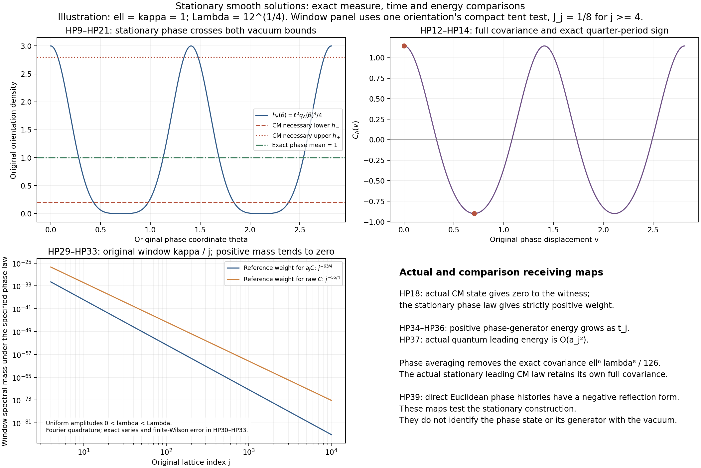

# Stationary homogeneous Yang–Mills laws and their exact receiving defects

The global finite-energy stationarity calculation [GM24–GM28](https://github.com/KokunoYumeto/yang-mills-interacting-workbench/blob/bb3c029754e9732bdf5cb28332a047692b32a7b5/yang-mills/continuations/20261011-central-signs-shrinking-window/GLOBAL_MEASURE_EVOLUTION.md) leads to the space of smooth source-free trajectories with finite energy on compact spatial sets and possibly infinite total energy. The periodic solutions proved in [HCR7](https://github.com/KokunoYumeto/yang-mills-interacting-workbench/blob/bb3c029754e9732bdf5cb28332a047692b32a7b5/yang-mills/continuations/20261011-central-signs-shrinking-window/HOLONOMY_CURVATURE_REVIEW.md) give explicit stationary probability laws in that space. This note calculates their original Wilson observations, full phase covariance, a quantitative incompatibility with the actual CM spatial law, and their auxiliary spectral weight in the unchanged shrinking window. The state, generator and comparison maps are all specified. No identification of the phase law with the quantum vacuum is made.

## 1. Original parameters and the stationary solution law

Keep the original coordinates \(x\), center \(o\), time \(s=x^0=ct_{\rm phys}\), Minkowski metric \(\operatorname{diag}(-1,1,1,1)\), and
\[
\begin{gathered}
T_i=-i\sigma_i/2,\quad [T_i,T_k]=\varepsilon_{ikq}T_q,\quad
\langle X,Y\rangle=-2\operatorname{Tr}(XY),\\
a_j=(100j)^{-1},\quad L_j=j^4,\quad
g_j^2=\kappa_*a_j/2,\quad b_j=(\kappa_*a_j^2)^{-1},\\
t_j=(\ell/a_j)^{3/4},\quad \delta_j=a_jt_j,\qquad
H_j=-\kappa_*\Delta+b_j\sum_p(2-\operatorname{Tr}U_p).
\end{gathered}\tag{HP1}
\]
In particular \(t_j\) is the retained dimensionless amplitude, not time. The last operator remains the original quantum Hamiltonian. Its ground-state law is the one used in CM1, not a phase law introduced below.

For \(\lambda>0\), let \(q_\lambda\) be the unique solution
\[
\begin{gathered}
q_\lambda''=-2q_\lambda^3,\qquad
q_\lambda(0)=\lambda,\quad q_\lambda'(0)=0,\qquad
(q_\lambda')^2+q_\lambda^4=\lambda^4,\\
I=\int_0^1(1-u^4)^{-1/2}\,du,\qquad
Q_\lambda=I/\lambda,\quad P_\lambda=4I/\lambda,\quad
\omega_\lambda=2\pi/P_\lambda.
\end{gathered}\tag{HP2}
\]
The integral \(I\) is finite: near one its integrand is bounded by a constant times \((1-u)^{-1/2}\), and near zero it is bounded. Conservation follows by differentiating the displayed energy identity. It bounds \(q_\lambda,q_\lambda'\); iteration for the polynomial first-order system on bounded balls gives local existence and uniqueness and extends every finite endpoint, hence gives global smoothness. On \((0,Q_\lambda)\), separation with \(q_\lambda'<0\) gives the first crossing time \(Q_\lambda\). The solution cannot stay positive indefinitely: a positive limiting value would keep its second derivative negative, and a zero limiting value would force its first derivative to tend to \(-\lambda^2\). Uniqueness and time reversal then give
\(q_\lambda(Q_\lambda)=0\), \(q_\lambda'(Q_\lambda)=-\lambda^2\),
\(q_\lambda(s+2Q_\lambda)=-q_\lambda(s)\), and period \(P_\lambda\).
Strict decrease from \(\lambda\) to \(-\lambda\), followed by strict increase, proves that this is its least positive period. These are the exact HCR7 objects, with their complete period retained.

For a phase \(\theta\in\mathbb R/P_\lambda\mathbb Z\), define
\[
\begin{gathered}
A^{j,\lambda,\theta}_0=0,\qquad
A^{j,\lambda,\theta}_i(s,x)
=t_jq_\lambda(\theta+t_js)T_i,\\
F_{0i}=t_j^2q_\lambda'(\theta+t_js)T_i,\qquad
F_{ik}=t_j^2q_\lambda(\theta+t_js)^2[T_i,T_k].
\end{gathered}\tag{HP3}
\]
Every derivative is smooth on all of space-time. Each spatial derivative is zero. Consequently
\[
\begin{gathered}
\sum_iD_iF_{0i}=0,\qquad
D^\mu F_{\mu i}
=t_j^3[-q_\lambda''-2q_\lambda^3](\theta+t_js)T_i=0,\\
e_j=\tfrac32t_j^4[(q_\lambda')^2+q_\lambda^4]
=\tfrac32t_j^4\lambda^4,\qquad
e_{{\rm phys},j}=\frac{3t_j^4\lambda^4}{\kappa_*a_j}.
\end{gathered}\tag{HP4}
\]
Gauss holds term by term because each electric component commutes with its matching connection. The source calculation uses
\([T_k,[T_k,T_i]]=-T_i\) for each of the two \(k\ne i\), together with the retained negative time sign. The energy density is positive, spatially constant and finite; total energy on \(\mathbb R^3\) is infinite. Thus HP3 supplies actual nonflat solutions in the larger space identified in GM28.

Give the phase its uniform probability \(d\theta/P_\lambda\), and push this probability forward by HP3. Under time translation by \(u\), the phase changes to \(\theta+t_ju\), so the resulting probability on trajectories is stationary. The map from phase to trajectories is continuous in the local smooth topology. Arbitrary probability mixtures in \(\lambda\) give Borel stationary laws too: ODE dependence on \(\lambda\) and phase is continuous on compact parameter subsets, or follows directly from the exact comparison
\[
q_\lambda(v)=\frac{\lambda}{\Lambda}
q_\Lambda\!\left(\frac{\lambda}{\Lambda}v\right),\qquad
P_\lambda=\frac{\Lambda}{\lambda}P_\Lambda
\quad(\lambda,\Lambda>0).
\tag{HP5}
\]
Substitution in the ODE and initial conditions proves HP5 by uniqueness. This is an explicit map between the original solutions, not a change of physical time or replacement of \(\lambda\).

For a fixed \(\lambda\), the uniform phase probability is the only probability invariant under every time translation. Indeed its \(n\)-th Fourier coefficient, for \(n\ne0\), equals itself times \(e^{in\omega_\lambda t_ju}\) for every \(u\), so choosing \(u=P_\lambda/(2nt_j)\) makes that coefficient zero. Fejér convolution approximates every continuous periodic function uniformly, proving equality with uniform measure from these coefficients. The Fejér approximation follows from positivity and integral one of its kernel: split its convolution into a small neighborhood, controlled by uniform continuity, and its complement, where the kernel mass tends to zero. For mixtures, \(\lambda\) is recovered from the conserved density HP4. Disintegrate over this invariant parameter; conditional invariance first holds for a countable dense set of times and then all times by continuity. Thus every invariant law within this specified isotropic family has uniform conditional phase. No density assumption on the initial phase law is needed.

## 2. Original finite faces and all one-time moments

Retain the ordered edge convention \(U'=UA_i\). On each original positive edge,
\(U_i=\exp(\delta_jq_\lambda(\theta+t_js)T_i)\).
For equal angles \(v=\delta_jq_\lambda(\theta+t_js)\), the original face product has exact deficit
\[
D_p=2-\operatorname{Tr}
(e^{vT_d}e^{vT_k}e^{-vT_d}e^{-vT_k})
=4\sin^4(v/2)\quad(d<k).
\tag{HP6}
\]
For verification, write \(e^{vT_i}=\cos(v/2)I+2\sin(v/2)T_i\), use
\(T_i^2=-I/4\), \(T_iT_k=-T_kT_i\) for distinct indices, and
\(\operatorname{Tr}T_i=0\). Multiplication leaves scalar part
\(1-2\sin^4(v/2)\); trace is twice that scalar part, proving HP6 with its original trace factor.

For the full original orientation triple \(\mathbf f\), define
\[
\begin{gathered}
J_{\mathbf f,j}=a_j^3\sum_{\sigma,p:\sigma}f_\sigma(x_{p,j}),\qquad
J_{\mathbf f}=\sum_\sigma\int f_\sigma(x)\,dx,\\
h_{j,\lambda}(\theta)=\frac4{a_j}
\sin^4\!\left(\frac{\delta_jq_\lambda(\theta)}2\right),\qquad
h_\lambda(\theta)=\frac{\ell^3}{4}q_\lambda(\theta)^4,\\
a_jC_{\mathbf f,j}(\operatorname{Hol}_jA(s))
=J_{\mathbf f,j}h_{j,\lambda}(\theta+t_js).
\end{gathered}\tag{HP7}
\]
There is no division by the three orientations. The face centers, box and original sums are unchanged. For any compact continuous signed tests, the ordinary translated mesh estimate gives \(J_{\mathbf f,j}\to J_{\mathbf f}\).

The full amplitude-sensitive error is
\[
\left|h_{j,\lambda}(\theta)-h_\lambda(\theta)\right|
\le \epsilon_j(\lambda)
:=\frac{\ell^{9/2}a_j^{1/2}\lambda^6}{24},
\qquad 0\le h_{j,\lambda}\le\ell^3\lambda^4/4 .
\tag{HP8}
\]
Indeed \(|\sin z-z|\le |z|^3/6\), obtained by integrating
\(|1-\cos z|\le z^2/2\), and
\(|\sin^4z-z^4|\le4|z|^3|\sin z-z|\).
Multiply by \(4/a_j\), put \(z=\delta_jq_\lambda/2\), and retain
\(\delta_j^6/a_j=\ell^{9/2}a_j^{1/2}\). The upper bound uses \(|\sin z|\le|z|\) and \(\delta_j^4=\ell^3a_j\). This estimate is uniform in phase and original time, and retains the additional \(\lambda^6\) needed for small-window calculations.

For fixed \(\lambda\), let \(Y=q_\lambda(\theta)^4/\lambda^4\). Its probability density is
\[
\frac{y^{-3/4}(1-y)^{-1/2}}{\mathrm B(1/4,1/2)}
\,\mathbf1_{(0,1)}(y),\qquad
\mathrm B(1/4,1/2)=4I .
\tag{HP9}
\]
To prove this, split the full period into the four monotone segments for \(|q_\lambda|\). Each contributes
\(\int_0^\lambda \varphi(u^4/\lambda^4)(\lambda^4-u^4)^{-1/2}du\).
Multiply by \(4/P_\lambda\), and substitute \(y=u^4/\lambda^4\), retaining
\(du=(\lambda/4)y^{-3/4}dy\). This gives HP9. In particular there are no endpoint atoms, and every nonempty open interval in \((0,1)\) has positive probability.

For every nonnegative integer \(m\),
\[
\begin{gathered}
\mathbb E_\theta q_\lambda^{4m}
=\lambda^{4m}\frac{\mathrm B(m+1/4,1/2)}
{\mathrm B(1/4,1/2)},\\
\mathbb E_\theta h_\lambda=\frac{\ell^3\lambda^4}{12},\qquad
\mathbb E_\theta h_\lambda^2=\frac{5\ell^6\lambda^8}{336},\qquad
\operatorname{Var}_\theta h_\lambda=\frac{\ell^6\lambda^8}{126}.
\end{gathered}\tag{HP10}
\]
The beta recurrence \(\mathrm B(x+1,y)=x\mathrm B(x,y)/(x+y)\) follows by integration by parts and
\(\mathrm B(x,y)=\mathrm B(x+1,y)+\mathrm B(x,y+1)\).
It gives the first two dimensionless moments \(1/3\) and \(5/21\);
their variance is \(5/21-1/9=8/63\). Multiplication by the full powers of \(\ell^3/4\) gives HP10.

The limiting one-time orientation measures are exactly
\(\nu^\theta_\sigma=h_\lambda(\theta)\,dx\), with the same random coefficient in all three orientations. Consequently
\[
\begin{gathered}
\mathbb E_\theta\prod_{v=1}^m\nu^\theta_{\sigma_v}(f_v)
=\left(\frac{\ell^3\lambda^4}{4}\right)^m
\frac{\mathrm B(m+1/4,1/2)}{\mathrm B(1/4,1/2)}
\prod_{v=1}^m\int f_v,\\
\operatorname{Cov}_\theta
(\nu^\theta(\mathbf f),\nu^\theta(\mathbf g))
=\frac{\ell^6\lambda^8}{126}J_{\mathbf f}J_{\mathbf g}.
\end{gathered}\tag{HP11}
\]
HP7–HP8 prove convergence of the original finite one-time mixed moments to these values at every original time, because phase translation preserves its law and the phase errors are uniform. Every signed and cross-orientation factor remains in the formulas. For compactly supported amplitude mixtures the same argument is dominated uniformly. Unbounded mixtures require the actual moment being integrated to be finite; no such moment is silently assigned.

## 3. Exact original-time covariance and the quarter-period map

Put
\[
\widehat h_n(\lambda)=\frac1{P_\lambda}
\int_0^{P_\lambda}h_\lambda(v)e^{-in\omega_\lambda v}\,dv .
\]
The function is real, even and \(P_\lambda/2\)-periodic, so
\(\widehat h_{-n}=\widehat h_n\in\mathbb R\), and all odd coefficients vanish. Repeated integration by parts gives
\(|\widehat h_n|\le (|n|\omega_\lambda)^{-r}
P_\lambda^{-1}\int|h_\lambda^{(r)}|\) for every \(r\ge1,n\ne0\).
Thus its Fourier series and every needed differentiated series converge absolutely after choosing sufficiently many derivatives. Orthogonality and Fejér approximation prove Parseval. The complete centered covariance is therefore
\[
\begin{gathered}
C_\lambda(v)
=\frac1{P_\lambda}\int_0^{P_\lambda}
(h_\lambda(\theta)-\bar h_\lambda)
(h_\lambda(\theta+v)-\bar h_\lambda)\,d\theta\\
=\sum_{n\ne0}|\widehat h_n(\lambda)|^2e^{in\omega_\lambda v},
\qquad C_\lambda(0)=\frac{\ell^6\lambda^8}{126},\\
\operatorname{Cov}(a_jC_{\mathbf f,j}(A(s)),
a_jC_{\mathbf g,j}(A(u)))
=J_{\mathbf f,j}J_{\mathbf g,j}C_\lambda(t_j(u-s))+o(1)
\quad(j\to\infty).
\end{gathered}\tag{HP12}
\]
The last error follows from HP8 and the boundedness of \(h_\lambda\); it is uniform in \(s,u\). Here \(\bar h_\lambda=\ell^3\lambda^4/12\). The covariance uses the same phase at both times.

There is an exact quarter-period formula, retaining the derivative:
\[
q_\lambda(v+Q_\lambda)
=\frac{\lambda q_\lambda'(v)}{\lambda^2+q_\lambda(v)^2},
\qquad
q_\lambda(v+Q_\lambda)^4
=\lambda^4
\left(\frac{\lambda^2-q_\lambda(v)^2}
{\lambda^2+q_\lambda(v)^2}\right)^2 .
\tag{HP13}
\]
For the first expression \(r\), differentiation using HP2 gives
\(r'=-2\lambda^3q_\lambda/(\lambda^2+q_\lambda^2)\) and
\(r''=-2\lambda^3q_\lambda'(\lambda^2-q_\lambda^2)/
(\lambda^2+q_\lambda^2)^2=-2r^3\).
Also \(r(0)=0,r'(0)=-\lambda^2\), the exact data at \(Q_\lambda\).
Uniqueness proves the first equality. Squaring twice and using the full energy identity proves the second.

The function \(z\mapsto\lambda^4[(\lambda^2-\sqrt z)/
(\lambda^2+\sqrt z)]^2\) is strictly decreasing on \(0<z<\lambda^4\).
If \(Z,Z'\) are independent copies of \(q_\lambda(\theta)^4\), then
\[
\operatorname{Cov}(Z,F(Z))
=\tfrac12\mathbb E[(Z-Z')(F(Z)-F(Z'))]<0.
\]
Strictness follows from HP9 and strict decrease. Hence
\[
C_\lambda(Q_\lambda)<0,\qquad
\|h_\lambda(\cdot+Q_\lambda)-h_\lambda\|_{L^2(d\theta/P_\lambda)}^2
=2[C_\lambda(0)-C_\lambda(Q_\lambda)]>0.
\tag{HP14}
\]
In particular, the time increments \(Q_\lambda/t_j\to0\) carry a fixed positive limiting mean-square difference of the original receiver whenever \(J_{\mathbf f}\ne0\). This family has no regulator-uniform mean-square continuity at zero.

For every fixed \(u-s\ne0\), the arguments \(|t_j(u-s)|\) tend to infinity and their successive increments tend to zero. Given any \(v\in[0,P_\lambda)\), the first index crossing \(mP_\lambda+v\) has overshoot tending to zero. Evenness treats the sign of \(u-s\). Thus the full accumulation set of HP12 is
\[
J_{\mathbf f}J_{\mathbf g}\,
C_\lambda([0,P_\lambda]),
\tag{HP15}
\]
understood as the image of that interval, retaining the sign of the product. This image is nontrivial when the product is nonzero, by HP14. It proves failure of an ordinary fixed-time covariance limit for those tests. It does not select an ultrafilter limit or assert that every such selected limit has the same time regularity.

## 4. Quantitative comparison with the actual spatial law

The actual law in [CM23–CM33](https://github.com/KokunoYumeto/yang-mills-interacting-workbench/blob/bb3c029754e9732bdf5cb28332a047692b32a7b5/yang-mills/continuations/20261011-central-signs-shrinking-window/SIMULTANEOUS_CENTRAL_MEASURE.md) has constraints not shared by arbitrary stationary classical laws. First, for any nonzero \(0\le f\in C_c(Q)\) in one orientation, where \(Q\) has side \(R\), set
\[
\mathsf L_R=9\kappa_*R^3+24R^2,\qquad
\ell_f=\frac{9\kappa_*^2}{8\mathsf L_R}
\frac{(\int f)^2}{\|f\|_\infty}>0 .
\tag{HP16}
\]
CM29 proves \(S_{f\mathbf e_\sigma}\ge\ell_f I\). Every character measure in that construction therefore obeys
\(\nu_{\xi,\sigma}(f)\ge\ell_f\).
For the stationary phase law, the same proposed receiving observable is
\(X=h_\lambda(\theta)\int f\), and HP9 gives
\[
\mathbb P_\theta(X<\ell_f)
=\frac{\displaystyle\int_0^{\min\{1,\ell_f/[(\ell^3\lambda^4/4)\int f]\}}
y^{-3/4}(1-y)^{-1/2}\,dy}
{\mathrm B(1/4,1/2)}>0.
\tag{HP17}
\]
Endpoint equality has probability zero. This is a positive violation probability for every finite \(\lambda>0\). Mixing these conditional probabilities against any probability on finite positive amplitudes leaves a strictly positive violation probability.

A bounded continuous functional gives an exact state-level certificate. Put
\(\varphi_f(z)=(\ell_f-z)_+\) for \(z\ge0\), extending it boundedly and continuously to the negative line if desired. The actual state has
\(\langle\Omega,\varphi_f(S_{f\mathbf e_\sigma})^2\Omega\rangle=0\), while
\[
\mathbb E_\theta\varphi_f(X)^2
\ge\frac{\ell_f^2}{4}\,
\mathbb P_\theta(X<\ell_f/2)>0 .
\tag{HP18}
\]
Therefore no state-preserving map of the continuous functional calculus can identify this actual \(S\) with the phase observable \(X\). This proves a specific receiving obstruction with its exact witnessing function, rather than a claim that the constructions have no relation.

The homogeneous density also obeys a useful complete deterministic interval test. Let
\[
d_\pm(\mathsf L_R,R)=\frac{\mathsf L_R
\pm\sqrt{\mathsf L_R^2-81\kappa_*^2R^6/4}}2,\qquad
h_\pm=\frac{3\kappa_*}{4}(2\pm\sqrt3).
\tag{HP19}
\]
If a homogeneous triple \(h\,dx,h\,dx,h\,dx\) is an actual CM character measure, then CM23 and CM33, including the actual energy coordinate before its ceiling, imply
\(d_-(\mathsf L_R,R)\le3hR^3\le d_+(\mathsf L_R,R)\) for every \(R>0\). Cube boundaries have zero mass for this specified homogeneous measure. Divide by \(3R^3\), retain
\(\mathsf L_R/R^3=9\kappa_*+24/R\), and let \(R\to\infty\); this proves
\[
h_-\le h\le h_+,\qquad h_->0 .
\tag{HP20}
\]
These are necessary inequalities, not a characterization of the full actual law.

The phase violation of this interval is uniformly positive even across amplitude mixtures. Let \(F_Y\) be the HP9 distribution function and set
\[
c_*=\min\{F_Y(h_-/(2h_+)),\,1-F_Y(1/2)\}>0 .
\tag{HP21}
\]
If \(h_{\max}=\ell^3\lambda^4/4\le2h_+\), then
\(\mathbb P(h_\lambda<h_-)\ge F_Y(h_-/(2h_+))\).
If \(h_{\max}>2h_+\), then
\(\mathbb P(h_\lambda>h_+)\ge1-F_Y(1/2)\).
Thus every law on the limiting homogeneous phase receivers places at least \(c_*\) mass outside HP20, including arbitrary mixtures. This does not assume a uniform Taylor estimate for unbounded regulator-dependent amplitudes in HP8.

Conditioning the phase on the interval HP20 does not restore stationarity of these Yang–Mills trajectories. At amplitudes for which the allowed set has positive length, write its finitely many arcs as \(\bigcup_\alpha(a_\alpha,b_\alpha)\); their endpoints come from the strictly monotone quarter arcs of HP2. For the probability with density equal to the reciprocal of their total length on those arcs, a smooth periodic test \(G\) has
\[
\mathbb E[t_j\partial_\theta G]
=\frac{t_j}{\sum_\alpha(b_\alpha-a_\alpha)}
\sum_\alpha[G(b_\alpha)-G(a_\alpha)] .
\tag{HP22}
\]
This is the exact boundary flux. The allowed set is neither the whole circle, since \(h_\lambda\) reaches zero, nor a stationary probability set. Choosing a smooth test with different values at one entering and one leaving endpoint makes the flux nonzero. Degenerate zero-length sets cannot support an invariant phase law either, by the uniqueness proved after HP5.

## 5. The averaging map and every lost covariance term

For a probability \(\pi\) on amplitudes, use the Hilbert space
\(\mathcal H_\pi=L^2(d\pi(\lambda)\,d\theta/P_\lambda)\).
The exact orthogonal projection onto the phase-invariant subspace is
\[
(\Pi G)(\lambda)=\frac1{P_\lambda}\int_0^{P_\lambda}G(\lambda,\theta)\,d\theta,
\qquad
\langle G,H\rangle
=\langle\Pi G,\Pi H\rangle
+\langle(I-\Pi)G,(I-\Pi)H\rangle .
\tag{HP23}
\]
Cauchy–Schwarz proves boundedness of this map; its defining integral gives
\(\Pi^2=\Pi=\Pi^*\), and expansion proves the displayed equality.
For \(X_{\mathbf f}=J_{\mathbf f}h_\lambda\), it gives
\[
\begin{gathered}
\Pi X_{\mathbf f}=J_{\mathbf f}\ell^3\lambda^4/12,\\
\operatorname{Cov}(X_{\mathbf f},X_{\mathbf g})
=J_{\mathbf f}J_{\mathbf g}
\left[
\operatorname{Var}_\pi(\ell^3\lambda^4/12)
+\int\frac{\ell^6\lambda^8}{126}\,d\pi(\lambda)
\right].
\end{gathered}\tag{HP24}
\]
All terms are finite, for example, for compact amplitude support; otherwise the asserted covariance requires the displayed eighth moment. The second term is exactly the phase covariance removed by averaging. At fixed amplitude it is \(8/7\) times the square of the mean density. It is not a vanishing error.

One can choose \(\lambda\) so the averaged density obeys HP20:
\((12h_-/\ell^3)^{1/4}\le\lambda\le(12h_+/\ell^3)^{1/4}\).
This calculation does not make averaging preserve the original state or its correlations: HP23–HP24 give the complete missing Gram term. The original instantaneous Wilson observation remains HP7.

## 6. Original-time generator and the full auxiliary spectral matrices

On \(\mathcal H_\pi\), the time-translation group is
\((U_sG)(\lambda,\theta)=G(\lambda,\theta+t_js)\).
It is unitary. Finite Fourier sums with bounded compact-amplitude coefficients are dense by fiberwise Fejér approximation and truncation in \(\lambda\); on them strong continuity follows by dominated convergence, and it extends by unitarity. The exact generator and its domain are
\[
\begin{gathered}
K_j=-it_j\partial_\theta,\qquad
(K_jG)_n(\lambda)=n\omega_\lambda t_jG_n(\lambda),\\
\mathcal D(K_j)=\left\{G:
\sum_n\int n^2\omega_\lambda^2t_j^2|G_n(\lambda)|^2\,d\pi<\infty\right\}.
\end{gathered}\tag{HP25}
\]
This real multiplication operator on the Fourier direct integral is self-adjoint: its resolvents at \(i\) and \(-i\) are the bounded multipliers
\((n\omega_\lambda t_j\mp i)^{-1}\), which have full range into the stated domain. Fourier synthesis proves \(U_s=e^{isK_j}\). In physical time \(t_{\rm phys}\) the generator is \(cK_j\).

The original quantum operator \(H_j-E_{0,j}\) is positive. The phase generator \(K_j\) has both positive and negative frequencies. This defect is present even on the original gauge-invariant plaquette receiver. In fact \(\widehat h_2(\lambda)>0\): by evenness and quarter-arc reflection,
\[
\widehat h_2(\lambda)
=\frac{\ell^3}{P_\lambda}
\int_0^{Q_\lambda}q_\lambda(v)^4
\cos(\pi v/Q_\lambda)\,dv
=-\frac{\ell^3Q_\lambda}{\pi P_\lambda}
\int_0^{Q_\lambda}(q_\lambda^4)'(v)
\sin(\pi v/Q_\lambda)\,dv>0 .
\tag{HP26}
\]
The derivative is strictly negative inside this interval. Both coefficients \(n=2\) and \(n=-2\) therefore carry positive weight in its centered observation. No positive-energy identification intertwining these full time groups and this observation is possible.

The exact positive comparison operator is \(\mathcal L_j=|K_j|\), with multiplier
\(|n|\omega_\lambda t_j\). Its kernel is the full phase-invariant subspace \(\Pi\mathcal H_\pi\), not merely the constants when \(\pi\) is nontrivial. Define the original phase-centered finite observations by
\[
v_{\mathbf f,j}=(I-\Pi)(a_jC_{\mathbf f,j})
=J_{\mathbf f,j}(h_{j,\lambda}-\Pi h_{j,\lambda}) .
\tag{HP27}
\]
For compact amplitude support, all following sums converge. Put
\(\widehat h_{j,n}(\lambda)=P_\lambda^{-1}
\int h_{j,\lambda}(\theta)e^{-in\omega_\lambda\theta}\,d\theta\).
Every finite family has the complete Gram, first-energy and second-energy matrices
\[
\begin{aligned}
G_{\mathbf f\mathbf g,j}
&=J_{\mathbf f,j}J_{\mathbf g,j}
\sum_{n\ne0}\int|\widehat h_{j,n}(\lambda)|^2\,d\pi,\\
E_{\mathbf f\mathbf g,j}
&=J_{\mathbf f,j}J_{\mathbf g,j}
\sum_{n\ne0}\int |n|\omega_\lambda t_j
|\widehat h_{j,n}(\lambda)|^2\,d\pi,\\
E^{(2)}_{\mathbf f\mathbf g,j}
&=J_{\mathbf f,j}J_{\mathbf g,j}
\sum_{n\ne0}\int n^2\omega_\lambda^2t_j^2
|\widehat h_{j,n}(\lambda)|^2\,d\pi .
\end{aligned}\tag{HP28}
\]
They follow by diagonal multiplication and Parseval. All signed cross terms and original mesh coefficients are retained. For a coefficient vector \(z\), every quadratic form contains exactly
\(|\sum_{\mathbf f}z_{\mathbf f}J_{\mathbf f,j}|^2\), which may be zero; no coefficient norm is substituted. The matrices for the unmultiplied original \(C_{\mathbf f,j}\) are \(a_j^{-2}\) times these matrices.

The change from \(K_j\) to \(\mathcal L_j\) has the explicit spectral difference
\(\mathcal L_j-K_j=2(-K_j)\mathbf1_{(-\infty,0)}(K_j)\).
Thus \(\mathcal L_j\) defines a different time group. It is an auxiliary positive generator with a precisely calculated relation to the classical group, not the quantum Hamiltonian in HP1. HP18 already prevents a state-preserving identification of their proposed spatial receivers.

## 7. Exact shrinking-window weight for a continuous amplitude law

Fix \(\Lambda>0\) and now specify the comparison law completely:
\(d\pi(\lambda)=\Lambda^{-1}\mathbf1_{(0,\Lambda)}\,d\lambda\).
This is a selected law for the present calculation. For the leading original receiver retain the exact comparison HP5, which gives
\(\widehat h_n(\lambda)=(\lambda/\Lambda)^4\widehat h_n(\Lambda)\).
Write \(v_{\mathbf f,j}^{\,0}
=J_{\mathbf f,j}(I-\Pi)h_\lambda\).
For any \(b>0\), its full nonzero-window Gram is
\[
\begin{split}
&\langle v_{\mathbf f,j}^{\,0},
\mathbf1_{(0,b]}(\mathcal L_j)v_{\mathbf g,j}^{\,0}\rangle\\
&\quad=\frac{J_{\mathbf f,j}J_{\mathbf g,j}}9
\sum_{n\ne0}|\widehat h_n(\Lambda)|^2
\min\left\{1,\frac{b}{|n|\omega_\Lambda t_j}\right\}^{9}.
\end{split}\tag{HP29}
\]
Indeed the mode cutoff is
\(\lambda\le\min\{\Lambda,b\Lambda/(|n|\omega_\Lambda t_j)\}\).
Integrating its complete factor \(\lambda^8/\Lambda^9\) gives the power nine and coefficient \(1/9\). The zero mode was removed by \(\Pi\), including all amplitude-dependent invariant vectors.

Odd modes vanish. For \(0<b<2\omega_\Lambda t_j\), put
\[
A_\Lambda=\sum_{n\ne0}
\frac{|\widehat h_n(\Lambda)|^2}{|n|^9}>0 .
\]
Its positivity follows from HP26 and its finiteness from Parseval. Formula HP29 becomes exactly
\[
\langle v_{\mathbf f,j}^{\,0},
\mathbf1_{(0,b]}(\mathcal L_j)v_{\mathbf g,j}^{\,0}\rangle
=\frac{J_{\mathbf f,j}J_{\mathbf g,j}A_\Lambda}{9}
\left(\frac{b}{\omega_\Lambda t_j}\right)^9 .
\tag{HP30}
\]
At the original window \(b=s_j=\kappa_*/j=100\kappa_*a_j\), this coefficient equals
\[
\frac{J_{\mathbf f,j}J_{\mathbf g,j}A_\Lambda}{9}
\left(\frac{\kappa_*}{\omega_\Lambda(100\ell)^{3/4}}\right)^9
j^{-63/4}.
\tag{HP31}
\]
This is positive on a nonzero mesh combination and tends to zero on any fixed test with nonzero limiting \(J_{\mathbf f}\). At each fixed regulator, arbitrarily small nonzero windows have positive comparison weight because amplitudes approach zero. HP31 keeps its actual vanishing mass along the original path.

The original finite Wilson error is much smaller on this same window; a global norm estimate alone would not show that. Every nonconstant mode of \(h_{j,\lambda}\) and \(h_\lambda\) is even, so a window vector is supported in amplitudes
\[
0<\lambda\le\lambda_{b,j}
:=\frac{b\Lambda}{2\omega_\Lambda t_j}<\Lambda.
\]
By HP8, orthogonal projection and integration of \(\lambda^{12}\),
\[
\begin{split}
&\left\|\mathbf1_{(0,b]}(\mathcal L_j)
(v_{\mathbf f,j}-v_{\mathbf f,j}^{\,0})\right\|\\
&\quad\le
|J_{\mathbf f,j}|\frac{\ell^{9/2}a_j^{1/2}}{24}
\left(\frac{\lambda_{b,j}^{13}}{13\Lambda}\right)^{1/2}.
\end{split}\tag{HP32}
\]
There is no extra factor two from centering: \(I-\Pi\) is a contraction on each phase fiber. For the nonzero reference combination, divide HP32 by the norm from HP30. The ratio is bounded explicitly by
\[
\frac{\ell^{9/2}\Lambda^6}{8\,2^{13/2}\sqrt{13A_\Lambda}}\,
a_j^{1/2}
\left(\frac{b}{\omega_\Lambda t_j}\right)^2 .
\tag{HP33}
\]
At \(b=s_j\), this is \(O(j^{-4})\), with its complete coefficient displayed. The two triangle inequalities bound the actual window norm between \(1-\) and \(1+\) that ratio times the reference norm. Squaring gives the corresponding exact Gram bounds for every coefficient combination, since all vectors are the same scalar fiber vector times their retained \(J_{\mathbf f,j}\). Thus the true finite Wilson window weight has HP31 as its leading term, with relative error bounded by \(2\eta_j+\eta_j^2\), where \(\eta_j\) is HP33. For the unmultiplied original \(C_{\mathbf f,j}\), multiply the full weight by \(a_j^{-2}=10^4j^2\); its exponent is \(-55/4\), with all constants still present.

## 8. Full energy comparison with the actual quantum receiving vectors

For this same uniform amplitude law, the complete reference matrices can be integrated without losing their energies. Write
\[
B_\Lambda=\sum_{n\ne0}|n|\,|\widehat h_n(\Lambda)|^2>0,\qquad
D_\Lambda=\sum_{n\ne0}n^2|\widehat h_n(\Lambda)|^2>0 .
\]
Their finiteness and positivity follow from smoothness and HP26. Direct integration of the retained powers \(\lambda^8,\lambda^9,\lambda^{10}\) gives
\[
\begin{aligned}
G^0_{\mathbf f\mathbf g,j}
&=\frac{J_{\mathbf f,j}J_{\mathbf g,j}}9
\frac{\ell^6\Lambda^8}{126},\\
E^0_{\mathbf f\mathbf g,j}
&=\frac{J_{\mathbf f,j}J_{\mathbf g,j}}{10}
t_j\omega_\Lambda B_\Lambda,\\
E^{(2),0}_{\mathbf f\mathbf g,j}
&=\frac{J_{\mathbf f,j}J_{\mathbf g,j}}{11}
t_j^2\omega_\Lambda^2D_\Lambda .
\end{aligned}\tag{HP34}
\]
These are the matrices for \(v^0\), with the original \(a_jC\) scaling. For raw \(C\), the multiplier is again \(a_j^{-2}\).

The same leading energies hold for the true finite Wilson observations, with an explicit relative error. Differentiating HP7 and using
\[
|\sin^3z\cos z-z^3|
\le3|z|^2|\sin z-z|+|z|^3|\cos z-1|\le|z|^5
\]
gives
\[
|\partial_\theta(h_{j,\lambda}-h_\lambda)|
\le\frac{\ell^{9/2}a_j^{1/2}\lambda^7}{4}.
\tag{HP35}
\]
Here \(|q_\lambda'|\le\lambda^2\), and every factor in
\((8\delta_j/a_j)q_\lambda'\sin^3z\cos z\) is retained.
Put \(d_j=(I-\Pi)(h_{j,\lambda}-h_\lambda)\). HP8, HP35 and integration of the two amplitude powers prove
\[
\begin{gathered}
\|d_j\|\le
\frac{\ell^{9/2}a_j^{1/2}\Lambda^6}{24\sqrt{13}},
\qquad
\|K_jd_j\|\le
\frac{t_j\ell^{9/2}a_j^{1/2}\Lambda^7}{4\sqrt{15}},\\
\|\mathcal L_j^{1/2}d_j\|^2
\le\|d_j\|\|K_jd_j\|
\le\frac{t_j\ell^9a_j\Lambda^{13}}{96\sqrt{195}} .
\end{gathered}\tag{HP36}
\]
The first-order inequality is spectral Cauchy–Schwarz.
For any nonzero mesh coefficient combination, the relative error in its first-energy square root is at most
\[
\left(\frac{10\ell^9a_j\Lambda^{13}}
{96\sqrt{195}\,\omega_\Lambda B_\Lambda}\right)^{1/2},
\]
and its second-energy square root has relative error at most
\[
\frac{\sqrt{11}\ell^{9/2}a_j^{1/2}\Lambda^7}
{4\sqrt{15}\,\omega_\Lambda\sqrt{D_\Lambda}} .
\]
The Gram square root has the analogous explicit ratio from HP8 and HP34. Triangle inequalities, followed by squaring, prove these bounds on the full finite matrices. In particular the positive phase-generator energy of \(a_jC_{\mathbf f,j}\) is asymptotic to
\(J_{\mathbf f}^2t_j\omega_\Lambda B_\Lambda/10\) when \(J_{\mathbf f}\ne0\); it diverges.

Now return to the actual unchanged quantum ground state, which has a different proved energy behavior. Use exactly CE2–CE3:
\[
\mathcal A_j=H_j-E_{0,j},\qquad
u_{\mathbf f,j}=(C_{\mathbf f,j}-\mu_jC_{\mathbf f,j})\psi_j,\qquad
w_{\mathbf f,j}=a_ju_{\mathbf f,j}.
\]
Here \(\mathcal A_j\) is named differently from the classical connection to keep the two domains explicit. CE9 proves
\(0<e_{\mathbf f}\le\liminf E_{\mathbf f,j}
\le\limsup E_{\mathbf f,j}\le U_{\mathbf f}<\infty\), with
\(E_{\mathbf f,j}=\langle u_{\mathbf f,j},\mathcal A_ju_{\mathbf f,j}\rangle\);
CE10 gives \(E_{2,\mathbf f,j}=O(a_j^{-1})\).
Therefore the original actual leading receiver satisfies
\[
\begin{gathered}
\langle w_{\mathbf f,j},\mathcal A_jw_{\mathbf f,j}\rangle
=a_j^2E_{\mathbf f,j}=O(a_j^2),\\
\|\mathcal A_jw_{\mathbf f,j}\|^2
=a_j^2E_{2,\mathbf f,j}=O(a_j),\\
\|(e^{is\mathcal A_j}-I)w_{\mathbf f,j}\|^2
\le2|s|a_j^2E_{\mathbf f,j},\\
\|(e^{-s\mathcal A_j}-I)w_{\mathbf f,j}\|^2
\le s a_j^2E_{\mathbf f,j}\quad(s\ge0).
\end{gathered}\tag{HP37}
\]
For the unitary estimate use
\(|e^{ix}-1|^2\le\min\{4,x^2\}\le2|x|\).
For heat use \((1-e^{-x})^2\le x\) for \(x\ge0\).
Integrate these inequalities against the actual spectral measure; no phase probability occurs in HP37. The energy identities are exact before the displayed bounds.

Consequently the actual central receiving vectors
\((S_{\mathbf f}-\langle S_{\mathbf f}\rangle)\Omega=[w_{\mathbf f,j}]\)
are fixed by every original-time heat or unitary operator on the continuous receiving space. This also follows from the centrality and word maps in CM13–CM40. All their mixed time correlations equal their actual static CM moments. The constant-time path \(\nu(s)=\nu_\xi\) with \(\xi\sim\mathbb P_\Omega\) is therefore an exact stationary realization of this leading commutative observation algebra, including its full actual spatial law. Its state and every map have been specified; it is not an assertion that such a path of measures is a Yang–Mills connection.

HP34–HP37 provide a quantitative obstruction to promoting the phase comparison to that quantum realization: for the same original test with \(J_{\mathbf f}\ne0\), the phase first energy grows like \(t_j\), while the actual leading first energy tends to zero like \(a_j^2\). The raw-\(C\) factors are also retained in HP28 and HP34. Neither subtracting its mean nor replacing \(K_j\) by its absolute value repairs this mismatch.

## 9. Exact generator and reflection-form tests for reconstruction

The two signs of the classical phase spectrum have a general structural explanation. On the complex \(L^2\) space of any stationary classical probability flow with a strongly continuous composition group, pointwise conjugation \(\mathcal J\) is antiunitary and obeys
\(\mathcal J U_s\mathcal J=U_s\). Differentiating on the generator domain, taking account of conjugation of \(i\), proves
\[
\mathcal J K\mathcal J=-K .
\tag{HP38}
\]
Equivalently, the domain is preserved because existence of the difference-quotient limit for \(G\) is equivalent to existence for \(\overline G\). If this whole composition generator were nonnegative, HP38 would also make it nonpositive, hence zero by its spectral theorem. This proves a precise restriction on a direct positive-energy identification of classical composition dynamics. It does not rule out reconstruction using a different positive-time quotient, whose maps would have to be proved.

There is also an explicit reflection-form test for the proposed use of these same real histories as Euclidean histories. This paragraph tests that direct use; it does not impose a Euclidean axiom on a Minkowski correlation without specifying the map. The time reflection of HP3 acts as \(\theta\mapsto-\theta\), since \(q_\lambda\) is even. For the real centered one-time cylinder
\[
F_j(\theta)=J_{\mathbf f,j}
[h_{j,\lambda}(\theta+t_j\tau_j)-\bar h_{j,\lambda}],
\qquad \tau_j=Q_\lambda/(2t_j)>0 ,
\]
the reflection form of this specified real-history law is exactly
\[
\begin{gathered}
\int\overline{F_j(-\theta)}F_j(\theta)\,\frac{d\theta}{P_\lambda}
=J_{\mathbf f,j}^2 C_{j,\lambda}(Q_\lambda),\\
|C_{j,\lambda}(Q_\lambda)-C_\lambda(Q_\lambda)|
\le4h_{\max}\epsilon_j(\lambda),\qquad
h_{\max}=\ell^3\lambda^4/4 .
\end{gathered}\tag{HP39}
\]
Evenness and a change of integration variable prove the first line. For the second, both \(h_{j,\lambda}\) and \(h_\lambda\) lie in \([0,h_{\max}]\); replacing the two product factors costs at most \(2h_{\max}\epsilon_j\), and replacing the squared mean costs at most the same amount. By HP14, the right-side covariance is strictly negative whenever
\(4h_{\max}\epsilon_j(\lambda)<-C_\lambda(Q_\lambda)\).
Thus, for any \(J_{\mathbf f}\ne0\), the original finite Wilson cylinder has a negative reflection square for all sufficiently large \(j\) in this direct real-history interpretation. The time and threshold are explicit. This is not a test of an unspecified analytic continuation.

The actual quantum heat histories have the opposite exact form, already constructed for full words in [CP17–CP20](https://github.com/KokunoYumeto/yang-mills-interacting-workbench/blob/bb3c029754e9732bdf5cb28332a047692b32a7b5/yang-mills/continuations/20261011-central-signs-shrinking-window/CURVATURE_PHASE_RECONSTRUCTION.md). For a finite positive-time history with
\(0\le r_1\le\cdots\le r_m\) and bounded original gauge-invariant multiplication operators \(M_1,\ldots,M_m\), its time-zero conditional vector is
\[
v_F=e^{-r_1\mathcal A_j}M_1
e^{-(r_2-r_1)\mathcal A_j}M_2\cdots
e^{-(r_m-r_{m-1})\mathcal A_j}M_m\psi_j .
\]
The original ground transformation makes the heat operator Markov and reversible. Integrating the ordered two-sided history, or successively conditioning at its time points, gives
\[
\mathbb E_j[(\Theta F_i)F_k]=\langle v_{F_i},v_{F_k}\rangle,\qquad
\sum_{i,k}\overline z_i z_k\,
\mathbb E_j[(\Theta F_i)F_k]
=\left\|\sum_i z_i v_{F_i}\right\|^2\ge0 .
\tag{HP40}
\]
For complex cylinders, \(\Theta\) includes conjugation and time reflection, so the adjoints appear in the reversed half of the product. The full vacuum energy remains in \(\mathcal A_j=H_j-E_{0,j}\); gauge invariance is preserved by all operators. For a centered single-time observation the identity is exactly
\(\langle u,e^{-2r\mathcal A_j}u\rangle
=\|e^{-r\mathcal A_j}u\|^2\).
All finite original \(C_{\mathbf f,j}\) are bounded on their compact configuration manifolds, so they too can be used in this finite identity. Any finite limiting collection with convergent correlations retains its positive Gram form by entrywise convergence; the actual bounded-word construction and its continuous quotient are supplied in CP.

The calculation supplies both sides of the receiving problem. The actual CM observation law already has stationary leading dynamics, with the precise energy and correlation map HP37, and the actual quantum histories retain HP40. The explicit smooth non-Abelian stationary phase laws solve the classical equation but have the quantitatively incompatible receiving maps HP18–HP21 and HP34–HP39. Their positive shrinking-window mass is fully calculated in HP29–HP33 and vanishes on the original path. The next dynamics must preserve the actual CM constraints and frozen leading observations while realizing the actual subleading fluctuation directions CE31–CE50 and their original positive generator. None of the auxiliary stationary laws or spectra is substituted for the requested smooth interacting quantum no-gap endpoint. No novelty claim is made.

The reproducible figure and bounded checks are in check_stationary_phase.py. The [source-use ledger](STATIONARY_PHASE_SOURCE_USE_LEDGER.json) records exact editions and actual reading coverage. Numerical samples illustrate the displayed formulas; they do not assign an actual quantum spectral coefficient.

## Actual energy vectors and bounded phase history maps

[EF1–EF27](ENERGY_ROOT_AND_ANCHORED_HISTORIES.md) prove that all actual CE heat-increment vectors have one continuous-time receiver, with their complete escaped Gram retained. A bounded sine-cylinder approximation receives every positive-energy component of the actual energy-root vector in an explicitly enlarged curvature-phase cyclic space. The proof preserves the smaller CM space and every zero-energy, original-window and cyclic-compression defect. Exact anchored variance and reflection formulas retain both spectral endpoints; a quantitative original-energy window bound uses the actual variance and the full fourth-moment remainder. EF25–EF27 additionally prove that the actual small-phase energy measures receive the complete finite-energy spectral measure, including its zero endpoint, and give a quantitative bound for positive windows. No actual coefficient is assigned a positive value merely from whole-vector survival.
