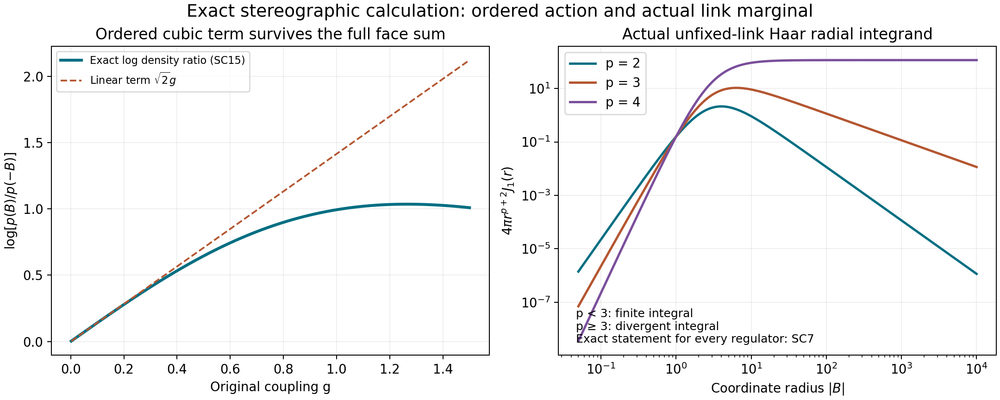
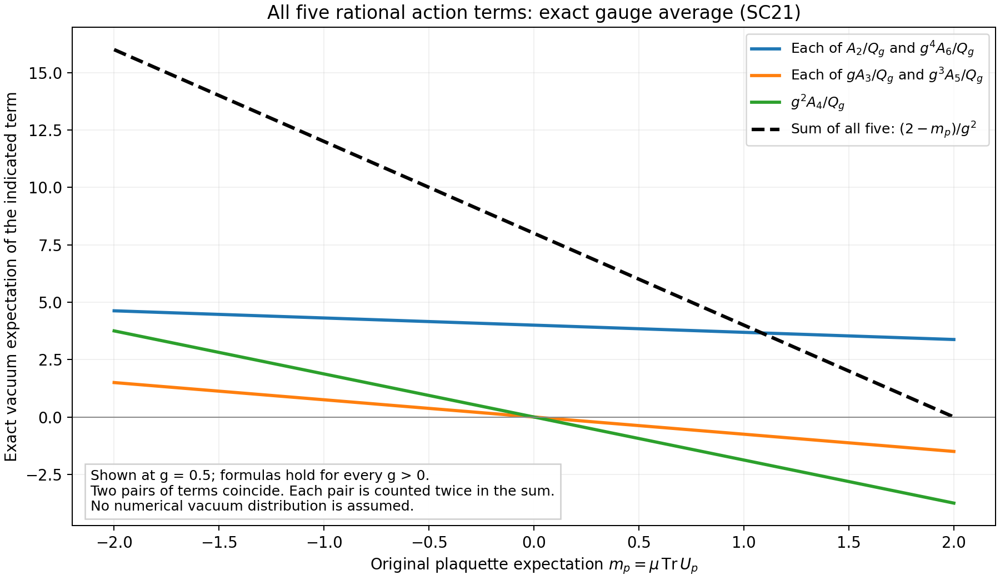

# Exact stereographic current, Haar tails and the ordered cubic term

This note applies the exact stereographic map in Sourav Chatterjee, *A scaling limit of SU(2) lattice Yang–Mills–Higgs theory*, [arXiv:2401.10507v4](https://arxiv.org/abs/2401.10507v4), to the programme's original finite Hamiltonian vacuum. It calculates the full density, metric and current integrals rather than replacing the vacuum by a Gibbs measure. It also gives an exact counterexample to the order of the remainder printed in the source's local free-field density lemma, label "approxdens", author TeX lines 1435–1499. The counterexample concerns that displayed approximation; it is not a disproof of the paper's scaling-limit theorem, whose complete proof has not been reviewed here.

The programme providers are [CTI1–CTI39](https://github.com/KokunoYumeto/yang-mills-interacting-workbench/blob/49fb910b4a77964cd611df7d0d6645f61ec2c5cf/yang-mills/continuations/20261011-central-signs-shrinking-window/CURRENT_TAILS_AND_RETAINED_SOURCE.md), [OW1–OW25](https://github.com/KokunoYumeto/yang-mills-interacting-workbench/blob/49fb910b4a77964cd611df7d0d6645f61ec2c5cf/yang-mills/continuations/20261011-central-signs-shrinking-window/ORDERED_WILSON_ACTION.md), and [TCR1–TCR21](TWO_SIDED_CURRENT_RESIDUAL.md). The source's coordinate ordering and the programme's radius-two metric are both retained.

## Exact coordinates and actual-state current

For the original \(g=g_j>0\), put
\[
\begin{gathered}
M(B)=\begin{pmatrix}
iB^1&B^2+iB^3\\-B^2+iB^3&-iB^1
\end{pmatrix},\quad q(B)=g^2|B|^2/8,\\
\Xi_g(B)=\frac{(1-q(B))I+(g/\sqrt2)M(B)}{1+q(B)},\\
\Xi_g:\mathbb R^3\longrightarrow SU(2)\setminus\{-I\}.
\end{gathered}\tag{SC1}
\]
This is exactly the inverse map in the source's "ueformula", not an exponential-coordinate replacement. Direct multiplication gives \(M(B)^*=-M(B)\), \(M(B)^2=-|B|^2I\), and determinant one for \(\Xi_g(B)\). Writing a group element as \(xI+M(y)\), \(x^2+|y|^2=1\), its inverse coordinate is \(B=(2\sqrt2/g)y/(1+x)\) when \(x\ne-1\). This proves bijectivity and smoothness of both maps.

The original \(T_\alpha=-i\sigma_\alpha/2\) are orthonormal. Under the identification with the unit \(S^3\), this metric is four times the sphere metric. Differentiating \(P_3(y)=((4-|y|^2)/(4+|y|^2),4y/(4+|y|^2))\) gives pullback metric \((1+|y|^2/4)^{-2}I\). Substitute \(y=gB/\sqrt2\) and multiply by four:
\[
\begin{gathered}
ds^2=\frac{2g^2}{(1+q)^2}\sum_{r=1}^3(dB^r)^2,\quad
A(B)=\frac{(1+q)^2}{2g^2},\\
dU=J_g(B)\,d^3B,\quad
J_g(B)=\frac{g^3}{4\sqrt2\pi^2}(1+q)^{-3}.
\end{gathered}\tag{SC2}
\]
The volume of the radius-two sphere is \(16\pi^2\); dividing the metric volume \((\sqrt2g)^3(1+q)^{-3}d^3B\) by that volume proves the probability-Haar constant. Thus neither a Jacobian factor nor the metric radius is suppressed.

Let \(\mathcal E_j\) be every positive edge of the original open lattice, and use the product map \(\Xi_g^{\mathcal E_j}\). Write \(\widehat X=X\circ\Xi_g^{\mathcal E_j}\) and \(\widehat w=(\log\psi_j)\circ\Xi_g^{\mathcal E_j}\). The original state becomes exactly
\[
\begin{gathered}
d\widehat\mu_j(B)=
\psi_j(\Xi_g^{\mathcal E_j}(B))^2
\prod_{e\in\mathcal E_j}J_g(B_e)\,d^3B_e,\qquad
\int d\widehat\mu_j=1,\\
\mu_j(Y)=\int Y(\Xi_g^{\mathcal E_j}(B))\,d\widehat\mu_j(B)
\end{gathered}\tag{SC3}
\]
for every integrable \(Y\). The omitted set is the finite union \(U_e=-I\), hence Haar null and \(\mu_j\)-null. The positive smooth ground state is bounded at this fixed regulator, so change of variables applies. No gauge constraint, boundary link or ground-state factor has been removed.

For real scalar functions pulled back from the compact manifold the original operators are
\[
\begin{gathered}
\langle dY,dZ\rangle=\sum_e A_e\,\partial_e\widehat Y\cdot\partial_e\widehat Z,\qquad
G_e=A_e|\partial_e\widehat w|^2,\\
\Delta_e Y=A_e\Delta_{B_e}\widehat Y-
\frac{1+q_e}{8}B_e\cdot\partial_e\widehat Y,\qquad
J_X=\sum_e A_e\partial_e\widehat w\cdot\partial_e\widehat X .
\end{gathered}\tag{SC4}
\]
Indeed the three-dimensional conformal Laplacian is \(\lambda^{-3}\operatorname{div}(\lambda\partial)\) with \(\lambda=\sqrt2g/(1+q)\). Since \(\partial q=g^2B/4\), its first-order term is precisely the one displayed. Products over edges add the corresponding Laplacians. In particular the exact TCR integrals now have the explicit receiving map
\[
\begin{aligned}
\|v\|_\mu^2&=\int\sum_\ell A_\ell|\partial_\ell\widehat X|^2\,d\widehat\mu,\\
\mathsf N_{er}&=a^4\delta_{er}\int A_e|\partial_e\widehat w|^2\,d\widehat\mu,\\
k_e(z)&=a^2\int\left[-A_e\partial_e\widehat V\cdot\partial_e\widehat X
-\kappa\sum_\ell A_\ell\partial_\ell\widehat G_e\cdot\partial_\ell\widehat X
+zA_e\partial_e\widehat w\cdot\partial_e\widehat X\right]d\widehat\mu,\\
\widehat V&=\frac1{\kappa a^2}\sum_p
\left[2-\operatorname{Tr}
\{\Xi_g(B_{e_1})\Xi_g(B_{e_2})\Xi_g(B_{e_3})^{-1}\Xi_g(B_{e_4})^{-1}\}\right].
\end{aligned}\tag{SC5}
\]
The order is the original face order. The sum over \(\ell\) in \(k_e\) is over all configuration edges. These are finite exact integrals because the complete contractions are pullbacks of smooth functions on the compact space. Unbounded coordinate factors cannot separately be dropped or integrated as though they were independent.

## The actual marginal and its divergent coordinate moments

The original vacuum measure is invariant under every vertex gauge transformation: the bi-invariant edge Laplacians and the traces of closed face words commute with that action, and uniqueness of the positive normalized ground state makes \(\psi_j\) invariant. For an edge \(e=(x,y)\) with distinct endpoints, transform only at \(x\) by \(h\in SU(2)\). It sends \(U_e\) to \(hU_e\); although other edges also change, integrating them out proves that the \(e\)-marginal is left invariant. Its mass is one, so it is probability Haar measure. More explicitly, for bounded \(\phi\), invariance and a further Haar integral give \(\mu\phi(U_e)=\int\phi(hU_e)\,dh\,d\mu=\int\phi(h)\,dh\). Therefore
\[
\mu_j(2-\operatorname{Tr}U_e)=2,\qquad
\mu_j\|I-U_e\|_{\rm HS}^2=4,\qquad
(\widehat\mu_j)_e=J_{g_j}(B_e)\,d^3B_e .
\tag{SC6}
\]
The trace mean is zero because \(U\mapsto-U\) preserves Haar measure and changes its sign. This does not concern plaquette deficits, which are gauge invariant and have the earlier small-deficit estimates.

Radial integration with SC2, retaining its constant, gives for \(0\le p<3\)
\[
\begin{gathered}
\mu_j|B_e|^p=
\left(\frac{\sqrt8}{g_j}\right)^p
\frac{\mathrm B((p+3)/2,(3-p)/2)}{\mathrm B(3/2,3/2)},\\
\mu_j|B_e|^2=\frac{24}{g_j^2}
=\frac{48}{\kappa_*a_j},\qquad
\mu_j|B_e|^p=+\infty\quad(p\ge3).
\end{gathered}\tag{SC7}
\]
To prove the first line substitute \(u=g_j^2r^2/8\) in the radial integral. The resulting beta integral has powers \(u^{(p+1)/2}(1+u)^{-3}\). Its denominator is the same integral at \(p=0\). At infinity the original radial integrand is a positive constant times \(r^{p-4}\), which proves divergence exactly at and above \(p=3\). At \(p=2\) the beta ratio is three. These are actual vacuum expectations at every finite regulator, not Gaussian diagnostics. Thus a bound by an unweighted fourth or sixteenth coordinate moment is infinite for this state. The bounded exponential representatives in OW17 remain available, and SC3–SC5 provide exact convergent contractions in the stereographic chart.

## Complete ordered face formula and the missing cubic contribution

For one original face define the signed list
\[
b_1=B_{e_1},\quad b_2=B_{e_2},\quad
b_3=-B_{e_3},\quad b_4=-B_{e_4},\\
r_i=|b_i|^2/8,\quad Q_g=\prod_{i=1}^4(1+g^2r_i).
\tag{SC8}
\]
Products are always in order \(1,2,3,4\). Let \(C=\sum_i b_i\), \(T=\sum_{i<j<k}b_i\cdot(b_j\times b_k)\), and
\[
\begin{gathered}
K_4=(b_1\cdot b_2)(b_3\cdot b_4)
-(b_1\cdot b_3)(b_2\cdot b_4)
+(b_1\cdot b_4)(b_2\cdot b_3),\\
A_2=\tfrac12|C|^2,\quad A_3=T/\sqrt2,\\
A_4=-\sum_{i<j}(b_i\cdot b_j)(r_k+r_l)-K_4/2,\\
A_5=-\frac1{\sqrt2}\sum_{i<j<k}
[b_i\cdot(b_j\times b_k)]r_l,\\
A_6=4\sum_{i<j<k}r_ir_jr_k+
\sum_{i<j}(b_i\cdot b_j)r_kr_l .
\end{gathered}\tag{SC9}
\]
In each pair sum \(\{k,l\}\) is the complementary pair; in each triple sum \(l\) is the complementary index. Direct quaternion multiplication proves the exact finite equality
\[
\frac{D_p}{g^2}
=\frac{A_2+gA_3+g^2A_4+g^3A_5+g^4A_6}{Q_g}.
\tag{SC10}
\]
For a complete algebraic verification, \(M(b)M(c)=-(b\cdot c)I+M(b\times c)\). Put \(d_i=1-g^2r_i\) and \(t=g/\sqrt2\). The scalar part of \(\prod_i(d_iI+tM(b_i))\) is
\[
S=\prod_i d_i
-t^2\sum_{i<j}(b_i\cdot b_j)d_kd_l
-t^3\sum_{i<j<k}[b_i\cdot(b_j\times b_k)]d_l
+t^4K_4 .
\tag{SC11}
\]
There are respectively zero, two, three and four vector factors in these terms; single vector factors have zero trace. The four-vector scalar is \(K_4\), by two applications of the multiplication rule. Now \(D_p=2(Q_g-S)/Q_g\). In \(2(Q_g-S)\), the coefficients at degrees two through six in \(g\) are exactly \(A_2,A_3,A_4,A_5,A_6\) multiplied by \(g^2,\ldots,g^6\). For example \(Q_g-\prod d_i=2g^2\sum r_i+2g^6\sum_{i<j<k}r_ir_jr_k\). Expanding the other three terms proves every coefficient in SC9 and SC10.

In particular the exact remainder after quadratic and cubic terms is
\[
\frac{D_p}{g^2}-A_2-gA_3
=\frac{g^2A_4+g^3A_5+g^4A_6-(A_2+gA_3)(Q_g-1)}{Q_g}.
\tag{SC12}
\]
This is \(O(g^2)\) for each fixed finite list \(b_i\), because \(Q_g\ge1\) and \(Q_g-1\) is a polynomial starting at degree two. The full rational expression, rather than that asymptotic notation, is what SC5 uses. No fixed-list estimate has been promoted to an integrable vacuum bound; SC7 explains why this distinction matters.

An explicit original-face test uses \(B_{e_1}=(1,0,0)\), \(B_{e_2}=(0,1,0)\), \(B_{e_3}=0\), \(B_{e_4}=(0,0,1)\). Then \(T=-1\), \(|C|^2=3\), and
\[
\begin{gathered}
D_p(g)=\frac{3g^2/2-g^3/\sqrt2+g^6/128}{(1+g^2/8)^3},\\
\lim_{g\downarrow0}\frac{D_p(g)/g^2-3/2}{g}=-1/\sqrt2,\\
\frac{D_p(g;B)-D_p(g;-B)}{g^2}
=-\frac{\sqrt2g}{(1+g^2/8)^3}.
\end{gathered}\tag{SC13}
\]
These identities follow either from SC9 or from \(S=(1-g^2/8)^3+g^3/(2\sqrt2)\) in SC11. The nonzero limit rules out an \(O(g^2)\) remainder after only the quadratic term for this fixed list.

The error also persists in the whole density, so it cannot be moved into a normalization constant. In a periodic box large enough to avoid identifications among this face and its neighbours, set just these three links nonzero and every other \(B_e=0\). The distinguished face is the only face containing more than one of the three nonzero links. Every other face has zero or one such link and its deficit is even under \(B\mapsto-B\). The source's exact density, retaining its Higgs and Jacobian factors, is
\[
\begin{gathered}
p_{g,\alpha}(B)=Z_D^{-1}
\exp\left[-\frac1{g^2}\sum_pD_p(B)
-\frac{\alpha^2}{2}\sum_eD_e(B)\right]\prod_eJ_g(B_e),
\\
D_e(B)=\frac{g^2|B_e|^2}{2(1+g^2|B_e|^2/8)} .
\end{gathered}\tag{SC14}
\]
Here \(Z_D=\int\exp[-g^{-2}\sum_pD_p-\alpha^2\sum_eD_e/2]\,dU\). In the source's action convention its partition function is exactly \(Z_S=\exp(2|P|/g^2+\alpha^2|E|)Z_D\). The Higgs and Haar terms are even. Consequently, for the full configurations just specified,
\[
\log\frac{p_{g,\alpha}(B)}{p_{g,\alpha}(-B)}
=\frac{\sqrt2g}{(1+g^2/8)^3}.
\tag{SC15}
\]
The source's "approxdens" instead prints an exponent with a quadratic plaquette term plus \(O(g^2B_p^{16})\), and a quadratic link term plus \(\alpha^2g^2O(g^2B_e^4)\). Its own convention bounds these symbols by a dimension-dependent constant times \(g^2\max_i(1+|B_{e_i}|)^{16}\) and \(g^2(1+|B_e|)^4\), respectively. On the displayed fixed configuration, for example with \(\alpha=2\) fixed, the claimed logarithmic ratio is \(O(g^2)\). Equation SC15 has a nonzero coefficient of \(g\). This disproves the printed remainder order in that lemma. Equation SC10 is an exact replacement for its plaquette calculation. Even on a scaling path with \(\alpha g=c\varepsilon\to0\), the allowed link remainder is \(O(\varepsilon^2g^2)\), so it cannot supply this missing linear term. Establishing a revised total-variation proof and its permissible coupling exponents requires further work; no conclusion about the main theorem follows here.

## Exact connection to the original Hamiltonian programme

The original vacuum in SC3 and the source density in SC14 are related, on the same finite graph, by an explicit positive Radon–Nikodym derivative:
\[
\begin{gathered}
\frac{d\mu_j}{d\nu_{g,\alpha}}(U)
=Z_D\,\psi_j(U)^2
\exp\left[\frac1{g^2}\sum_pD_p(U)
+\frac{\alpha^2}{2}\sum_eD_e(U)\right],\\
\mu_j(Y)=\nu_{g,\alpha}\left(
Y Z_D\psi_j^2
\exp\left[g^{-2}\sum_pD_p+\alpha^2\sum_eD_e/2\right]\right).
\end{gathered}\tag{SC16}
\]
Here \(\nu_{g,\alpha}\) is defined by exactly the finite density SC14 on that graph. For the original open graph it is an auxiliary comparison measure, not the source's periodic infinite-volume limit. The derivative is smooth, bounded and strictly positive at each fixed regulator by compactness. Its formula follows by dividing the two complete Haar densities, and integration gives the second equality. No bound uniform in \(j\) is claimed. This supplies the actual state map; equality of group coordinates alone would not do so.

For the original coupling path and the tentative identification \(\varepsilon=a_j\), the source's theorem does not directly apply:
\[
\begin{gathered}
\frac{g_j}{a_j^{50d}}=\sqrt{\kappa_*/2}\,
a_j^{1/2-50d}\longrightarrow+\infty\quad(d\ge2),\\
\alpha_jg_j=ca_j
\quad\Longrightarrow\quad
\alpha_j=c\sqrt{2/\kappa_*}\,a_j^{1/2}\longrightarrow0 .
\end{gathered}\tag{SC17}
\]
Its theorem requires \(\alpha\to\infty\), \(g=O(\varepsilon^{50d})\), and a unitary-gauge Yang–Mills–Higgs state. In four Euclidean dimensions \(50d=200\). Equation SC17 is a calculation for the proposed parameter identification, not a proof that every possible relation fails. SC1–SC5 and SC16 are the exact positive connections that survive.

The next calculation for the residual uses the actual integrands in SC5 or gauge-invariant functions of the rooted holonomies in [PG25–PG26](https://github.com/KokunoYumeto/yang-mills-interacting-workbench/blob/49fb910b4a77964cd611df7d0d6645f61ec2c5cf/yang-mills/continuations/20261011-central-signs-shrinking-window/POLYNOMIAL_GRADIENT_BOUNDS.md). A polynomial small-coordinate moment bound on the unfixed links cannot evaluate it, because SC7 proves that bound infinite. The rational denominators, metric factors, original ground state and ordered cubic term are all available to retain in a valid calculation. The complete least-squares defect remains unevaluated, as do reconstruction and the smooth global no-gap endpoint.

Reading coverage is bounded and explicit: author TeX lines 300–394 for the model and gauge fixing, 581–613 for the SU(2) scaling statement, and 1265–1501 for the stereographic map, exact gauge-fixed density, concentration estimate and local density approximation including their proofs. The rest of the scaling-limit proof has not been read or applied. The intact v4 source archive and exact hashes remain in the private source ledger. The displayed counterexample and state-map calculation are derived here; no claim of novelty is made.

## Actual gauge averages of all five rational action terms

The divergent polynomial moments in SC7 suggest a concrete next calculation: integrate the complete rational terms in SC10 by the original gauge symmetry. This can be done exactly. On a face with its four distinct vertices, write its four oriented links as \(Q_i=x_iI+M(y_i)\), with \(Q_3=U_{e_3}^{-1}\), \(Q_4=U_{e_4}^{-1}\), and set \(E_0=I,E_a=M(e_a)\). Thus \(Q_i=\sum_{a=0}^3q_i^aE_a\). Define
\[
\tau_{abcd}=\tfrac12\operatorname{Tr}(E_aE_bE_cE_d),\qquad
m_p=\mu_j\operatorname{Tr}U_p .
\tag{SC18}
\]
All these traces are real. Gauge averaging at the four face vertices gives the exact actual-state identity
\[
\mu_j(q_1^a q_2^b q_3^c q_4^d)=\frac{m_p}{128}\tau_{abcd}.
\tag{SC19}
\]
Here is a direct proof including the constant. First hold the root gauge fixed and integrate the other three vertex gauges. After the changes of variables to the first three oriented links, these are three independent probability-Haar quaternions \(Q_1,Q_2,Q_3\); the last is \(Q_4=Q_3^{-1}Q_2^{-1}Q_1^{-1}U_p\). These changes preserve Haar measure successively by left and right multiplication. A further root gauge integral replaces \(U_p\) by \((\operatorname{Tr}U_p/2)I\): its scalar part stays and its vector part averages to zero under conjugation. The coefficient of \(E_d\) in the last link is therefore, after this root integral,
\[
\frac{\operatorname{Tr}U_p}{2}\,
\operatorname{Re}(Q_1Q_2Q_3E_d).
\]
Quaternion conjugation and invariance of the real part prove this expression from \(\operatorname{Re}(E_d^*Q_3^*Q_2^*Q_1^*U_p)\). Each of the first three Haar integrals uses \(\int q^aq^b\,dU=\delta_{ab}/4\), the coordinate second moment on the unit sphere. Hence the product gives \(4^{-3}(\operatorname{Tr}U_p/2)\tau_{abcd}\). Finally integrate the original state, whose gauge invariance permits the whole orbit average without changing its expectation. This proves SC19.

A product linear in the coordinates of a nonempty proper subset of the four links has zero expectation. That subset has a face vertex incident on exactly one selected edge. The gauge transformation \(-I\) there changes the sign of the product. Thus gauge invariance makes its integral zero. This argument also applies term by term when a polynomial is expanded into subsets; no independence of the actual links is asserted.

For clarity the full contractions needed below are
\[
\begin{gathered}
\mu(x_1x_2x_3x_4)=m_p/128,\\
\mu[(y_i\cdot y_j)x_kx_l]=-3m_p/128\quad(i<j),\\
\mu\{[y_i\cdot(y_j\times y_k)]x_l\}=-6m_p/128
\quad(i<j<k),\\
\mu K_4(y_1,y_2,y_3,y_4)=21m_p/128 .
\end{gathered}\tag{SC20}
\]
The pair contraction sums three copies of \(\operatorname{Re}(E_a^2)=-1\). The triple contraction sums six products \(\epsilon_{abc}\operatorname{Re}(E_aE_bE_c)=-1\). For the four-vector expression the first pairing contributes nine, the middle pairing contributes minus three before its minus sign, and the last pairing contributes nine. Indeed \(E_aE_bE_aE_b\) has real part one for \(a=b\) and minus one for \(a\ne b\), whereas \(E_a^2E_b^2\) and \(E_aE_b^2E_a\) always have real part one. This proves all coefficients in SC20.

The stereographic factors connect exactly to these bounded coordinates:
\[
\frac1{1+g^2r_i}=\frac{1+x_i}{2},\qquad
\frac{g^2r_i}{1+g^2r_i}=\frac{1-x_i}{2},\qquad
\frac{(g/\sqrt2)b_i}{1+g^2r_i}=y_i .
\]
Consequently every separate term \(g^{k-2}A_k/Q_g\) in SC10 is integrable in the actual state. Applying SC20 and the proper-subset vanishing proves
\[
\begin{aligned}
\mu\frac{A_2}{Q_g}
&=\mu\frac{g^4A_6}{Q_g}
=\frac{1-5m_p/64}{g^2},\\
\mu\frac{gA_3}{Q_g}
&=\mu\frac{g^3A_5}{Q_g}
=-\frac{3m_p}{16g^2},\\
\mu\frac{g^2A_4}{Q_g}
&=-\frac{15m_p}{32g^2},\\
\mu\frac{D_p}{g^2}
&=\frac{2-m_p}{g^2}.
\end{aligned}\tag{SC21}
\]
To verify every term, decompose \(A_2=\frac12\sum_i|b_i|^2+\sum_{i<j}b_i\cdot b_j\). The four first terms become
\((4g^2)^{-1}(1-x_i)\prod_{k\ne i}(1+x_k)\), and their sum has mean \(g^{-2}(1-m_p/128)\). The six pair terms become
\((2g^2)^{-1}(y_i\cdot y_j)(1+x_k)(1+x_l)\), with total mean \(-9m_p/(128g^2)\). Together they give the first expression. The \(A_6\) terms have three minus signs in the first product and two in the pair product, giving exactly the same surviving expectations.

For \(gA_3/Q_g\), each triple becomes
\(g^{-2}[y_i\cdot(y_j\times y_k)](1+x_l)\).
Only its four-link term survives, and the four triples sum to \(-24m_p/(128g^2)=-3m_p/(16g^2)\). For \(g^3A_5/Q_g\) the expression is the negative of the same triple times \(1-x_l\), giving the identical surviving expectation. For \(g^2A_4/Q_g\), the six pair terms become
\(-g^{-2}(y_i\cdot y_j)(1-x_kx_l)\), of total mean \(-18m_p/(128g^2)\). Its four-vector term is \(-2K_4(y)/g^2\), of mean \(-42m_p/(128g^2)\). Their sum is \(-15m_p/(32g^2)\). Finally summing all five entries gives \((2-m_p)/g^2\), preserving the original positive deficit.

This is an evaluation in the actual interacting vacuum, with its original plaquette expectation retained. It supplies exact signed information absent from separate absolute moment bounds. For a strict fitting cube \(Q_j\), let \(\mathcal P(Q_j)\) be all its \(M_Q\) faces and \(d_Q=\sum_{p\in\mathcal P(Q_j)}\mu D_p\), exactly as in CTI38. Thus the face average of \(m_p\) is \(2-d_Q/M_Q\). The original path has \(d_Q=O(a_j^{-2})\), \(M_Q\) of order \(a_j^{-3}\), \(g_j^2=\kappa_*a_j/2\). Therefore the original, unaltered terms satisfy
\[
\begin{gathered}
\frac{a_j}{M_Q}\sum_{p\in\mathcal P(Q_j)}
\begin{pmatrix}
\mu(A_{2,p}/Q_{g_j,p})\\
\mu(g_jA_{3,p}/Q_{g_j,p})\\
\mu(g_j^2A_{4,p}/Q_{g_j,p})\\
\mu(g_j^3A_{5,p}/Q_{g_j,p})\\
\mu(g_j^4A_{6,p}/Q_{g_j,p})
\end{pmatrix}
\longrightarrow\frac1{\kappa_*}
\begin{pmatrix}27/16\\-3/4\\-15/8\\-3/4\\27/16\end{pmatrix},\\
\frac{a_j}{M_Q}\sum_p\mu\frac{D_p}{g_j^2}
=\frac2{\kappa_*}\frac{d_Q}{M_Q}\longrightarrow0 .
\end{gathered}\tag{SC22}
\]
Substitute the exact face mean into SC21 and use \(a_j/g_j^2=2/\kappa_*\) to prove every entry. Their sum is zero. The original potential receives these same terms by the exact factor \(b_jg_j^2=1/(2a_j)\): in particular the two odd entries each have mean contribution \(-3b_jm_p/16\) per face to that decomposition of \(V\), not a discarded perturbative error.

## Weighted gauge averages and the original force receiver

The orbit calculation has a useful further consequence. For every bounded gauge-invariant scalar \(Y\), keep \(y_0=\mu Y\), \(m_{p,Y}=\mu(Y\operatorname{Tr}U_p)\). Since \(Y\) is unchanged by every gauge transformation used in SC19, it can remain inside the final original-state integral. Thus SC21 strengthens to
\[
\begin{aligned}
\mu\frac{YA_2}{Q_g}
&=\mu\frac{Yg^4A_6}{Q_g}=\frac{y_0-5m_{p,Y}/64}{g^2},\\
\mu\frac{YgA_3}{Q_g}
&=\mu\frac{Yg^3A_5}{Q_g}=-\frac{3m_{p,Y}}{16g^2},\\
\mu\frac{Yg^2A_4}{Q_g}
&=-\frac{15m_{p,Y}}{32g^2},\qquad
\mu\frac{YD_p}{g^2}=\frac{2y_0-m_{p,Y}}{g^2}.
\end{aligned}\tag{SC23}
\]
This proof uses exactly SC19–SC21 with \(Y\) retained; the constant terms receive \(y_0\) and every full four-link term receives \(m_{p,Y}\). At each fixed regulator it applies to \(Y=G_e\) and \(Y=J_X\): both are smooth gauge-invariant functions on the compact original configuration manifold, because gauge transformations are isometries and \(w,X\) are invariant. No independence between the score and the face is needed.

The force term can also be written exactly in original loop expectations. For every face \(p\) incident to \(e\), cyclically start its word at \(e\); if \(e\) occurs inversely, first invert the entire word. Its real SU(2) trace is unchanged. Write the resulting word \(U_eS_{e,p}\), where the ordered three-link staple \(S_{e,p}\) is independent of \(U_e\). Define
\[
\mathcal K_{e;pq}
=\frac12\mu\operatorname{Tr}(S_{e,p}S_{e,q}^{-1})
-\frac14\mu[(2-D_p)(2-D_q)] .
\]
Then the original full source in TCR7 obeys
\[
\begin{aligned}
\mu(d_eD_p\cdot d_eD_q)&=\mathcal K_{e;pq},\\
\mu(F_e\cdot d_eX)
&=ab\sum_{p\ni e}\sum_{q\ni e}u_q\mathcal K_{e;pq},\\
k_e(z)&=-a^3b\sum_{p\ni e}\sum_{q\ni e}u_q\mathcal K_{e;pq}\\
&\quad+3\kappa a^3\sum_q u_q\,\mu[G_e(2-D_q)]
+2\kappa a^2\mu(G_eJ_X)+z\mathsf b_e,\\
\mathsf b_e&=\frac{3a^3}{8}\sum_{q\ni e}u_q(\mu D_q-2).
\end{aligned}\tag{SC24}
\]
All \(p\) in the force sum are retained, including faces outside the source support; \(u_q\) is precisely the full or outside-source coefficient in TCR6. The final score sum over \(q\) includes every source face, not only faces incident to \(e\).

For the first identity, the original \(T_\alpha=-i\sigma_\alpha/2\) satisfy
\(\sum_\alpha(T_\alpha)_{ij}(T_\alpha)_{kl}
=-\delta_{il}\delta_{jk}/2+\delta_{ij}\delta_{kl}/4\).
This follows by multiplying the three explicit Pauli matrices entry by entry. Consequently, for \(A=U_eS_{e,p}\), \(B=U_eS_{e,q}\), the two deficit derivatives have contraction
\(-\operatorname{Tr}(AB)/2+\operatorname{Tr}A\operatorname{Tr}B/4\).
Cayley–Hamilton for \(B\in SU(2)\) gives \(B+B^{-1}=(\operatorname{Tr}B)I\); substitute it to obtain
\(\operatorname{Tr}(AB^{-1})/2-\operatorname{Tr}A\operatorname{Tr}B/4\).
Cyclicity cancels \(U_e\) from the first trace, proving \(\mathcal K\) with all factors and signs. For \(p=q\), it is \(\mu(D_p-D_p^2/4)\), as required by the original one-face norm. Differentiate the complete \(V=b\sum_pD_p\) and \(X=a\sum_q u_q(D_q-\mu D_q)\) to prove the second line. Finally TCR6 gives \(\Delta X=3a\sum_q u_q(2-D_q)\); substitute both identities into TCR7. This proves SC24 without a new state, coordinate truncation or omitted cross term.

Equations SC23–SC24 advance the actual residual calculation to precise original loop and mixed score expectations. They preserve the mixed moment \(\mu(G_eJ_X)\) and do not assign it a value from an unweighted gauge average. Computing its required signed contribution and the complete Gram defect remains active work.

Reproducible diagnostics: [current residual](check_current_residual.py), [stereographic calculation](check_stereographic_current.py), [complete gauge average and force contraction](check_gauge_averaged_action.py). Full [source-use record](CURRENT_RESIDUAL_SOURCE_USE_LEDGER.json).
