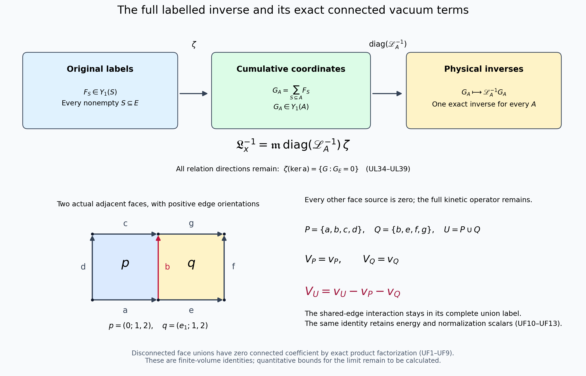

# Exact connected supports and scalar factorization of the labelled vacuum

11 October 2026. This continuation proves consequences of [UL1–UL47](union_label_global/FULL_UNION_LABEL_INVERSE.md), with every edge label, kinetic term, gauge constraint and scalar retained. It makes no novelty claim for product ground states or inclusion–exclusion.

## 1. Factorization on the original product, before gauge reduction

Use exactly the vertices, oriented edges, faces, Haar measure, generators, \(K\), \(\Gamma\), \(H_A(x)\), positive unit ground vectors \(\psi_A\), energies \(E_A\), and functions \(v_A,c_A,C_A\) of UL1–UL19. In particular,
\[
H_A(x)=\kappa\sum_{e\in E,\alpha}(-X_{e,\alpha}^2)
 +\kappa\sum_{\partial p\subseteq A}x_p(2-W_p),
\quad
v_A=\log\psi_A-P_H\log\psi_A,
\quad c_A=P_H\log\psi_A.
\tag{UF1}
\]
Fix real sources \(x\) and a nonempty edge set \(S\). Define a hypergraph whose vertices are precisely the edges in \(S\), with one hyperedge \(\partial p\) for each original face satisfying \(\partial p\subseteq S\) and \(x_p\ne0\). Include all isolated vertices. Its connected components partition \(S\):
\[
S=S_1\mathbin{\dot\cup}\cdots\mathbin{\dot\cup}S_r.
\tag{UF2}
\]
Connectivity here means a chain of face boundaries sharing original edges. Faces that meet only at a lattice vertex do not share a variable and belong to different components unless another such chain connects them.

For every \(A\subseteq S\), put \(A_i=A\cap S_i\). Every nonzero potential term of \(H_A\) belongs to precisely one \(A_i\). The operator on the entire original Hilbert space is therefore the tensor sum
\[
H_A=\sum_{i=1}^r h_{A_i}\otimes I_{E\setminus A_i}
 +\kappa\sum_{e\notin A,\alpha}(-X_{e,\alpha}^2),
\quad
h_{A_i}=\kappa\sum_{e\in A_i,\alpha}(-X_{e,\alpha}^2)
 +\kappa\sum_{\partial p\subseteq A_i}x_p(2-W_p).
\tag{UF3}
\]
Terms with source zero still have their original source value zero; no nonzero scalar \(2\kappa x_p\) is discarded. The factor Hilbert spaces are \(L^2(SU(2)^{A_i})\) and the individual outside-link spaces. Each factor of the positive unit ground vector of the full \(H_{A_i}\) is independent of links outside \(A_i\), by UL17. Its energy is \(E_{A_i}\). Each outside-link kinetic operator is nonnegative, with unit constant ground vector. Thus the tensor product below is an eigenvector with energy \(\sum_iE_{A_i}\), and the operator lower bounds \(h_{A_i}\ge E_{A_i}I\) prove that this energy is the bottom. Full ground-state uniqueness in UL16 identifies it exactly:
\[
\boxed{\psi_A(U)=\prod_{i=1}^r\psi_{A_i}(U_{A_i})
                   \prod_{e\notin A}1,
\qquad E_A=\sum_{i=1}^rE_{A_i}.}
\tag{UF4}
\]
The product has unit norm for the original product Haar measure. Each factor is invariant under every original vertex gauge action on its variables, by UL16–UL17. Even if components meet at a lattice vertex, their product is therefore physical. The argument did not presume a tensor-product decomposition of the gauge-invariant Hilbert space.

Take logarithms and their original Haar means. Since the variables in different components are disjoint, derivative cross terms vanish for each individual original edge. Consequently
\[
\boxed{v_A=\sum_i v_{A_i},\qquad c_A=\sum_i c_{A_i},\qquad
C_A=\int\Gamma(v_A,v_A)dU=\sum_i C_{A_i}.}
\tag{UF5}
\]
The scalar identity also follows directly from
\(\int e^{2\sum_i v_{A_i}}dU=\prod_i\int e^{2v_{A_i}}dU\) and the full formula \(c_A=-\tfrac12\log\int e^{2v_A}dU\). Thus no vacuum normalization or removed Haar scalar is omitted.

## 2. Exact cancellation of disconnected labelled coefficients

For a family \(f_A\) with \(f_\varnothing=0\), write its original Möbius coefficient as
\[
\widehat f_S=\sum_{A\subseteq S}(-1)^{|S\setminus A|}f_A.
\tag{UF6}
\]
Apply this to each of \(v_A,c_A,C_A,E_A\). If the hypergraph in UF2 has at least two components, substitute the corresponding additive formula from UF4–UF5. The contribution from a fixed component \(S_i\) factors exactly as
\[
\left[\sum_{A_i\subseteq S_i}(-1)^{|S_i\setminus A_i|}f_{A_i}\right]
\prod_{k\ne i}\left[\sum_{A_k\subseteq S_k}(-1)^{|S_k\setminus A_k|}\right]
=\widehat f_{S_i}\prod_{k\ne i}(1-1)^{|S_k|}=0.
\tag{UF7}
\]
All components are nonempty, so every product on the right contains a zero factor. If the hypergraph has just one vertex and no hyperedge, every source term vanishes and \(\psi_A=1\), \(E_A=v_A=c_A=C_A=0\) for its subsets. Therefore
\[
\boxed{V_S=\mathfrak c_S=\mathcal C_S=\mathcal E_S=0
\quad\text{unless }S\text{ is a nonempty connected union of active face boundaries}.}
\tag{UF8}
\]
Here the four families are precisely UL22, UL26 and UL29. An uncovered original edge is an isolated vertex, and thus produces the same exact cancellation. Formula UF8 is a pointwise assertion for the stated sources, including arbitrary signs and zero sources. It holds at every finite real source, not just in the Taylor neighbourhood.

The function spaces and inverse in UL7 and UL34 still contain every original label. In particular, a relation direction can have disconnected labels even though the vacuum coefficients there are zero. UF8 is a proved support property of this solution and these four scalar families; it does not delete directions from the full Jacobian.

The finite exact vacuum and energy sums can now be written with their vanishing terms identified:
\[
\log\psi_E=\sum_{\substack{\varnothing\ne S\subseteq E\\
 S\text{ connected active face union}}}(V_S+\mathfrak c_S),
\qquad
E_E=\sum_{\substack{\varnothing\ne S\subseteq E\\
 S\text{ connected active face union}}}\mathcal E_S.
\tag{UF9}
\]
These equalities retain all nonzero contributions and follow from UL30 and UF8. They give no volume-independent bound on the size of the surviving coefficients. Quantitative decay of these coefficients is the next calculation needed to use this identity in a limit.

## 3. The exact two-face example drawn in the figure

Take the two original faces \(p=(0;1,2)\) and \(q=(e_1;1,2)\), contained in every original box with \(L\ge2\). Their seven positively oriented edges are
\[
\begin{array}{llll}
a=(0;1),&b=(e_1;2),&c=(e_2;1),&d=(0;2),\\
e=(e_1;1),&f=(2e_1;2),&g=(e_1+e_2;1).
\end{array}
\tag{UF10}
\]
Thus \(P=\partial p=\{a,b,c,d\}\), \(Q=\partial q=\{b,e,f,g\}\), and \(U=P\cup Q\), while the original oriented words are
\[
W_p=\operatorname{Tr}(U_aU_bU_c^{-1}U_d^{-1}),\qquad
W_q=\operatorname{Tr}(U_eU_fU_g^{-1}U_b^{-1}).
\tag{UF11}
\]
Set sources outside these two faces to zero, retaining the kinetic operator on every edge in \(E\). Each cumulative vacuum \(v_A\) then equals \(0,v_P,v_Q\), or \(v_U\), according as \(A\) contains neither boundary, only \(P\), only \(Q\), or both. Equivalently,
\[
v_A=\mathbf1_{P\subseteq A}v_P+\mathbf1_{Q\subseteq A}v_Q
 +\mathbf1_{U\subseteq A}(v_U-v_P-v_Q).
\tag{UF12}
\]
Apply the Boolean interval identity UL28 to every term. The complete list of possibly nonzero labelled coefficients is
\[
\boxed{V_P=v_P,\qquad V_Q=v_Q,\qquad V_U=v_U-v_P-v_Q.}
\tag{UF13}
\]
Every other label has coefficient zero by this direct calculation. The last term retains the interaction across the common edge \(b\); it is not set to zero. UF12–UF13 hold with \(v,V\) replaced by \(c,\mathfrak c\), \(C,\mathcal C\), or \(E,\mathcal E\). If the two boundaries instead have disjoint edge sets, UF4 proves \(v_U=v_P+v_Q\), and the connected term vanishes exactly, even when the two faces meet at a vertex.

## 4. A stronger bound on the same full Boolean transformations

UL6 proves that \(Y_1(S)=\{0\}\) whenever the original subgraph on \(S\) is a forest. In particular every possibly nonzero coordinate in the original labelled function space has \(|S|\ge4\). Use this consequence without deleting any coordinate. For a fixed anchor edge \(e\) and \(|S|=k\ge4\), the exact counting coefficient in UL10 satisfies
\[
2^{N-|S\cup\{e\}|}
\le2^{N-7}\left(5\mathbf1_{e\in S}
                      +\sum_{f\in S\setminus\{e\}}1\right).
\tag{UF14}
\]
If \(e\in S\), this reduces to \(2^{7-k}\le k+4\): equality holds at \(k=4\), and the left side decreases while the right side increases. If \(e\notin S\), it reduces to \(2^{6-k}\le k\), again equality at \(k=4\) and then strict. Multiply by each original coordinate norm and sum. The anchor capacities in UL7 give
\[
C_N^{\mathrm{cyc}}=(N+4)2^{N-7},\qquad
\boxed{\|\zeta\|_{\mathrm{loc}\to\mathrm{loc}},
       \|\mathfrak m\|_{\mathrm{loc}\to\mathrm{loc}}
       \le C_N^{\mathrm{cyc}}.}
\tag{UF15}
\]
Indeed the coefficient of the \(e\)-anchored sum is \(5\cdot2^{N-7}\); each of the other \(N-1\) anchored sums has coefficient \(2^{N-7}\). The same proof works for the labelled physical Sobolev products in UL36, because their nonconstant physical support also contains a cycle. It does not assert this improved estimate for arbitrary scalar families, whose singleton coordinates need not vanish.

The exact inverse formula remains UL34. Replacing only the proved transformation bound strengthens UL35 and UL45 to
\[
\|\mathfrak L_x^{-1}\|_{\mathrm{loc}\to\mathrm{loc}}
 \le (C_N^{\mathrm{cyc}})^2\max_A B_A(x),
\qquad
\|\mathfrak L_x^{-1}\|_{\mathrm{loc},\dot H^1_H\to\mathrm{loc},\dot H^1_H}
 \le (C_N^{\mathrm{cyc}})^2e^{\Omega/2}
 \left(1+\frac{2S(x)}{\sqrt3}e^{\Omega/2}\right).
\tag{UF16}
\]
All quantities \(B_A,\Omega,S(x)\) have precisely their UL35 and UL44 definitions. On the unchanged original sequence this gives
\[
\boxed{\|\mathfrak L_{x_j}^{-1}\|_{\mathrm{loc},\dot H^1_H\to\mathrm{loc},\dot H^1_H}
\le (N_j+4)^2 2^{2N_j-14}e^{\Omega_j/2}
\left(1+\frac{16\xi_j\sqrt{N_j}}{\sqrt3}e^{\Omega_j/2}\right).}
\tag{UF17}
\]
This strengthens the finite-volume constant without changing its exponential volume dependence. Neither this bound nor the connected-support identity determines the phase spectral mass in the shrinking window. The exact full-labelled inverse, its support structure and all scalar connecting maps are available for that continuing calculation.

