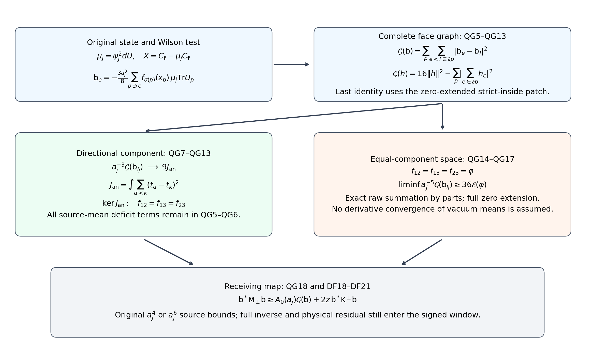
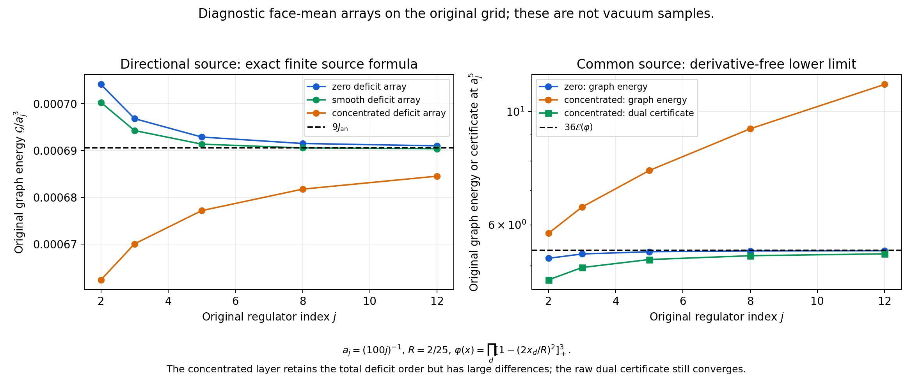

# Three-shift gains and the original source graph

This note quantifies the actual augmented-residual gains at the original three shifts, evaluates the full raw-source graph matrix, and calculates the equal-component test space at its next spatial scale. Original vacuum deficits, inverse coefficients, boundary pairs and physical residuals remain. No positive limiting spectral-window value is assumed.

Complete providers: [QCF1–QCF16](https://github.com/KokunoYumeto/yang-mills-interacting-workbench/blob/fe42544dc6dd210988031ea686f1b77c8724ad26/yang-mills/continuations/20261011-central-signs-shrinking-window/QUANTITATIVE_FORCE_CURL.md), [DF1–DF21](https://github.com/KokunoYumeto/yang-mills-interacting-workbench/blob/fe42544dc6dd210988031ea686f1b77c8724ad26/yang-mills/continuations/20261011-central-signs-shrinking-window/CURRENT_DENSITY_FLUX_AND_PROJECTED_RESIDUAL.md), [SOM15–SOM24](https://github.com/KokunoYumeto/yang-mills-interacting-workbench/blob/fe42544dc6dd210988031ea686f1b77c8724ad26/yang-mills/continuations/20261011-central-signs-shrinking-window/ACTUAL_SCORE_MOMENTS_AND_SECOND_ENERGY.md), [CFC14–CFC21](https://github.com/KokunoYumeto/yang-mills-interacting-workbench/blob/fe42544dc6dd210988031ea686f1b77c8724ad26/yang-mills/continuations/20261011-central-signs-shrinking-window/CENTERED_CURRENT_COVARIANCE.md). Human weighted-form provenance remains Jon Johnsen, arXiv:1703.10011v2, and Assane Lo, arXiv:math-ph/0611002v9, with exact original author-TeX reading records retained in the source ledger. This is a direct calculation from the checked providers; no additional external reading or novelty is claimed.

## Original objects and finite domains

Keep the open lattice with vertices \(\{0,\ldots,2L_j\}^3\), every positive edge, the original vertex gauge action, and probability Haar measure. The SU(2) edge metric has radius two and \(T_\alpha=-i\sigma_\alpha/2\) orthonormal. Retain
\[
\begin{gathered}
L_j=j^4,\quad a_j=(100j)^{-1},\quad g_j^2=\kappa_*a_j/2,\quad
b_j=(\kappa_*a_j^2)^{-1},\quad s_j=100\kappa_*a_j,\\
U_p=U_d(z)U_k(z+e_d)U_d(z+e_k)^{-1}U_k(z)^{-1}\quad(d<k),\\
D_p=2-\operatorname{Tr}U_p,\quad
V=b_j\sum_pD_p=2b_j|\mathcal P_j|-b_j\sum_p\operatorname{Tr}U_p,\\
H_j=-\kappa_*\Delta+V,\quad H_j\psi_j=E_{0,j}\psi_j,\quad
\psi_j>0,\quad \|\psi_j\|=1,\quad d\mu_j=\psi_j^2dU .
\end{gathered}
\]
The positive smooth gauge-invariant ground and its score bound are the original SOM1–SOM5. Suppress \(j\) only within finite formulas and write \(\kappa=\kappa_*\), \(w=\log\psi\), \(g_e=d_ew\), \(G_e=|g_e|^2\), \(T_e=\mu G_e\), \(F_e=d_eV\), and
\[
\mathscr D=\Delta+2dw\cdot d,\qquad
\mathscr L_0=-\kappa\mathscr D,\qquad
\mathscr L_1=\kappa(dd_\mu^*+d_\mu^*d).
\]
All are the original weighted operators on the compact full configuration manifold; no outside derivative is suppressed.

For the centered observable below, \(E_X=\kappa\mu|dX|^2\). For the original full test use \(A=H-E_0I\), \(u_{\mathbf f}=(C_{\mathbf f}-\mu C_{\mathbf f})\psi\), \(\zeta_{\mathbf f}=A^{1/2}u_{\mathbf f}\), and \(\mathcal R_{\mathbf f}(z)=\langle\zeta_{\mathbf f},(A+zI)^{-1}\zeta_{\mathbf f}\rangle=\kappa\langle dC_{\mathbf f},D_z^{-1}dC_{\mathbf f}\rangle_\mu\). SG12 proves this exact original-Hamiltonian map.

For a nonzero real continuous compactly supported triple \(\mathbf f=(f_{12},f_{13},f_{23})\), keep
\[
\begin{gathered}
x_p=o+a(z-L_j\mathbf1+(e_d+e_k)/2),\quad
x_e=o+a(z-L_j\mathbf1+e_d/2),\\
C_{\mathbf f}=a\sum_p f_{\sigma(p)}(x_p)D_p,\quad
X=a\sum_pu_pD_p-\mu\!\left(a\sum_pu_pD_p\right),\\
u_p=f_{\sigma(p)}(x_p)\ \hbox{for the full source},\qquad
u_p=f_{\sigma(p)}(x_p)\mathbf1_{\{e_0\notin\partial p\}}
\ \hbox{for its outside source},\\
M_f=\max_\sigma\|f_\sigma\|_\infty,\quad
t_1=f_{12}+f_{13},\quad t_2=f_{12}+f_{23},\quad
t_3=f_{13}+f_{23},\quad J_t=\sum_d\int_{\mathbb R^3}t_d^2>0 .
\end{gathered}
\]
The last strict inequality follows by the inverse relations \(2f_{12}=t_1+t_2-t_3\), \(2f_{13}=t_1+t_3-t_2\), \(2f_{23}=t_2+t_3-t_1\). Put \(v=dX\), \(J_X=dw\cdot dX\), \(\alpha_e=a^2\Pi_edw\), and \(D_z=\mathscr L_1+zI\), \(z>0\). For a deterministic finite edge list, \(\mathsf Cc=\sum_ec_e\alpha_e\), \(\mathsf N=\mathsf C^*\mathsf C\), \(\mathsf Z=(D_z\mathsf C)^*D_z\mathsf C\), \(\mathsf b=\mathsf C^*v\), \(k=(D_z\mathsf C)^*v\). The distinct sources \(k\) and \(\mathsf b\) are never identified.

Use the fitting cube \(Q=v_Q+\{0,\ldots,q\}^3\) for a physical support cube \(\prod_d[c_d,c_d+R]\), where \(q=\lceil R/a\rceil+3\), \((v_Q)_d=L_j+\lfloor(c_d-o_d)/a\rfloor-1\). Eventually it is strictly inside the full lattice. Its finite quantities, with boundary indicators retained, are
\[
\begin{gathered}
N_Q=3q(q+1)^2,\quad M_Q=3q^2(q+1),\quad
I=E_Q^\circ,\quad n=|I|=3q(q-1)^2,\\
C_Q=2q(q+1)\sum_d
[\mathbf1_{\{(v_Q)_d>0\}}+\mathbf1_{\{(v_Q)_d+q<2L_j\}}],\\
W_Q=\sum_{p\ {\rm inside}\ Q}D_p,\quad d_Q=\mu W_Q,\quad
T_Q=\sum_{e\ {\rm inside}\ Q}T_e,\quad E_Q=E_0-E_{\rm out},\\
\Lambda_Q=\min\{2M_Q,6g^2\sqrt{N_QM_Q}\}+2C_Q,\quad
\kappa T_Q+bd_Q\le E_Q\le b\Lambda_Q,\\
\mathsf L_R=9\kappa_*R^3+24R^2,\qquad
K_R=\frac{\mathsf L_R+\sqrt{\mathsf L_R^2-81\kappa_*^2R^6/4}}2 .
\end{gathered}
\]
Every edge in \(I\) has four incident faces, all inside \(Q\). HVR18–HVR22 prove both \(\limsup a_j^2d_Q\le K_R\) and \(\limsup a_j^2(\Lambda_Q-d_Q)\le K_R\). The inside, outside and crossing energies remain as displayed. All limits below use this same fitting prescription and original path.

Retain the complete Hessian row, incident deficit and positive density
\[
\begin{gathered}
H_{er}=(\nabla^2w)_{er},\quad R_e=\sum_{r\in\mathcal E_j}\|H_{er}\|_{\rm HS}^2,\quad
W_e^{\rm def}=\sum_{p\ni e}D_p,\quad w_e=\mu W_e^{\rm def},\\
\mathcal K_e=\Delta_eV-\kappa(2R_e+G_e),\quad \mu\mathcal K_e=0,\\
\mathcal A_e=\kappa(2R_e+G_e)+(3b/4)W_e^{\rm def}\ge0,\quad
\mu\mathcal A_e=6b,\quad d\nu_e=\frac{\mathcal A_e}{6b}d\mu,\\
I_j(C)=\{e\in I_j:w_e\le Ca_j\},\quad
C=\max\{\kappa_*,64M_f^2K_R/J_t\},\\
\liminf a_j^{-3}\|\mathsf b_{I(C)}\|^2\ge27J_t/16,\qquad
\gamma_C(z)=z^2a^4\,\frac{9(8-Ca)^2}{256Ca}\quad(Ca<8).
\end{gathered}
\]
CFC6–CFC20 prove these identities and bounds in the actual state, with no changed boundary or reference law. The ground log-Hessian bound and score estimate remain \(\nabla^2w\ge-2(\kappa a)^{-1}g\) and \(T_e\le3/(\kappa a)\).

## Quantifying the three actual augmented-residual gains

Keep \(J=I_j(C)\), the same list at all shifts, and
\[
\begin{gathered}
\Omega_j(z)=\mathcal D_{0,j}(z)-\mathcal D_{\star,j}(z),\qquad
k_j(z)=k_j(0)+z\mathsf b_j,\\
z_r=100\kappa_*a_j\theta_r,\qquad
0<\theta_1<\theta_2<\theta_3,\qquad
\delta_z=\min_{r<s}(z_s-z_r),\\
c_0(z)=\mathsf Z_j(z)^{-1}k_j(z),\qquad
m_j=m_{C,Q_j}(a_j).
\end{gathered}
\]
Here \(\theta_1=\varepsilon\theta,\theta_2=\theta,\theta_3=R_{\rm win}\theta\) for the original window. The quantities \(\mathsf b_j\) and \(k_j\) are distinct sources as in DF; \(b_j=(\kappa_*a_j^2)^{-1}\) remains the potential coefficient. The inverse formulas are used for the sufficiently large regulators where CFC16 proves \(J\ne\varnothing\). At an earlier empty list the trial is zero, as in DF10; no inverse is evaluated on an unavailable list.

With \(c_{\rm S}=\sqrt{8\sqrt{35}}\), retain the complete actual SOM17 upper bound
\[
\begin{aligned}
U_j(z)={}&\kappa_*^{-2}
[4\sqrt{d_Q}+c_{\rm S}\{d_Q(\Lambda_Q-d_Q)\}^{1/4}]^2\\
&+2z[3a_j^2|I_j|/\kappa_*
+4a_j(\Lambda_Q-d_Q)/\kappa_*^2]\\
&+z^2a_j^2(\Lambda_Q-d_Q)/\kappa_*^2 .
\end{aligned}
\]
All entries are nonnegative by the existing exact local energy inequality. Hence \(U_j(z)\) increases in \(z>0\). Positivity of the full current matrix and restriction to \(J\) imply
\(\|\mathsf Z_J(z_r)\|\le\operatorname{tr}\mathsf Z_J(z_r)
\le\operatorname{tr}\mathsf Z_I(z_r)\le U_j(z_3)=:U_j\).
Thus QCF16 proves, without an unknown coefficient norm in this lower estimate,
\[
\Omega_j(z_r)\ge m_j\|c_0(z_r)\|^2
\ge\frac{m_j}{U_j^2}\|k_j(z_r)\|^2 .
\tag{QG1}
\]
Indeed \(\|k\|=\|\mathsf Zc_0\|\le U_j\|c_0\|\).

For each pair, the parallelogram identity and
\(k_j(z_s)-k_j(z_r)=(z_s-z_r)\mathsf b_j\) give
\[
\Omega_j(z_r)+\Omega_j(z_s)
\ge\frac{m_j(z_s-z_r)^2}{2U_j^2}\|\mathsf b_j\|^2 .
\tag{QG2}
\]
At most one of the three \(k_j(z_r)\) has norm strictly below
\(\delta_z\|\mathsf b_j\|/2\): two such vectors would have distance strictly less than \(\delta_z\|\mathsf b_j\|\), contradicting their exact difference. Consequently the second largest of the three actual gains obeys
\[
\Omega_j^{[2]}\ge
\frac{m_j\delta_z^2}{4U_j^2}\|\mathsf b_j\|^2 .
\tag{QG3}
\]
Ordering the gains here is only a finite comparison; their original shift labels are not changed.

Let
\[
D_R=\frac{(4+\sqrt{8\sqrt{35}})^2}{\kappa_*^2}\mathsf L_R,
\qquad
\delta_\theta=\min_{r<s}(\theta_s-\theta_r)>0.
\]
SOM24 gives \(\limsup a_j^2U_j\le D_R\), CFC16 gives
\(\liminf a_j^{-3}\|\mathsf b_j\|^2\ge27J_t/16\), and QCF15 gives
\(m_j/a_j^3\to\pi^2/(32\kappa_*R^2)\). Therefore
\[
\liminf_{j\to\infty}\frac{\Omega_j^{[2]}}{a_j^{12}}
\ge
\frac{\pi^2}{32\kappa_*R^2}
\frac{10000\kappa_*^2\delta_\theta^2}{4D_R^2}
\frac{27J_t}{16}>0 .
\tag{QG4}
\]
The powers are \(a_j^3\) from \(m_j\), \(a_j^2\) from \(\delta_z^2\), \(a_j^3\) from the retained source squared norm, and \(a_j^4\) from \(U_j^{-2}\). The actual gains are not asserted to have this exact order; this is the evaluated lower bound. In particular it gives no nonvanishing unscaled gain or signed-window value.

## The full raw-source face energy

The preceding trace estimate is weak in the source direction. A more directional object can be evaluated before any matrix inverse. Use the full inside list \(I\) first and zero extend its source. The exact integration-by-parts formula for the full Wilson source is
\[
\begin{aligned}
\mathsf b_e
={}&-\frac{3a^3}{8}\sum_{p\ni e}
f_{\sigma(p)}(x_p)\,\mu\operatorname{Tr}U_p\\
={}&-\frac{3a^3}{4}\sum_{p\ni e}f_{\sigma(p)}(x_p)\\
&+\frac{3a^3}{8}\sum_{p\ni e}f_{\sigma(p)}(x_p)\,\mu D_p .
\end{aligned}
\tag{QG5}
\]
The first equality uses
\(\mu(g_e\cdot d_eX)=-\tfrac12\mu\Delta_eX\) and
\(\Delta_eX=(3a/4)\sum_{p\ni e}f_{\sigma(p)}(x_p)\operatorname{Tr}U_p\).
Keep the comparison list
\[
\bar b_{(z,d)}=-\frac{3a^3}{2}t_d(x_e)
\]
at the original edge center, zero extended, with the unchanged
\(t_1=f_{12}+f_{13}\), \(t_2=f_{12}+f_{23}\), \(t_3=f_{13}+f_{23}\).

For its full error, write \(\omega_f(h)\) for the maximum of the three uniform moduli of continuity of the original compactly supported functions. Each of the two incident faces of a fixed orientation has center distance \(a/2\) from \(x_e\), so the first part of QG5 differs from \(\bar b_e\) by at most \(3a^3\omega_f(a/2)\). The deficit part has magnitude at most
\((3a^3M_f/8)w_e\). Since \(0\le w_e\le16\) and
\(\sum_{e\in I}w_e\le4d_Q\),
\[
\begin{gathered}
\sum_{e\in I}w_e^2\le64d_Q,\\
\|\mathsf b_I-\bar b_I\|
\le3a^3\sqrt{|I|}\,\omega_f(a/2)
+3a^3M_f\sqrt{d_Q},\\
a^{-3/2}\|\mathsf b_I-\bar b_I\|\longrightarrow0 .
\end{gathered}\tag{QG6}
\]
The last limit uses \(|I|=3q(q-1)^2\), \(qa\to R\), \(a^2d_Q=O(1)\) and uniform continuity. For the outside observable, the deleted star contains at most four faces and affects at most sixteen source entries. Each entry changes by at most \(3a^3M_f\), so add the exact error \(12a^3M_f\) to the displayed norm bound; it is \(o(a^{3/2})\). The fitting margin ensures all faces carrying a nonzero coefficient and their boundary edges are inside \(Q\) eventually; a potential coefficient evaluated exactly on the support boundary is zero by continuity. The complete zero extension therefore has the stated same error.

The full four-edge face identity, including boundary incidence counts \(m_e=|\{p:e\in\partial p\}|\le4\), gives for any complex list \(h\)
\[
\mathcal G(h)
=4\sum_em_e|h_e|^2-\sum_p\left|\sum_{e\in\partial p}h_e\right|^2
\le16\|h\|^2.
\]
This follows by expanding the six differences on each face:
\(\sum_{e<f}|h_e-h_f|^2=4\sum_e|h_e|^2-|\sum_eh_e|^2\).
No face or exterior coefficient is removed. On the zero-extended strict-inside list all nonzero \(h_e\) have \(m_e=4\), so the first term is exactly \(16\|h\|^2\). This strengthens the earlier degree-only upper bound.
The graph square root is a seminorm, so QG6 implies
\(a^{-3/2}|\sqrt{\mathcal G(\mathsf b_I)}
-\sqrt{\mathcal G(\bar b_I)}|\to0\).
On a face in directions \(d,k\), the parallel-pair differences of \(\bar b\) are \(O(a^3\omega_t(a))\), uniformly. Each of the four cross-direction pairs equals
\(-3a^3(t_d(x_p)-t_k(x_p))/2\), with an error of that same modulus form. Applying QCF10, or summing all six pairs directly, and using the Riemann sums at the original face centers yields
\[
\begin{gathered}
J_{\rm an}=\int_{\mathbb R^3}\sum_{d<k}(t_d-t_k)^2,\\
\lim_{j\to\infty}a_j^{-3}\mathcal G(\mathsf b_{I_j})
=9J_{\rm an}.
\end{gathered}\tag{QG7}
\]
Here is a finite control of the face expansion. Let \(\omega_t(h)=\max_d\sup_{|x-y|\le h}|t_d(x)-t_d(y)|\le2\omega_f(h)\). Each cross-direction pair differs from its face-center value by at most \(3a^3\omega_t(a/2)\), while the face-center value has magnitude at most \(3a^3M_f\), because \(t_d-t_k\) is a difference of two original \(f\)'s. Each parallel-pair difference has magnitude at most \(3a^3\omega_t(a)/2\). Thus
\[
\begin{aligned}
&a^{-3}\left|\mathcal G(\bar b_I)
-9a^6\sum_{p:\sigma(p)=(d,k)}(t_d(x_p)-t_k(x_p))^2\right|\\
&\quad\le a^3M_Q\left[
72M_f\omega_t(a/2)+36\omega_t(a/2)^2
+\frac92\omega_t(a)^2\right]\longrightarrow0 .
\end{aligned}
\]
The face sum ranges over all three orientations, each with its own \(d<k\). The factor \(a^3M_Q\) tends to \(3R^3\). The remaining face-center Riemann sums converge on each shifted mesh: on cells of diameter \(\sqrt3a\) the error is bounded by their total bounded physical volume times the modulus of the continuous squared difference at \(\sqrt3a\); the finite boundary shell has volume tending to zero. This proves QG7 with every pair and support boundary retained. The original functions remain explicit:
\[
J_{\rm an}=\int[(f_{13}-f_{23})^2
+(f_{12}-f_{23})^2+(f_{12}-f_{13})^2].
\]
This is a statement about the actual raw source; it does not commute a matrix inverse with the face graph.

For any fixed larger threshold \(C'\ge C\), define the actual set \(I(C')\) by the original incident means. The unchanged bound
\(|\mathsf b_e|\le3a^3M_f\) and
\(|I\setminus I(C')|\le4d_Q/(C'a)\) give
\[
\limsup a_j^{-3}\|\mathsf b_{I\setminus I(C')}\|^2
\le36M_f^2K_R/C'.
\]
Therefore the graph seminorm triangle inequality proves
\[
\liminf a_j^{-3}\mathcal G(\mathsf b_{I(C')})
\ge\left[3\sqrt{J_{\rm an}}
-\sqrt{576M_f^2K_R/C'}\right]_+^2.
\tag{QG8}
\]
For \(J_{\rm an}>0\), the explicitly chosen
\(C'=\max\{C,256M_f^2K_R/J_{\rm an}\}\) makes the bracket at least
\(3\sqrt{J_{\rm an}}/2\). Thus QCF14 gives the actual source-direction bound
\[
\liminf a_j^{-4}
\mathsf b_{I(C')}^*\mathsf M_\perp(z)\mathsf b_{I(C')}
\ge\frac{9J_{\rm an}}{512\kappa_*},
\qquad z=\theta s_j,\quad\theta>0.
\tag{QG9}
\]
The full \(2z\mathsf K^\perp\) term remains nonnegative and retained in QCF14. The zero leading graph-energy case is calculated at its next spatial scale below.

## Original-cutoff signed tests and the complete joint graph

At the original \(C=\max\{\kappa_*,64M_f^2K_R/J_t\}\), QG8 already gives
\[
\liminf a_j^{-3}\mathcal G(\mathsf b_{I(C)})
\ge9[\sqrt{J_{\rm an}}-\sqrt{J_t}]_+^2.
\tag{QG10}
\]
Indeed \(576M_f^2K_R/C\le9J_t\). To identify an explicit nonzero branch without changing the cutoff, put
\[
F=\int(f_{12}^2+f_{13}^2+f_{23}^2),\qquad
S=\int(f_{12}+f_{13}+f_{23})^2 .
\]
Direct expansion gives \(J_t=F+S\) and \(J_{\rm an}=3F-S\). Thus a nonzero triple satisfying \(f_{12}+f_{13}+f_{23}=0\) pointwise has \(J_t=F>0\), \(J_{\rm an}=3J_t\). QCF14 and QG10 imply
\[
\liminf a_j^{-4}
\mathsf b_{I(C)}^*\mathsf M_\perp(\theta s_j)\mathsf b_{I(C)}
\ge\frac{9(\sqrt3-1)^2J_t}{128\kappa_*}>0 .
\tag{QG11}
\]
For example the original real test triple \((\varphi,-\varphi,0)\), with any nonzero real continuous compactly supported \(\varphi\), meets this condition. Its original source is not replaced by a positive or absolute-valued test.

There is a complete joint statement for any fixed finite list of the original test triples \(\mathbf f^{(1)},\ldots,\mathbf f^{(m)}\). Choose one fitting cube containing all supports, and let \(\mathsf B_j\) have their full original raw-source columns. Let \(\mathsf L_{\rm face}\) be the exact matrix of \(\mathcal G\) on that zero-extended patch. Then
\[
\begin{gathered}
a_j^{-3}\mathsf B_j^*\mathsf L_{\rm face}\mathsf B_j
\longrightarrow9\mathsf J_{\rm an},\\
(\mathsf J_{\rm an})_{rs}
=\int\sum_{d<k}
\big(t_d^{(r)}-t_k^{(r)}\big)
\big(t_d^{(s)}-t_k^{(s)}\big).
\end{gathered}\tag{QG12}
\]
Apply QG7 to each column and to the sums and differences of every two columns. Real polarization proves every entry; the Hermitian extension conjugates the first coefficient. Finite-dimensional entry convergence is operator-norm convergence: if the maximum entry error is \(e_j\), the norm error is at most \(me_j\), by Cauchy–Schwarz on the row sums. Therefore for arbitrary raw coefficients \(\gamma_j\),
\[
\left|a_j^{-3}\mathcal G(\mathsf B_j\gamma_j)
-9\gamma_j^*\mathsf J_{\rm an}\gamma_j\right|
\le me_j\|\gamma_j\|^2,\qquad e_j\longrightarrow0.
\]
No assertion of a vanishing absolute error is made for an unbounded coefficient sequence without the displayed factor.

The nullspace has an exact original-test description. Write the orientation vector as \(\mathbf f=(f_{12},f_{13},f_{23})^T\), retain
\[
t=\begin{pmatrix}1&1&0\\1&0&1\\0&1&1\end{pmatrix}\mathbf f=:A\mathbf f,
\qquad L=3I-\mathbf1\mathbf1^T .
\]
Direct multiplication gives \(A^TLA=L\), hence
\(J_{\rm an}(\mathbf f)=\int\mathbf f^*L\mathbf f\).
The eigenvalues of \(L\) are zero on \(\mathbb C\mathbf1\) and three on its orthogonal complement: this follows directly from
\(Lv=3v-\mathbf1(\mathbf1^Tv)\).
Consequently
\[
\gamma\in\ker\mathsf J_{\rm an}
\quad\Longleftrightarrow\quad
\sum_r\gamma_r f_{12}^{(r)}
=\sum_r\gamma_r f_{13}^{(r)}
=\sum_r\gamma_r f_{23}^{(r)}
\quad\hbox{everywhere}.
\tag{QG13}
\]
A zero integral of the continuous nonnegative squared differences forces them to vanish everywhere. This defines the equal-component test space precisely, and its actual source is calculated next.

## The next spatial scale on the equal-component space

Let \(f_{12}=f_{13}=f_{23}=\varphi\), where \(\varphi\) is any real continuous compactly supported function, as allowed in the original test class. Then \(t_d=2\varphi\) and QG6 gives the full raw-source convergence
\[
\bar b_{(z,d)}=-3a_j^3\varphi(x_e),\qquad
a_j^{-3/2}\|\mathsf b_{I_j}-\bar b_{I_j}\|\longrightarrow0.
\tag{QG14}
\]
All vacuum-mean deficit terms in QG5 remain in this error. Their derivatives are not assumed to converge.

For a positive edge \(e=(z,d)\), define its parallel-edge difference
\[
\Delta_k\mathsf b_{(z,d)}
=\mathsf b_{(z+e_k,d)}-\mathsf b_{(z,d)},\qquad k\ne d.
\]
Extend coefficients by zero outside the fitting patch. Every contributing pair is an original parallel pair on a unit face. Since the fitting cube is strictly inside the full lattice eventually, no artificial face crosses the full-system boundary. QCF10 gives
\[
\mathcal G(\mathsf b_{I_j})
\ge2\sum_{d=1}^3\sum_{k\ne d}\sum_z
|\Delta_k\mathsf b_{(z,d)}|^2.
\]
For any real \(\eta\in C_c^\infty(\mathbb R^3)\), evaluated at the original midpoint between the two parallel edges, the square inequality \(|u-a_j^4\eta|^2\ge0\) yields
\[
a_j^{-5}\sum_z|\Delta_k\mathsf b_{(z,d)}|^2
\ge2a_j^{-1}\sum_z
\Delta_k\mathsf b_{(z,d)}
\eta(x_e+a_je_k/2)
-a_j^3\sum_z\eta(x_e+a_je_k/2)^2 .
\tag{QG15}
\]
Here both sums can be taken over all integer \(z\): only a bounded physical support contributes, and all corresponding original lattice edges exist for large \(j\).

The original raw pairing has the exact summation-by-parts formula
\[
\begin{aligned}
&a_j^{-1}\sum_z\Delta_k\mathsf b_{(z,d)}
\eta(x_e+a_je_k/2)\\
&\quad=-a_j^{-1}\sum_z\mathsf b_{(z,d)}
[\eta(x_e+a_je_k/2)-\eta(x_e-a_je_k/2)]
\longrightarrow3\int\varphi\,\partial_k\eta .
\end{aligned}\tag{QG16}
\]
There is no boundary term: the coefficient list is zero extended and the two translated finite sums match exactly. To verify the limit, first insert \(\bar b=-3a_j^3\varphi(x_e)\). The centered difference of the smooth fixed \(\eta\), divided by \(a_j\), converges uniformly to \(\partial_k\eta\), and the original edge-center Riemann sum gives the displayed integral. For the retained error, the difference quotient has Euclidean sample norm \(O(a_j^{-3/2})\) on a bounded physical set. QG14 gives its pairing with \(\mathsf b-\bar b\) as \(o(1)\). The same argument covers the outside observable: its finitely supported \(O(a_j^3)\) source correction contributes \(o(1)\) to this pairing. No derivative estimate on that correction has been used.

For completeness define the extended Dirichlet energy of the original \(\varphi\) by
\[
\mathcal E(\varphi)=
\begin{cases}
\displaystyle\int_{\mathbb R^3}|\nabla\varphi|^2,
&\varphi\in H^1(\mathbb R^3),\\
+\infty,&\varphi\notin H^1(\mathbb R^3).
\end{cases}
\]
The original function is already in \(L^2\) because it is continuous with compact support. Taking the supremum of the joint six test-function bounds QG15–QG16 proves
\[
\boxed{\quad
\liminf_{j\to\infty}a_j^{-5}\mathcal G(\mathsf b_{I_j})
\ge36\mathcal E(\varphi).\quad}
\tag{QG17}
\]
Here is the domain verification for that supremum. For one direction the supremum is
\[
\sup_{\eta\in C_c^\infty}
\left\{6\int\varphi\,\partial_k\eta-\int|\eta|^2\right\}.
\]
If the weak derivative \(\partial_k\varphi\) is in \(L^2\), completing the square gives \(9\|\partial_k\varphi\|_2^2\), using the density of smooth compactly supported functions in \(L^2\). One can obtain that density by first truncating and then convolving with the compact mollifier whose full kernel is
\[
\rho_\epsilon(x)=
\frac{\mathbf1_{\{|x|<\epsilon\}}
\exp[-1/(1-|x|^2/\epsilon^2)]}
{\epsilon^3\int_{|y|<1}\exp[-1/(1-|y|^2)]\,dy}.
\]
If the supremum is finite, substitute \(s\eta\) and maximize over \(s\in\mathbb R\). The resulting bound makes
\(\eta\mapsto\int\varphi\,\partial_k\eta\) an \(L^2\)-bounded linear functional. Its Riesz representative is the negative weak derivative, so that derivative exists in \(L^2\). Thus the supremum is infinite exactly when the derivative has no \(L^2\) representative. The six tests are independent; each coordinate derivative appears for exactly two edge directions \(d\ne k\), and QCF10 supplies the factor two. Therefore their sum is \(2\cdot2\cdot9\,\mathcal E(\varphi)\), proving QG17 also in the infinite-energy case.

This bound is positive for every nonzero \(\varphi\). If its finite energy were zero, all weak derivatives would vanish. Each convolution \(\rho_\epsilon*\varphi\) would have zero gradient, hence be constant on \(\mathbb R^3\); its compact support makes the constant zero. Convergence in \(L^2\) then forces \(\varphi=0\), a contradiction.

For a complex common component, apply QG14–QG17 to its real and imaginary parts. The exact Hermitian graph energy is the sum of those two real graph energies, and the same holds for the Dirichlet energy. This supplies the corresponding bound on the complex joint nullspace in QG13.

## Full-source force floor and the surviving physical calculation

The unrestricted QCF9 is available on all \(I_j\), with \(\rho=1/2,\sigma=1\). Retain its finite coefficient
\[
A_0(a)=
\frac1{36\kappa_*^2(1+2\sqrt{2/(\kappa_*a)})^2},
\qquad
\frac{A_0(a_j)}{a_j}\longrightarrow\frac1{288\kappa_*}.
\]
The full matrix is the original proper-patch matrix; no fixed-\(C\) restriction is imposed in the next two bounds. QCF14 with this coefficient gives
\[
\begin{gathered}
\mathsf b_I^*\mathsf M_\perp(z)\mathsf b_I
\ge A_0(a)\mathcal G(\mathsf b_I)
+2z\kappa_*a^4\sum_{e<f}|(\mathsf b_I)_e-(\mathsf b_I)_f|^2
\mu\|(\nabla^2w)_{ef}\|_{\rm HS}^2,\\
J_{\rm an}>0:\qquad
\liminf a_j^{-4}\mathsf b_I^*\mathsf M_\perp(\theta s_j)\mathsf b_I
\ge\frac{J_{\rm an}}{32\kappa_*},\\
\mathbf f=(\varphi,\varphi,\varphi):\qquad
\liminf a_j^{-6}\mathsf b_I^*\mathsf M_\perp(\theta s_j)\mathsf b_I
\ge\frac{\mathcal E(\varphi)}{8\kappa_*}.
\end{gathered}\tag{QG18}
\]
The full outside-pair Hessian term remains exactly as displayed. The two limits follow from QG7 and QG17, respectively, multiplied by the proved limit of \(A_0/a\). The infinite-energy case follows by taking arbitrarily large finite lower bounds before passing to the limit. The three original shifts are covered separately for every fixed \(\theta>0\).

These are quantitative statements about the actual raw source in the actual interacting finite-regulator state. The original \(a_j^4\), \(a_j^6\) and the coefficient norms in QG1–QG4 have not been discarded. The source map through \(\mathsf Z^{-1}\), the signed DF11 moments, and the full physical residual in DF18 still control the original spectral-window value. The next calculation must use these source-direction bounds in that complete matrix map; no commutation with the graph and no positive limiting spectral mass is assumed.

## Joint physical force matrices with all raw coefficients retained

For the finite family in QG12, let \(\mathsf B_j\) contain the original full raw-source columns and set
\[
\mathsf F_j(\theta)=
\mathsf B_j^*\mathsf M_{\perp,I_j}(\theta s_j)\mathsf B_j .
\]
This keeps the same full matrix at one common fitting cube for the entire family. Its exact entries contain the full force projection and the full Hessian-pair term of QG18. QG12 and the unrestricted finite coefficient \(A_0\) give
\[
\begin{gathered}
\mathsf F_j(\theta)\ge
A_0(a_j)\mathsf B_j^*\mathsf L_{\rm face}\mathsf B_j,\\
\liminf_{j\to\infty}\lambda_{\min}
\left(a_j^{-4}\mathsf F_j(\theta)
-\frac{\mathsf J_{\rm an}}{32\kappa_*}\right)\ge0 .
\end{gathered}\tag{QG19}
\]
Indeed the first inequality is the exact quadratic-form inequality for every raw coefficient vector. Multiplying by \(a_j^{-4}\), its right side converges in matrix norm to
\((288\kappa_*)^{-1}9\mathsf J_{\rm an}\), by QG12 and the proved limit of \(A_0/a_j\). For any Hermitian matrices \(K,E\), the Rayleigh quotient gives
\(\lambda_{\min}(K+E)\ge\lambda_{\min}(K)-\|E\|\). Applying it to this convergent lower matrix proves QG19; it does not set any mixed entry to zero.

On the equal-component space, take any fixed finite family
\(\mathbf f^{(r)}=(\varphi_r,\varphi_r,\varphi_r)\) with
\(\varphi_r\in C_c(\mathbb R^3)\cap H^1(\mathbb R^3)\), and retain its complete Hermitian Dirichlet matrix
\[
\mathsf D_{rs}=\int_{\mathbb R^3}
\overline{\nabla\varphi_r}\cdot\nabla\varphi_s .
\]
Then the next-scale joint bounds are
\[
\begin{gathered}
\liminf_{j\to\infty}\lambda_{\min}
\left(a_j^{-5}\mathsf B_j^*\mathsf L_{\rm face}\mathsf B_j
-36\mathsf D\right)\ge0,\\
\liminf_{j\to\infty}\lambda_{\min}
\left(a_j^{-6}\mathsf F_j(\theta)-\frac{\mathsf D}{8\kappa_*}\right)\ge0 .
\end{gathered}\tag{QG20}
\]
The first statement requires a uniform-direction argument, not only separate scalar limits. If it failed, a subsequence and unit vectors \(\gamma_j\in\mathbb C^m\) would make the displayed quadratic difference less than a fixed negative number. A further subsequence has \(\gamma_j\to\gamma\) with \(\|\gamma\|=1\). The source comparison QG6 holds uniformly for this finite family: by the triangle inequality its error for \(\gamma_j\) is at most the Euclidean norm of the vector of column errors. That error is \(o(a_j^{3/2})\). Also the comparison source for
\(\sum_r\gamma_{j,r}\varphi_r\) differs from the one for
\(\sum_r\gamma_r\varphi_r\) by \(o(a_j^{3/2})\), since its original edge-center sample norm after division by \(a_j^{3/2}\) is bounded on this finite family.

Consequently the exact pairings QG16 converge, for every fixed smooth test, to the distributional derivative pairing of
\(\varphi_\gamma=\sum_r\gamma_r\varphi_r\). The same six-test supremum proof as QG17 yields
\[
\liminf a_j^{-5}
\mathcal G(\mathsf B_j\gamma_j)
\ge36\gamma^*\mathsf D\gamma .
\]
But \(\gamma_j^*\mathsf D\gamma_j\to\gamma^*\mathsf D\gamma\) because this is a fixed finite matrix. This contradicts the negative bound and proves the first line of QG20. The second follows from the first finite inequality of QG19 and \(A_0/a_j\to1/(288\kappa_*)\). Dependent test families cause no problem: the inequalities concern positive semidefinite matrices and do not invert \(\mathsf D\).

These statements retain growing raw coefficient norms explicitly. For instance define
\[
\epsilon_j=
\max\!\left\{0,-\lambda_{\min}
\left(a_j^{-6}\mathsf F_j(\theta)-\frac{\mathsf D}{8\kappa_*}\right)\right\}.
\]
QG20 proves \(\epsilon_j\to0\), and for every raw \(\gamma_j\), without a boundedness assumption,
\[
\gamma_j^*\mathsf F_j(\theta)\gamma_j
\ge a_j^6\left[
\frac{\gamma_j^*\mathsf D\gamma_j}{8\kappa_*}
-\epsilon_j\|\gamma_j\|^2\right].
\]
The analogous \(a_j^4\) statement follows from QG19 with its own negative-eigenvalue error. This is a proved finite receiving inequality with a retained coefficient factor; it does not claim that the error vanishes after multiplication by an arbitrary growing norm. The noncommuting original \(\mathsf Z^{-1}k\) map and the full signed physical residual remain the next calculation.

## Reproducible figures and checks

The diagnostic arrays are inputs to the exact finite source identity; they are not sampled Yang–Mills vacuum means. The proof uses the actual state and its established deficit bounds. The plotted tests retain
\[
R=2/25,\qquad
\varphi(x)=\prod_{d=1}^3[1-(2x_d/R)^2]_+^3,\qquad
\mathbf f_{\rm an}=(\varphi,-\varphi/2,7\varphi/10).
\]
The full common test is \((\varphi,\varphi,\varphi)\). The figure's reference integrals are evaluated exactly by
\[
\begin{gathered}
I_0=R\sum_{r=0}^6\frac{(-1)^r\binom6r}{2r+1},\qquad
I_1=\frac{144}{R}\sum_{r=0}^4\frac{(-1)^r\binom4r}{2r+3},\\
\int\varphi^2=I_0^3,\qquad
\mathcal E(\varphi)=3I_1I_0^2 .
\end{gathered}
\]
These follow by expanding \((1-y^2)^6\) for the squared one-dimensional factor, and \(144y^2(1-y^2)^4/R^2\) for its squared derivative, with \(x=Ry/2\) and both endpoints retained. The plots use the original \(a_j=(100j)^{-1}\), original fitting offset and full zero extension. [Reproducible gain, graph and summation-by-parts checks](check_source_graph.py) and the [source-use record](SOURCE_GRAPH_SOURCE_USE_LEDGER.json) accompany the complete proofs.
