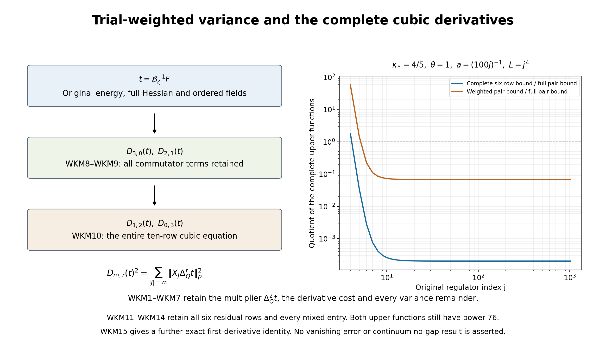

# Trial-weighted kinetic variance and full cubic derivative bounds

The original inverse trial supplies a nonconstant multiplier in the conditional kinetic variance. This paper proves its complete weighted identity with four positive energy remainders, retains the score covariance and every raw source pairing, and bounds the third through sixth ordered trial derivatives from the original energy identities and entire cubic equation. The resulting six-row residual estimate has a strictly positive leading coefficient at power 76. It improves the preceding coefficient but does not prove a vanishing signed error or a continuum no-gap result.

The complete mathematical providers are [KC7–KC14: original sector energies and kinetic variance](https://github.com/KokunoYumeto/yang-mills-interacting-workbench/blob/c2ea548bfdefc5c799a9ec506e1907982e54065c/yang-mills/continuations/20261011-central-signs-shrinking-window/KINETIC_CURRENT_AND_PHYSICAL_ENERGY.md), [ROF1–ROF17: complete outside projection and actual weighted row](https://github.com/KokunoYumeto/yang-mills-interacting-workbench/blob/c2ea548bfdefc5c799a9ec506e1907982e54065c/yang-mills/continuations/20261011-central-signs-shrinking-window/OUTSIDE_FLUX_AND_CUBIC_MOMENTS.md), [WCR1–WCR15: full flux, ordered energy identities and finite constants](https://github.com/KokunoYumeto/yang-mills-interacting-workbench/blob/c2ea548bfdefc5c799a9ec506e1907982e54065c/yang-mills/continuations/20261011-central-signs-shrinking-window/FULL_CUBIC_FLUX_AND_RESIDUAL_ENERGY.md), [CCJ1–CCJ20: original coefficient arrays and complete finite derivative ceilings](https://github.com/KokunoYumeto/yang-mills-interacting-workbench/blob/c2ea548bfdefc5c799a9ec506e1907982e54065c/yang-mills/continuations/20261011-central-signs-shrinking-window/CONTRACTED_CUBIC_BOUNDS.md), [CDE1–CDE4: full ordered cubic equation](https://github.com/KokunoYumeto/yang-mills-interacting-workbench/blob/c2ea548bfdefc5c799a9ec506e1907982e54065c/yang-mills/continuations/20261011-central-signs-shrinking-window/ORIGINAL_FRAME_CUBIC_RESIDUAL.md), [HCB1: original Hessian minimum-principle bound](https://github.com/KokunoYumeto/yang-mills-interacting-workbench/blob/c2ea548bfdefc5c799a9ec506e1907982e54065c/yang-mills/continuations/20261011-central-signs-shrinking-window/ACTUAL_HESSIAN_BOUNDS.md). All retain the original finite regulator, metric, potential scalar, ground energy and raw source coefficients. No novelty claim is made.

## Original state, source and full operators

Keep the original SU(2) product with radius-two metric, probability Haar measure, generators \(T_\alpha=-i\sigma_\alpha/2\), and ordered left-multiplication fields \(X_{e,\alpha}\). All operators below restrict to the original gauge-invariant physical subspace. The complete state is
\[
\begin{gathered}
a=(100j)^{-1},\quad L=j^4,\quad g^2=\kappa_*a/2,\quad
b=(\kappa_*a^2)^{-1},\quad\zeta=\theta\kappa_*/j,\quad j\ge4,\\
N=3(2L)(2L+1)^2,\qquad M=3(2L)^2(2L+1),\\
V=2bM-b\sum_pT_p,\quad H=-\kappa_*\sum_{i\in\mathcal I}X_i^2+V,\quad
H\psi=E_0\psi,\quad \psi>0,\quad\int\psi^2dU=1,\\
d\mu=\psi^2dU,\quad w=\log\psi,\quad
\mathcal L=\psi^{-1}(H-E_0)\psi,\quad\mathscr H_\mu=L^2(\mu).
\end{gathered}
\]
The original oriented plaquette and raw centered source are
\[
\begin{gathered}
U_p=U_d(z)U_k(z+e_d)U_d(z+e_k)^{-1}U_k(z)^{-1},\qquad
T_p=\operatorname{Tr}U_p,\\
Z_p=a(\mu T_p-T_p)/2,\qquad Z=\sum_p\varphi_p Z_p .
\end{gathered}
\]
Every original face, orientation, source center and coefficient stays fixed.
Let \(Q_r=(L-r)\mathbf1+\{0,\ldots,2r\}^3\), \(50j\le r\le L\), with the original source supported in \(Q_{50j}\). Write
\(\rho_r(x_r)=\int\psi(x_r,y_r)^2dy_r\) and
\(\mathscr H_r=L^2(\rho_r dx_r)\). The exact maps are
\[
J_r:\mathscr H_r\to\mathscr H_\mu,\quad J_rf=f(x_r),\qquad
J_r^*f=\rho_r^{-1}\int\psi^2 f\,dy_r,\qquad J_r^*J_r=I.
\]
Their full complement \(R_r=I-J_rJ_r^*\) is retained.
Here conditional means integration against the actual density
\(\psi(x_r,y_r)^2/\rho_r(x_r)\). It introduces no assumption about an
unconstructed continuum state. The full typed transformation is
\[
\begin{gathered}
\mathcal U_r:\mathscr H_\mu\longrightarrow
\mathscr H_r\oplus\ker J_r^*,\qquad
\mathcal U_rf=(J_r^*f,R_rf),\\
\mathcal U_r^{-1}(g,h)=J_rg+h,\qquad
\|f\|_\mu^2=\|J_r^*f\|_r^2+\|R_rf\|_\mu^2 .
\end{gathered}
\]
To prove every assertion, weighted Cauchy–Schwarz on each outside fiber
gives \(\|J_r^*f\|_r\le\|f\|_\mu\); direct integration gives
\(\|J_rg\|_\mu=\|g\|_r\) and the stated adjoint formula.
Hence \(J_rJ_r^*\) is an orthogonal projection,
\(J_r^*R_r=0\), and
\(\langle J_rJ_r^*f,R_rf\rangle_\mu=0\).
These equations prove the norm identity. For \(h\in\ker J_r^*\),
\(J_r^*(J_rg+h)=g\) and \(R_r(J_rg+h)=h\); the reverse
composition is \(J_rJ_r^*f+R_rf=f\). Thus the displayed map is a
unitary isomorphism, with its full inverse proved.
The original generator is transported to
\(\mathcal U_r\mathcal L\mathcal U_r^{-1}\) on precisely
\(\mathcal U_rD(\mathcal L)\). This follows by applying the inverse
before \(\mathcal L\), so the full operator and its domain are retained.
The first component alone is a projection and is not asserted to
represent the whole state. The constants \(\kappa_*,\theta\) are positive. Use the original filter parameters \(1/4,4\) and every term of
\[
\begin{gathered}
q_\zeta(\lambda)=(\lambda+\zeta)(\lambda+\zeta/4)(\lambda+4\zeta),\\
k_\zeta(\lambda)=\frac{\zeta\lambda}{(\lambda+\zeta)^2}
-\frac{16}{25}\frac{(\zeta/4)\lambda}{(\lambda+\zeta/4)^2}
-\frac{16}{25}\frac{4\zeta\lambda}{(\lambda+4\zeta)^2}.
\end{gathered}
\]
Define the positive full cubic \(\mathscr A_\zeta=q_\zeta(\mathcal L)\), with domain H6 and form domain H3, and its closed compression \(\mathcal B_r=J_r^*\mathscr A_\zeta J_r\), with the same original inside Sobolev orders. Put
\[
\begin{gathered}
F_r=J_r^*Z,\quad t_r=\mathcal B_r^{-1}F_r,\quad u_r=J_rt_r,\quad
Y_r=\mathscr A_\zeta u_r=Z+W_r,\quad J_r^*W_r=0,\\
h_r=\mathscr A_\zeta^{-1}Z-u_r=-\mathscr A_\zeta^{-1}W_r,\quad
\delta_r=\|\mathscr A_\zeta^{1/2}h_r\|_\mu^2,\\
C(F)=\langle Z,k_\zeta(\mathcal L)Z\rangle_\mu,\quad
T_r(F)=\langle Y_r,k_\zeta(\mathcal L)Y_r\rangle_\mu,\quad
m_1(F)=\langle Z,\mathcal LZ\rangle_\mu .
\end{gathered}
\]
NSE7–NSE9 prove smoothness of the displayed finite-regulator vectors, their gauge restrictions, and
\[
v_s=u_{s+1}-u_s,\quad
d_s=\|\mathscr A_\zeta^{1/2}v_s\|_\mu^2,\quad
h_r=\sum_{s=r}^{L-1}v_s,\quad
\delta_r=\sum_{s=r}^{L-1}d_s,\quad
\langle v_s,\mathscr A_\zeta v_t\rangle=0\quad(s\ne t).
\]
The terminal cube has \(J_L=I\), \(W_L=h_L=0\) and crossing count zero. These identities retain the entire finite tail and its original terminal boundary.

For every real Sobolev order s, the original shifted scale is
\[
\mathscr H_\zeta^s=D((\mathcal L+\zeta)^{s/2})\quad(s\ge0),\qquad
\|f\|_{s,\zeta}=\|(\mathcal L+\zeta)^{s/2}f\|_\mu ;
\]
for negative s use the completion in that norm, equivalently the dual of the positive space with the original L2 pairing. All constants here are at the fixed regulator unless a complete j-dependent bound is displayed. In particular
\[
\mathfrak b_r(F)=\langle W_r,(\mathcal L+\zeta)^{-1}W_r\rangle_\mu,
\qquad
\mathsf B_{{\rm res},r}[v,v]=\mathfrak b_r(F_v).
\]
The matrix is indexed by the unchanged raw face coefficients. The full space of field-component arrays used below carries the original product metric and its gauge-covariant action; its components are not asserted to be invariant scalar observables. The scalar outputs restrict to the physical subspace. The gradient, weighted adjoint and resolvent intertwine these actions, so the displayed divergence and right inverse restrict to the corresponding physical scalar and covariant-array spaces.

## 1. Original operators and the actual multiplier

Keep the original finite product, fields, Haar measure, full Hamiltonian
\[
H=-\kappa_*\Delta+V,\quad V=2bM-b\sum_pT_p,\quad
b=(\kappa_*a^2)^{-1},\quad a=(100j)^{-1},\quad L=j^4,
\]
and positive unit ground \(H\psi=E_0\psi\), \(d\mu=\psi^2dU\).
Use the original inside cube Q, conditional density \(\rho\), and the exact
sector partition of KC7:
\[
\begin{gathered}
H_{\rm in}=-\kappa_*\Delta_Q+b\mathcal W_Q,\qquad
H_{\rm out}=-\kappa_*\Delta_{\rm out}+V_{\rm out},\\
A=H_{\rm in}-e_{\rm in},\quad B=H_{\rm out}-e_{\rm out},
\quad D=A+B,\quad V_\times=b\mathcal W_\times,\\
\varepsilon=E_0-e_{\rm in}-e_{\rm out},\quad
M_\times=2bC_Q^\times,\quad
0\le\varepsilon\le M_\times,\quad 0\le V_\times\le2M_\times,\\
D\psi=(\varepsilon-V_\times)\psi .
\end{gathered}
\]
Every original potential scalar and the vacuum energy occur in this
partition. The operators A and B are nonnegative and strongly commute on
the full Haar product because they act on disjoint link sets. This
statement does not factor the gauge-invariant physical Hilbert space.

For each unchanged raw face coefficient vector v let
\[
t_v=\mathcal B_\zeta^{-1}F_v,\qquad
f_v=\Delta_Q^2t_v,\qquad u_v=\psi f_v,\qquad
c_v=\psi\mathcal Lf_v,\qquad
\mathcal L=\psi^{-1}(H-E_0)\psi .
\]
Finite-regulator smoothness is already proved in NSE7–NSE9. Thus these
are actual smooth columns, not unknown vectors assumed to have bounds.
The following calculation is linear in v and holds for every such
column, including zero and linearly dependent columns.

Put
\[
a_{\rm en}=\psi^{-1}A\psi=b\mathcal W_Q-e_{\rm in}-\kappa_*K_Q,
\quad a_Q=\mathbb E[a_{\rm en}\mid x],\quad
K_Q=\Delta_Q\psi/\psi,\quad k_Q=K_Q-\mathbb E[K_Q\mid x].
\]
Since f is inside-only, every outside derivative of f is zero and
\([B,f]=0\). The entire differential product rule gives
\[
\begin{gathered}
[A,f]\psi=-\kappa_*\psi\left(\Delta_Q f+
2\sum_{h\ {\rm inside}}a_hX_hf\right)=\psi\mathcal Lf,\\
Au=\psi f a_{\rm en}+c,\qquad
Bu=\psi f(\psi^{-1}B\psi),\qquad
Du=\psi f(\varepsilon-V_\times)+c,\\
\kappa_*^2\|fk_Q\|_\mu^2
=\|\psi f a_{\rm en}\|_{L^2(dU)}^2-\|fa_Q\|_\mu^2 .
\end{gathered}\tag{WKM1}
\]
The last equality is conditional variance, with the factor f retained
inside the integral: the conditional mean of \(f a_{\rm en}\) is
\(f a_Q\), and \(a_{\rm en}-a_Q=-\kappa_*k_Q\).

## 2. Full positive-remainder identity

For each actual column the exact identity is
\[
\begin{aligned}
\kappa_*^2\|fk_Q\|_\mu^2
={}&(2M_\times-\varepsilon)^2\|f\|_\rho^2+
\|\mathcal Lf\|_\mu^2\\
&-\int |f|^2(2M_\times-2\varepsilon+V_\times)
                 (2M_\times-V_\times)\,d\mu\\
&-\|B(\psi f)-\psi\mathcal Lf\|_{L^2(dU)}^2\\
&-2\|A^{1/2}B^{1/2}(\psi f)\|_{L^2(dU)}^2
-\|fa_Q\|_\mu^2 .
\end{aligned}\tag{WKM2}
\]
Here is the full algebra. Let \(s=\psi f(\varepsilon-V_\times)\).
WKM1 gives \(\psi f a_{\rm en}=s-Bu\) and \(s=Au+Bu-c\).
Expanding both norms without dropping their cross term gives
\[
\|s-Bu\|^2
=\|s\|^2-\|Bu\|^2-2\operatorname{Re}\langle Au,Bu\rangle
+2\operatorname{Re}\langle c,Bu\rangle
=\|s\|^2+\|c\|^2-\|Bu-c\|^2
-2\operatorname{Re}\langle Au,Bu\rangle .
\]
In the joint spectral resolution of A and B,
\(\langle Au,Bu\rangle=\|A^{1/2}B^{1/2}u\|^2\).
The exact scalar factorization is
\[
(2M_\times-\varepsilon)^2-(\varepsilon-V_\times)^2
=(2M_\times-2\varepsilon+V_\times)(2M_\times-V_\times).
\]
Substitute these two equalities into the last line of WKM1 to obtain
WKM2. Each of its four subtracted terms is nonnegative:
\(\varepsilon\le M_\times\) and \(0\le V_\times\le2M_\times\)
give the first, and the others are full squared norms.
The identity includes the derivative cost \(\|\mathcal Lf\|_\mu^2\);
the earlier unweighted variance bound has not been multiplied by
\(\|f\|_\rho^2\).

## 3. Complete matrix form, with all face cross entries

Let
\[
\mathsf S_f[v,z]=\langle f_v,f_z\rangle_\rho,\quad
\mathsf L_f[v,z]=\langle\mathcal Lf_v,\mathcal Lf_z\rangle_\mu,\quad
\mathsf K_f[v,z]=\langle f_vk_Q,f_zk_Q\rangle_\mu .
\]
Define four column maps, with their actual codomains:
\[
\begin{aligned}
\mathcal Z_1v&=
\sqrt{(2M_\times-2\varepsilon+V_\times)(2M_\times-V_\times)}
\,f_v \in L^2(\mu),\\
\mathcal Z_2v&=B(\psi f_v)-\psi\mathcal Lf_v\in L^2(dU),\\
\mathcal Z_3v&=\sqrt2 A^{1/2}B^{1/2}(\psi f_v)\in L^2(dU),\\
\mathcal Z_4v&=a_Qf_v\in L^2(\mu).
\end{aligned}
\]
Polarizing WKM2 proves the complete matrix identity and order
\[
\begin{gathered}
\kappa_*^2\mathsf K_f
=(2M_\times-\varepsilon)^2\mathsf S_f+\mathsf L_f
-\sum_{\ell=1}^4\mathcal Z_\ell^*\mathcal Z_\ell,\\
\mathsf K_f\le
\kappa_*^{-2}\big[(2M_\times-\varepsilon)^2\mathsf S_f+\mathsf L_f\big].
\end{gathered}\tag{WKM3}
\]
No source-column independence or matrix invertibility is used.

The full derivative cost itself has the exact conditional decomposition
\[
\begin{gathered}
\xi_Q=d_Q\log\psi-d_Q\log\sqrt\rho,\qquad
\overline{\mathcal L}=-\kappa_*
\left(\Delta_Q+2d_Q\log\sqrt\rho\cdot d_Q\right),\\
\mathcal Lf=\overline{\mathcal L}f-2\kappa_*\xi_Q\cdot d_Qf,\\
\langle\mathcal Lf_v,\mathcal Lf_z\rangle_\mu
=\langle\overline{\mathcal L}f_v,\overline{\mathcal L}f_z\rangle_\rho
+4\kappa_*^2\langle\xi_Q\cdot d_Qf_v,\xi_Q\cdot d_Qf_z\rangle_\mu .
\end{gathered}\tag{WKM4}
\]
Differentiating \(\rho=\int\psi^2dy\) proves
\(\mathbb E[\xi_Q\mid x]=0\). Both mixed terms therefore vanish
exactly, since the other factors are inside-only. The second positive
term remains; the marginal generator is not substituted for the full one.

## 4. Score variance with the original multiplier

Use the original per-edge ceiling from KC12/SR65, without changing
the metric or units:
\[
G(a)=\min\left\{\frac8{\kappa_*^2a^2},
\frac{2+2\sqrt{4+2\pi}}{\kappa_*a}\right\},\qquad
\mathfrak A_Q=N_QG(a)^2,\qquad |d_Q\log\psi|^2\le\mathfrak A_Q .
\]
Put \(Y=|\xi_Q|^2\), \(m(x)=\mathbb E[Y\mid x]\), and
\(r_Q=Y-m\). Conditional Cauchy–Schwarz gives
\[
0\le m=\mathbb E[|d_Q\log\psi|^2\mid x]
-|d_Q\log\sqrt\rho|^2\le\mathfrak A_Q,\qquad
0\le Y\le4\mathfrak A_Q.
\]
The exact variance identity is
\[
\begin{gathered}
3\mathfrak A_Q^2-\mathbb E[r_Q^2\mid x]
=(\mathfrak A_Q-m)(3\mathfrak A_Q-m)
+\mathbb E[Y(4\mathfrak A_Q-Y)\mid x]\ge0,\\
\mathsf R_f[v,z]=\langle f_vr_Q,f_zr_Q\rangle_\mu,\qquad
\mathsf R_f\le3\mathfrak A_Q^2\mathsf S_f .
\end{gathered}\tag{WKM5}
\]
Expanding the first line gives
\(3\mathfrak A_Q^2+m^2-\mathbb E[Y^2\mid x]\) on both
sides. Both remainder terms are nonnegative by the two proved bounds.
Integrate against \(\overline{f_v}f_z\rho\,dx\), or first against
\(|f_v|^2\) and polarize, to obtain the matrix statement. This is
a pointwise conditional estimate, so applying the actual f weights is valid.

## 5. Receive the original highest cubic row

For every \(\tau>0\), the full identity
\[
|k_Q+r_Q|^2=(1+\tau)|k_Q|^2+(1+\tau^{-1})|r_Q|^2
-|\sqrt\tau\,k_Q-\tau^{-1/2}r_Q|^2
\]
retains the exact mixed term. Define the corresponding last weighted
column map \(v\mapsto f_v(\sqrt\tau\,k_Q-\tau^{-1/2}r_Q)\).
Its Gram matrix is the complete nonnegative remainder. ROF17, WKM3
and WKM5 therefore give
\[
\begin{aligned}
\mathsf M_0^{22}\le36\kappa_*^6\bigg\{
&\frac{1+\tau}{\kappa_*^2}
\big[(2M_\times-\varepsilon)^2\mathsf S_f+\mathsf L_f\big]\\
&+3(1+\tau^{-1})\mathfrak A_Q^2\mathsf S_f\bigg\}.
\end{aligned}\tag{WKM6}
\]
The exact equality preceding this bound subtracts the four WKM3
Gram matrices with coefficient \((1+\tau)/\kappa_*^2\), the
two WKM5 remainder matrices with coefficient \(1+\tau^{-1}\),
and the last mixed-square Gram matrix, all with the original
outer factor \(36\kappa_*^6\).
No row-pair term in the full six-row residual has been replaced by
this one diagonal block.

The same conditional mean m gives the complete leading flux bound
\[
\begin{gathered}
\kappa_*^{-1}
(\mathcal F_{\rm in}^{(2)})^*\mathcal F_{\rm in}^{(2)}
=36\kappa_*^5\big[\langle f_v,mf_z\rangle_\rho\big]_{v,z}
\le36\kappa_*^5\mathfrak A_Q\mathsf S_f,\\
36\kappa_*^5\mathfrak A_Q\mathsf S_f
-\kappa_*^{-1}(\mathcal F_{\rm in}^{(2)})^*\mathcal F_{\rm in}^{(2)}
=36\kappa_*^5\big[\langle f_v,(\mathfrak A_Q-m)f_z\rangle_\rho\big]_{v,z}.
\end{gathered}\tag{WKM7}
\]
This preserves every raw source pairing and gives the exact positive
remainder of the upper order.

## 6. Original-field commutator and the full third derivative

Retain the original constants
\[
\begin{gathered}
c=\frac2{\kappa_*a},\quad A=\frac{4bM}{\kappa_*},\quad
G=4\pi^2Nc^2,\quad A_Q=2\pi c\sqrt{N_Q},\\
K=A+(3N-1)c,\qquad
\alpha_Q=\min\{A_Q,\sqrt{\mathfrak A_Q}\},\\
e_1=21\zeta/4,\quad e_2=21\zeta^2/4,\quad e_3=\zeta^3,\\
s_0=e_3^{-1},\quad s_1=(2\sqrt{\kappa_*e_2e_3})^{-1},\quad
s_L=(2\sqrt{e_1e_3})^{-1},\quad s_{3/2}=(2\sqrt{e_3})^{-1}.
\end{gathered}
\]
HCB1's original Hessian lower bound is \(-cg\le\nabla^2w\).
Its trace is exactly \((V-E_0)/\kappa_*-|dw|^2\), so each
eigenvalue is at most \(A+(3N-1)c=K\). In particular
\(\|\nabla^2w\|_{\rm op}\le K\). Both original score bounds
give \(|d_Qw|\le\alpha_Q\). The full vacuum energy remains in the
trace equality; the displayed K is an upper function.

Let \(c_{ih}^{\,l}\) be the original structure constants
\([X_i,X_h]=\sum_l c_{ih}^{\,l}X_l\); on each link these are
\(-\epsilon_{ihl}\), and they vanish on disjoint links. For an
inside function u the exact commutator is
\[
\begin{aligned}
[\mathcal L,X_i]u
&=2\kappa_*\sum_h\left[(X_i a_h)X_hu+a_h[X_i,X_h]u\right]\\
&=2\kappa_*\sum_h(\nabla^2w)_{ih}X_hu
+\kappa_*\sum_{h,l}c_{ih}^{\,l}a_hX_lu .
\end{aligned}\tag{WKM8}
\]
The first line follows by commuting the full drift with \(X_i\);
the full Casimir commutes with \(X_i\). For the second, substitute
\(X_i a_h=(\nabla^2w)_{ih}+\frac12c_{ih}^{\,l}a_l\).
Interchanging only the two summed names h,l in the connection term
and using \(c_{il}^{\,h}=-c_{ih}^{\,l}\) leaves exactly the coefficient
one in the last term. No derivative word is interchanged.
An outside h contributes zero because u is inside-only.
The last term on each link is the cross product of its real score
and complex derivative array, with its original sign. Its squared
norm is \(|a_e|^2|d_eu|^2-|\langle a_e,d_eu\rangle|^2\).
Thus the complete inside commutator array has norm at most
\(\kappa_*(2K+G(a))\|d_Qu\|_\mu\).

For any smooth inside f, the original ordered-field energy identity is
\[
D_{2,0}(f)^2
=\kappa_*^{-2}\|\mathcal Lf\|_\mu^2
+2\int\nabla^2w(df,d\overline f)\,d\mu .
\]
WCR8 proves this by integration by parts; it retains the radius-two
connection contribution \(|df|^2/2\) in the ordered second derivatives.
It applies to each \(X_i t\) as a scalar component on the full product.
The array of these components has the induced gauge action. No individual
component is asserted to be a gauge-invariant scalar observable.

Write \(\widehat t_{m,r}\) for the full existing WCR11 ceilings and
\(\overline d_{m,r}\) for the full finite CCJ11/CCJ16 ceilings.
Set
\[
\begin{aligned}
b_{3,0}
&=\left[
\left(\kappa_*^{-3/2}s_{3/2}+(2K+G(a))s_1\right)^2
+2K\widehat t_{2,0}^{\,2}\right]^{1/2},\\
b_{2,1}
&=\left[
\left(\widehat t_{0,2}+2\alpha_Q\widehat t_{1,1}\right)^2
+2K\widehat t_{1,1}^{\,2}\right]^{1/2},\\
t^\sharp_{3,0}&=\min\{\overline d_{3,0},b_{3,0}\},\qquad
t^\sharp_{2,1}=\min\{\overline d_{2,1},b_{2,1}\}.
\end{aligned}\tag{WKM9}
\]
Then \(D_{3,0}(t)\le t^\sharp_{3,0}\|F\|_\rho\) and
\(D_{2,1}(t)\le t^\sharp_{2,1}\|F\|_\rho\).
For the first bound sum the energy identity over \(f=X_i t\).
The entire \(\mathcal LX_i t\) array is \(d_Q\mathcal Lt\)
plus WKM8. Its first part has norm at most
\(\kappa_*^{-1/2}\|\mathcal L^{3/2}t\|_\mu
\le\kappa_*^{-1/2}s_{3/2}\|F\|_\rho\).
The second part is bounded by WKM8 and the unchanged \(s_1\).
The Hessian remainder is at most \(2K D_{2,0}(t)^2\).
These three contributions give the first square root.
For the second use the same energy identity on \(f=\Delta_Qt\)
and the full equation
\(\mathcal L\Delta_Qt=-\kappa_*\Delta_Q^2t
-2\kappa_*d_Qw\cdot d_Q\Delta_Qt\).
All derivative words and norms are therefore original ones.

## 7. Close the fifth and sixth derivatives using the entire cubic equation

The original cube counts are
\[
q=100j,\quad N_Q=3q(q+1)^2,\quad M_Q=3q^2(q+1),\quad
C_Q^\times=12q(q+1).
\]
Keep the complete incidence constants
\[
\begin{gathered}
p_1=2b\sqrt{4M_Q+C_Q^\times},\quad
p_2=3b\sqrt{16M_Q+C_Q^\times},\\
p_{1,\times}=2b\sqrt{C_Q^\times},\quad
p_{2,\times}=3b\sqrt{C_Q^\times},\\
p_{2,+}=6b\sqrt{4M_Q+C_Q^\times},\qquad
A_+^+=2\pi c\sqrt{N_Q+3C_Q^\times}.
\end{gathered}
\]
The original ratio bounds needed here, including every term, are
\[
\begin{gathered}
H_2^+=
\sqrt{A^2+2(3N-1)cA+3N(3N-1)c^2},\\
U_1^Q=A_Q,\qquad U_2^Q=H_2^++A_Q^2+A_Q/\sqrt2,\\
U_3^Q=\sqrt{2\pi U_2^Q
\left[(2A+G)U_2^Q+(2p_1U_1^Q+p_2)/\kappa_*\right]}.
\end{gathered}
\]
CCJ3–CCJ4 prove these bounds from the original ground equation.
Define, for the actual full coefficient arrays,
\[
\begin{aligned}
d_{2,1}&=12\kappa_*^3U_2^Q,&
d_{3,0}&=8\kappa_*^3U_3^Q,\\
d_{1,1}&=6\kappa_*^2p_1+4e_1\kappa_*^2U_1^Q,\\
d_{2,0}&=8\kappa_*^2p_2+12\kappa_*^2p_1A_Q
+4e_1\kappa_*^2U_2^Q,\\
d_{1,0}&=6\kappa_*^2p_1+4\kappa_*^2p_{2,+}A_+^+
+2e_1\kappa_*p_1+2e_2\kappa_*U_1^Q .
\end{aligned}
\]
The complete cubic compression has the following ten original rows;
a bar is the actual \(\psi^2/\rho\) outside integral:
\[
\begin{array}{c|l}
(m,r)&b^{m,r}_J\\\hline
(0,3)&-\kappa_*^3\\
(0,2)&e_1\kappa_*^2\\
(0,1)&-e_2\kappa_*\\
(0,0)&e_3\\
(1,2)&-6\kappa_*^3\overline a_i\\
(2,1)&-12\kappa_*^3\overline a_{ji}\\
(3,0)&-8\kappa_*^3\overline a_{kji}\\
(1,1)&-6\kappa_*^2\overline V_i+4e_1\kappa_*^2\overline a_i\\
(2,0)&-8\kappa_*^2\overline V_{ji}
-4\kappa_*^2\overline{V_ja_i+2V_ia_j}
+4e_1\kappa_*^2\overline a_{ji}\\
(1,0)&6\kappa_*^2\overline V_i
-4\kappa_*^2\overline{\sum_{j\in\mathcal I}a_jV_{ji}}
+2e_1\kappa_*\overline V_i-2e_2\kappa_*\overline a_i .
\end{array}
\]
Thus \(\mathcal B_\zeta t=\sum b^{m,r}_JX_J\Delta_Q^rt=F\).
This is the complete CCJ12/CDE2–CDE3 equation. Its last sum remains
over all original fields. The bounds d above use the full original
incidence arrays, including the outside collar in that last contraction.

Put
\[
\begin{aligned}
\mathcal R_6=\kappa_*^{-3}\big[
&1+e_1\kappa_*^2\widehat t_{0,2}
+e_2\kappa_*\widehat t_{0,1}+e_3s_0\\
&+d_{2,1}t^\sharp_{2,1}+d_{3,0}t^\sharp_{3,0}
+d_{1,1}\widehat t_{1,1}
+d_{2,0}\widehat t_{2,0}+d_{1,0}\widehat t_{1,0}\big],\\
\mathcal Y&=4\alpha_Q\widehat t_{0,2}
+\sqrt{16\alpha_Q^2\widehat t_{0,2}^{\,2}
+\widehat t_{0,2}\mathcal R_6},\\
\mathcal X&=6\alpha_Q\mathcal Y+\mathcal R_6,\\
t^\sharp_{1,2}&=\min\{\overline d_{1,2},\mathcal Y\},\qquad
t^\sharp_{0,3}=\min\{\overline d_{0,3},\mathcal X\}.
\end{aligned}\tag{WKM10}
\]
These give \(D_{1,2}(t)\le t^\sharp_{1,2}\|F\|_\rho\) and
\(D_{0,3}(t)\le t^\sharp_{0,3}\|F\|_\rho\).
To prove them, first let \(F\ne0\), and denote the two raw norm
quotients by X and Y. The full ten-row equation, conditional
Cauchy–Schwarz and WKM9 give
\[
X\le6\alpha_QY+\mathcal R_6 .
\]
The bound on its first-derivative coefficient uses
\(|\overline a|\le\alpha_Q\); all other rows have been retained in
\(\mathcal R_6\), including the bare lower powers and the source term 1.
Inside integration by parts in the original density gives exactly
\[
\|d_Q\Delta_Q^2t\|_\rho^2
=-\operatorname{Re}\langle\Delta_Q^2t,\Delta_Q^3t\rangle_\rho
-2\operatorname{Re}\langle\Delta_Q^2t\,
d_Q\log\sqrt\rho,d_Q\Delta_Q^2t\rangle_\rho .
\]
Consequently
\[
Y^2\le\widehat t_{0,2}X+2\alpha_Q\widehat t_{0,2}Y
\le8\alpha_Q\widehat t_{0,2}Y+\widehat t_{0,2}\mathcal R_6.
\]
Completing the displayed square gives \(Y\le\mathcal Y\);
substitution gives \(X\le\mathcal X\). For \(F=0\), positivity of
\(\mathcal B_\zeta\) gives \(t=0\), so all norms vanish.
No uniform Sobolev bound has been assumed.

## 8. Every residual row and both signed matrix orders

Keep the complete residual coefficient ceilings
\[
\begin{aligned}
r_{1,2}&=6\kappa_*^3U_1^Q,&
r_{2,1}&=12\kappa_*^3U_2^Q,&
r_{3,0}&=8\kappa_*^3U_3^Q,\\
r_{1,1}&=6\kappa_*^2p_{1,\times}
+4e_1\kappa_*^2U_1^Q,\\
r_{2,0}&=8\kappa_*^2p_{2,\times}
+12\kappa_*^2p_1A_Q+4e_1\kappa_*^2U_2^Q,\\
r_{1,0}&=6\kappa_*^2p_{1,\times}
+4\kappa_*^2p_{2,+}A_+^+
+2e_1\kappa_*p_{1,\times}+2e_2\kappa_*U_1^Q .
\end{aligned}
\]
These are the actual CDE4/CCJ17 arrays. In potential terms with
only inside dependence, conditional centering is exactly zero.
Their crossing parts have the displayed \(p_{1,\times},p_{2,\times}\).
The potential-score products retain \(p_1A_Q\), and the full outside
contraction retains \(p_{2,+}A_+^+\); neither is replaced by a
crossing-only constant.

Let
\[
\begin{aligned}
\beta^\sharp={}&r_{1,2}t^\sharp_{1,2}
+r_{2,1}t^\sharp_{2,1}+r_{3,0}t^\sharp_{3,0}\\
&+r_{1,1}\widehat t_{1,1}
+r_{2,0}\widehat t_{2,0}+r_{1,0}\widehat t_{1,0},\\
\Xi_{\rm dir}^\sharp&=\zeta^{-1}(\beta^\sharp)^2 .
\end{aligned}\tag{WKM11}
\]
For each original vector of face coefficients,
\[
\|W(F)\|_\mu\le\beta^\sharp\|F\|_\rho,\qquad
\mathfrak b(F)\le\Xi_{\rm dir}^\sharp\|F\|_\rho^2,\qquad
\mathsf B_{\rm res}\le\Xi_{\rm dir}^\sharp\mathsf S,\quad
\mathsf S=F^*F=Z^*Z.
\]
For each centered coefficient and inside derivative array B,
\(\int\rho\,\operatorname{Var}(cB\mid x)\le
\int\rho\,\mathbb E(|cB|^2\mid x)\).
Use each full array ceiling and the proved derivative norm above,
then the triangle inequality across all six rows. The exact
\(\|W\|^2\) remains the sum of their six diagonal and thirty mixed
ordered pairings. The squared upper sum in WKM11 includes every
numeric cross term. The resolvent norm is at most \(1/\zeta\)
because the original \(\mathcal L\ge0\).
Applying the scalar bound to every unchanged coefficient vector
proves the matrix order without commuting two matrices.

One may also receive WKM6 in a full representing pair. For the
highest row use the exact inside pair
\[
G^{(2)}_h=-6\kappa_*^3(\xi_Q)_h\Delta_Q^2t,\qquad
G^{(2)}_{\rm out}=0,\qquad
S^{(2)}=-6\kappa_*^3(k_Q+r_Q)\Delta_Q^2t.
\]
For each other row keep its complete WCR extended pair.
Their sum still maps to W under the original \(\mathfrak D\).
The difference from the fully extended pair is exactly the
highest-row outside divergence-kernel vector. This proves the
relation between the representations while retaining both.

Define
\[
\begin{gathered}
\ell^\sharp=\kappa_*
(t^\sharp_{0,3}+2\alpha_Qt^\sharp_{1,2}),\\
K^\sharp_f=\kappa_*^{-1}
\sqrt{4M_\times^2\widehat t_{0,2}^{\,2}+(\ell^\sharp)^2},\qquad
R^\sharp_f=\sqrt3\,\mathfrak A_Q\widehat t_{0,2},\\
f^\sharp_2=6\kappa_*^3\sqrt{\mathfrak A_Q}\widehat t_{0,2},
\qquad s^\sharp_2=6\kappa_*^3(K^\sharp_f+R^\sharp_f).
\end{gathered}
\]
WKM3–WKM7 and \((2M_\times-\varepsilon)^2\le4M_\times^2\)
prove these bounds. The exact energy scalar \(\varepsilon\) remains
in WKM2–WKM3 before this upper comparison.
The complete other five rows retain their WCR12 constants:
\[
\begin{gathered}
\mathfrak F^\sharp=f^\sharp_2+
\sum_{(m,r)\ne(0,2)}C_{m,r}\widehat t_{m,r},\\
\mathfrak S^\sharp=s^\sharp_2+
\sum_{(m,r)\ne(0,2)}(\Gamma_{m,r}+2U_1^{\rm all}C_{m,r})
\widehat t_{m,r},\\
\Xi_{\rm wt}^\sharp=\kappa_*^{-1}(\mathfrak F^\sharp)^2
+\zeta^{-1}(\mathfrak S^\sharp)^2,\qquad
\Xi_*=\min\{\Xi_\zeta^{\rm best},\Xi_{\rm dir}^\sharp,\Xi_{\rm wt}^\sharp\}.
\end{gathered}\tag{WKM12}
\]
The entire mixed pair norm is bounded by these full sums, so
\(\mathsf B_{\rm res}\le\Xi_*\mathsf S\).
ROF14's actual matrix gain remains available; this scalar ceiling
does not replace its retained matrix remainder.

The full signed receiver is
\[
\begin{gathered}
-\mathsf X_\tau\le\mathsf C-\mathsf T_{50j}\le\mathsf X_\tau,\\
\mathsf X_\tau=\tau(43/25)^2\mathsf M_1^{\rm source}
+(\tau^{-1}+43\zeta/25)\Xi_*\mathsf S,\quad \tau>0 .
\end{gathered}\tag{WKM13}
\]
This follows from PST10 and the proved residual order. The original
two negative filter tails, raw source norms and every face cross
entry are retained.

## 9. Exact growth and the complete leading coefficient

The following powers refer to limits of the full finite upper
functions, without replacing them in any preceding equation:
\[
\begin{array}{c|cccccccc}
\text{quantity}&b_{3,0}&b_{2,1}&\mathcal R_6&
t^\sharp_{1,2}&t^\sharp_{0,3}&\ell^\sharp&
\beta^\sharp&\Xi_{\rm dir}^\sharp\\\hline
\text{power of }j&33/2&47/2&75/2&61/2&75/2&75/2&75/2&76 .
\end{array}
\]
The earlier direct ceilings have powers
\(\overline d_{3,0}:24\), \(\overline d_{2,1}:31\),
\(\overline d_{1,2}:38\), \(\overline d_{0,3}:45\).
Every term of WKM9–WKM12 has nonnegative coefficients, so the largest
power in each sum gives its exact leading order; a positive maximal
term is present. In particular the two dominant terms of
\(\mathcal R_6\) are \(12U_2^Qt^\sharp_{2,1}\) and
\(8U_3^Qt^\sharp_{3,0}\). The \(\alpha_Q\mathcal Y\) term
has lower power than \(\mathcal R_6\).

Keep the complete original leading constants from WCR14:
\[
\begin{gathered}
\mathfrak a=960000/\kappa_*^2,\quad
\mathfrak g=3840000\pi^2/\kappa_*^2,\quad
u_1=\sqrt{\mathfrak g},\quad u_2=\mathfrak a+\mathfrak g,\\
\gamma=\sqrt{2\pi(2\mathfrak a+\mathfrak g)},\quad u_3=u_2\gamma,
\quad d=(\sqrt{21}\theta^{5/2}\kappa_*^3)^{-1},\\
\ell_{20}=\sqrt{2\mathfrak a}\,d,\qquad \ell_{11}=2\mathfrak a d,\\
\ell_{02}=4[\mathfrak a\sqrt{2\mathfrak a}
+u_1(2\mathfrak a+\mathfrak g)]d,\\
v_{30}=2\sqrt2\,\mathfrak a d,\qquad
v_{21}=\sqrt{\ell_{02}^2+2\mathfrak a\ell_{11}^2},\qquad
r_6=12\mathfrak a v_{21}+8\mathfrak a\gamma v_{30}.
\end{gathered}
\]
The limits \(K/j^{14}\to\mathfrak a\),
\(U_2^Q/j^{14}\to\mathfrak a\), and
\(U_3^Q/j^{21}\to\mathfrak a\gamma\) follow directly from
their full formulas. In WKM9, the squared terms for b30 have
leading coefficients \((2\mathfrak a d)^2\) and
\(2\mathfrak a\ell_{20}^2\), giving v30. The two leading
squares for b21 give v21. Substitution into WKM10 then gives
\(\mathcal R_6/j^{75/2}\to r_6\),
\(t^\sharp_{1,2}/j^{61/2}\to\sqrt{\ell_{02}r_6}\), and
\(t^\sharp_{0,3}/j^{75/2}\to r_6\).
Only the second and third terms in WKM11 have maximal power.
Therefore the exact full limit is
\[
\lim_{j\to\infty}\frac{\Xi_{\rm dir}^\sharp}{j^{76}}
=\frac{\kappa_*^5r_6^2}{\theta}>0 .
\tag{WKM14}
\]
The complete six residual row powers are \(33,75/2,75/2,39/2,45/2,17/2\)
in the displayed order of WKM11. These follow from the unchanged
incidence counts and row coefficients.

For comparison, let
\[
\mathfrak s=\kappa_*^3[
6(\mathfrak a+3\mathfrak g)\ell_{02}
+12u_1(4\mathfrak a+3\mathfrak g)\ell_{11}
+8(\mathfrak a u_2+3u_1u_3)\ell_{20}].
\]
The earlier WCR14 coefficient is \(\mathfrak s^2/(\theta\kappa_*)\).
Their exact quotient is \((\kappa_*^3r_6/\mathfrak s)^2\).
For \(\kappa_*=4/5,\theta=1\) it is approximately
\(0.0002025679882716699364\).
At j=4 the finite direct upper function is approximately
1.793194911 times the earlier one, so the minimum retains the
earlier bound there. At j=16 their finite quotient is approximately
0.0002088242147027774693. These are evaluations of the complete
upper functions, not measurements of the interacting state.
The positive power 76 means that this estimate alone does not
prove vanishing signed error.

## 10. Retain a first-derivative cost for the actual weighted variance

The derivative cost in WKM2 has a further exact identity.
Let \(b_{\rm out}=\psi^{-1}B\psi\) and
\(\beta_Q(x)=\mathbb E[b_{\rm out}\mid x]\). For each x,
\(\rho(x)\beta_Q(x)=\langle\psi(x,\cdot),B\psi(x,\cdot)\rangle_{dy}\ge0\).
Moreover, for every inside h,
\[
\int\psi^2X_hb_{\rm out}\,dy
=\int[\psi B(X_h\psi)-(B\psi)X_h\psi]\,dy=0 .
\]
The first equality uses that B has only outside variables; the second
uses its original Haar self-adjointness. Weighted integration by parts
therefore gives, with all complex conjugates retained,
\[
\operatorname{Re}\langle\psi\mathcal Lf,B(\psi f)\rangle_{dU}
=\kappa_*\int\rho\,\beta_Q|d_Qf|^2dx .
\]
Expanding the retained square in WKM2 gives the full identity
\[
\begin{aligned}
\kappa_*^2\|fk_Q\|_\mu^2
={}&(2M_\times-\varepsilon)^2\|f\|_\rho^2
+2\kappa_*\int\rho\,\beta_Q|d_Qf|^2dx\\
&-\int |f|^2(2M_\times-2\varepsilon+V_\times)
(2M_\times-V_\times)d\mu\\
&-\|B(\psi f)\|_{dU}^2
-2\|A^{1/2}B^{1/2}(\psi f)\|_{dU}^2-\|fa_Q\|_\mu^2 .
\end{aligned}\tag{WKM15}
\]
This is an identity on the same original state and trial, not an
independence assumption about \(\beta_Q\) and f. In particular the
new weighted first-derivative integral cannot be replaced by
\(\mu\beta_Q\,\|df\|_\rho^2\).

For every original smooth inside multiplier g its full form identity is
\[
\int\rho\,\beta_Q|g|^2dx
=\varepsilon\|g\|_\rho^2+\kappa_*\|d_Qg\|_\rho^2
-\langle\psi g,A(\psi g)\rangle_{dU}
-\int V_\times|g|^2d\mu .
\]
It follows from the ground form for \(H-E_0\), the exact sector
sum and \([B,g]=0\). Its two last terms are nonnegative.
Taking \(g=X_hf\) and summing gives a fully proved further upper
bound with the complete ordered second derivatives of f.
The exact \(\beta_Q\)-weighted quantity and both form remainders
remain available for the next calculation.

## 11. Exact derivative routes and full finite comparisons

The left panel follows the original ordered derivative arrays in WKM8–WKM10. Each arrow names a proved energy or full-equation estimate on the same inverse trial. The right panel evaluates the complete finite expressions WKM11–WKM12 at \(\kappa_*=4/5,\theta=1\); its denominator is the full WCR13 upper function. The horizontal line is equality of these upper functions. All constants, source norms and operator scales remain as displayed in the proof. These curves are not sampled spectral masses or actual residual energies.

[check_weighted_cubic.py](check_weighted_cubic.py) checks the original two-factor SU(2) ordered commutators as exact rational polynomial identities. A separate finite tensor fixture checks the weighted matrix remainder with complex, dependent source columns. Exact score-variance fixtures and independent evaluations of the complete finite constants check all six row powers and the leading formula. These diagnostics supplement the proofs; the constructed fixtures do not replace the interacting Wilson state.

## Positive sector moments and the full second-derivative receiver

[PSE1–PSE25](https://github.com/KokunoYumeto/yang-mills-interacting-workbench/blob/main/yang-mills/continuations/20261011-central-signs-shrinking-window/POSITIVE_SECTOR_CUBIC_ENERGY.md) give exact sector graph maps and full first, second and third positive sector-energy moments of the actual inverse trial. The crossing potential, vacuum energies, joint mixed norms and raw source matrices remain. In the original weighted measure,
\[
D_{2,0}(t)\le
(\kappa_*^{-1}s_L+2\alpha_Qs_1)\|F\|_\rho .
\]
PSE18–PSE20 prove this bound by the complete weighted integration identity; its explicit upper function has power \(j^5\). PSE21–PSE24 receive it through all six original cubic residual rows and the complete representing pair. Their exact finite minima retain every previous bound. The total direct energy ceiling still has power \(j^{76}\), with coefficient \(\kappa_*^5(r_6^\dagger)^2/\theta\). PSE15–PSE16 retain the actual derivative-weighted sector moments and every ordered ground-derivative correction. These results do not evaluate physical spectral mass.
