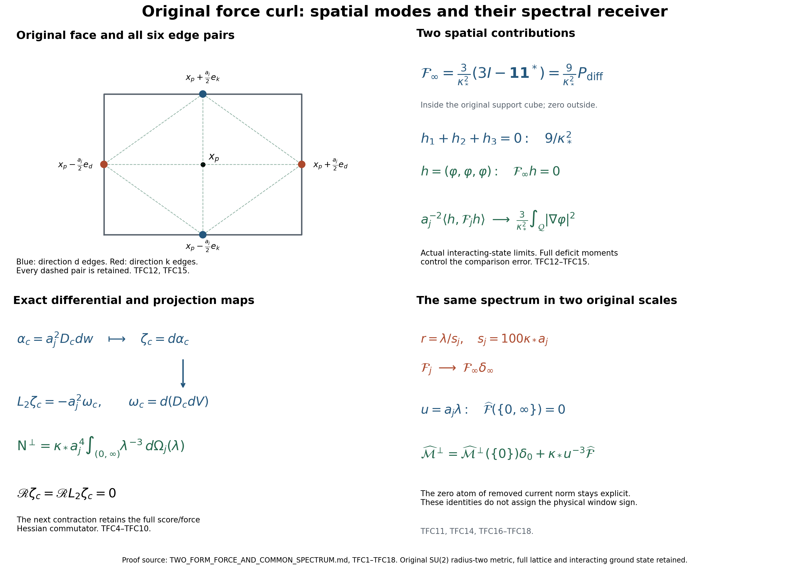
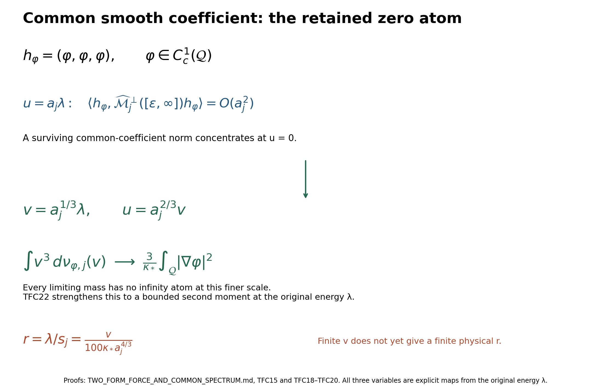
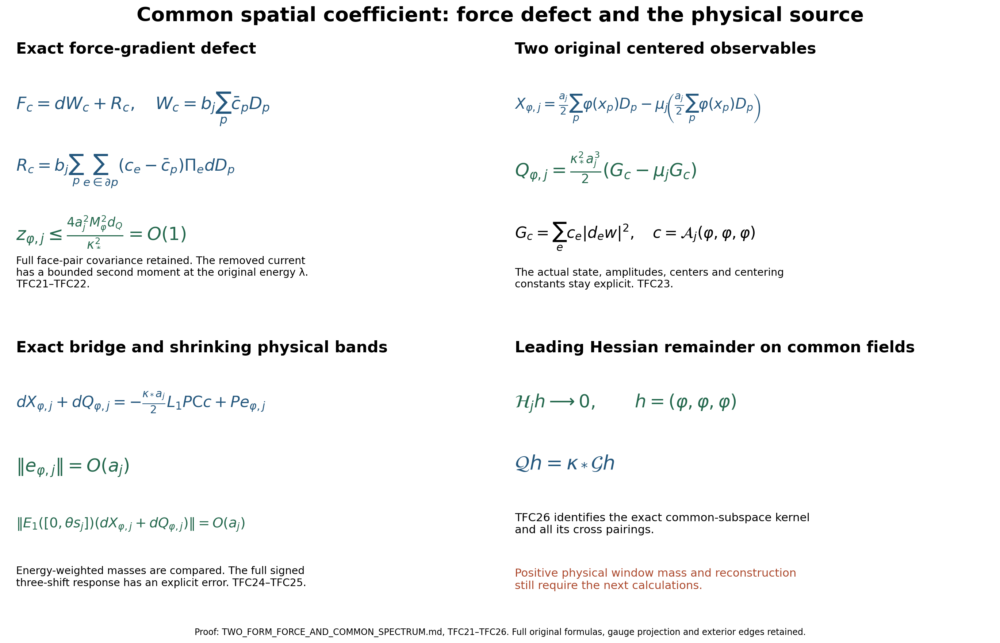

# The two-form force receiver and its actual spatial limits

Reviewed derivation, 13 October 2026. These are calculations in the original interacting finite-regulator state. The smooth global no-gap result is the programme goal, not a conclusion of this note. No novelty claim is made.

Providers at the verified edition 89f404bedf53479031c1825b113fffce9f2440a3:
[GCM1–GCM16](https://github.com/KokunoYumeto/yang-mills-interacting-workbench/blob/89f404bedf53479031c1825b113fffce9f2440a3/yang-mills/continuations/20261011-central-signs-shrinking-window/GAUGE_CURRENT_COVARIANCE_AND_DYNAMIC_CURL.md),
[DF5–DF15](https://github.com/KokunoYumeto/yang-mills-interacting-workbench/blob/89f404bedf53479031c1825b113fffce9f2440a3/yang-mills/continuations/20261011-central-signs-shrinking-window/CURRENT_DENSITY_FLUX_AND_PROJECTED_RESIDUAL.md),
[QCF1–QCF12](https://github.com/KokunoYumeto/yang-mills-interacting-workbench/blob/89f404bedf53479031c1825b113fffce9f2440a3/yang-mills/continuations/20261011-central-signs-shrinking-window/QUANTITATIVE_FORCE_CURL.md),
[GWH1–GWH15](https://github.com/KokunoYumeto/yang-mills-interacting-workbench/blob/89f404bedf53479031c1825b113fffce9f2440a3/yang-mills/continuations/20261011-central-signs-shrinking-window/GAUGE_HESSIAN_AND_COVARIANT_GRAPH.md), and
[KP cell maps and limits](https://github.com/KokunoYumeto/yang-mills-interacting-workbench/blob/89f404bedf53479031c1825b113fffce9f2440a3/yang-mills/continuations/20261011-central-signs-shrinking-window/ACTUAL_KINETIC_PROFILE_AND_SHIFT_MOMENTS.md).
The complete human-source and original-author-TeX provenance of those proofs is retained. The new index query is routing only; no additional external-author reading is claimed.

The inherited human-source comparisons are Jon Johnsen,
[On the spectral properties of Witten-Laplacians, their range projections and Brascamp-Lieb's inequality](https://arxiv.org/abs/1703.10011v2),
Section 3 and the exact-range passage (author TeX lines 934–1167 and 1439–1558);
Assane Lo,
[Witten Laplacian Methods for the Decay of Correlations](https://arxiv.org/abs/math-ph/0611002v9),
Section 2 and the weighted-convexity setup (author TeX lines 308–446 and 2029–2083);
and Geneviève Dusson, Israel Michael Sigal and Benjamin Stamm,
[The Feshbach–Schur map and perturbation theory](https://arxiv.org/abs/2105.02058v1),
the abstract map and reconstruction passage (author TeX lines 398–490).
PT and CSR prove the original compact-manifold and raw-coefficient receiving maps. The present two-form and actual-state calculations are proved below. Rechecking these papers' bibliographic metadata does not count as a fresh reading of their full sources.

## Original state, operators and coordinates

The full open lattice has vertices \(\{0,\ldots,2L_j\}^3\) and every positive coordinate edge. Its configuration manifold is \(M_j=SU(2)^{\mathcal E_j}\). Each factor has radius-two metric, the orthonormal ordered Pauli basis \(T_\alpha=-i\sigma_\alpha/2\), and probability Haar measure. Keep
\[
\begin{gathered}
L_j=j^4,\qquad a_j=(100j)^{-1},\qquad
g_j^2=\kappa_*a_j/2,\qquad b_j=(\kappa_*a_j^2)^{-1},
\qquad s_j=100\kappa_*a_j,\\
U_p=U_d(z)U_k(z+e_d)U_d(z+e_k)^{-1}U_k(z)^{-1}
\quad(d<k),\\
D_p=2-\operatorname{Tr}U_p,\qquad
V=b_j\sum_pD_p
=2b_j|\mathcal P_j|-b_j\sum_p\operatorname{Tr}U_p,\\
H_j=-\kappa_*\Delta+V,\qquad
H_j\psi_j=E_{0,j}\psi_j,\qquad
\psi_j>0,\quad\|\psi_j\|_{L^2(dU)}=1,\quad d\mu_j=\psi_j^2dU.
\end{gathered}
\]
The ground is the original smooth gauge-invariant state. For a finite formula only, write \(a=a_j\), \(\kappa=\kappa_*\), \(b=b_j\), \(\mu=\mu_j\), \(w=\log\psi_j\), \(g=dw\), \(H^w=\nabla^2w\), \(H^V=\nabla^2V\), \(T_e=\mu|g_e|^2\). Set
\[
\delta_\mu=d_\mu^*=\delta-2\iota_g,\qquad
L_k=\kappa(d\delta_\mu+\delta_\mu d)\big|_{\Lambda^k},\qquad
L_0=-\kappa(\Delta+2g\cdot\nabla).
\]
All derivatives include the entire original configuration manifold. These weighted operators have the closed nonnegative forms and \(H^2\) operator domains proved in PT and GCM16; no regulator-independent elliptic constant is assumed.

The original gauge action is \(U_e^h=h_{s(e)}U_eh_{t(e)}^{-1}\). Its tangent map in the right frame, its graph operator and its contraction are
\[
(K_U\xi)_e=\xi_{s(e)}-\operatorname{Ad}_{U_e}\xi_{t(e)},\quad
\mathbb L_U=K_U^*K_U,\quad
\mathscr T\alpha=K_U^*\alpha^\sharp .
\]
GCM proves \(0\le\mathbb L_U\le12I\). The signless endpoint map and the two-form map are
\[
(\mathscr S_Ub)_v=\sum_{s(e)=v}b_e+
\sum_{t(e)=v}\operatorname{Ad}_{U_e}^*b_e,\qquad
\mathscr R\omega=\mathscr S_U\big((*_e\omega_{ee})_e\big).
\]
Both sums have their displayed plus sign. The star uses the original right-frame orientation. GCM14 gives
\[
\mathscr T L_1-L_0^{\mathbb V}\mathscr T=\kappa\mathscr R d,
\qquad \|\mathscr T\|,\|\mathscr R\|\le\sqrt{12}.
\]
Here \(L_0^{\mathbb V}\) acts componentwise on all vertex-Lie-valued functions. It is not the restriction to invariant scalar observables.

For every deterministic complex coefficient list \(c\), extended by zero from the original strict fitting edge set \(I_j\) to every original edge, define
\[
D_cg=(c_eg_e)_e,\quad
\alpha_c=\mathsf Cc=a^2D_cg,\quad
G_c=\sum_ec_e|g_e|^2,\quad
F_c=D_cdV,\quad \zeta_c=d\alpha_c,\quad\omega_c=dF_c .
\]
The exact invariant one-form projection is \(P\), and \(P^\perp=I-P\) within invariant one-forms. Set \(\mathsf N^\perp=\mathsf C^*P^\perp\mathsf C\). Inner products conjugate their first entry.

For the support cube \(\mathcal Q=\prod_d[c_d,c_d+R]\), keep
\[
\begin{gathered}
q=\lceil R/a\rceil+3,\quad
(v_Q)_d=L_j+\lfloor(c_d-o_d)/a\rfloor-1,\quad
Q=v_Q+\{0,\ldots,q\}^3,\\
N_Q=3q(q+1)^2,\quad M_Q=3q^2(q+1),\quad
I_j=E_Q^\circ,\quad |I_j|=3q(q-1)^2,\\
C_Q=2q(q+1)\sum_d
[\mathbf1_{\{(v_Q)_d>0\}}+\mathbf1_{\{(v_Q)_d+q<2L_j\}}],\\
d_Q=\mu\sum_{p\text{ inside }Q}D_p,\quad
\Lambda_Q=\min(2M_Q,6g_j^2\sqrt{N_QM_Q})+2C_Q,\\
\kappa T_Q+bd_Q\le E_{0,j}-E_{\rm out}\le b\Lambda_Q,\quad
\limsup_j a_j^2d_Q\le K_R,\\
\mathsf L_R=9\kappa_*R^3+24R^2,\quad
K_R=\frac{\mathsf L_R+\sqrt{\mathsf L_R^2-81\kappa_*^2R^6/4}}2 .
\end{gathered}
\]
No inside, outside or crossing contribution has been deleted. Every face incident to \(I_j\) lies inside \(Q\). Original centers are
\[
x_e=o+a(z-L_j\mathbf1+e_d/2),\qquad
x_p=o+a(z-L_j\mathbf1+(e_d+e_k)/2).
\]
The direction-labelled cells centered at \(x_e\) have side \(a\). Keep the actual cell injection \(J_j\), averaging map \(\mathcal A_j=a_j^{-3}J_j^*\), and
\[
J_j^*J_j=a_j^3I,\quad
\langle J_jc,J_jd\rangle=a_j^3c^*d,\quad
P_{{\rm cell},j}=J_j\mathcal A_j\longrightarrow M_{\mathbf1_{\mathcal Q}}
\quad\hbox{strongly}.
\]
GWH gives, for all original edges including finite boundary cases,
\[
T_e\le\frac{\Theta_G(a)}a,\qquad
\Theta_G(a)=
\frac{-3a/2+\sqrt{9a^2/4+144/(\kappa_*^2(7/5))}}8
<\Theta_0:=\frac3{2\kappa_*}\sqrt{\frac57}.
\]
Thus \(a_j^{-3}J_j\mathsf N^\perp\mathcal A_j
\le a_j^{-3}J_j\mathsf N\mathcal A_j
=M_{\tau_j}P_{{\rm cell},j}\le\Theta_G(a_j)P_{{\rm cell},j}\).

## A uniform bound for the charged scalar contraction

Let \(\mathcal F_{\rm ad}\) be the closed space of measurable vertex fields with
\(F_v(U^h)=\operatorname{Ad}_{h_v}F_v(U)\), equipped with
\(\sum_v\mu|F_v|^2\). This condition means equality in \(L^2\); for smooth fields it is pointwise. Gauge pullback combined with the inverse fiber adjoint action is unitary because the metric and \(\mu\) are invariant. Averaging this unitary representation over the compact full vertex gauge group projects onto \(\mathcal F_{\rm ad}\). The average commutes with the scalar form and resolvent, so the subspace reduces \(L_0^{\mathbb V}\). Averaging smooth approximations proves density of smooth equivariant fields in its form domain.

For smooth equivariant \(F\), differentiating one vertex action gives
\[
dF_v(K_u(T_\alpha))=\mathbf1_{\{u=v\}}[T_\alpha,F_v].
\]
The original Pauli commutator is the Euclidean cross product in this ordered basis. Therefore, also for complex \(F_v\) by polarization of the real identity,
\(\sum_{\alpha=1}^3|[T_\alpha,F_v]|^2=2|F_v|^2\).
At each \(U\), \(\|K_U\|^2\le12\) implies
\(\|dF\circ K_U\|_{\rm HS}^2\le12\|dF\|_{\rm HS}^2\).
Sum all vertex generators and output components, integrate against the actual \(\mu\), and close the form. This proves
\[
L_0^{\mathbb V}\big|_{\mathcal F_{\rm ad}}\ge\frac{\kappa}{6}I,
\qquad
\|(L_0^{\mathbb V}+z)^{-1}\big|_{\mathcal F_{\rm ad}}\|
\le(\kappa/6+z)^{-1}\quad(z>0).
\tag{TFC1}
\]
For an invariant form \(\alpha\), gauge covariance of the tangent map gives
\((\mathscr T\alpha)_v(U^h)=\operatorname{Ad}_{h_v}(\mathscr T\alpha)_v(U)\).
The oriented star and both adjoint endpoint transports transform the same way, so \(\mathscr R\) sends invariant two-forms into \(\mathcal F_{\rm ad}\). In particular \(B_Uc=K_U^*D_cg\) is in that space. TFC1 controls precisely the scalar contraction in GCM16. It makes no mass-gap assertion for invariant scalar observables.

Let \(E_\Lambda=E_{L_1}([0,\Lambda])\) on invariant one-forms, with \(0\le\Lambda<\kappa/6\). The Hodge form gives \(\|dE_\Lambda\|\le\sqrt{\Lambda/\kappa}\). Put \(A=L_0^{\mathbb V}|_{\mathcal F_{\rm ad}}\). Differentiating \(e^{-tA}\mathscr T e^{tL_1}E_\Lambda\) on smooth spectral vectors and using GCM14 gives the derivative \(\kappa e^{-tA}\mathscr R d e^{tL_1}E_\Lambda\). The norm of the undifferentiated expression tends to zero because \(A\ge\kappa/6\) and \(L_1\le\Lambda\) on the band. Integration, followed by continuity on the finite band, proves
\[
\begin{gathered}
\mathscr T E_\Lambda
=-\kappa\int_0^\infty e^{-tA}\mathscr R d\,e^{tL_1}E_\Lambda\,dt,\\
\|\mathscr T E_\Lambda\|
\le\frac{\sqrt{12\kappa\Lambda}}{\kappa/6-\Lambda}.
\end{gathered}\tag{TFC2}
\]
The integral converges in operator norm by the displayed exponential bound. On each finite regulator the compact elliptic operator has finite-dimensional bounded spectral bands, so the differentiations also follow directly on its smooth eigenbasis.

For \(\delta>0\), pointwise spectral calculus defines the orthogonal projection onto the vertical graph modes with graph eigenvalue at least \(\delta\):
\[
P_{{\rm vert},\ge\delta}
=K_U\mathbb L_U^\dagger E_{\mathbb L_U}([\delta,12])K_U^* .
\]
The singular-value decomposition of \(K_U\) proves both the projection assertion and
\(\|P_{{\rm vert},\ge\delta}\alpha\|_\mu^2
\le\delta^{-1}\|\mathscr T\alpha\|_\mu^2\). Hence
\[
\|P_{{\rm vert},\ge\delta}E_\Lambda\alpha\|_\mu^2
\le
\frac{12\kappa\Lambda}{\delta(\kappa/6-\Lambda)^2}
\|\alpha\|_\mu^2 .
\tag{TFC3}
\]
No interchange of the graph projection with the time spectral projection was made. At \(\Lambda=\theta s_j\), this bounds the graph tail of any surviving low-time vertical part. Setting \(\delta=R_{\rm g}s_j\) gives the exact factor
\(12\kappa_*\theta/[R_{\rm g}(\kappa_*/6-\theta s_j)^2]\).
For fixed positive \(\delta\), the factor tends to zero. Small graph eigenvalues remain in the full inverse-graph norm.

## The current curl maps exactly to the original force curl

The complete DF11 identity and its exterior derivative give
\[
\begin{gathered}
L_1\alpha_c=-a^2F_c-\kappa a^2dG_c,\qquad
L_2\zeta_c=-a^2\omega_c,\\
(\zeta_c)_{ef}=a^2(c_f-c_e)H^w_{ef},\qquad
(\omega_c)_{ef}=(c_f-c_e)H^V_{ef}\quad(e\ne f),\\
(\zeta_c)_{ee}=(\omega_c)_{ee}=0,\qquad
\mathscr R\zeta_c=\mathscr R L_2\zeta_c=0.
\end{gathered}\tag{TFC4}
\]
For completeness, retain the original ground equation
\(-\kappa(\Delta w+|dw|^2)+V=E_0\). Its full derivative is
\(d\Delta w=\kappa^{-1}dV-2H^wg\).
For \(B=\kappa(\nabla^*\nabla-2\nabla_g+\operatorname{Ric}^{\#})\),
the covariant gradient identity gives
\[
Bg=\kappa[-d\Delta w-\operatorname{Ric}^{\#}g
-2H^wg+\operatorname{Ric}^{\#}g]=-dV.
\]
The original product-edge projections are parallel and commute with the diagonal Ricci action, so \(BD_cg=-D_cdV\).
Since \(L_1=B-2\kappa H^w\) and
\(2H^wD_cg=d(\sum_ec_e|g_e|^2)=dG_c\), multiplication by \(a^2\) proves the full first identity. Applying \(d\), with \(d^2G_c=0\) and \(dL_1=L_2d\), proves the second identity. The mixed curl components follow from the two product covariant derivatives. Same-edge Hessians are symmetric, proving their zero blocks. Thus both cancellations against \(\mathscr R\) follow from its actual definition.

The resolvent identity \( (L_2+z)^{-1}=z^{-1}I-z^{-1}(L_2+z)^{-1}L_2\), applied successively to these smooth forms, yields
\[
\begin{gathered}
\mathscr R(L_2+z)^{-1}\zeta_c
=\frac{a^2}{z}\mathscr R(L_2+z)^{-1}\omega_c
=-\frac{a^2}{z^2}\mathscr R(L_2+z)^{-1}L_2\omega_c,\\
\mathscr T(L_1+z)^{-1}\alpha_c
=(A+z)^{-1}
\left[a^2B_Uc+\frac{\kappa a^2}{z^2}
\mathscr R(L_2+z)^{-1}L_2\omega_c\right].
\end{gathered}\tag{TFC5}
\]
Here \(A\) has the proved domain in TFC1. For \(z=\theta s_j\),
\(\kappa_*a_j^2/z^2=1/(10000\kappa_*\theta^2)\), with no suppressed factor. The entire bracket and outer resolvent remain together inside the inverse-graph norm of GCM16; separate inverse-graph integrability is not asserted.

## Full two-form blocks and the first uncancelled contraction

Let \(\Pi_D\) project onto \(\bigoplus_e\Lambda^2T_e^*M_j\) and \(\Pi_M=I-\Pi_D\) onto the sum of all mixed factors \(T_e^*M_j\otimes T_f^*M_j\), \(e<f\). They are parallel orthogonal projections. The unweighted two-form curvature operator is \(I/2\) on \(D\) and \(I\) on \(M\). Indeed a radius-two three-sphere has sectional curvature \(1/4\); contraction of its constant-curvature tensor in degree \(k\) gives \(k(3-k)/4\), hence \(1/2\) for \(k=2\). On different product factors the mixed curvature tensor is zero, and the two individual one-form Ricci contributions are \(1/2+1/2=1\).

Expanding \(\delta_\mu=\delta-2\iota_g\) and using
\(d\iota_g+\iota_gd=\mathcal L_g\) gives the full identity
\[
L_2=\kappa\{\nabla_\mu^*\nabla+
\mathcal R_2-2(H^w)^{[2]}\},\qquad
((H^w)^{[2]}\omega)_{ij}
=\sum_k H^w_{ik}\omega_{kj}+\omega_{ik}H^w_{kj}.
\]
The Lie derivative on covariant forms is \(\nabla_g+(H^w)^{[2]}\), while \(\nabla_\mu^*\nabla=\nabla^*\nabla-2\nabla_g\). This proves every weight term and its sign.

For a mixed two-form \(\omega\), the rough and curvature terms retain its mixed blocks. The diagonal block is therefore exactly
\[
(\Pi_DL_2\omega)_{ee}
=2\kappa\sum_{f\ne e}
\left(H^w_{ef}\omega_{ef}^{\,T}
-\omega_{ef}(H^w_{ef})^T\right).
\tag{TFC6}
\]
The transpose, not complex conjugation, is required by the antisymmetry of a complex two-form. \(H^w,H^V\) are real. To check the formula, use \(\omega_{fe}=-\omega_{ef}^T\) and \(H^w_{fe}=(H^w_{ef})^T\) in the displayed Hessian action. For \(\zeta_c\) the two products cancel separately for every \(f\). For \(\omega_c\), they give
\[
(\Pi_DL_2\omega_c)_{ee}
=2\kappa\sum_{f\ne e}(c_f-c_e)
\left(H^w_{ef}(H^V_{ef})^T-H^V_{ef}(H^w_{ef})^T\right).
\tag{TFC7}
\]
Only coface pairs have nonzero \(H^V_{ef}\), by its original potential, but every such pair, including zero-coefficient outside neighbors, remains.

Twice iterating GCM14 with TFC4 gives
\(\mathscr T L_1^2\alpha_c=A^2\mathscr T\alpha_c\).
A third iteration gives the exact first possibly nonzero defect
\[
\mathscr T L_1^3\alpha_c-A^3\mathscr T\alpha_c
=-\kappa a^2\mathscr R L_2\omega_c .
\tag{TFC8}
\]
Its full local expression is obtained by applying the signless endpoint star map to TFC7, with factor \(-2\kappa^2a^2\). This formula does not assert a nonzero value in the actual state, nor identify it with the earlier J5 third Schur coefficient without a further comparison.

For an exact domain version of the two-form block receiver, put
\(A_D=\Pi_DL_2\Pi_D|_D\), \(A_M=\Pi_ML_2\Pi_M|_M\), and
\(K_{DM}=-2\kappa\Pi_D(H^w)^{[2]}\Pi_M\).
The projections are parallel and the off-diagonal term is bounded smooth multiplication at each finite regulator. Thus the diagonal compression forms are closed, nonnegative and have \(H^2\) domains in their respective bundles; this also follows by subtracting the bounded off-diagonal operator from the already self-adjoint \(L_2\).
For \(z>0\), completing the square proves
\[
\begin{gathered}
S_M(z)=A_M+z-K_{DM}^*(A_D+z)^{-1}K_{DM}\ge zI,\\
\Pi_D(L_2+z)^{-1}\zeta_c
=-(A_D+z)^{-1}K_{DM}S_M(z)^{-1}\zeta_c .
\end{gathered}\tag{TFC9}
\]
For the inequality, minimize the quadratic form of \(L_2+z\) over its \(D\) entry at fixed \(M\) entry; the original form is at least \(z\) times the full norm. Solving the first block equation and substituting it into the second proves the resolvent formula. Bounded multiplication preserves all original mixed blocks; no Hessian entry has been replaced.

## The exact inverse third force moment

There are no weighted harmonic one-forms on \(M_j\). Each radius-two \(SU(2)\) factor is a three-sphere and is simply connected, and so is their finite product. A smooth closed one-form therefore has the path-integral primitive: its integral around any loop vanishes by Stokes along a contracting homotopy, and local differentiation of the primitive gives the original form. If such a form is also \(\delta_\mu\)-closed, integration against its primitive gives its squared norm zero. Elliptic regularity applies to weighted harmonic forms, completing the argument. Gauge averaging makes the primitive invariant when the form is invariant, without changing its derivative. Thus the projection \(P\) used here is the restriction of the full exact-space projection.

The exact two-form \(\zeta_c\) is orthogonal to \(\ker L_2\) by integration against harmonic forms. On this complement the finite compact operator has an inverse; no uniform lower eigenvalue is claimed. Exterior intertwining and the same integration show
\[
P^\perp\alpha_c=\kappa\delta_\mu L_2^{-1}\zeta_c .
\]
Indeed the right side is co-closed. Since \(d\zeta_c=0\), its exterior derivative equals
\(\kappa d\delta_\mu L_2^{-1}\zeta_c=\zeta_c\).
Here \(dL_2^{-1}\zeta_c=0\): in the eigenbasis on positive eigenvalues it equals \(L_3^{-1}d\zeta_c=0\); harmonic components are orthogonal by adjointness. The difference from \(P^\perp\alpha_c\) is both closed and co-closed and is zero by the one-form result.

Let \(\Omega_j(B)\) be the positive matrix measure on the raw coefficient space defined by
\[
c^*\Omega_j(B)d=\langle\omega_c,E_{L_2}(B)\omega_d\rangle_\mu .
\]
The original inverse and its domain are defined on the harmonic complement. Since \(L_2\zeta_c=-a^2\omega_c\), both forms have zero harmonic component. The preceding identity, the Hodge form and spectral calculus give, including all polarized cross terms,
\[
\begin{aligned}
\mathsf N^\perp
&=\kappa\,\zeta^*L_2^{-1}\zeta
=\kappa a^4\int_{(0,\infty)}\lambda^{-3}\,d\Omega_j(\lambda),\\
\mathsf C^*P^\perp L_1\mathsf C
&=\kappa\,\zeta^*\zeta
=\kappa a^4\int_{(0,\infty)}\lambda^{-2}\,d\Omega_j(\lambda),\\
\mathsf C^*P^\perp L_1^2\mathsf C
&=\kappa\,\zeta^*L_2\zeta
=\kappa a^4\int_{(0,\infty)}\lambda^{-1}\,d\Omega_j(\lambda)
=a^4 F^*P^\perp F .
\end{aligned}\tag{TFC10}
\]
For example, if \(\beta=L_2^{-1}\zeta_c\), then \(d\beta=0\) and
\(\kappa\|\delta_\mu\beta\|^2=\langle\beta,L_2\beta\rangle\).
Multiplication by the extra \(\kappa\) proves the first line. Apply the exterior intertwining to each positive eigenspace for the next two lines. Finally project TFC4 onto \(P^\perp\); its exact \(dG_c\) term disappears and \(P^\perp L_1\alpha_c=-a^2P^\perp F_c\), proving the last equality without deleting any part before projection.

On the original relative time-energy variable \(r=\lambda/s_j\), define
\[
\begin{gathered}
\mathcal M^\perp_j(B)
=\kappa_*a_jJ_j
\int_{\lambda/s_j\in B}\lambda^{-3}\,d\Omega_j(\lambda)\,\mathcal A_j,\\
\mathcal F_j(B)
=a_j^4J_j\Omega_j(\{\lambda:\lambda/s_j\in B\})\mathcal A_j .
\end{gathered}
\]
They are positive operator-valued measures on the fixed direction-labelled \(L^2\) space; the factor \(\mathcal A_j=a_j^{-3}J_j^*\) ensures positivity. Their exact relation and total are
\[
\begin{gathered}
d\mathcal F_j(r)=10^6\kappa_*^2a_j^6r^3\,d\mathcal M^\perp_j(r),\\
\mathcal M^\perp_j([0,\infty])
=a_j^{-3}J_j\mathsf N^\perp\mathcal A_j
=M_{\tau_j}P_{{\rm cell},j}-\mathcal M^{\rm phys}_j([0,\infty]).
\end{gathered}\tag{TFC11}
\]
The factor follows from \(a_j^4/(\kappa_*a_j)\) times
\(\lambda^3=(100\kappa_*a_jr)^3\). There is no finite-regulator zero atom. Limiting zero atoms remain possible. Since \(P_{\rm vert}P=0\),
\(\mathsf V_g\le\mathsf N^\perp\); the gauge norm and this whole removed norm must not be added as though they were disjoint.

## An explicit actual-state force covariance limit

QCF1–QCF2 give, for every original face and with its full second deficit moment,
\[
\begin{gathered}
q_{p,j}=\frac34-\frac{\mu_jD_p}{4}+\frac{\mu_jD_p^2}{16}
=\frac34-\frac14\mu_j|d_eD_p|^2,\qquad
\frac12\le q_{p,j}\le\frac34,\\
\|\omega_c\|_{\mu_j}^2
=b_j^2\sum_{p\in\mathcal P_j}q_{p,j}
\sum_{\substack{e<f\\e,f\in\partial p}}|c_e-c_f|^2 .
\end{gathered}\tag{TFC12}
\]
All six pairs occur. Two different edges belong to at most one unit face; thus no omitted cross-face interference appears. In particular, for \(c=\mathcal A_jh\), the total force operator has form
\[
\langle h,\mathcal F_j([0,\infty])h\rangle
=\frac{a_j^3}{\kappa_*^2}
\sum_pq_{p,j}\sum_{e<f\in\partial p}|c_e-c_f|^2 .
\]
Let \(\mathcal F_j^0\) have the same actual cell maps, coefficients and boundaries, with comparison weights \(3/4\). It does not replace the actual operator. Each edge has at most twelve coface neighbors, so expansion of squared differences gives graph norm at most \(24\). Hence
\(0\le\mathcal F_j\le\mathcal F_j^0\le18\kappa_*^{-2}P_{{\rm cell},j}\).

For \(h\in C_c(\mathcal Q;\mathbb C^3)\), put
\(H_h=\max_d\|h_d\|_\infty\).
Every contributing face lies in \(Q\) for all large \(j\), and its six differences have squared sum at most \(24H_h^2\). Since
\(0\le3/4-q_{p,j}\le\mu_jD_p/4\), the full actual correction obeys
\[
0\le\langle h,(\mathcal F_j^0-\mathcal F_j)h\rangle
\le\frac{6H_h^2a_j^3d_Q}{\kappa_*^2}
\longrightarrow0 .
\]
For a bounded positive operator \(D\), \(\|Dh\|^2\le\|D\|\langle h,Dh\rangle\); thus this is strong convergence of the correction on these tests. Functions supported a positive distance outside the cube are eventually annihilated. Such inside and outside tests are dense, since the boundary has zero Lebesgue measure. The uniform norm bound extends the strong conclusion to the whole fixed \(L^2\) space.

The comparison operator itself has an explicit strong limit. For an interior direction-\(d\) edge, the two faces in each other direction \(k\) each contain two direction-\(k\) edges and one other direction-\(d\) edge. Its row is
\((3/(4\kappa_*^2))\sum_{f\sim e}(c_e-c_f)\).
Uniform continuity of each compactly supported component makes the same-direction contributions tend to zero and the four direction-\(k\) contributions tend to \(4(h_d-h_k)\). The output cells approach the same point, so the limiting row is \(3\kappa_*^{-2}\sum_{k\ne d}(h_d-h_k)\). Its error tends uniformly to zero on a fixed bounded support; multiplication by the support volume proves \(L^2\) convergence. The preceding density argument handles all \(L^2\) inputs. Therefore the actual result is
\[
\begin{gathered}
\mathcal F_j([0,\infty])\longrightarrow
\mathcal F_\infty
=\frac3{\kappa_*^2}M_{\mathbf1_{\mathcal Q}}(3I_3-\mathbf1\mathbf1^*)
=\frac9{\kappa_*^2}M_{\mathbf1_{\mathcal Q}}P_{\rm diff}
\quad\hbox{strongly},\\
P_{\rm diff}=I_3-\frac13\mathbf1\mathbf1^*,\qquad
\ker(\mathcal F_\infty|_{L^2(\mathcal Q;\mathbb C^3)})
=\{(\varphi,\varphi,\varphi):\varphi\in L^2(\mathcal Q)\}.
\end{gathered}\tag{TFC13}
\]
The last assertion follows from
\(h^*(3I-\mathbf1\mathbf1^*)h
=\sum_{d<k}|h_d-h_k|^2\).
It is an actual-state limit; the deficit estimate proves precisely why its comparison calculation receives the actual state.

At every fixed finite relative time-energy cutoff \(R_{\rm t}\), TFC11 yields
\[
0\le\mathcal F_j([0,R_{\rm t}])
\le10^6\kappa_*^2a_j^6R_{\rm t}^3\Theta_G(a_j)I.
\]
Combining this estimate with TFC13 proves weak operator-measure convergence on the compact \([0,\infty]\):
\[
\mathcal F_j\longrightarrow\mathcal F_\infty\delta_\infty
\quad\hbox{when }r=\lambda/s_j .
\tag{TFC14}
\]
To prove it for any continuous scalar function on this compactification, subtract its value at infinity, split at a fixed large \(R_{\rm t}\), use the uniform total bound on the tail and the displayed vanishing finite-interval bound, then increase \(R_{\rm t}\). Polarization gives all cross terms. This quantifies the escaping force-curl weight without assigning its behavior to the physical scalar measure.

## The next spatial term for a common coefficient

Take \(\varphi\in C_c^1(\mathcal Q;\mathbb C)\), first sampled at the original edge centers, \(c_e=\varphi(x_e)\). At a face center \(x_p\) in directions \(d<k\), the two direction-\(d\) centers are \(x_p\pm ae_k/2\), and the two direction-\(k\) centers are \(x_p\pm ae_d/2\). Denote the four values in that order by \(A_-,A_+,B_-,B_+\). Expansion of all six pairs gives exactly
\[
\sum_{\{e,f\}\subset\partial p}|c_e-c_f|^2
=2|A_--A_+|^2+2|B_--B_+|^2
+|A_-+A_+-B_--B_+|^2 .
\]
The uniform first-order Taylor formula on a fixed compact neighborhood of the support gives
\((A_--A_+)/a\to-\partial_k\varphi(x_p)\),
\((B_--B_+)/a\to-\partial_d\varphi(x_p)\),
and the last signed sum divided by \(a\) tends uniformly to zero. Riemann summation on each face-center grid, with every pair of directions retained, gives
\[
a\sum_p\sum_{\{e,f\}\subset\partial p}|c_e-c_f|^2
\longrightarrow4\int_{\mathcal Q}|\nabla\varphi|^2 .
\]
Each spatial derivative occurs in two face orientations, accounting for the factor four. If \(M_\varphi=\sup\|D\varphi\|_{\mathbb R^3\to\mathbb C}\), the two opposite pairs have distance \(a\), and the other four pairs have distance \(a/\sqrt2\). Thus the exact six-pair sum is at most \(4a^2M_\varphi^2\). The actual-state error after division by \(a^2\) is at most
\(M_\varphi^2a^3d_Q/\kappa_*^2\to0\).

To pass from samples to \(c=\mathcal A_j(\varphi,\varphi,\varphi)\), the cells are symmetric about their actual centers. The integral of the linear Taylor term is zero. If \(\omega_{D\varphi}\) is a modulus of continuity of the derivative, the pointwise difference is bounded by
\((\sqrt3a/2)\omega_{D\varphi}(\sqrt3a/2)=o(a)\).
Its cell \(L^2\) norm is \(o(a)\), because the affected cells have uniformly bounded total volume. The uniform operator bound for \(\mathcal F_j\) makes its own quadratic form \(o(a^2)\). Cauchy–Schwarz in this positive form, together with the \(O(a^2)\) sampled energy already proved, makes both cross terms \(o(a^2)\). Consequently, for \(h_\varphi=(\varphi,\varphi,\varphi)\),
\[
a_j^{-2}\langle h_\varphi,\mathcal F_j([0,\infty])h_\psi\rangle
\longrightarrow
\frac3{\kappa_*^2}\int_{\mathcal Q}
\nabla\overline{\varphi}\cdot\nabla\psi
\quad(\varphi,\psi\in C_c^1(\mathcal Q;\mathbb C)).
\tag{TFC15}
\]
Polarization of the proved complex quadratic formula supplies the mixed version. This is the full next spatial contribution of the original force curl. The physical time spectral scale remains \(\lambda/s_j\), and the exact connection to the removed current is TFC10–TFC11.

## The scale receiving the escaping force and its removed norm

There is a further actual-state consequence of the complete codifferential. QCF5 and the at-most-four incident-face count give
\(\|\delta\omega_c\|_\mu\le3b\sqrt{\mathcal G(c)}\), where
\(\mathcal G(c)=\sum_p\sum_{e<f\in\partial p}|c_e-c_f|^2\).
For the drift, the exact mixed-Hessian operator norm \(b/2\), the at-most-twelve coface neighbors and the unchanged endpoint scores give
\[
\|\iota_g\omega_c\|_\mu^2
\le3b^2\sum_p\sum_{e<f\in\partial p}
|c_e-c_f|^2(T_e+T_f)
\le\frac{6b^2\Theta_G(a)}a\mathcal G(c).
\]
This includes outside neighbors even where their coefficient is zero. Because \(d\omega_c=0\), the Hodge form and the complete identity
\(\delta_\mu\omega_c=\delta\omega_c-2\iota_g\omega_c\) prove
\[
\begin{gathered}
\langle\omega_c,L_2\omega_c\rangle_\mu
=\kappa\|\delta_\mu\omega_c\|_\mu^2
\le\kappa b^2D(a)^2\mathcal G(c)
\le2\kappa D(a)^2\|\omega_c\|_\mu^2,\\
D(a)=3+2\sqrt{6\Theta_G(a)/a}.
\end{gathered}\tag{TFC16}
\]
The first inequality uses the triangle inequality after retaining both codifferential terms. The second uses the exact lower weight \(q_{p,j}\ge1/2\).

For a nonzero \(\omega_c\), divide its spectral measure by its squared norm. Jensen's scalar inequality for the positive convex function \(\lambda^{-3}\) gives
\[
\int\lambda^{-3}d\langle c,\Omega_jc\rangle
\ge\frac{\|\omega_c\|_\mu^8}
{\langle\omega_c,L_2\omega_c\rangle_\mu^3}
\ge(2\kappa D(a)^2)^{-3}\|\omega_c\|_\mu^2 .
\]
There is no zero spectral component, and all inverse moments exist at each finite regulator by TFC10. For \(\omega_c=0\) the resulting nonnegative inequality holds directly. Thus this quadratic-form inequality for every raw \(c\), followed by the original cell map, proves
\[
\mathcal M^\perp_j([0,\infty])
\ge\frac{\mathcal F_j([0,\infty])}
{8\kappa_*^2a_j^3D(a_j)^6}.
\tag{TFC17}
\]
No operator-convexity claim for the inverse third power is used. Put
\[
\gamma_*=\frac1{8\kappa_*^2(24\Theta_0)^3}>0 .
\]
Since \(aD(a)^2=9a+12\sqrt{6\Theta_G(a)a}+24\Theta_G(a)\to24\Theta_0\), any common weak limit of the already bounded total removed norm satisfies
\[
\mathcal M^\perp_{\rm total}\ge\gamma_*\mathcal F_\infty,\qquad
\mathcal M^{\rm phys}_{\rm total}
\le M_{\tau}-\gamma_*\mathcal F_\infty .
\]
This strengthens the physical total-norm restriction on the orientation-difference subspace. It does not assert a uniform physical spectral gap. The common smooth sector additionally obeys
\(\liminf_j a_j^{-2}\langle h_\varphi,\mathcal M^\perp_j([0,\infty])h_\varphi\rangle
\ge3\gamma_*\kappa_*^{-2}\int|\nabla\varphi|^2\),
by TFC15 and the same finite inequality.

Finally use the distinct variable \(u=a_j\lambda\), retaining both maps to the original \(\lambda\):
\[
\widehat{\mathcal F}_j(B)=a_j^4J_j\Omega_j(\{\lambda:a_j\lambda\in B\})\mathcal A_j,\quad
\widehat{\mathcal M}^\perp_j(B)=
\kappa_*a_jJ_j\int_{a_j\lambda\in B}\lambda^{-3}d\Omega_j(\lambda)\mathcal A_j .
\]
These are pushforwards of the same full measures; their totals are unchanged. Direct cancellation of the displayed factors gives
\[
\begin{gathered}
d\widehat{\mathcal F}_j(u)=\frac{u^3}{\kappa_*}\,
d\widehat{\mathcal M}^\perp_j(u),\\
\int u\,d\widehat{\mathcal F}_j(u)
\le2\kappa_*a_jD(a_j)^2\widehat{\mathcal F}_j([0,\infty]),\\
\widehat{\mathcal F}_j([0,\varepsilon])
\le\frac{\varepsilon^3\Theta_G(a_j)}{\kappa_*}I,\quad
\widehat{\mathcal M}^\perp_j([R_{\rm u},\infty])
\le\frac{\kappa_*}{R_{\rm u}^3}\widehat{\mathcal F}_j([0,\infty]).
\end{gathered}\tag{TFC18}
\]
The moment inequality is TFC16 on every raw coefficient list, then the cell map. Each tail estimate integrates the nonnegative scalar factor in the first identity; no time/graph spectral commutation is involved.

On a common weak operator-measure subsequence, obtained by diagonal extraction of scalar matrix elements on a countable dense set, TFC13 and the uniform total bounds give
\(\widehat{\mathcal F}([0,\infty])=\mathcal F_\infty\).
The bounded first moment in TFC18 excludes its infinity atom: integrate \(\min(u,A)\) and increase \(A\). Its small-interval bound excludes its zero atom by decreasing \(\varepsilon\), using continuous cutoff approximations. The last tail bound excludes an infinity atom in \(\widehat{\mathcal M}^\perp\). On every compact interval inside \((0,\infty)\), the reciprocal factor is continuous and bounded, so the limit relation is exactly
\[
\widehat{\mathcal M}^\perp\big|_{(0,\infty)}
=\kappa_*u^{-3}\widehat{\mathcal F},\qquad
\widehat{\mathcal M}^\perp
=\widehat{\mathcal M}^\perp(\{0\})\delta_0
+\kappa_*u^{-3}\widehat{\mathcal F}.
\]
The integral is finite because it is bounded by the total removed norm; increasing compact intervals proves this without assuming an inverse-moment limit. Its zero atom is retained. Thus the actual orientation-difference force has a nonzero finite positive spectral receiver at \(a_j\lambda\), while escaping to infinity at \(\lambda/s_j\); the exact map to the removed current includes its inverse third moment and a potentially remaining zero atom.

## A finer receiver for the common smooth coefficient

The common kernel in TFC13 has a quantitative consequence for the current itself. This goes beyond the force calculation while retaining its full inverse-moment map. For \(h_\varphi=(\varphi,\varphi,\varphi)\), \(\varphi\in C_c^1(\mathcal Q)\), push the original removed-current measure to
\(v=a_j^{1/3}\lambda\), and call its scalar quadratic form \(\nu_{\varphi,j}\). Its total is precisely
\(\langle h_\varphi,\mathcal M^\perp_j([0,\infty])h_\varphi\rangle\).
TFC10 and the original cell adjoints give the exact third moment
\[
\begin{gathered}
\int v^3\,d\nu_{\varphi,j}(v)
=\kappa_*a_j^{-2}
\langle h_\varphi,\mathcal F_j([0,\infty])h_\varphi\rangle
\longrightarrow\frac3{\kappa_*}\int_{\mathcal Q}|\nabla\varphi|^2,\\
\nu_{\varphi,j}([R_{\rm c},\infty])
\le\frac{\kappa_*a_j^{-2}
\langle h_\varphi,\mathcal F_j([0,\infty])h_\varphi\rangle}{R_{\rm c}^3}
\quad(R_{\rm c}>0).
\end{gathered}\tag{TFC19}
\]
Indeed \(\int\lambda^3d\mathcal M^\perp_j
=\kappa_*a_j^{-3}\mathcal F_j([0,\infty])\) from the unreplaced measure, and \(v^3=a_j\lambda^3\). The scalar tail estimate integrates \(1\le v^3/R_{\rm c}^3\).
The total remains bounded by \(\Theta_G(a_j)\|h_\varphi\|^2\). Hence common weak limits exist; integrating \(\min(v^3,A)\), then increasing \(A\), proves that every such limit has zero infinity atom and third moment at most \(3\kappa_*^{-1}\int|\nabla\varphi|^2\). Equality for the limiting third moment is not inferred, because a third moment itself may escape while its associated mass vanishes.

The exact change of variable to TFC18 is \(u=a_j^{2/3}v\). In particular,
\[
\langle h_\varphi,\widehat{\mathcal M}^\perp_j([\varepsilon,\infty])h_\varphi\rangle
\le\frac{\kappa_*}{\varepsilon^3}
\langle h_\varphi,\mathcal F_j([0,\infty])h_\varphi\rangle
=O(a_j^2)
\quad(\varepsilon>0).
\]
Thus any common-coefficient removed norm that survives is at the zero atom of the \(u=a_j\lambda\) measure. TFC19 supplies its finer upper-tail scale rather than discarding that atom. For the full operator measure, TFC13 also implies that \(\widehat{\mathcal F}(B)\) annihilates the common subspace for every Borel set \(B\): its nonnegative quadratic form is bounded by that of its total \(\mathcal F_\infty\), which vanishes there. Cauchy–Schwarz in this positive form then makes its cross entries with that kernel zero. The same assertion holds for the positive-\(u\) part of \(\widehat{\mathcal M}^\perp\) by its exact inverse-third relation. Its zero atom may still have common components and cross entries.

There is a corresponding improvement of the first two removed-current moments. Set
\[
n_{\varphi,j}=\langle h_\varphi,\mathcal M^\perp_j([0,\infty])h_\varphi\rangle,\quad
k_{\varphi,j}=\langle h_\varphi,a_j^{-3}J_j
\mathsf C^*P^\perp L_1\mathsf C\,\mathcal A_jh_\varphi\rangle,\quad
z_{\varphi,j}=\langle h_\varphi,a_j^{-3}J_j
\mathsf C^*P^\perp L_1^2\mathsf C\,\mathcal A_jh_\varphi\rangle .
\]
Here \(z_{\varphi,j}\) is a second moment, not the positive resolvent shift. Hölder's inequality for the original positive scalar spectral measure gives
\[
\begin{gathered}
k_{\varphi,j}\le n_{\varphi,j}^{2/3}
\left(\kappa_*a_j^{-3}\langle h_\varphi,\mathcal F_j([0,\infty])h_\varphi\rangle\right)^{1/3},\\
z_{\varphi,j}\le n_{\varphi,j}^{1/3}
\left(\kappa_*a_j^{-3}\langle h_\varphi,\mathcal F_j([0,\infty])h_\varphi\rangle\right)^{2/3},\\
\limsup_j a_j^{1/3}k_{\varphi,j}
\le(\Theta_0\|h_\varphi\|^2)^{2/3}
\left(\frac3{\kappa_*}\int|\nabla\varphi|^2\right)^{1/3},\\
\limsup_j a_j^{2/3}z_{\varphi,j}
\le(\Theta_0\|h_\varphi\|^2)^{1/3}
\left(\frac3{\kappa_*}\int|\nabla\varphi|^2\right)^{2/3}.
\end{gathered}\tag{TFC20}
\]
For the first line write \(\lambda=(\lambda^3)^{1/3}1^{2/3}\) under the measure and apply exponents \(3,3/2\); for the second write \(\lambda^2=(\lambda^3)^{2/3}1^{1/3}\) and use \(3/2,3\). If the mass is zero, positivity makes all these finite moments zero. The last two inequalities use the retained norm bound and TFC15. All raw current and source coefficients remain unchanged.

This is not yet control at the sought shrinking physical time-energy scale: the exact relation is
\(r=v/(100\kappa_*a_j^{4/3})\).
A finite nonzero \(v\) still corresponds to escaping \(r\). The next needed estimate is therefore the actual mixed scalar-source distribution in the remaining common sector; the exact maps above identify what must be calculated without asserting that its norm vanishes or that it already has low physical energy.

## The exact-gradient defect gives a uniform common-current bound

The next calculation strengthens TFC19–TFC20. For any original coefficient list, retain
\[
\bar c_p=\frac14\sum_{e\in\partial p}c_e,\qquad
W_c=b\sum_p\bar c_pD_p,\qquad
R_c=F_c-dW_c
=b\sum_p\sum_{e\in\partial p}(c_e-\bar c_p)\Pi_edD_p.
\]
Its full actual covariance is
\[
\|R_c\|_\mu^2=b^2\sum_e\sum_{p,q\ni e}
\overline{(c_e-\bar c_p)}(c_e-\bar c_q)
\mu\langle d_eD_p,d_eD_q\rangle .
\]
Every face pair, traversal sign and outside neighbor remains. Since \(W_c\) is gauge invariant, \(PdW_c=dW_c\), so \(P^\perp F_c=P^\perp R_c\). There are at most four faces at each edge. Cauchy–Schwarz over those faces, followed by the exact four-value variance identity and
\(t_{p,j}=\mu_jD_p-\mu_jD_p^2/4=\mu_j|d_eD_p|^2\), gives
\[
\begin{gathered}
\|R_c\|_\mu^2
\le4b^2\sum_p t_{p,j}\sum_{e\in\partial p}|c_e-\bar c_p|^2
=b^2\sum_p t_{p,j}\sum_{e<f\in\partial p}|c_e-c_f|^2,\\
c^*\mathsf C^*P^\perp L_1^2\mathsf Cc
=a^4\|P^\perp R_c\|_\mu^2
\le\frac1{\kappa_*^2}\sum_p t_{p,j}
\sum_{e<f\in\partial p}|c_e-c_f|^2 .
\end{gathered}\tag{TFC21}
\]
The actual value \(t_{p,j}\) is independent of the selected edge in \(p\), by QCF1. The second line is TFC10 and \(a^4b^2=\kappa_*^{-2}\). The full covariance remains alongside its proved upper bound.

For \(c=\mathcal A_jh_\varphi\), put
\(\varphi_{a_j}(x)=a_j^{-3}\int_{[-a_j/2,a_j/2)^3}\varphi(x+y)\,dy\).
Then \(c_e=\varphi_{a_j}(x_e)\). For all sufficiently large \(j\), extending \(c\) by zero agrees with this formula on every original edge: the enlarged support remains strictly inside the fitting region. The derivative operator norm of this average is at most \(M_\varphi\). TFC15's six exact distances give the squared difference sum at most \(4a_j^2M_\varphi^2\). Every nonzero face is inside \(Q\), and \(0\le t_{p,j}\le\mu_jD_p\). Therefore
\[
\begin{gathered}
z_{\varphi,j}\le\frac{4a_j^2M_\varphi^2d_Q}{\kappa_*^2},\qquad
k_{\varphi,j}\le\sqrt{n_{\varphi,j}z_{\varphi,j}},\\
\limsup_j z_{\varphi,j}\le\frac{4M_\varphi^2K_R}{\kappa_*^2},\qquad
\limsup_j k_{\varphi,j}
\le\frac{2M_\varphi}{\kappa_*}
\sqrt{\Theta_0\|h_\varphi\|^2K_R}.
\end{gathered}\tag{TFC22}
\]
The first-moment bound is Cauchy–Schwarz for the original positive measure. Thus the common removed-current measures have uniformly bounded second moment at the unchanged energy \(\lambda\). Any common weak limit on \([0,\infty]\) has no infinity atom and second moment at most the displayed constant, by integrating \(\min(\lambda^2,A)\) and increasing \(A\). This strengthens TFC19–TFC20. Their finite third moment on \(a_j^{1/3}\lambda\) remains exact, even though that third moment can escape while the mass concentrates at zero.

## Exact comparison with the original common plaquette observable

Use the original triple \(f_{12}=f_{13}=f_{23}=\varphi/2\), whose edge test is \(t=h_\varphi\). Keep the two centered observables
\[
\begin{gathered}
X_{\varphi,j}=\frac{a_j}{2}\sum_p\varphi(x_p)D_p
-\mu_j\!\left(\frac{a_j}{2}\sum_p\varphi(x_p)D_p\right),\\
Q_{\varphi,j}=\frac{\kappa_*^2a_j^3}{2}
\left(G_{c_j}-\mu_jG_{c_j}\right),\qquad
c_j=\mathcal A_jh_\varphi,\quad
v_{\varphi,j}=dX_{\varphi,j},\quad q_{\varphi,j}=dQ_{\varphi,j}.
\end{gathered}
\]
Their amplitudes, actual state and centering constants have not been identified or discarded. Define
\[
e_{\varphi,j}=\frac{a_j}{2}
\sum_p\sum_{e\in\partial p}
[\varphi(x_p)-(c_j)_e]\Pi_edD_p .
\]
The exact potential derivative and \(b_j=(\kappa_*a_j^2)^{-1}\) give, edge by edge,
\[
\begin{gathered}
v_{\varphi,j}=\frac{\kappa_*a_j^3}{2}F_{c_j}+e_{\varphi,j},\\
v_{\varphi,j}+q_{\varphi,j}
=-\frac{\kappa_*a_j}{2}L_1P\mathsf Cc_j+Pe_{\varphi,j}.
\end{gathered}\tag{TFC23}
\]
To prove the second line, project the first using \(Pv=v\), then substitute
\(L_1P\mathsf Cc_j=-a_j^2PF_{c_j}-\kappa_*a_j^2dG_{c_j}\)
from TFC4. This proves the sign and every factor without identifying the two observables.

The error has the full covariance
\[
\|e_{\varphi,j}\|_\mu^2=\frac{a_j^2}{4}
\sum_e\sum_{p,q\ni e}
\overline{[\varphi(x_p)-(c_j)_e]}
[\varphi(x_q)-(c_j)_e]\,
\mu\langle d_eD_p,d_eD_q\rangle .
\]
Let \(\delta_{\varphi,j}=\sup_x|\varphi_{a_j}(x)-\varphi(x)|\).
Symmetry cancels the linear Taylor term, giving
\[
\delta_{\varphi,j}\le(\sqrt3a_j/2)\omega_{D\varphi}(\sqrt3a_j/2)=o(a_j).
\]
The original face-to-edge distance is \(a_j/2\), so
\(|\varphi(x_p)-(c_j)_e|\le a_jM_\varphi/2+\delta_{\varphi,j}\).
Cauchy–Schwarz over the at-most-four faces at an edge, then counting the four edges of each face, proves
\[
\|e_{\varphi,j}\|_\mu^2
\le a_j^4\left(M_\varphi+
\frac{2\delta_{\varphi,j}}{a_j}\right)^2d_Q=O(a_j^2).
\]
All nonzero terms are inside the same fitting cube eventually. PSC5, with \(M_f=\|\varphi\|_\infty/2\), also gives
\(\|v_{\varphi,j}\|_\mu^2\le4a_j^2\|\varphi\|_\infty^2d_Q=O(1)\).

For every Borel set \(B\subset[0,\Lambda]\), apply its exact spectral projection to TFC23. Since \(P\) reduces \(L_1\) and
\(\|\mathsf Cc_j\|\le\sqrt{\Theta_G(a_j)}\|h_\varphi\|\), this proves
\[
\begin{gathered}
\|E_1(B)(v_{\varphi,j}+q_{\varphi,j})\|_\mu
\le\eta_{\varphi,j}(\Lambda),\\
\eta_{\varphi,j}(\Lambda)=
\frac{\kappa_*a_j\Lambda}{2}
\sqrt{\Theta_G(a_j)}\,\|h_\varphi\|
+a_j^2\left(M_\varphi+\frac{2\delta_{\varphi,j}}{a_j}\right)\sqrt{d_Q}.
\end{gathered}\tag{TFC24}
\]
The error is \(O(a_j)\) for fixed \(\Lambda\) and for \(\Lambda=\theta s_j\); it tends to zero whenever \(a_j\Lambda_j\to0\). The bound holds uniformly over every Borel subset of the band. In particular,
\[
\left|\|E_1(B)v_{\varphi,j}\|^2-\|E_1(B)q_{\varphi,j}\|^2\right|
\le\eta_{\varphi,j}(\Lambda)
\left(2\|v_{\varphi,j}\|+\eta_{\varphi,j}(\Lambda)\right).
\]
To see this, replace the second vector by \(-E_1(B)q\), subtract squared norms and apply the triangle inequality. For two different tests, expanding the two cross inner products and using Cauchy–Schwarz retains the negative sign on each score vector and bounds the error by the two error-times-norm terms and their product.

Multiplication by the original ground is unitary from invariant \(L^2(\mu_j)\) to physical Haar space and sends \(L_0\) to \(H_j-E_{0,j}I\). PT14's polar isometry \(\sqrt{\kappa_*}\,dL_0^{-1/2}\) sends mean-zero scalar energy vectors \(L_0^{1/2}X,L_0^{1/2}Q\) to \(\sqrt{\kappa_*}dX,\sqrt{\kappa_*}dQ\). Thus TFC24 compares the actual energy-weighted observable measures, retaining \(\kappa_*\). For unweighted masses on a band \([u,v]\), \(u>0\), apply \(L_1^{-1/2}E_1([u,v])\) to the vector difference. Its norm is at most \(\eta/\sqrt u\), and the first vector has norm at most \(\|v_{\varphi,j}\|/\sqrt u\). Multiplication by \(\kappa_*\) bounds the unweighted mass difference by \(\kappa_*\eta(2\|v_{\varphi,j}\|+\eta)/u\). At \(u=\varepsilon\theta s_j\) this need not vanish. No comparison uniform down to zero is inferred.

## The complete three-shift response comparison

The same identity controls all original squared-resolvent kernels without cutting off high energies. Put \(s=s_j\), and for \(\beta>0\) define
\[
u_{X,\beta}=s(L_1+\beta s)^{-1}v_{\varphi,j},\qquad
u_{Q,\beta}=s(L_1+\beta s)^{-1}q_{\varphi,j},
\]
\[
D_{\varphi,j}(\beta)=
\frac{\kappa_*a_js_j}{2}\sqrt{\Theta_G(a_j)}\|h_\varphi\|
+\frac{a_j^2}{\beta}
\left(M_\varphi+\frac{2\delta_{\varphi,j}}{a_j}\right)\sqrt{d_Q}.
\]
Apply \(s(L_1+\beta s)^{-1}\) to TFC23. The positive spectral bounds
\(\|L_1(L_1+\beta s)^{-1}\|\le1\) and
\(\|s(L_1+\beta s)^{-1}\|\le1/\beta\) prove
\(\|u_{X,\beta}+u_{Q,\beta}\|\le D_{\varphi,j}(\beta)=O(a_j)\).
For either original centered observable \(Z=X_{\varphi,j}\) or \(Q_{\varphi,j}\), keep
\(\mathcal W_Z(z)=\kappa_*z\|(L_1+z)^{-1}dZ\|^2\).
Since \(s_j\mathcal W_Z(\beta s_j)/\kappa_*=\beta\|u_{Z,\beta}\|^2\) and
\(\|u_{X,\beta}\|\le\|v_{\varphi,j}\|/\beta\),
\[
\begin{gathered}
\left|\frac{s_j}{\kappa_*}
[\mathcal W_X(\beta s_j)-\mathcal W_Q(\beta s_j)]\right|
\le B_{\varphi,j}(\beta),\\
B_{\varphi,j}(\beta)=D_{\varphi,j}(\beta)
\left(2\|v_{\varphi,j}\|+\beta D_{\varphi,j}(\beta)\right).
\end{gathered}
\]
With the unchanged \(0<\varepsilon<1<R_{\rm win}\), retain all three original signs:
\[
\mathcal C_Z(\theta s_j)=
\mathcal W_Z(\theta s_j)
-\frac{4\varepsilon}{(1+\varepsilon)^2}\mathcal W_Z(\varepsilon\theta s_j)
-\frac{4R_{\rm win}}{(1+R_{\rm win})^2}\mathcal W_Z(R_{\rm win}\theta s_j).
\]
Then the triangle inequality only after this signed combination gives
\[
\begin{aligned}
\left|\frac{s_j}{\kappa_*}
[\mathcal C_X(\theta s_j)-\mathcal C_Q(\theta s_j)]\right|
\le{}&B_{\varphi,j}(\theta)
+\frac{4\varepsilon}{(1+\varepsilon)^2}B_{\varphi,j}(\varepsilon\theta)\\
&+\frac{4R_{\rm win}}{(1+R_{\rm win})^2}B_{\varphi,j}(R_{\rm win}\theta)
=O(a_j).
\end{aligned}\tag{TFC25}
\]
This is the original CSR8/PSC9 response with a proved squared-score comparison. Its unscaled difference is bounded by \(\kappa_*/s_j\) times the full right side, only \(O(1)\) from this estimate. Neither response has been assigned a positive sign. The original inequality
\(\nu_{X,j}([\varepsilon\theta s_j,R_{\rm win}\theta s_j])
\ge4[\mathcal C_X(\theta s_j)]_+\)
keeps its physical mass measure and original amplitude.

## The leading Hessian remainder vanishes on the common subspace

Keep PSC1's Hessian-pair matrix and cell operator,
\[
c^*\mathsf L_{H,j}c=
\sum_{e<f}|c_e-c_f|^2\mu_j\|H^w_{ef}\|_{\rm HS}^2,\qquad
\mathcal H_j=a_j^2J_j\mathsf L_{H,j}\mathcal A_j .
\]
The sum includes every original edge, with \(c=0\) outside \(I_j\). TFC10 and the complete mixed curl prove
\(\mathsf C^*P^\perp L_1\mathsf C=\kappa_*a_j^4\mathsf L_{H,j}\).
The cell adjoint therefore gives
\(\langle h_\varphi,\mathcal H_jh_\varphi\rangle
=a_jk_{\varphi,j}/\kappa_*=O(a_j)\).
PSC1/GWH retain a uniform operator bound on \(\mathcal H_j\); the earlier \(6/\kappa_*^2\) suffices. Its positivity implies
\(\|\mathcal H_jh\|^2\le\|\mathcal H_j\|\langle h,\mathcal H_jh\rangle\).
Thus \(\mathcal H_jh_\varphi\to0\) strongly, and density and the uniform bound extend this to every common \(L^2(\mathcal Q)\) coefficient.

With the original centered score map
\(\mathsf B_jc=\sum_ec_e(\Delta_ew+2|g_e|^2)\), retain
\(\mathcal G_j=a_j^2J_j\mathsf B_j^*\mathsf B_j\mathcal A_j\) and
\(\mathcal Q_j=a_j^{-2}J_j\mathsf Q_j\mathcal A_j\).
PSC1's complete identity is \(\mathcal Q_j=\kappa_*(\mathcal G_j+\mathcal H_j)\). Hence
\[
\begin{gathered}
\mathcal H_jh\longrightarrow0
\quad\text{for every }h=(\varphi,\varphi,\varphi)\in L^2(\mathcal Q;\mathbb C^3),\\
\mathcal H_\infty h=0,\qquad
\mathcal Qh=\kappa_*\mathcal Gh
\quad\text{on every common actual subsequence}.
\end{gathered}\tag{TFC26}
\]
This proves the kernel relation including cross pairings with other directions. It does not assert \(\mathcal Qh=0\) or \(\mathcal Gh=0\). The leading physical score covariance can still escape at the original relative-energy scale, as PSC2 states.

## Reproducible diagnostics and illustrations

The file check_two_form_force.py checks the Pauli adjoint Casimir, full two-form block signs with complex coefficients, all six face pairs, spectral inverse moments and scale factors, and convergence on the actual \(a_j,L_j\) coordinate meshes. The mesh calculation uses the explicitly specified comparison face weight \(3/4\); the actual-state transfer is the written deficit estimate, not a numerical vacuum model. The additional check_common_source.py tests original SU(2) face derivatives and the complete source and spectral-response factors. The original figure sources are figure_two_form_force.py, figure_common_force_scale.py and figure_common_source_bridge.py. No diagnostic replaces the proofs.

## Next calculation

The common smooth coefficient is in the exact kernel of the leading orientation force operator, and TFC15 evaluates its first surviving spatial term. TFC23–TFC25 insert that sector into the original response with its full error. The next calculation evaluates the actual squared-score covariance and the remaining complete TFC5/TFC9 correction in the original physical \(Y/G_0/X\) cross kernels and three-shift window, retaining the full zero-atom term in TFC18 and all five original second-energy Green moments. The third-order contraction TFC8 must be compared explicitly with the original J5 third Schur coefficient. None of these comparisons is replaced by assuming a positive window. The interacting continuum state, reconstruction, intended-theory identification and smooth global no-gap endpoint remain unfinished.
