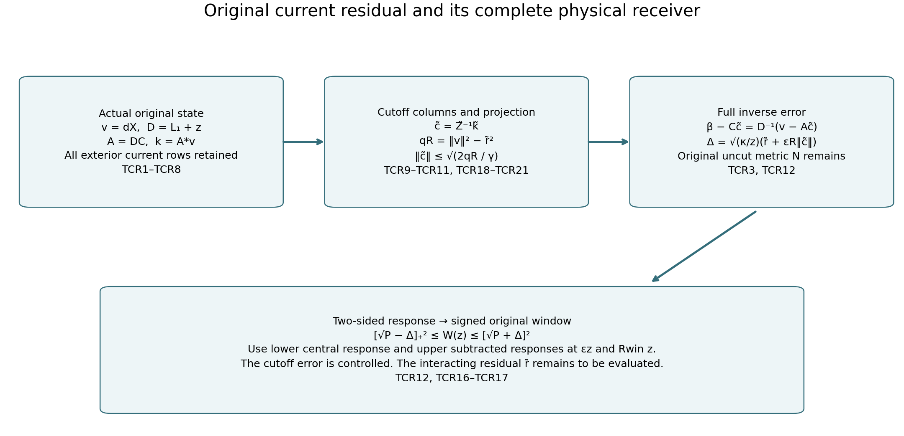

# Complete original-source residual and two-sided physical responses

Continuation after HSF1–HSF17. These exact finite-regulator calculations give upper as well as lower physical responses in terms of the complete current residual. They do not assign a value to the remaining least-squares defect. They retain the entire original current, actual state, outside rows, norms and three shifts.

Providers are [CTI1–CTI39](https://github.com/KokunoYumeto/yang-mills-interacting-workbench/blob/49fb910b4a77964cd611df7d0d6645f61ec2c5cf/yang-mills/continuations/20261011-central-signs-shrinking-window/CURRENT_TAILS_AND_RETAINED_SOURCE.md), [FTC21–FTC31](https://github.com/KokunoYumeto/yang-mills-interacting-workbench/blob/49fb910b4a77964cd611df7d0d6645f61ec2c5cf/yang-mills/continuations/20261011-central-signs-shrinking-window/ACTUAL_FILTERED_CURRENT_AND_TAIL.md) and [HSF1–HSF17](https://github.com/KokunoYumeto/yang-mills-interacting-workbench/blob/49fb910b4a77964cd611df7d0d6645f61ec2c5cf/yang-mills/continuations/20261011-central-signs-shrinking-window/ORIGINAL_SOURCE_HESSIAN_AND_FILTER.md). Read these full definitions, including the original finite cube and boundary counts in HSF16. The new source vector below is not the FTC overlap vector.

## Full current residual

At the same original regulator let \(X=F_j\) or \(X=h_{e_0,j}\), \(v=dX\), \(D_z=\mathscr L_1+zI\), \(z>0\), and \(E_X=\kappa_*\|v\|_\mu^2\). The full one-form operator obeys \(D_z\ge zI\). On any nonempty finite original edge set \(I\), retain
\[
\begin{gathered}
\alpha_e=a_j^2\Pi_edw_j,\quad
C_Ic=\sum_{e\in I}c_e\alpha_e,\quad A_z=D_zC_I,\\
\mathsf N=C_I^*C_I>0,\quad
\mathsf Z(z)=A_z^*A_z>0,\quad
k(z)=A_z^*v,\quad
\mathsf b=C_I^*v .
\end{gathered}\tag{TCR1}
\]
The coefficients are unscaled complex numbers. All forms are smooth and gauge invariant at this finite regulator. The \(\mathsf b\) of FTC26 is retained; \(k(z)\) is a different, explicitly defined source. Positivity follows from the independence proof in CTI20 and \(D_z\ge zI\).

For any such coefficient vector,
\[
\begin{gathered}
\alpha_c=C_Ic,\quad r_c=v-D_z\alpha_c,\\
\|r_c\|_\mu^2=\frac{E_X}{\kappa_*}
-2\operatorname{Re}(c^*k)+c^*\mathsf Zc,\\
c_{\rm res}=\mathsf Z^{-1}k,\quad
\|r_{c_{\rm res}}\|_\mu^2
=\frac{E_X}{\kappa_*}-k^*\mathsf Z^{-1}k\ge0 .
\end{gathered}\tag{TCR2}
\]
Expansion proves the second line. Completing its square gives the third, and its nonnegativity is also the squared norm of the orthogonal projection of \(v\) off \(\operatorname{ran}A_z\). This evaluates the optimal residual exactly in terms of the actual finite matrices; it makes no assertion that the residual is small.

The full inverse error, including any nonexact component of \(\alpha_c\), is exactly
\[
\beta_X(z)-\alpha_c=D_z^{-1}r_c,\qquad
\beta_X(z)=D_z^{-1}v,\qquad
\|\beta_X(z)-\alpha_c\|_\mu\le\frac{\|r_c\|_\mu}{z}.
\tag{TCR3}
\]
It follows by applying \(D_z^{-1}\) to the definition of \(r_c\). No physical projection residual has been set to zero. In particular put
\[
P_c(z)=z\kappa_*c^*\mathsf Nc,\qquad
\Delta_c(z)=\sqrt{\frac{\kappa_*}{z}}\,\|r_c\|_\mu .
\tag{TCR4}
\]
The ordinary and reverse triangle inequalities, together with the exact physical current representation HSF12, prove the two-sided bound
\[
[\sqrt{P_c(z)}-\Delta_c(z)]_+^2
\le\mathcal W_{X\psi_j}(z)
\le[\sqrt{P_c(z)}+\Delta_c(z)]^2 .
\tag{TCR5}
\]
This is an unconditional finite-regulator bound for each actual \(c\), including the computed \(c_{\rm res}\). The residual supplies the upper error that the FTC29 trial lower bound alone does not provide. It is the full residual on the original configuration space, not only a residual within the finite trial span.

## Original force and full source vector

Suppress \(j\) only in the finite identities and write \(\kappa=\kappa_*,a=a_j,w=\log\psi_j\), \(g_e=d_ew\), \(G_e=|g_e|^2\), and \(F_e=d_eV_{\rm pot}\). For the full source set \(u_p=f_p\); for the outside source set \(u_p=f_p\mathbf1_{\{p\not\ni e_0\}}\). The original formulas are
\[
\begin{gathered}
V_{\rm pot}=b_j\sum_pD_p=2b_j|\mathcal P_j|-b_j\sum_p\operatorname{Tr}U_p,\\
dX=a\sum_pu_p\,dD_p,\qquad
\Delta X=6a\sum_pu_p-3a\sum_pu_pD_p,\qquad
J_X=\sum_\ell g_\ell\cdot d_\ell X,\\
D_z\alpha_e=a^2(-\Pi_edV_{\rm pot}-\kappa\,dG_e+z\Pi_edw).
\end{gathered}\tag{TCR6}
\]
All \(dG_e\) derivatives, including every exterior row, remain. The full configuration Laplacian of an original four-link trace deficit is \(6-3D_p\), which proves the displayed \(\Delta X\) by linearity. The centering constant has zero derivative but is retained in \(X\).

The exact new source is therefore
\[
\begin{aligned}
k_e(z)
={}&a^2\{-\mu(F_e\cdot d_eX)
-\kappa\mu\langle dG_e,dX\rangle
+z\mu(g_e\cdot d_eX)\}\\
={}&-a^2\mu(F_e\cdot d_eX)
+\kappa a^2\mu\{G_e(\Delta X+2J_X)\}
+z\mathsf b_e,\\
\mathsf b_e={}&\frac{3a^3}{8}\sum_{p\ni e}u_p(\mu D_p-2).
\end{aligned}\tag{TCR7}
\]
Compact weighted integration gives
\(\mu\langle dG_e,dX\rangle=-\mu G_e(\Delta X+2J_X)\).
The final line is the same weighted integration and original incident Casimir as HSF11. Thus every term of \(k\) is an actual-state integral of the original force, score, source derivatives and deficit; it contains no unknown resolvent vector. It is not assigned the value of \(\mathsf b\).

For actual finite computations one may use the complete norm bound
\[
\|v\|_\mu^2=a^2\mu\sum_\ell
\left|\sum_{p\ni\ell}u_p\,d_\ell D_p\right|^2
\le16a^2M_f^2d_Q .
\tag{TCR8}
\]
Each edge meets at most four retained faces, each face has four edges, and
\(|d_\ell D_p|^2=D_p-D_p^2/4\le D_p\).
The equality preserves all distinct-face contractions before the inequality. The original \(d_Q,\Lambda_Q\) and finite counts are HSF16; \(d_Q\le\Lambda_Q\) may be substituted without changing those definitions.

## Current cutoff with the changed source pairing retained

Take CTI27's actual retained set \(I^+\), eventually nonempty, and its original \(\mathsf N\). Use the full CTI8 cutoff columns
\(\widetilde A c=\sum_{e\in I^+}c_e\mathbf1_{\{G_e\le R/(\kappa a)\}}D_z\alpha_e\)
as a column map on \(\mathbb C^{I^+}\). This is an \(L^2\) comparison; no derivative of the indicator is taken. Put
\[
\begin{gathered}
\widetilde Z=\widetilde A^*\widetilde A,\quad
\widetilde k=\widetilde A^*v,\quad
\epsilon_R=\mathcal B_t(z)e^{-tR/2},\\
\|A_z-\widetilde A\|_{\rm HS}\le\epsilon_R,\quad
\|k-\widetilde k\|\le\epsilon_R\|v\|_\mu,\\
\|\mathsf Z-\widetilde Z\|\le
\eta_R=(2\sqrt{\mathcal U_z}+\epsilon_R)\epsilon_R .
\end{gathered}\tag{TCR9}
\]
The constants \(\mathcal B_t,\mathcal U_z\), their full first-moment and deficit factors, and the unchanged parameter \(0<t<1/4\) are exactly CTI11, CTI34 and CTI38. This pairing is against the actual \(v\), not against \(D_z^{-1}v\). The source error follows directly from the adjoint of the same column difference.

At every regulator where \(I^+\ne\varnothing\), CTI31 proves
\[
\mathsf Z\ge\gamma I,\qquad
\gamma=z^2a^4\frac{9(8-\delta^{\rm sel})^2}{256\delta^{\rm sel}},
\quad\delta^{\rm sel}=a\log(1/a).
\tag{TCR10}
\]
Choose the explicit CTI36 cutoff so that \(\eta_R\le\gamma/2\), or use TCR14 below. Then \(\widetilde Z\ge\gamma I/2\). Its uniquely defined coefficients and full residual estimate are
\[
\begin{gathered}
\widetilde c=\widetilde Z^{-1}\widetilde k,\quad
\widetilde r^2=\|v\|_\mu^2-\widetilde k^*
\widetilde Z^{-1}\widetilde k\ge0,\\
\|v-A_z\widetilde c\|_\mu
\le\widetilde r+\epsilon_R\|\widetilde c\|,\qquad
\|\widetilde c\|\le
\frac{2(\sqrt{\mathcal U_z}+\epsilon_R)\|v\|_\mu}{\gamma}.
\end{gathered}\tag{TCR11}
\]
The first residual is the orthogonal least-squares residual for the cutoff columns. The second line applies the triangle inequality to
\(v-A_z\widetilde c=(v-\widetilde A\widetilde c)
-(A_z-\widetilde A)\widetilde c\).
The coefficient estimate uses the proved inverse bound and
\(\|\widetilde k\|\le\|\widetilde A\|\|v\|
\le(\sqrt{\mathcal U_z}+\epsilon_R)\|v\|\).
No sign is assigned to a Gram-matrix difference.

Use the original uncut trial form \(C_I\widetilde c\) and metric:
\[
\begin{gathered}
\widetilde P(z)=z\kappa\,\widetilde c^*\mathsf N\widetilde c,\\
\widetilde\Delta(z)=\sqrt{\kappa/z}
\{\widetilde r+\epsilon_R\|\widetilde c\|\},\\
L_X(z)=[\sqrt{\widetilde P(z)}-\widetilde\Delta(z)]_+^2,\quad
U_X(z)=[\sqrt{\widetilde P(z)}+\widetilde\Delta(z)]^2,\\
L_X(z)\le\mathcal W_{X\psi_j}(z)\le U_X(z).
\end{gathered}\tag{TCR12}
\]
TCR3–TCR5 prove this interval; the cutoff columns are not themselves used as domain elements of \(D_z\). If \(v=0\), use the exact zero response. For an early empty \(I^+\), use \(c=0\) on the full space, which gives \(0\le\mathcal W\le E_X/z\); no unavailable inverse is required.

The cutoff contribution to the amplitude error is explicitly
\[
\sqrt{\kappa/z}\,\epsilon_R\|\widetilde c\|
\le\frac{2\sqrt{\kappa/z}\,\epsilon_R
(\sqrt{\mathcal U_z}+\epsilon_R)\|v\|_\mu}{\gamma}.
\tag{TCR13}
\]
For any prescribed positive amplitude tolerance \(\zeta\), set, when \(v\ne0\),
\[
\begin{gathered}
e_*=\min\left\{1,\
\frac{\gamma}{2(2\sqrt{\mathcal U_z}+1)},\
\frac{\zeta\gamma\sqrt z}
{2\sqrt\kappa\,\|v\|_\mu(\sqrt{\mathcal U_z}+1)}\right\},\\
R_*=\frac2t\log\max\{1,\mathcal B_t(z)/e_*\}.
\end{gathered}\tag{TCR14}
\]
For \(R\ge R_*\), \(\epsilon_R\le e_*\le1\), so
\(\eta_R\le(2\sqrt{\mathcal U_z}+1)e_*\le\gamma/2\)
and TCR13 is at most \(\zeta\). This proves every required inverse and error from the actual finite state and constants; it is not an assumed matrix-conditioning estimate.

On the original path, for fixed \(\theta>0\) and \(z=\theta s_j\), CTI13's cutoff
\(R=(3+2\rho)\log(1/a_j)/t\) gives
\(\epsilon_R=O(a_j^\rho)\),
\(\mathcal U_z=O(a_j^{-2})\),
\(\gamma\) of order \(a_j^5/\log(1/a_j)\), and TCR8 gives \(\|v\|=O(1)\).
Thus the cutoff contribution in TCR13 is
\[
O\!\left(a_j^{\rho-13/2}\log(1/a_j)\right).
\tag{TCR15}
\]
For \(\rho>8\) it is \(o(a_j^{3/2})\), smaller than the amplitude scale of HSF13's lower response. The separate term \(\sqrt{\kappa/z}\,\widetilde r\) is still present and has not been bounded by this cutoff calculation.

## The complete signed physical-window bound

For the same original source \(X\), use TCR12 at all three original shifts, preserving each independently computed coefficient vector. With the original coefficients of HSF15,
\[
\begin{gathered}
c_\varepsilon=\frac{4\varepsilon}{(1+\varepsilon)^2},\qquad
c_{R_{\rm win}}=\frac{4R_{\rm win}}{(1+R_{\rm win})^2},\\
\mathcal C_X(z)=\mathcal W_X(z)
-c_\varepsilon\mathcal W_X(\varepsilon z)
-c_{R_{\rm win}}\mathcal W_X(R_{\rm win}z),\\
L_X(z)-c_\varepsilon U_X(\varepsilon z)
-c_{R_{\rm win}}U_X(R_{\rm win}z)
\le\mathcal C_X(z)\\
\le U_X(z)-c_\varepsilon L_X(\varepsilon z)
-c_{R_{\rm win}}L_X(R_{\rm win}z).
\end{gathered}\tag{TCR16}
\]
Every subtracted response is bounded with the correct sign. Directly on the requested full source \(F_j\), HSF15 yields
\[
\begin{aligned}
&\|1_{[\varepsilon s_j,R_{\rm win}s_j]}(H_j-E_{0,j})(F_j\psi_j)\|^2\\
&\quad\ge4[L_{F_j}(s_j)-c_\varepsilon U_{F_j}(\varepsilon s_j)
-c_{R_{\rm win}}U_{F_j}(R_{\rm win}s_j)]_+ .
\end{aligned}\tag{TCR17}
\]
There is no removed-source amplitude subtraction in this direct receiver. The actual finite least-squares defect in TCR11 includes the omitted trial directions and the full physical complement.

What would make this useful for the target, based on the preceding calculations? TCR14–TCR15 already control the column cutoff at the needed amplitude scale. The remaining actual calculation is \(\|v\|^2-\widetilde k^*\widetilde Z^{-1}\widetilde k\), together with the original \(\widetilde c^*\mathsf N\widetilde c\), at all three shifts. TCR7 specifies the force/score/source integrals that must be evaluated; the existing covariance bounds do not yet give their required signed cancellations. A value for that defect is not assumed. These exact formulas make a two-sided calculation possible without replacing it by a lower-bound subtraction.

## Stronger coefficient and cutoff bounds from the actual projection

The coefficient estimate in TCR11 does not use the orthogonality that defines its particular coefficient vector. Retain that earlier valid bound and prove the stronger one. Set
\[
q_R=\widetilde k^*\widetilde Z^{-1}\widetilde k
=\|\widetilde A\widetilde c\|_\mu^2
=\|v\|_\mu^2-\widetilde r^2 .
\tag{TCR18}
\]
The normal equation is \(\widetilde A^*(v-\widetilde A\widetilde c)=0\). Its inner product with \(\widetilde c\) gives orthogonality between \(\widetilde A\widetilde c\) and \(v-\widetilde A\widetilde c\). Pythagoras proves all equalities and \(0\le q_R\le\|v\|^2\). Hence TCR10 gives
\[
\begin{gathered}
\|\widetilde c\|\le\sqrt{\frac{2q_R}{\gamma}}
\le\sqrt{\frac2\gamma}\|v\|_\mu,\\
\sqrt{\kappa/z}\,\epsilon_R\|\widetilde c\|
\le\epsilon_R\sqrt{\frac{2\kappa q_R}{z\gamma}}
\le\epsilon_R\sqrt{\frac{2\kappa}{z\gamma}}\|v\|_\mu .
\end{gathered}\tag{TCR19}
\]
Indeed \((\gamma/2)\|\widetilde c\|^2\le\widetilde c^*\widetilde Z\widetilde c=q_R\). This removes the extra \(\sqrt{\mathcal U_z}/\sqrt\gamma\) loss without changing any coefficient, norm or matrix.

For a finite prescribed \(\zeta>0\) and \(v\ne0\), define
\[
\begin{gathered}
e_{\rm proj}=\min\left\{1,\
\frac{\gamma}{2(2\sqrt{\mathcal U_z}+1)},\
\frac{\zeta}{\|v\|_\mu}\sqrt{\frac{z\gamma}{2\kappa}}
\right\},\\
R_{\rm proj}=\frac2t\log\max\{1,\mathcal B_t(z)/e_{\rm proj}\}.
\end{gathered}\tag{TCR20}
\]
For \(R\ge R_{\rm proj}\), TCR9 gives \(\eta_R\le\gamma/2\), and TCR19 is at most \(\zeta\). Thus this choice proves both invertibility and the amplitude tolerance; no unknown \(q_R\) is needed to choose the cutoff.

For the original \(z=\theta s_j\), the quantitative lower singular value gives a better asymptotic choice than using the coarse Gram perturbation. From \(\mathsf Z\ge\gamma I\) and \(\|A_z-\widetilde A\|\le\epsilon_R\), directly
\[
\begin{gathered}
\|\widetilde A c\|_\mu\ge(\sqrt\gamma-\epsilon_R)\|c\|,\\
\epsilon_R\le(1-1/\sqrt2)\sqrt\gamma
\quad\Longrightarrow\quad \widetilde Z\ge(\gamma/2)I,\\
\epsilon_R\sqrt{\frac{2\kappa}{z\gamma}}\|v\|_\mu
=O\!\left(a_j^{\rho-3}\sqrt{\log(1/a_j)}\right).
\end{gathered}\tag{TCR21}
\]
The first line is the reverse triangle inequality. CTI13 gives \(\epsilon_R=O(a_j^\rho)\), while TCR10 gives \(\gamma\) of order \(a_j^5/\log(1/a_j)\). Therefore every \(\rho>9/2\) makes the last line \(o(a_j^{3/2})\) and also satisfies the displayed singular-value requirement eventually. Using only the coarse Gram estimate would require \(\rho>6\) to justify invertibility; that extra restriction is unnecessary after this direct argument. All finite-regulator choices remain available: replace the middle entry of \(e_{\rm proj}\) by \((1-1/\sqrt2)\sqrt\gamma\) to obtain a valid finite singular-value-based cutoff by the identical exponential calculation.

These strengthenings change only the controlled cutoff contribution. The actual least-squares residual \(\widetilde r\), and its factor \(\sqrt{\kappa/z}\), remain in TCR12. In particular no conclusion about the sign of TCR17 is inferred from TCR21.

Reproducible diagnostics: [current residual](check_current_residual.py), [stereographic calculation and figures](check_stereographic_current.py). Full [source-use record](CURRENT_RESIDUAL_SOURCE_USE_LEDGER.json).

## Actual stereographic source receiver

[SC23–SC24](https://github.com/KokunoYumeto/yang-mills-interacting-workbench/blob/main/yang-mills/continuations/20261011-central-signs-shrinking-window/STEREOGRAPHIC_CURRENT_AND_CUBIC.md) extend the complete current calculation to weighted gauge averages and original staple-loop force contractions. They keep every exterior score row and the mixed moment \(\mu(G_eJ_X)\) in the actual source vector. This does not assign a value to the complete least-squares defect.
