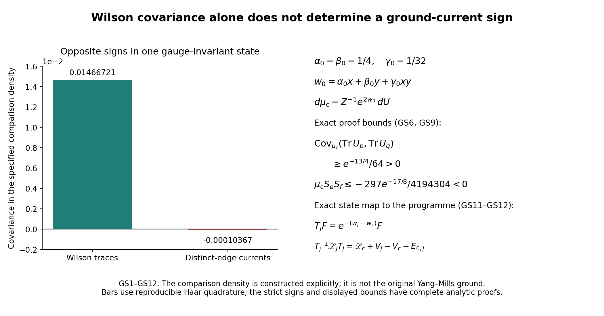

# Wilson covariance and ground-current covariance have different signs

The actual derivative formulas [RD6–RD13](https://github.com/KokunoYumeto/yang-mills-interacting-workbench/blob/main/yang-mills/continuations/20261011-central-signs-shrinking-window/RETAINED_DERIVATIVE_AND_GOOD_BOUNDARIES.md) involve ground-current entries, not only Wilson-loop covariance. This note proves a concrete gauge-invariant comparison on the same original link manifold: a pair of Wilson traces has strictly positive covariance while the corresponding edge currents have strictly negative covariance. It then gives the exact unitary, potential and current maps back to the original Yang–Mills ground. The comparison is not substituted for that ground.

For source context, Abdelmalek Abdesselam's [arXiv:2207.07603v2](https://arxiv.org/abs/2207.07603v2), Section 1, defines correlation inequalities for specified monomials in specified basic observables. The original TeX, lines 35–224, was read; no general ground-current sign is imported from that setting. Ilya Chevyrev and Christophe Garban's [arXiv:2404.09928v2](https://arxiv.org/abs/2404.09928v2), Corollary \(\texttt{c.monotone}\), states Wilson-loop monotonicity for \(G=U(1)\); its statement and proof were read in original TeX, lines 602–645 and 1051–1076. The group and observable restrictions remain part of those source statements. The calculation below supplies its own complete comparison and does not assert a new correlation inequality for the actual Yang–Mills ground.

## 1. Two exact original holonomies

Fix any original regulator \(j\ge2\). In the original open cube choose the orientation-\((1,2)\) plaquettes based at
\(z=(L_j,L_j,L_j)\) and \(z+3e_1\). Their eight links are distinct and remain inside the lattice. Keep their original ordered products and the scalar half-traces
\[
\begin{gathered}
U_p=U_1(z)U_2(z+e_1)U_1(z+e_2)^{-1}U_2(z)^{-1},\\
U_q=U_1(z+3e_1)U_2(z+4e_1)
U_1(z+3e_1+e_2)^{-1}U_2(z+3e_1)^{-1},\\
x=\tfrac12\operatorname{Tr}U_p,\qquad
y=\tfrac12\operatorname{Tr}U_q,\qquad -1\le x,y\le1 .
\end{gathered}\tag{GS1}
\]
Both traces are invariant under every original vertex gauge transformation. Haar invariance, integrating any one edge of each word first, proves that \(U_p,U_q\) have independent Haar laws under the original product Haar measure. This does not factor the physical Hilbert space or fix a gauge.

With the original radius-two metric and \(T_\beta=-i\sigma_\beta/2\), for an edge \(e\in\partial p\) and \(f\in\partial q\),
\[
\begin{gathered}
\Delta_ex=-\tfrac34x,\qquad
|\nabla_ex|^2=\tfrac14(1-x^2),\qquad
\Delta_fy=-\tfrac34y,\qquad
|\nabla_fy|^2=\tfrac14(1-y^2),\\
\Delta x=-3x,\quad|\nabla x|^2=1-x^2,\qquad
\Delta y=-3y,\quad|\nabla y|^2=1-y^2,\qquad
\langle\nabla x,\nabla y\rangle=0.
\end{gathered}\tag{GS2}
\]
To check the constants, write a Haar group element as \(u_0I+i\sum_{\beta=1}^3u_\beta\sigma_\beta\), with \(\sum_{\beta=0}^3u_\beta^2=1\). Each coordinate on the radius-two sphere has Laplacian \(-3u_\beta/4\) and gradient norm squared \((1-u_\beta^2)/4\), obtained by projecting its ambient gradient onto the tangent plane and applying the radius-two metric. Left or right multiplication, inversion and cyclic permutation of the other factors of the face word preserve this metric. Summing the four identical edge contributions gives the second line. The final equality uses the disjoint edge supports.

## 2. A positive gauge-invariant comparison density

Keep the following constants explicitly:
\[
\begin{gathered}
\alpha_0=\beta_0=\tfrac14,\quad \gamma_0=\tfrac1{32},\quad
w_0=\alpha_0x+\beta_0y+\gamma_0xy,\\
Z=\int e^{2w_0}\,dU,\qquad
\psi_{\rm c}=Z^{-1/2}e^{w_0},\qquad
d\mu_{\rm c}=Z^{-1}e^{2w_0}dU,\qquad
w_{\rm c}=\log\psi_{\rm c}=w_0-\tfrac12\log Z .
\end{gathered}\tag{GS3}
\]
Every partition factor remains in the density. The comparison is smooth, strictly positive and invariant under the full original gauge group. Its logarithmic derivatives equal those of \(w_0\), because \(Z\) is a configuration-independent scalar, not because that scalar was removed from the state.

For any two distinct original edge factors and any smooth positive density \(\psi^2dU\), its currents \(S_e=\Delta_ew+2|\nabla_ew|^2\) obey
\[
\mu S_e=0,\qquad
\mu S_eS_f=
\mu\|H_{ef}\|_{\rm HS}^2
-2\mu H_{ef}(g_e,g_f),\qquad e\ne f .
\tag{GS4}
\]
Here is a direct proof. Weighted divergence integration in \(e\) gives
\(\mu S_eS_f=-\mu\langle g_e,\nabla_eS_f\rangle\).
Different-factor scalar derivatives commute, so
\(\nabla_eS_f=\Delta_fg_e+4H_{ef}g_f\).
Integration by parts in \(f\), retaining the derivative \(2g_f\) of the weight, gives
\(-\mu\langle g_e,\Delta_fg_e\rangle=
\mu\|H_{ef}\|^2+2\mu H_{ef}(g_e,g_f)\).
Subtract the remaining fourfold term to obtain (GS4). The first identity is the integral of the weighted divergence of \(g_e\). Different-factor curvature is zero on this product; no same-factor Ricci contribution is being omitted.

For the specified \(e,f\) in (GS2), put
\(G_x=(1-x^2)/4,\ G_y=(1-y^2)/4\).
The comparison derivatives give
\[
\begin{gathered}
g_{{\rm c},e}=(\alpha_0+\gamma_0y)\nabla_ex,\qquad
g_{{\rm c},f}=(\beta_0+\gamma_0x)\nabla_fy,\qquad
H_{{\rm c},ef}=\gamma_0\,\nabla_ex\otimes\nabla_fy,\\
\mu_{\rm c}S_{{\rm c},e}S_{{\rm c},f}
=\mu_{\rm c}\!\left[
G_xG_y\{\gamma_0^2
-2\gamma_0(\alpha_0+\gamma_0y)(\beta_0+\gamma_0x)\}\right]\\
\le-\frac{33}{16384}\mu_{\rm c}(G_xG_y)<0 .
\end{gathered}\tag{GS5}
\]
Indeed each parenthesis is at least \(1/4-1/32=7/32\). Hence its coefficient is at most
\(1/1024-(1/16)(49/1024)=-33/16384\).
The remaining factor \(G_xG_y\) is strictly positive off the Haar-null endpoint sets, and the density has full support.

This also gives an entirely explicit negative bound:
\[
\begin{gathered}
|w_0|\le17/32,\quad
e^{-17/16}\le Z\le e^{17/16},\\
\mu_{\rm c}(G_xG_y)\ge
Z^{-1}e^{-17/16}\frac9{256}
\ge e^{-17/8}\frac9{256},\\
\mu_{\rm c}S_{{\rm c},e}S_{{\rm c},f}
\le-\frac{297}{4194304}e^{-17/8}<0 .
\end{gathered}\tag{GS6}
\]
To verify the Haar factor, symmetry of the four sphere coordinates gives
\(\int x^2dU_p=1/4\), so \(\int G_xdU_p=3/16\).
The two holonomies are independent under Haar, giving \(9/256\).
The inequalities for \(Z\) are obtained by integrating the full exponential bounds; they do not replace \(Z\) in (GS3).

## 3. The same density has positive Wilson covariance

Conditional on \(x\), the law of \(y\) is its original Haar-coordinate law multiplied by
\[
\frac{\exp[2(\beta_0+\gamma_0x)y]}
{\int\exp[2(\beta_0+\gamma_0x)t]\,d\nu_H(t)} .
\tag{GS7}
\]
Let \(m_y(x)\) denote its mean. Differentiating the complete numerator and denominator gives
\[
m_y'(x)=2\gamma_0\operatorname{Var}_{\mu_{\rm c}}(y\mid x)
\ge\frac1{64}e^{-9/8}>0 .
\tag{GS8}
\]
Here \(|\beta_0+\gamma_0x|\le9/32\), so the conditional density relative to \(\nu_H\) is at least \(e^{-9/8}\). For every real \(c\),
its integral of \((y-c)^2\) is at least
\(e^{-9/8}\int(y-c)^2d\nu_H\).
Taking the infimum over \(c\) gives conditional variance at least \(e^{-9/8}/4\). This proves the bound with \(2\gamma_0=1/16\).

Let \(X,X'\) be independent variables with the actual comparison marginal of \(x\). Full support and (GS8) give
\[
\begin{gathered}
\operatorname{Cov}_{\mu_{\rm c}}(x,y)
=\tfrac12\mathbb E[(X-X')(m_y(X)-m_y(X'))]\\
\ge\frac1{64}e^{-9/8}\operatorname{Var}_{\mu_{\rm c}}x
\ge\frac1{256}e^{-13/4}>0,\\
\operatorname{Cov}_{\mu_{\rm c}}
(\operatorname{Tr}U_p,\operatorname{Tr}U_q)
=4\operatorname{Cov}_{\mu_{\rm c}}(x,y)
\ge\frac1{64}e^{-13/4}>0 .
\end{gathered}\tag{GS9}
\]
The first equality is the independent-copy covariance identity, expanded term by term. The final variance bound follows from the full density lower bound \(e^{-17/8}\) and the same infimum-over-constants argument against Haar. Thus positive covariance of these exact Wilson observables and negative covariance of the specified exact ground currents coexist in one fully specified gauge-invariant state.

## 4. Its exact Hamiltonian and map to the programme ground

The comparison density is the unique positive ground of the following complete operator on the same original full link product:
\[
\begin{gathered}
V_{\rm c}=\kappa_*\big[
-3\alpha_0x-3\beta_0y-6\gamma_0xy
+(\alpha_0+\gamma_0y)^2(1-x^2)
+(\beta_0+\gamma_0x)^2(1-y^2)\big],\\
H_{\rm c}=-\kappa_*\Delta+V_{\rm c},\qquad
H_{\rm c}\psi_{\rm c}=0,\qquad
\mathscr L_{\rm c}=\psi_{\rm c}^{-1}H_{\rm c}\psi_{\rm c}
=-\kappa_*(\Delta+2\nabla w_{\rm c}\cdot\nabla).
\end{gathered}\tag{GS10}
\]
This potential is exactly \(\kappa_*(\Delta w_{\rm c}+|\nabla w_{\rm c}|^2)\), using every term of (GS2). For a smooth function \(F\), integration by parts gives
\(\langle\psi_{\rm c}F,H_{\rm c}\psi_{\rm c}F\rangle
=\kappa_*\mu_{\rm c}|\nabla F|^2\).
It follows that \(H_{\rm c}\ge0\), its displayed ground energy is zero, and its ground space is one-dimensional: a zero form value forces \(F\) to be constant on the connected full link product. The same ground is gauge invariant. This constructs the comparison Hamiltonian; it is not identified with the original Wilson potential \(V_j=b_j\sum_p(2-\operatorname{Tr}U_p)\).

The exact connection to that original Hamiltonian retains its full potential and vacuum energy. Define
\[
\begin{gathered}
r_j=w_j-w_{\rm c},\qquad
T_j:L^2(\mu_{\rm c})\longrightarrow L^2(\mu_j),\quad
T_jF=e^{-r_j}F,\\
U_jF=\psi_jF,\quad U_{\rm c}F=\psi_{\rm c}F,\qquad
U_jT_j=U_{\rm c},\\
T_j^{-1}\mathscr L_jT_j
=\mathscr L_{\rm c}+V_j-V_{\rm c}-E_{0,j},\qquad
\mathscr L_j=\psi_j^{-1}(H_j-E_{0,j})\psi_j .
\end{gathered}\tag{GS11}
\]
All densities are strictly positive and smooth on the same compact finite manifold, so multiplication by each displayed ratio preserves the relevant \(H^2\) domains. The norm identity
\(\int|e^{-r_j}F|^2\psi_j^2dU=\int|F|^2\psi_{\rm c}^2dU\)
proves unitarity, with inverse multiplication by \(e^{r_j}\).
Conjugate \(H_j-E_{0,j}=H_{\rm c}+V_j-V_{\rm c}-E_{0,j}\) by the displayed ground transformations to prove the operator identity. The ratios are gauge invariant, so the map restricts to the original invariant scalar spaces. It commutes with every common multiplication observable.

Its state and current transformations are fully explicit:
\[
\begin{gathered}
T_j^{-1}1=e^{r_j},\qquad
d\mu_j=e^{2r_j}d\mu_{\rm c},\qquad
\mu_{\rm c}e^{2r_j}=1,\\
\kappa_*\{\Delta r_j+
2\langle\nabla w_{\rm c},\nabla r_j\rangle+
|\nabla r_j|^2\}=V_j-V_{\rm c}-E_{0,j},\\
B_{e,j}=\Delta_er_j+
4\langle\nabla_ew_{\rm c},\nabla_er_j\rangle+
2|\nabla_er_j|^2,\qquad S_{e,j}=S_{{\rm c},e}+B_{e,j},\\
\mu_j(S_{e,j}S_{f,j})
=\mu_{\rm c}\!\left[e^{2r_j}
(S_{{\rm c},e}+B_{e,j})(S_{{\rm c},f}+B_{f,j})\right].
\end{gathered}\tag{GS12}
\]
The logarithmic equation is the difference of the two complete ground equations. Expanding each current then proves its transformation and the last line. Every ratio, derivative contribution, original coupling, scalar potential and vacuum energy remains in the comparison. Thus (GS5) does not assign a sign to the programme entry: its exact remaining terms are specified by (GS11)–(GS12).

This calculation rules out the proposed inference from positivity of Wilson covariance alone to entrywise positivity of ground-current covariance. It does not rule out a further sign result using the specific original Yang–Mills potential. The actual programme continues with the signed RD6–RD13 contractions, the good-boundary evaluation RD16–RD19, and the full CG28 conditional spectral multiplier. Those quantities retain their original state and Hamiltonian.

Complete reproducible diagnostics and figure sources are in [check_retained_derivative.py](check_retained_derivative.py). The curved manufactured densities and the displayed comparison are not samples of the original Yang–Mills ground. Original source versions and bounded reading coverage are recorded in [the source-use ledger](RETAINED_DERIVATIVE_SOURCE_USE_LEDGER.json).
