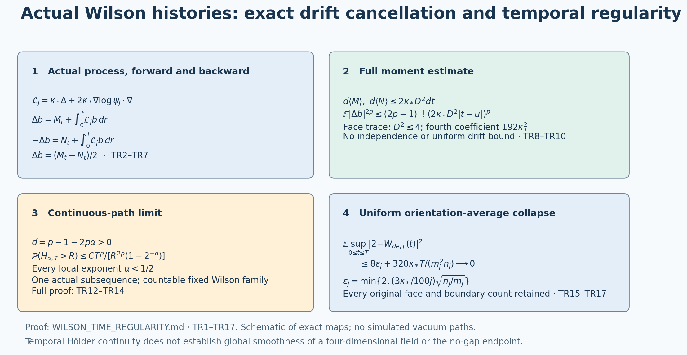

# Continuous time histories of the actual Wilson observables

This note strengthens ASL38 from mean-square continuity to a continuous version with every local Hölder exponent below one half, for each specified countable family of fixed finite Wilson words. It uses the actual finite-volume ground-state process, with the original metric, full drift and coupling. The original growing physical loops and raw phase retain their full gradient constants; no uniform estimate for them is inferred.

The provider is [ASL1–ASL66](ACTUAL_SEMIGROUP_LIMIT.md), especially ASL3–ASL4, ASL23–ASL29, ASL33–ASL38 and ASL46–ASL66. The forward/backward identity is the symmetric Lyons–Zheng mechanism. The original author TeX of Masayoshi Takeda and Gerald Trutnau, [arXiv:1007.3900v1](https://arxiv.org/abs/1007.3900v1), Section 2, equation (1) and Remark (i), was read at source lines 228–263. Its general nonsymmetric theorem is not imported. The identity required here is derived below for the actual smooth compact diffusion. Their bibliography identifies T. J. Lyons and W. Zheng, *A crossing estimate for the canonical process on a Dirichlet space and a tightness result*, Astérisque 157–158 (1988), 249–271; that historical reference has not been read here. This is an application and complete specialized calculation, with no novelty claim.

## 1. The original reversible process

Retain the path and all finite-volume objects:
\[
\begin{gathered}
 L_j=j^4,\quad m_j=2j^4,\quad n_j=2j^4+1,\quad
 a_j=(100j)^{-1},\quad g_j^2=\kappa_*/(200j),\\
 \xi_j=10000j^2/\kappa_*^2,\quad s_j=\kappa_*/j,\quad
 N_j=3m_jn_j^2,\quad M_j=3m_j^2n_j,\\
 H_j=\kappa_*K_j+\kappa_*\xi_j\sum_p(2-W_p),\qquad
 K_j=-\sum_{e,\alpha}X_{e,\alpha}^2,\\
 H_j\psi_j=E_j^{\rm vac}\psi_j,\quad \psi_j>0,\quad
 \|\psi_j\|_{L^2(dU_j)}=1,\quad A_j=H_j-E_j^{\rm vac}I,
 \quad d\mu_j=\psi_j^2dU_j.
\end{gathered}\tag{TR1}
\]
The configuration space is the full compact product of one radius-two SU(2) per positive edge of the open box, including every boundary edge. Haar measure is probability measure. The fields use exactly \(T_\alpha=-i\sigma_\alpha/2\). The actual Markov generator, obtained by the complete product rule and the vacuum equation, is
\[
 \mathcal L_j f=-\psi_j^{-1}A_j(\psi_j f)
 =\kappa_*\sum_{e,\alpha}X_{e,\alpha}^2f
   +2\kappa_*\sum_{e,\alpha}(X_{e,\alpha}\log\psi_j)X_{e,\alpha}f.
 \tag{TR2}
\]
Both the potential scalar and the vacuum energy in (TR1) cancel by that equation. The full nonconstant logarithmic drift in (TR2) remains.

At each finite j this smooth generator is realized by the Stratonovich equation with diffusion fields \(\sqrt{2\kappa_*}X_{e,\alpha}\) and drift \(2\kappa_*\sum(X_{e,\alpha}\log\psi_j)X_{e,\alpha}\). Smooth coefficients on the compact product give a global continuous diffusion: solve the usual local Lipschitz stochastic equations in charts up to exit, concatenate the solutions on the finite chart cover, and use compactness and bounded coefficients to exclude finite lifetime. This uses the foundational existence and uniqueness theorem for finite-dimensional smooth stochastic differential equations and Itô's formula. No uniform drift bound as j grows is used. Its generator agrees with (TR2); uniqueness of the smooth parabolic problem on the compact product identifies its semigroup with \(S_j(t)f=\psi_j^{-1}e^{-tA_j}(\psi_jf)\).

For smooth real f,g, integration by parts gives the exact identity
\[
 \int f\mathcal L_jg\,d\mu_j
 =-\kappa_*\int\sum_{e,\alpha}(X_{e,\alpha}f)(X_{e,\alpha}g)\,d\mu_j.
 \tag{TR3}
\]
The divergence contribution from differentiating \(\psi_j^2\) cancels precisely the drift in (TR2). Thus \(\mu_j\) is invariant and the Markov semigroup is self-adjoint in \(L^2(\mu_j)\). Start the diffusion \(U_j(t)\) in \(\mu_j\). Its stationary finite-time laws are invariant under time reversal: write their integrals as alternating multiplication and semigroup operators, take the adjoint, and use the real symmetric transition kernels. This proves the reversal property used below, rather than substituting Haar measure for the vacuum. Gauge-invariant observables have exactly the physical correlations of ASL33.

## 2. Exact cancellation of the two drift integrals

Fix j, a real smooth gauge-invariant observable b, and a time interval [0,T]. Retain
\[
 D^2=\sup_U\sum_{e,\alpha}|X_{e,\alpha}b(U)|^2,
 \qquad c=2\kappa_*D^2.
 \tag{TR4}
\]
Itô's formula gives the forward martingale
\[
 M_t=b(U_j(t))-b(U_j(0))-\int_0^t\mathcal L_jb(U_j(r))\,dr,
 \quad
 \langle M\rangle_t=2\kappa_*\int_0^t|\nabla b(U_j(r))|^2dr\le ct.
 \tag{TR5}
\]
The reversed stationary path \(\widehat U_j(r)=U_j(T-r)\) has the same generator and law. In its own forward filtration its martingale is
\[
 N_r=b(U_j(T-r))-b(U_j(T))
       -\int_0^r\mathcal L_jb(U_j(T-v))\,dv,
 \qquad d\langle N\rangle_r\le c\,dr.
 \tag{TR6}
\]
The variables M and N need not be independent or adapted to a common forward filtration. No such property is used. Subtracting (TR6) at T and T-t, with the exact substitution r=T-v in its integral, gives
\[
 N_T-N_{T-t}=b(U_j(0))-b(U_j(t))-\int_0^t\mathcal L_jb(U_j(r))\,dr.
\]
Consequently every original drift contribution cancels in the exact identity
\[
 b(U_j(t))-b(U_j(0))
   =\tfrac12 M_t-\tfrac12(N_T-N_{T-t}),\qquad 0\le t\le T.
 \tag{TR7}
\]
This is the required map from the full drift process to two martingale increments. For an estimate at the endpoint of any interval of length h, use that interval as the reversal horizon: its increment is exactly \((M_h-N_h)/2\).

## 3. All even moments with explicit constants

For a real continuous martingale starting at zero and satisfying \(d\langle M\rangle_t\le c\,dt\), Itô's formula for its even powers yields, for every integer p at least one,
\[
 \mathbb E|M_h|^{2p}\le (2p-1)!!\,c^p h^p.
 \tag{TR8}
\]
Here \((2p-1)!!=1\cdot3\cdots(2p-1)\), with the empty product one. To justify expectations, first stop at \(|M|=R\). The martingale integral then has zero mean. For p=1 the assertion follows from the bracket. Inductively,
\[
 \mathbb E M_{h\wedge\tau_R}^{2p}
 \le p(2p-1)c\int_0^h
      \mathbb E\bigl[\mathbf1_{r<\tau_R}M_r^{2p-2}\bigr]dr
 \le (2p-1)(2p-3)!!\,c^ph^p.
\]
The stopped lower moment is bounded by its inductive estimate; the indicator only decreases its nonnegative integrand. Fatou as R tends to infinity proves (TR8). Finite moments for the unstopped formula can then be obtained by the same localization. Stationarity, (TR7) with horizon h, and convexity of the even power now prove
\[
 \boxed{\quad
 \mathbb E|b(U_j(t))-b(U_j(u))|^{2p}
 \le (2p-1)!!(2\kappa_*D^2)^p|t-u|^p.
 \quad}\tag{TR9}
\]
Indeed \(|(x-y)/2|^{2p}\le(|x|^{2p}+|y|^{2p})/2\). Apply (TR8) to the two martingales separately; their dependence creates no omitted covariance assumption.

For an elementary face trace, ASL26 proves \(D^2\le4\) by differentiating its four distinct original oriented edges. Thus
\[
 \mathbb E|W_{p_j}(U_j(t))-W_{p_j}(U_j(u))|^{2p}
 \le (2p-1)!!(8\kappa_*)^p|t-u|^p.
 \tag{TR10}
\]
For p=1 this is the original ASL38 coefficient. For p=2 its coefficient is exactly \(192\kappa_*^2\). For a product of k face traces, including all repetitions and overlap derivatives, ASL28 gives \(D\le k2^k\); insert \(D^2\le k^24^k\) in (TR9). A real polynomial combination uses the sum of its absolute coefficients times the corresponding gradient bounds. Real and imaginary parts give the corresponding result for complex polynomial observables, without deleting cross terms from their definitions.

For a complete growing original loop, keep \(\nu_j=\sum_e m_{e,j}^2\) with its actual occurrence multiplicities. ASL40 gives \(D_j^2\le\nu_j\), so its proved coefficient is
\[
 (2p-1)!!(2\kappa_*\nu_j)^p.
 \tag{TR11}
\]
For the physical rectangles of ASL43, \(\nu_j/j\to200(r+s)\); this bound is not uniform. The raw phase keeps its full gradient and all beta and row factors as well. Neither observable is silently replaced by a divided or truncated version in (TR9).

## 4. Continuous versions and convergence on path space

Take the actual limiting history state and a specified countable real Wilson family from ASL33–ASL38 and ASL64–ASL66. Every coordinate is bounded and its original moment difference is a polynomial of two time coordinates. Therefore its common limiting finite-dimensional laws satisfy exactly (TR9), with the same finite constant C for that coordinate and p:
\[
 \mathbb E|X(t)-X(u)|^{2p}\le C|t-u|^p,
 \quad C=(2p-1)!!(2\kappa_*D^2)^p.
 \tag{TR12}
\]
Here is a direct continuity proof that retains constants. Fix T>0 and \(0<\alpha<(p-1)/(2p)\). On the dyadic times \(t_{n,k}=kT2^{-n}\), put
\[
 H_{\alpha,T}=\sup_{n\ge0,\,0\le k<2^n}
  2^{n\alpha}|X(t_{n,k+1})-X(t_{n,k})|,\quad
 d=p-1-2p\alpha>0.
\]
The union bound and (TR12), with every one of the \(2^n\) edges retained, give
\[
 \mathbb P(H_{\alpha,T}>R)
 \le\frac{CT^p}{R^{2p}(1-2^{-d})},\qquad R>0.
 \tag{TR13}
\]
Thus H is finite almost surely. For two dyadic times at separation at most \(T2^{-n}\), approximate both from below by level-n grid points. The grid points are equal or adjacent; their increment is at most \(H2^{-n\alpha}\). Each finer chain contributes at most \(H\sum_{k>n}2^{-k\alpha}\). Choose n with \(T2^{-n-1}<|t-u|\le T2^{-n}\). Summing the two chains proves the explicit bound
\[
 |X(t)-X(u)|\le C_\alpha H_{\alpha,T}
       (|t-u|/T)^\alpha,\qquad
 C_\alpha=\frac{2^{\alpha+1}}{1-2^{-\alpha}}.
 \tag{TR14}
\]
The displayed constant bounds \(2^\alpha[1+2/(2^\alpha-1)]\); it is not an asserted sharp constant. The dyadic function therefore has a unique continuous extension. For any fixed real t, dyadic approximants converge to the original X(t) in probability by (TR12), so the extension agrees almost surely with X(t). This proves a modification preserving all finite-dimensional distributions. Apply the argument to integer bounded time intervals, a countable sequence of exponents increasing to one half with p chosen sufficiently large, and the countably many chosen coordinates. Their common probability-one intersection gives simultaneous locally Hölder paths for every exponent strictly below one half. The extensions agree on overlapping intervals by agreement on the rational times.

The same constants apply before taking the limit. For each coordinate on each compact time interval, (TR13)–(TR14), together with its uniform value bound, provide compact sets of continuous paths carrying uniformly high probability by Arzelà–Ascoli. For countably many coordinates and time intervals, choose the individual error budgets with summable total. Their product compact set gives tightness on the countable product of continuous path spaces with uniform convergence on compact time intervals. The usual tightness theorem for probability measures on complete separable metric spaces yields subsequential weak limits. Evaluation at any finite set of times is continuous there, and ASL64–ASL66 already identify all such finite-time laws on one ordinary subsequence. Rational-time cylinder sets generate this path-space Borel algebra, so two weak limits with those laws coincide. Hence the entire selected ASL subsequence converges weakly on this path space, rather than only at individual times.

Original polynomial trace relations hold at each finite set of rational times, pass to the limiting laws, and then hold at all times for the continuous versions. Reflection positivity is unchanged because the finite-time correlations are unchanged. This proves temporal continuity for the stated observable family. It supplies no spatial derivative, differentiability in time, local four-dimensional field, or identification of the intended interacting theory.

## 5. Orientation-average collapse on whole time intervals

Retain the exact original orientation average and its ASL constants:
\[
 \overline W_{de,j}=(K_j^0)^{-1}\sum_{p:\operatorname{type}p=de}W_p,
 \quad K_j^0=m_j^2n_j,\qquad
 \epsilon_j=\min\{2,(3\kappa_*/100j)\sqrt{n_j/m_j}\},
\]
\[
 \mathbb E(2-\overline W_{de,j}(U_j(0)))^2\le4\epsilon_j,
 \quad D_j^2\le\frac{4m_jn_j(2m_j-1)}{(K_j^0)^2}\le\frac8{K_j^0}.
 \tag{TR15}
\]
The forward/backward identity also controls the maximum over the whole interval. With \(M_*\) and \(N_*\) the absolute suprema on [0,T], (TR7) gives
\(\sup_t|b(U_j(t))-b(U_j(0))|\le M_*/2+N_*\).
The L² martingale maximal inequality and (TR5)–(TR6) give \(\mathbb EM_*^2,\mathbb EN_*^2\le4cT\). To recall that inequality, the stopping-time bound \(\lambda\mathbb P(M_*>\lambda)\le\mathbb E[|M_T|\mathbf1_{M_*>\lambda}]\), after division by \(\lambda\) and integration against \(2\lambda\,d\lambda\), gives \(\mathbb EM_*^2\le2\mathbb E|M_T|M_*\); Cauchy–Schwarz proves the coefficient four, with localization if needed. Therefore
\[
 \mathbb E\sup_{0\le t\le T}|b(U_j(t))-b(U_j(0))|^2
 \le 2\mathbb E(M_*^2/4+N_*^2)
 \le10cT=20\kappa_*D^2T.
 \tag{TR16}
\]
All three terms of the backward increment remain in this estimate. Combining it with (TR15) proves
\[
 \boxed{\quad
 \mathbb E\sup_{0\le t\le T}|2-\overline W_{de,j}(U_j(t))|^2
 \le8\epsilon_j+40\kappa_*D_j^2T
 \le8\epsilon_j+\frac{320\kappa_*T}{m_j^2n_j}
 \longrightarrow0.\quad}\tag{TR17}
\]
Thus the three original orientation-average histories converge to the constant 2 uniformly in time in probability, and in the displayed squared maximum mean, on every bounded interval. This strengthens ASL52's scalar action and finite-time correlations. No equality of individual-face expectations or collapse of growing-loop histories is asserted. The nonconstant quantities still requiring actual calculation are their spatially resolved and raw-phase correlations and spectral weights, as retained in ASL39–ASL45 and ASL53–ASL63.

The figure shows the proved maps (TR2), (TR7), (TR9), (TR13)–(TR14) and (TR17). It depicts no simulated vacuum trajectories. Its reproducible source is draw_wilson_time.py; the complete proof and original human-source coverage accompany it.

## Stronger estimates for the same original histories

The complete independent derivation [R1–R29](WILSON_TIME_REVIEW.md) strengthens TR12, TR16 and TR17 while retaining all of their original valid bounds. With the same original (c=2\kappa_*D^2), time horizon (T), and actual orientation defect (Y_{de,j}=2-\overline W_{de,j}), it proves
\[
\mathbb E\sup_{0\le t\le T}|b(U_t)-b(U_0)|^2\le\frac{25}{4}cT,
\qquad
\limsup_j j^2\mathbb E\sup_{0\le t\le T}Y_{de,j}(t)^2
\le\frac{27\kappa_*^2}{10000}.
\]
The first follows from the exact reversal identity and the separate terminal backward-martingale term, as proved in R9. The second follows from the full actual curvature-moment recurrence R21–R25 and the maximum estimate R26–R27. R8 and R17–R18 give the stronger logarithmic time modulus. R29 gives summable tails and the precise almost-sure bound under any specified coupling with the original marginal path laws. These complete proofs are included below in the same reader. The growing-loop and raw-phase constants retain their stated scope.

## Evaluated local physical quadratures

The complete [local curvature calculation, LC1–LC42](LOCAL_CURVATURE_BUDGET.md), now determines the formerly unevaluated scalar component of LEM27–LEM29. LC4–LC15 partition every original edge and face and prove the exact outside-ground crossing cost 2b per crossing face. The local kinetic-plus-potential estimate retains its potential subtraction, and LC17–LC25 give actual local moments without translation invariance. LC26–LC39 prove that each original a_j³-weighted physical face quadrature acts on the entire cyclic reconstruction as exactly 2 times its test-function integral. Its centered zero-energy component is zero. LC34 retains the full finite-word error, LC35 includes the original shrinking window, and LC40–LC42 prove the complete time-interval bounds and specified coupled almost-sure limit. This strengthens the earlier positive-energy loss; it supplies neither an individual-face law nor the original raw-phase weight. Candidate fluctuating observables require their own actual covariance and spectral calculation.
