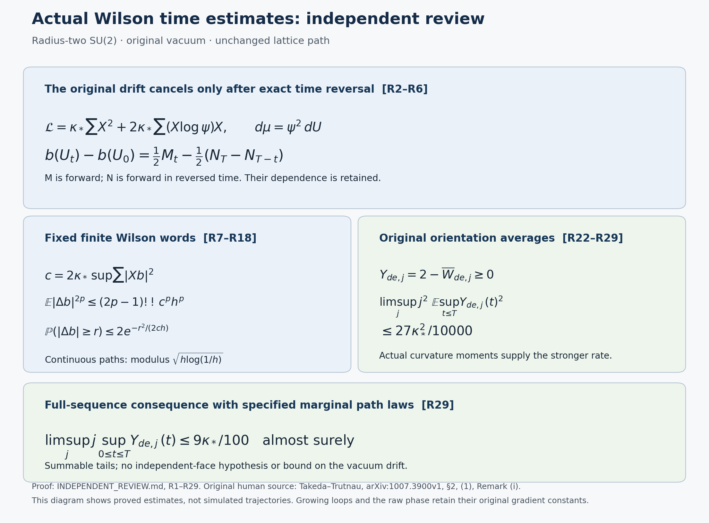

# Independent proof review of the original Wilson time estimates

The statements TR1–TR17 in the reviewed source version are valid. This
note proves the reversal identity and all receiving estimates independently,
including their time directions, original metric, boundary incidences and
actual vacuum. It also proves stronger exponential increment estimates,
a logarithmic continuity modulus, an \(O(j^{-2})\) bound for the squared
maximum orientation defect, and a full-sequence almost-sure orientation
bound on an explicitly specified coupling. These conclusions concern the
original observables. No spatial regularity, raw-phase spectral endpoint
or uniform estimate for growing physical loops follows from them.

The reviewed source versions and reading coverage are recorded in
TEMPORAL_SPECTRAL_SOURCE_USE_LEDGER.json and TEMPORAL_SPECTRAL_SOURCE_FIDELITY.json. Equation labels R1–R29
below are local proof locators. No novelty claim is made.

## 1. Original objects and the exact ground-state transform

For every integer \(j\ge2\) and fixed \(\kappa_*>0\), retain
\[
\begin{gathered}
 L_j=j^4,\quad m_j=2j^4,\quad n_j=2j^4+1,\quad
 a_j={1\over100j},\quad g_j^2={\kappa_*\over200j},\\
 \xi_j={10000j^2\over\kappa_*^2},\quad s_j={\kappa_*\over j},\quad
 N_j=3m_jn_j^2,\quad M_j=3m_j^2n_j,\\
 H_j=-\kappa_*\sum_{e,\alpha}X_{e,\alpha}^2+
       b_j W_j,\qquad b_j=\kappa_*\xi_j={1\over2g_j^2a_j},\\
 W_j=\sum_{p\ {\rm all\ faces}}D_p,\quad
 D_p=2-\operatorname{Tr}U_p,\qquad
 H_j\psi_j=E_j\psi_j,\quad\psi_j>0,\quad
 \int\psi_j^2\,dU_j=1.
\end{gathered}\tag{R1}
\]
Here \(e\) runs through every positively oriented edge of the open cube,
including boundary edges, and \(\alpha=1,2,3\).
The full configuration manifold is \(\mathrm{SU}(2)^{N_j}\), with
probability Haar measure on every factor, radius-two bi-invariant metric
and \(T_\alpha=-i\sigma_\alpha/2\). In particular
\(\Delta=\sum_\alpha X_\alpha^2\) and
\(\Delta(\operatorname{Tr}U/2)=-3\operatorname{Tr}U/8\).
The spatial boundary is a boundary of the graph, not a boundary of the
compact configuration manifold; there are no omitted integration boundary
terms. The potential includes the full scalar \(2b_jM_j\).

The actual positive vacuum from the finite Hamiltonian is used throughout.
Smoothness follows from elliptic regularity on this compact manifold.
Positivity and uniqueness also follow from its positivity-improving heat
kernel, equivalently the compact elliptic maximum principle and the
variational ground state. Cube symmetries and gauge transformations
therefore fix this positive unit vector. The physical ground state is
the same vector, and multiplication by a gauge-invariant observable gives
the physical correlations.

Write \(A_j=H_j-E_j\), \(d\mu_j=\psi_j^2dU_j\), and retain
\(\Gamma(f)=\sum_{e,\alpha}(X_{e,\alpha}f)^2\) for real \(f\).
The full product expansion is
\[
\begin{split}
-\psi_j^{-1}A_j(\psi_j f)
={}&\kappa_*\sum X^2f+
  2\kappa_*\sum\psi_j^{-1}(X\psi_j)Xf\\
 &+\left[\kappa_*\psi_j^{-1}\sum X^2\psi_j
            -b_jW_j+E_j\right]f.
\end{split}
\]
The bracket vanishes by (R1), with its scalar retained. Hence
\[
 \mathcal L_jf=\kappa_*\sum X^2f+
      2\kappa_*\sum(X\log\psi_j)Xf,\qquad
 \int f\mathcal L_jg\,d\mu_j=-\kappa_*\int\sum XfXg\,d\mu_j.
 \tag{R2}
\]
The latter identity follows by Haar integration by parts: differentiation
of \(\psi_j^2\) contributes
\(-2\kappa_*\sum f(X\log\psi_j)Xg\), exactly the negative of
the displayed drift. No estimate of that drift uniform in \(j\) is made.

The Stratonovich equation with diffusion fields
\(\sqrt{2\kappa_*}X_{e,\alpha}\) and drift
\(2\kappa_*\sum(X\log\psi_j)X\) has a global continuous solution for
each \(j\). Its coefficients are smooth on a compact finite-dimensional
manifold. Local smooth stochastic differential equations patch uniquely;
bounded coefficients on finitely many charts exclude explosion. Its
generator is (R2), and uniqueness of the compact parabolic equation
identifies its semigroup as
\(S_j(t)f=\psi_j^{-1}e^{-tA_j}(\psi_j f)\).
It preserves \(1\) and \(\mu_j\), and is symmetric in \(L^2(\mu_j)\).
We use the stationary solution \(U_j\). Symmetry implies detailed
balance, so reversal of a stationary finite path has the same
finite-dimensional distributions and generator. Indeed, reverse the
order of the multiplication and symmetric semigroup factors in its
expectation by taking their adjoint. This proves reversal with the
actual density. A two-sided stationary version is obtained by the
consistent stationary kernel laws on all finite sets of real times;
its continuous versions on bounded intervals agree on overlaps.

## 2. Every drift term and time direction in the reversal formula

Fix \(j\), real smooth gauge-invariant \(b\), and \(T>0\). Put
\[
 D^2=\sup_U\Gamma(b)(U),\quad c=2\kappa_*D^2,\quad
 \ell(r)=\kappa_*\sum X^2b(U_j(r))+
       2\kappa_*\sum (X\log\psi_j)(U_j(r))Xb(U_j(r)).
 \tag{R3}
\]
The forward filtration gives the continuous martingale
\[
 M_t=b(U_j(t))-b(U_j(0))-\int_0^t\ell(r)\,dr,\quad
 \langle M\rangle_t=2\kappa_*\int_0^t\Gamma(b)(U_j(r))\,dr.
 \tag{R4}
\]
The reverse-time filtration
\(\widehat{\mathcal F}_r=\sigma(U_j(T-v):0\le v\le r)\), completed
in the usual way, gives a different martingale
\[
 N_r=b(U_j(T-r))-b(U_j(T))-\int_0^r\ell(T-v)\,dv,\quad
 \langle N\rangle_r=2\kappa_*\int_0^r\Gamma(b)(U_j(T-v))\,dv.
 \tag{R5}
\]
Both bracket densities are at most \(c\). Subtraction at \(r=T\)
and \(r=T-t\) gives, without altering either drift summand,
\[
 N_T-N_{T-t}=b(U_j(0))-b(U_j(t))-\int_{T-t}^T\ell(T-v)\,dv
            =b(U_j(0))-b(U_j(t))-\int_0^t\ell(r)\,dr.
\]
Subtracting this equality from (R4) proves
\[
 b(U_j(t))-b(U_j(0))
       ={M_t\over2}-{N_T-N_{T-t}\over2},\qquad 0\le t\le T.
 \tag{R6}
\]
The drift cancels because the integral in both martingale definitions
has the same minus sign after the exact reversal substitution.
This does not make \(M\) and \(N\) independent or adapted to one
forward filtration. At the endpoints of an interval \([u,t]\), use
that interval's own reversal horizon \(h=t-u\); its increment is
\((M_h-N_h)/2\). Stationarity justifies the same law and constants
for every such interval.

In Takeda–Trutnau, arXiv:1007.3900v1, Section 2, equation (1),
the two finite-energy martingale terms are \(M^{[b]}\) and the
reversed \(\widehat M^{[b]}\). These map respectively to (R4) and
(R5). Their \(N^{[b]},\widehat N^{[b]}\) are zero-energy additive
functionals, not the reverse martingale called \(N\) here.
In this symmetric situation those two zero-energy functionals coincide,
as their Remark (i) states; (R2)–(R6) prove the cancellation directly.
No assertion about their nonsymmetric theorem is needed.

## 3. Even moments, exponential increments and full-time maxima

For a continuous martingale \(Z_0=0\) with bracket density at most
\(c\), stop at \(\tau_R=\inf\{|Z|\ge R\}\). Itô's formula gives
\[
 \mathbb E Z_{h\wedge\tau_R}^{2p}
 \le p(2p-1)c\int_0^h
  \mathbb E[\mathbf1_{r<\tau_R}Z_r^{2p-2}]\,dr.
\]
The integrand is bounded by the stopped lower moment, whose
inductive bound is \((2p-3)!!c^{p-1}r^{p-1}\).
The integral of \(r^{p-1}\) cancels the factor \(p\).
Starting with the bracket estimate at \(p=1\), then using Fatou as
\(R\to\infty\), proves
\[
 \mathbb E|Z_h|^{2p}\le (2p-1)!!c^ph^p,\qquad
 \mathbb E|b(U_j(t))-b(U_j(u))|^{2p}
 \le (2p-1)!!c^p|t-u|^p. \tag{R7}
\]
The second inequality uses (R6) with horizon \(|t-u|\) and
\(|(x-y)/2|^{2p}\le(|x|^{2p}+|y|^{2p})/2\).
Thus the dependence of the two martingales introduces no missing
covariance or factor.

The exponential local martingale
\(\exp(\lambda Z_h-\lambda^2\langle Z\rangle_h/2)\) is a
nonnegative supermartingale, by stopping and Fatou. Since its bracket
is deterministically bounded, it follows that
\(\mathbb E e^{\lambda Z_h}\le e^{\lambda^2ch/2}\).
Cauchy–Schwarz applied to the two endpoint terms of (R6) now gives
\[
\begin{split}
 \mathbb E e^{\lambda(b(U_j(t))-b(U_j(u)))}
 &\le e^{\lambda^2c|t-u|/2},\\
 \mathbb P(|b(U_j(t))-b(U_j(u))|\ge r)
 &\le2\exp\left(-{r^2\over2c|t-u|}\right).
\end{split}\tag{R8}
\]
This is a stronger receiving estimate than (R7); it uses no
Gaussian vacuum and no drift estimate.
If \(D=0\), \(b\) is constant on the connected configuration manifold,
and every increment vanishes; formulas with \(c\) in a denominator
are then replaced by this exact statement.

For later maxima let \(Z_*=\sup_{r\le T}|Z_r|\).
The stopping-time submartingale inequality
\(\lambda\mathbb P(Z_*>\lambda)
\le\mathbb E[|Z_T|\mathbf1_{Z_*>\lambda}]\), integrated after
division by \(\lambda\) against \(q\lambda^{q-1}d\lambda\),
gives
\(\mathbb E Z_*^q\le q/(q-1)\mathbb E(|Z_T|Z_*^{q-1})\).
Hölder, with localization first, yields
\(\|Z_*\|_q\le q/(q-1)\|Z_T\|_q\).
For \(q=2p\), (R6) retains the terminal reverse term separately:
\[
\begin{split}
 \left\|\sup_{0\le t\le T}|b(U_j(t))-b(U_j(0))|\right\|_{2p}
 &\le {1\over2}\bigl(\|M_*\|_{2p}
             +\|N_T\|_{2p}+\|N_*\|_{2p}\bigr)\\
 &\le \left({2p\over2p-1}+{1\over2}\right)
 [(2p-1)!!]^{1/(2p)}\sqrt{cT}.
\end{split}\tag{R9}
\]
In particular the squared maximum is at most
\(25cT/4=(25/2)\kappa_*D^2T\), improving TR16's valid \(10cT\).

The exponential supermartingale, stopped at the first crossing and
optimized in \(\lambda\), also gives
\(\mathbb P(Z_*\ge z)\le2e^{-z^2/(2cT)}\).
Since the maximum in (R9) is at most \(M_*/2+N_*\), the two-event
union bound at threshold \(2r/3\) proves
\[
 \mathbb P\left(\sup_{0\le t\le T}
       |b(U_j(t))-b(U_j(0))|\ge r\right)
 \le4\exp\left(-{2r^2\over9cT}\right). \tag{R10}
\]
No backward increment has been treated as a forward martingale.

## 4. Original Wilson derivatives and boundary counts

Write a group element as \(G=x_0I-i\sum_{\alpha=1}^3x_\alpha\sigma_\alpha\)
with \(x_0^2+|x|^2=1\). Direct multiplication gives
\(\operatorname{Tr}(T_\alpha G)=-x_\alpha\).
Thus differentiating one original edge occurrence of a Wilson trace
gives a three-component vector of squared norm
\[
 |x|^2=1-(\operatorname{Tr}G)^2/4=D_G-D_G^2/4.
 \tag{R11}
\]
An inverse occurrence contributes its exact minus sign and an adjoint
rotation, and each surrounding transport contributes another orthogonal
adjoint rotation. Hence for the original ordered loop \(\gamma\),
with every multiplicity \(m_e\) retained,
\[
 \Gamma(W_\gamma)=\sum_e\left|
   \sum_{r:e_r=e}\epsilon_r R_rx(G_\gamma)\right|^2
 \le\left(\sum_e m_e^2\right)
       (D_\gamma-D_\gamma^2/4).
 \tag{R12}
\]
Four distinct edges of an elementary face give equality
\(\Gamma(W_p)=4(1-W_p^2/4)\le4\).
Consequently (R7) has coefficient
\((2p-1)!!(8\kappa_*)^p\), including
\(192\kappa_*^2\) when \(p=2\).
For a product of \(k\) face traces the full Leibniz sum, including
every repeated or shared derivative, has gradient norm at most
\(k2^{k-1}\cdot2=k2^k\).
Triangle inequalities give the corresponding finite-polynomial constants.
For other fixed finite loops use their full \(\sum m_e^2\).
For growing physical rectangles this number is
\(2(\lceil100jr\rceil+\lceil100js\rceil)\);
its quotient by \(j\) tends to \(200(r+s)\).
Neither it nor the original raw phase receives a uniform \(D\)
by the preceding arguments.

Fix an orientation \(o=de\). It has \(K_j^0=m_j^2n_j\) faces.
Let \(r_e^o\) be the number incident on \(e\); its possible values
are \(0,1,2\). Set
\[
 W_{o,j}=\sum_{p:\operatorname{type}p=o}D_p,\quad
 Y_{o,j}={W_{o,j}\over K_j^0}=2-\overline W_{o,j},\quad
 \mathcal D_j={4m_jn_j(2m_j-1)\over(K_j^0)^2}.
 \tag{R13}
\]
Each in-plane edge direction contributes \(m_jn_j\) times the sum
\(1^2+1^2+(m_j-1)2^2=4m_j-2\) to \(\sum_e(r_e^o)^2\).
The two directions therefore give exactly
\(4m_jn_j(2m_j-1)\). The other direction contributes zero.
Also \(\sum_e r_e^o=4K_j^0\). Using (R11) before the triangle
inequality gives
\[
 \Gamma(Y_{o,j})\le\mathcal D_j\le{8\over K_j^0}.
 \tag{R14}
\]
This retains both boundary rows with incidence one.

## 5. Dyadic continuity and the common path-space subsequence

Let \(X(t)\) have any limiting finite-time laws from ASL for a bounded
real coordinate with uniform \(D\). The two-time functions used in (R7)
and (R8) are continuous and bounded on the coordinate value cube,
so the estimates pass to the limiting laws. No choice of subsequence
depending on the two times is made.

For \(p\ge2\), \(0<\alpha<(p-1)/(2p)\), and \(T>0\), define
\[
 H_{\alpha,T}=\sup_{n\ge0,\,0\le k<2^n}
  2^{n\alpha}|X((k+1)T2^{-n})-X(kT2^{-n})|,\quad
 d=p-1-2p\alpha.
\]
Markov's inequality for each increment and the union bound over all
\(2^n\) edges give exactly
\[
 \mathbb P(H_{\alpha,T}>R)
 \le{(2p-1)!!c^pT^p\over R^{2p}(1-2^{-d})}. \tag{R15}
\]
In particular \(H_{\alpha,T}<\infty\) almost surely. For two dyadic
times a distance \(h\) apart choose \(n\ge0\) so that
\(T2^{-n-1}<h\le T2^{-n}\).
Their lower level-\(n\) approximants are equal or adjacent.
The two finer chains and the connecting level-\(n\) edge give
\[
 |X(t)-X(u)|\le
 2^\alpha\left(1+{2\over2^\alpha-1}\right)
 H_{\alpha,T}(h/T)^\alpha
 \le {2^{\alpha+1}\over1-2^{-\alpha}}H_{\alpha,T}(h/T)^\alpha.
 \tag{R16}
\]
This proves TR13–TR14 with their stated, deliberately nonoptimal
constant. The dyadic function extends uniquely by uniform continuity.
For any fixed real time, dyadic convergence to the original variable
in probability by (R7) identifies that extension as a modification.
Take a countable intersection over coordinates, integer bounded intervals,
and exponents tending to \(1/2\) (with suitable \(p\)).
Agreement with every rational-time variable makes interval extensions
agree on their overlaps. This proves all local exponents below
\(1/2\) simultaneously.

There is a stronger explicit modulus. Define
\[
 H_{\log,T}=\sup_{n,k}{2^{n/2}\over\sqrt{n+1}}
   |X((k+1)T2^{-n})-X(kT2^{-n})|.
\]
Equation (R8) and the same complete edge count give
\[
 \mathbb P(H_{\log,T}>R)\le
 {2e^{-a}\over1-2e^{-a}},\qquad
 a={R^2\over2cT}>\log2. \tag{R17}
\]
Indeed the \(n\)-th contribution is \(2^{n+1}e^{-a(n+1)}\).
This tends to zero as \(R\to\infty\), proving almost-sure finiteness.
The preceding chaining now uses
\(\sqrt{n+r+1}\le\sqrt{n+1}\sqrt{r+1}\). With
\[
 q=2^{-1/2},\quad
 B=1+2\sum_{r\ge1}\sqrt{r+1}\,q^r
 \le {2\over(1-q)^2}-1,
\]
it yields, for \(0<h=|t-u|\le T\),
\[
 |X(t)-X(u)|
 \le\sqrt2\,B H_{\log,T}
      \sqrt{\,{h\over T}\left(1+\log_2{T\over h}\right)}.
 \tag{R18}
\]
Here \(2^{-n}\le2h/T\) and \(n+1\le1+\log_2(T/h)\).
The same countable-intersection argument proves this local modulus
simultaneously for the chosen countable coordinate family.
It is not a claim of Hölder exponent exactly \(1/2\).

For completeness, the common path-space passage has no extra
subsequence hidden in it. Let the chosen real coordinates be indexed
by \(\mathbb N\), each with its own finite value bound and uniform
gradient bound. Their path space
\[
 \mathscr P=\prod_{i=1}^{\infty}C(\mathbb R,\mathbb R)
 \tag{R19}
\]
has the product of the compact-uniform topologies and is Polish.
For example, sum the bounded compact-uniform metrics with weights
\(2^{-i}\), and inside each coordinate use weights \(2^{-T}\) on
the intervals \([-T,T]\). Given \(\eta>0\), choose in (R15)
thresholds for every pair \((i,T)\) with total failure probability
at most \(\eta\). The set of paths satisfying the corresponding
uniform value and Hölder bounds on every interval is compact:
Arzelà–Ascoli gives a convergent subsequence on each interval and
coordinate, and a diagonal extraction has compatible limits on
all overlaps. Thus all finite-\(j\) path laws are tight.

ASL64–ASL66 supply one ordinary subsequence with the specified
finite-dimensional limits. Tightness gives weakly convergent
subsubsequences in (R19); evaluation at every finite list of coordinates
and times is continuous, so each weak limit has those same laws.
Rational-time cylinder sets generate the Borel algebra of (R19).
To see this, a compact-uniform distance between continuous functions
is a supremum over a dense countable set of times; closed balls,
and then open balls by countable unions of smaller closed balls,
are measurable in those evaluations. A countable base finishes the
argument. The finite-cylinder uniqueness theorem therefore makes all
weak limit measures equal. If the full selected subsequence failed
to converge, a further subsequence outside a fixed weak neighborhood
would, by tightness, have a subsubsequence converging to that same
measure, a contradiction. This proves convergence of the entire
selected ASL subsequence on (R19).

Polynomial trace relations and reflection-positive finite-time
correlations pass to this limit through their original bounded
coordinate products. At all rational times the relations hold
simultaneously; continuity then gives every real time. This argument
applies to the specified smooth bounded-gradient family, not every
element of its uniform-norm closure. No additional Markov property
of a projected Wilson family is asserted.

## 6. Actual vacuum moments received by the orientation averages

The retained vacuum energy bound is
\[
 E_j\le\overline E_j
 :=\min\left\{2b_jM_j,{3\sqrt{N_jM_j}\over a_j}\right\},\quad
 B_j={\overline E_j\over b_j}
 =\min\{2M_j,6g_j^2\sqrt{N_jM_j}\}.
 \tag{R20}
\]
For clarity its derivation uses a comparison vector solely in the
variational inequality, and leaves the receiving vacuum equal to
\(\psi_j\). Set \(x=\operatorname{Tr}U/2\). Its exact Haar density
is \((2/\pi)\sqrt{1-x^2}\,dx\). Retain the complete one-link factor
\[
 Z_t=\int e^{2tx}\,dU,\qquad f_t(U)=Z_t^{-1/2}e^{tx},\qquad
 q_t=Z_t^{-1}\int x e^{2tx}\,dU.
\]
Thus \(q_t\) is the expectation of \(x\) in precisely \(f_t^2dU\).
Symmetry gives \(0\le q_t\le1\). The density of
\(z=1-x\) is proportional to
\(e^{-2tz}z^{1/2}\sqrt{2-z}\mathbf1_{[0,2]}\).
Relative to the gamma density \(e^{-2tz}z^{1/2}\), the extra
factor is decreasing. The two-copy covariance identity shows its
mean is at most the gamma mean \(3/(4t)\); hence
\(1-q_t\le3/(4t)\).
The identities \(\Gamma(x)=(1-x^2)/4\), \(\Delta x=-3x/4\)
give, by integration of \(\operatorname{div}(e^{2tx}\nabla x)\),
kinetic energy \(3tq_t/8\) for one factor.
The independent central factors have exact face expectation
\(2q_t^4\), including inverse traversals, so their unit product vector
\(F_t(U)=\prod_{e\ {\rm all\ positive\ edges}}f_t(U_e)\) has energy
\[
 {3\kappa_*N_jtq_t\over8}
       +2b_jM_j(1-q_t^4)
 \le {3\kappa_*N_jt\over8}+{6b_jM_j\over t}.
\]
At \(t=4\sqrt{\xi_jM_j/N_j}\) this is
\(3\kappa_*\sqrt{\xi_jN_jM_j}=3\sqrt{N_jM_j}/a_j\).
The constant comparison vector has energy \(2b_jM_j\).
This proves (R20). The comparison need not be gauge invariant:
the full and physical ground energies agree, as established after (R1).
No comparison density is used for an expectation below.

From (R11), the exact edge-face incidence and \(r_e\le4\),
\[
 \Gamma(W_j)\le
 \sum_e r_e\sum_{p\ni e}(D_p-D_p^2/4)
 \le16W_j. \tag{R21}
\]
For smooth real \(f\), expansion of the whole original Hamiltonian
and the vacuum equation give
\[
 \langle f\psi_j,H_jf\psi_j\rangle-E_j\mu_j(f^2)
       =\kappa_*\mu_j\Gamma(f).
\]
Dropping only the nonnegative kinetic form on the left yields
\(b_j\mu_j(W_j f^2)\le E_j\mu_j(f^2)+\kappa_*\mu_j\Gamma(f)\).
With \(f=(W_j+\delta)^{k/2}\), (R21) gives
\(\Gamma(f)\le4k^2W_j(W_j+\delta)^{k-2}\).
For \(k=1\) this is at most \(4\); for \(k\ge2\) compactness
justifies passage to \(\delta\downarrow0\).
Writing \(m_k=\mu_j(W_j^k)\), \(\rho_j=4g_j^2\), we obtain
\[
 m_0=1,\quad m_1\le B_j,\quad
 m_{k+1}\le B_jm_k+\rho_j^2k^2m_{k-1}.
 \tag{R22}
\]
Here \(\rho_j^2=16(g_j^2)^2=4\kappa_*/b_j\), so no original
coupling factor has been removed.
Define the explicit polynomial bounds
\[
 U_0=1,\quad U_1=B_j,\quad
 U_{k+1}=B_jU_k+\rho_j^2k^2U_{k-1}.
 \tag{R23}
\]
Induction gives \(m_k\le U_k\), with
\(U_2=B_j^2+\rho_j^2\) and
\(U_3=B_j^3+5B_j\rho_j^2\).
This is IP10 with the additional valid minimum branch in (R20).

Coordinate permutations preserve \(\mu_j\) and interchange the
three orientation sums. For every integer \(k\ge1\), nonnegativity
gives \(\sum_o W_{o,j}^k\le W_j^k\); their equal expectations imply
\[
 \mu_j(Y_{o,j}^k)\le{U_k\over3(K_j^0)^k}.
 \tag{R24}
\]
This proves an orientation bound without individual-face uniformity.
In particular, with the original
\(\epsilon_j=B_j/M_j=\min\{2,(3\kappa_*/100j)\sqrt{n_j/m_j}\}\),
\[
 \mu_j(Y_{o,j}^2)\le Q_j:=
 \min\left\{4\epsilon_j,\,
        {B_j^2+\rho_j^2\over3(K_j^0)^2}\right\}. \tag{R25}
\]

## 7. Stronger full-time receiving estimates on the unchanged path

Apply (R9), with \(b=Y_{o,j}\), (R14) and Minkowski to its actual
initial value. The complete finite-\(j\) estimate is
\[
 \boxed{\quad
 \mathbb E\sup_{0\le t\le T}|2-\overline W_{o,j}(U_j(t))|^2
 \le\left(\sqrt{Q_j}
       +{5\over2}\sqrt{2\kappa_*\mathcal D_jT}\right)^2.
 \quad}\tag{R26}
\]
In particular TR17 holds as written, and is strengthened by (R26).
The unchanged path gives the exact limits
\[
\begin{gathered}
 {jB_j\over K_j^0}\longrightarrow {9\kappa_*\over100},\qquad
 {K_j^0\over j^{12}}\longrightarrow8,\qquad
 j^{12}\mathcal D_j\longrightarrow1,\\
 j^2Q_j\longrightarrow{27\kappa_*^2\over10000},\qquad
 \limsup_{j\to\infty}j^2
 \mathbb E\sup_{0\le t\le T}Y_{o,j}(U_j(t))^2
 \le{27\kappa_*^2\over10000}.
\end{gathered}\tag{R27}
\]
For example, eventually
\(B_j/K_j^0=18g_j^2\sqrt{n_j/m_j}
=(9\kappa_*/100j)\sqrt{n_j/m_j}\);
the \(\rho_j^2/(K_j^0)^2\) term vanishes after multiplication by
\(j^2\), and the maximum increment term is \(O(j^{-6})\) in norm.
This proves the rate for the actual vacuum. It asserts neither a
matching lower bound nor a limiting distribution.
For every \(p\ge1\), (R9) and (R24) also give the explicit higher
moment bound
\[
 \|\sup_{t\le T}Y_{o,j}(U_j(t))\|_{2p}
 \le {U_{2p}^{1/(2p)}\over3^{1/(2p)}K_j^0}
 +\left({2p\over2p-1}+{1\over2}\right)
 [(2p-1)!!]^{1/(2p)}
 \sqrt{2\kappa_*\mathcal D_jT}=O(j^{-1}).
 \tag{R28}
\]

One can calculate beyond moment convergence. Induction in (R22) gives
\(m_k\le(B_j+\rho_j k)^k\).
Indeed, at the induction step the right side is at most
\([B_j(B_j+\rho_jk)+\rho_j^2k^2](B_j+\rho_jk)^{k-1}
\le(B_j+\rho_jk)^{k+1}\).
The cases \(k=0,1\) hold directly, and the claimed next bound is
larger still. For \(z\ge4\rho_j\), choose
\(k=\lfloor z/(2\rho_j)\rfloor\ge z/(4\rho_j)\).
Markov's inequality then proves
\[
 \mathbb P(W_j(U_j(0))\ge B_j+z)
 \le\left({B_j+\rho_jk\over B_j+z}\right)^k
 \le\exp\left(-{z^2\over8\rho_j(B_j+z)}\right).
\]
Fix \(\delta,T>0\), and put \(z=\delta B_j/2\).
For all sufficiently large \(j\), (R10), \(Y_{o,j}\le W_j/K_j^0\)
and a union bound give the fully explicit estimate
\[
\begin{split}
 &\mathbb P\left(\sup_{0\le t\le T}Y_{o,j}(U_j(t))
                       >(1+\delta){B_j\over K_j^0}\right)\\
 &\quad\le
 \exp\left(-{\delta^2B_j\over32\rho_j(1+\delta/2)}\right)
 +4\exp\left(-{\delta^2B_j^2\over
                  36\kappa_*\mathcal D_jT(K_j^0)^2}\right).
\end{split}\tag{R29}
\]
The first exponent has order \(j^{12}\), since eventually
\(B_j/\rho_j=(3/2)\sqrt{N_jM_j}\sim36j^{12}\).
The second has order \(j^{10}\), since
\[
 {B_j^2\over\mathcal D_j(K_j^0)^2j^{10}}
       \longrightarrow {81\kappa_*^2\over10000}.
\]
Thus the displayed probabilities are summable in \(j\).
To make an almost-sure statement precise, put the original
finite-\(j\) stationary continuous path laws on their countable
product probability space. Every marginal remains exactly its
actual ground-state process. Borel–Cantelli, for rational
\(\delta>0\), integer \(T\), and all three orientations, gives
\[
 \limsup_{j\to\infty}j\sup_{0\le t\le T}
       (2-\overline W_{o,j}(U_j(t)))
       \le {9\kappa_*\over100}
 \quad\hbox{almost surely, for every finite \(T\).}
\]
The same conclusion holds under any other joint coupling with these
same marginal path laws, since no independence is used in the
summable-probability argument. This specifies exactly the meaning
of the full-sequence assertion; it does not identify configurations
of different lattice sizes or create a new vacuum density.

## 8. Audit conclusions and exact limits of the conclusions

| Original claims | Independent verification | Status |
|---|---|---|
| TR1–TR3 | R1–R2: full potential, radius-two fields, actual drift and symmetry | Valid |
| TR4–TR7 | R3–R6: both filtrations, both drift summands and reversal substitution | Valid |
| TR8–TR11 | R7, R11–R12: localization, all factors, original word occurrences | Valid |
| TR12–TR14 | R15–R19: dyadic edge count, constants, modification and common subsequence | Valid |
| TR15 | R13–R14, R20 and R25: boundary incidences and actual orientation mean | Valid |
| TR16–TR17 | R9 and R26: original bounds hold; sharper constants and rate proved | Valid underclaims |
| Further implication | R8, R17–R18: exponential increments and logarithmic modulus | Proved |
| Further implication | R22–R29: actual higher moments, full-time rate and coupled almost-sure bound | Proved |

The public provider is [ASL1–ASL66](https://github.com/KokunoYumeto/yang-mills-interacting-workbench/blob/5017bb93fcafa6f6282b72d076934d793a3ca6ad/yang-mills/continuations/20261011-central-signs-shrinking-window/ACTUAL_SEMIGROUP_LIMIT.md), with the original [TR1–TR17](https://github.com/KokunoYumeto/yang-mills-interacting-workbench/blob/5017bb93fcafa6f6282b72d076934d793a3ca6ad/yang-mills/continuations/20261011-central-signs-shrinking-window/WILSON_TIME_REGULARITY.md) retained in full.

The stronger estimates still concern fixed finite Wilson words and
orientation averages. Formula (R12) retains the growing-loop
coefficient, and the moment argument controls the original total
curvature without allocating a uniform expectation to individual
faces. Consequently neither the original rooted phase \(F\), its
spectral weight on \((0,s_j]\), nor spatially resolved continuum
Wilson loops acquire the missing bound from this note.
The new receiving calculation is instead the exact original
orientation estimate (R26)–(R29), which is complete with its
constants and probability space.

The figure records proved maps and constants in R2, R6, R7–R10,
R18 and R26–R29. It contains no sample paths or simulated vacua.
Its source is draw_review_findings.py.

The original human source is [Takeda–Trutnau, arXiv:1007.3900v1](https://arxiv.org/abs/1007.3900v1), Section 2, equation (1) and Remark (i); the exact compact symmetric receiving calculation is R2–R6. The later nonsymmetric theorem is not imported.

## Evaluated local physical quadratures

The complete [local curvature calculation, LC1–LC42](LOCAL_CURVATURE_BUDGET.md), now determines the formerly unevaluated scalar component of LEM27–LEM29. LC4–LC15 partition every original edge and face and prove the exact outside-ground crossing cost 2b per crossing face. The local kinetic-plus-potential estimate retains its potential subtraction, and LC17–LC25 give actual local moments without translation invariance. LC26–LC39 prove that each original a_j³-weighted physical face quadrature acts on the entire cyclic reconstruction as exactly 2 times its test-function integral. Its centered zero-energy component is zero. LC34 retains the full finite-word error, LC35 includes the original shrinking window, and LC40–LC42 prove the complete time-interval bounds and specified coupled almost-sure limit. This strengthens the earlier positive-energy loss; it supplies neither an individual-face law nor the original raw-phase weight. Candidate fluctuating observables require their own actual covariance and spectral calculation.

## Actual curvature covariance and a larger continuous representation

The complete [PVC1–PVC50 calculation](PHYSICAL_LOCAL_COVARIANCE.md) adds exact original-face source-pulse receiving maps, a coupled positive lower mean, and positive finite first-energy bounds for tests with nonzero integral. Its source-averaged covariance is O(a_j); PVC47–PVC50 retain and bound the signed response needed to reach the original-source covariance. That covariance is not evaluated by substituting the source average.

The complete [CP1–CP50 construction](CURVATURE_PHASE_RECONSTRUCTION.md) now admits bounded phases of the original a_j-weighted curvature into a continuous cyclic space. Exact multiplication, adjoints and coincident-time products survive there, and the earlier compression product defect vanishes on that space. Actual stationary reversible histories have real continuous anchored increments and a compact initial character. CP38–CP43 construct the regular-character reducing space and the exact effect of centering. CP44–CP49 retain positive energy, zero-energy collapse, first-energy loss, interval endpoints and the original shrinking window. No positive limiting spectral weight is inferred from finite energy bounds. The LC a_j³ quadratures remain scalar on this enlarged space.
